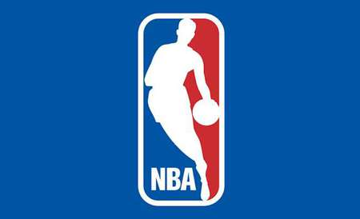
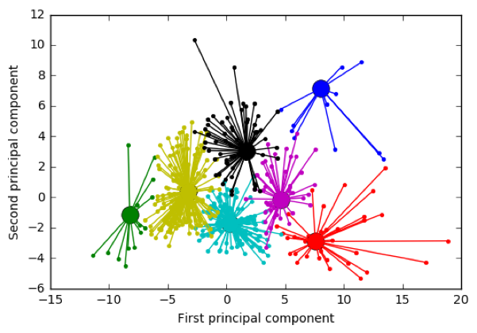
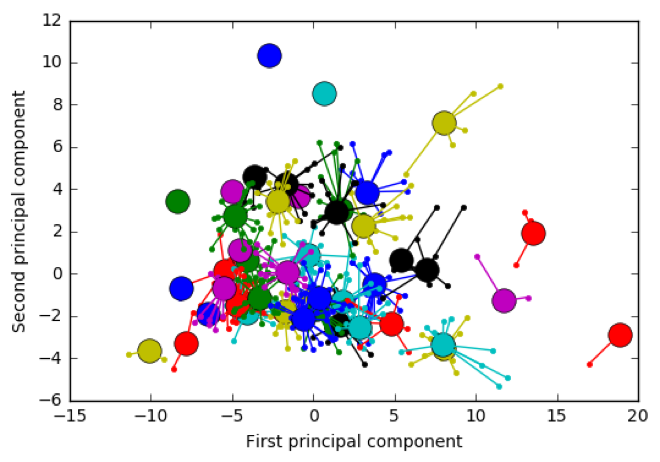
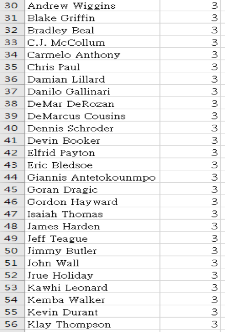
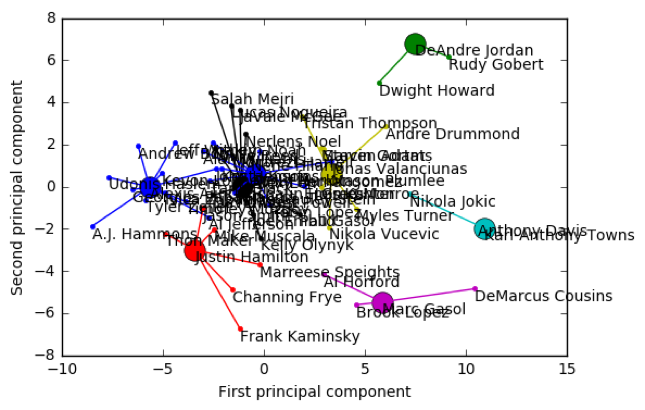
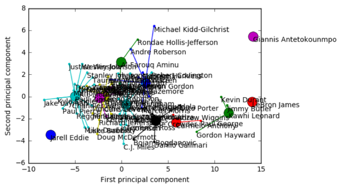
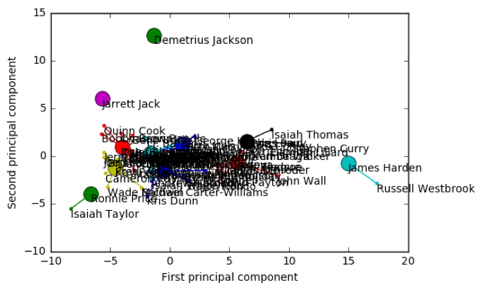
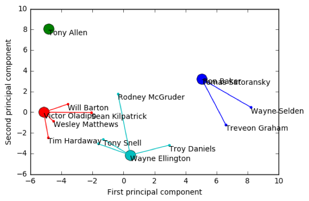
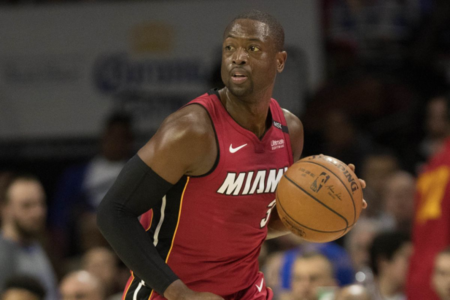
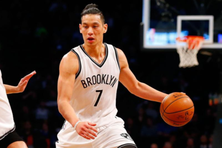

# Concept
---

[Source code](https://github.com/LawrenceGao0224/Intelligence-Oriented-Management-Decision/tree/master/%E6%99%BA%E6%85%A7%E5%9E%8B%E6%9C%9F%E6%9C%AB%E5%A0%B1%E5%91%8A)

We imagined ourselves as team analysts, hoping to hand the boss a set of clustering results that wouldn't get shot down — something that gives the front office a reasonable, objective basis for trades, roster reinforcements, and backup options.

---

# Method

We took data on every NBA player (e.g. salary, age, points, assists, effective field goal percentage, true shooting percentage, usage rate, rebound rate, efficiency rating...) and ran it through the AP algorithm: we computed the negative Euclidean distance between players, tuned the preference and Damping Factor parameters to find k high-quality clusters, and then compressed the high-dimensional data into low dimensions with PCA() so we could visualize it.

Data source: (https://www.kaggle.com/acasalan/nba-player-stats-201718)

---

# Results

## Tuning the parameters:

1. Preference:
Preference = median (-62.5683289159)
Number of clusters: 43

Preference = -500
Number of clusters: 7

2. Damping Factor:

Damping Factor = 0.5      -->      Time = 0.8640606880187988 seconds.
Damping Factor = 0.9      -->      Time = 1.2220699787139893 seconds.

## All players:

   

## By position

1. center (C) : 8 clusters

2. power forward (PF) : 8 clusters

3. small forward (SF) : 12 clusters

4. point guard (PG) : 11 clusters

5. shooting guard (SG) : 4 clusters

## By attribute

Offensive vs. defensive...

---

# Further Discussion

That said, the data we fed in has its blind spots. When NBA owners or teams pick players, they don't just look at on-court stats — plenty of factors can't be quantified or show up in the numbers (like a player's mental state, chemistry between teammates...)

For example:

❖Business value ex: Dwyane Wade
Wade is a household-name superstar who's even been on the cover of a 2K game. His recent stats aren't as impressive as other players', but he still has potential and a huge fan base, and fans bring commercial value.

❖Player background ex: Jeremy Lin
Jeremy is a famous Taiwanese-American player who can draw fans across Asia to follow his team, which brings in money.

❖Health ex: Derrick Rose
Rose is the youngest player ever named MVP, but foot injuries in earlier seasons made him miss several seasons, and since coming back he hasn't stood out like he used to — something the data can't show either.

---

# References

(https://zi.media/@yidianzixun/post/uKZUFF?fbclid=IwAR1Dib-4T5MkM2x_helYBtq0TgTD871fAixs-4sBivOUXUNjuMl07xFahOs)

(https://www.cnblogs.com/huadongw/p/4202492.html?fbclid=IwAR3PHEOcrAar0rCI1e9AeYBxV0fI6JKJIRqGAJ3ag9BnlleT5M9v_8oNiy0)

(https://www.itread01.com/articles/1495821610.html?fbclid=IwAR1Ssz1ZCdqnxtT6obwpx0AFRDBEGrqKK0BXmMGPK-I1lvNwqJuif9EhZt0)

(https://scikit-learn.org/stable/auto_examples/applications/plot_stock_market.html?fbclid=IwAR29Qcy3SrWFDjHAJGF--XO-0zW2FWt8t4dYZT0lsYxUDqJpBz17ds2pQQM)

(https://scikit-learn.org/stable/auto_examples/cluster/plot_affinity_propagation.html?fbclid=IwAR2SsWtrb5MJdypMha6G59nWSeEwf7QK5vzmCa_UefR9mHDT0WzLgEbqng4#sphx-glr-auto-examples-cluster-plot-affinity-propagation-py)
