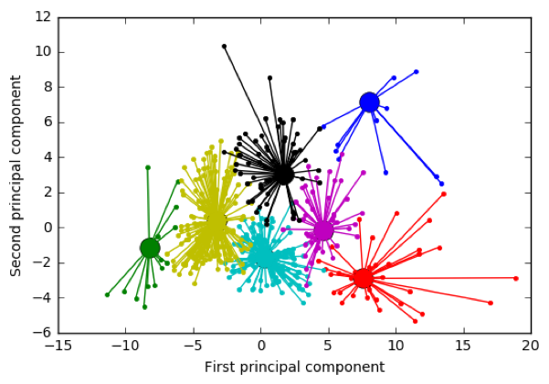
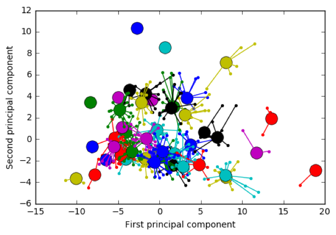
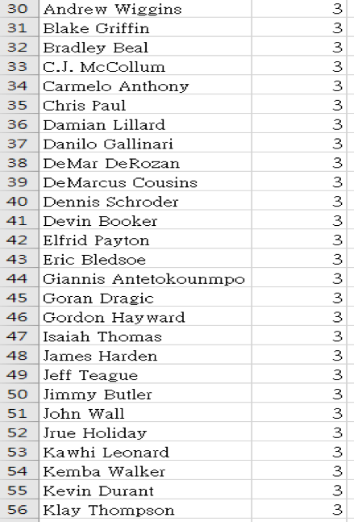
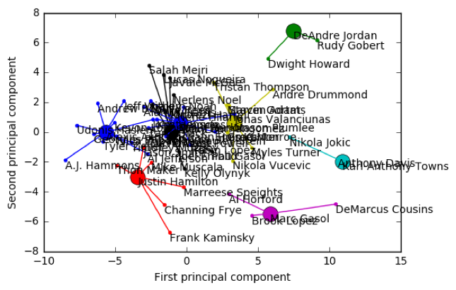
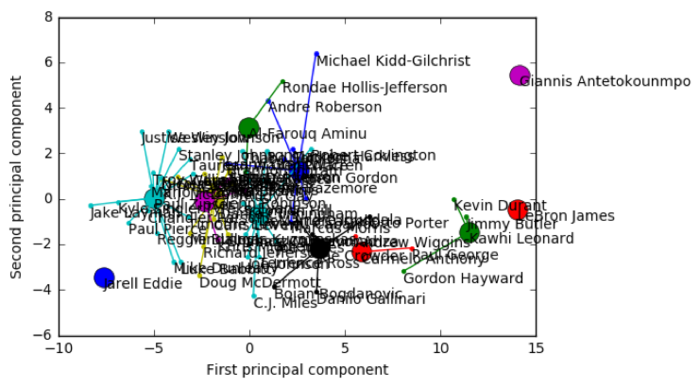
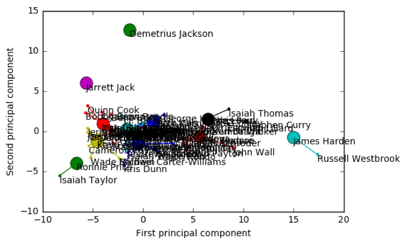
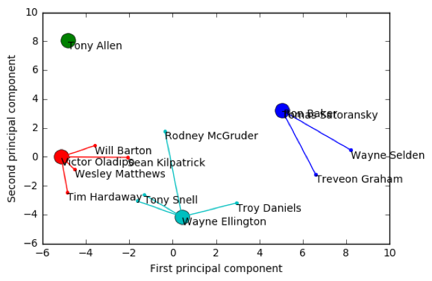

# 概念發想
---

[程式碼連結](https://github.com/LawrenceGao0224/Intelligence-Oriented-Management-Decision/tree/master/%E6%99%BA%E6%85%A7%E5%9E%8B%E6%9C%9F%E6%9C%AB%E5%A0%B1%E5%91%8A)

我們將自己設想為球隊分析師，並希望能遞上一份不讓老闆"打臉"的分群資料，提供球隊高層在球員交易、補強、替代方案上有份合理客觀的依據。

---

# 操作方法

將NBA所有球員資料(Ex: 薪水、年齡、得分、助攻、有效命中率、真實命中率、球權佔有率、籃板率、效率值...)，以AP演算法實作，計算各球員資料的負歐幾里得距離，調整preference、Damping Factor參數，求出k個高質量聚類，且我們將多維度的資料透過PCA()方法壓縮為低維度的資料，實現可視化。

資料來源 ： (https://www.kaggle.com/acasalan/nba-player-stats-201718)

---

# 實作結果

## 調整參數:

1. Preference:
Preference = 中位數(-62.5683289159)
群集數: 43

Preference = -500
群集數: 7

2. Damping Factor:

Damping Factor = 0.5      -->      Time = 0.8640606880187988 seconds.
Damping Factor = 0.9      -->      Time = 1.2220699787139893 seconds.

## 所有球員資料:

   

## 依球員打球的位置

1. center (C) : 8群集數

2. power forward (PF) : 8群集數

3. small forward (SF) : 12群集數

4. point guard (PG) : 11群集數

5. shooting guard (SG) : 4群集數

## 依不同屬性

進攻性質 or 防守性質...

---

# 延伸探討

然而在我們丟入的data有其盲點存在,NBA的老闆或球隊在選擇球員上,並不會只觀看球員在場上的數據表現,還包括許多因素,是無法量化或在數據表現出來的(包括球員心理狀態、球員間磨合度...)

如下:

❖商業價值 ex: Dwyane Wade
Wade是大家耳熟能詳的巨星,曾經出現在2K遊戲的封面上,但最近的數據表現並不如其他球員出色,但仍是有潛力的球員,也累積許多粉絲,粉絲能帶來商業價值。

❖球員背景 ex: Jeremy Lin
Jeremy是著名的台裔球員,能吸引亞洲地區的球迷關注其球隊,帶來利益。

❖健康因素 ex: Derrick Rose
Rose是最年輕獲選MVP的球員,但由於前幾賽季腳傷原因,造成多個賽季缺賽,而傷後復出便不如以前突出,這也是無法顯現在數據上的。

---

# 參考資料

(https://zi.media/@yidianzixun/post/uKZUFF?fbclid=IwAR1Dib-4T5MkM2x_helYBtq0TgTD871fAixs-4sBivOUXUNjuMl07xFahOs)

(https://www.cnblogs.com/huadongw/p/4202492.html?fbclid=IwAR3PHEOcrAar0rCI1e9AeYBxV0fI6JKJIRqGAJ3ag9BnlleT5M9v_8oNiy0)

(https://scikit-learn.org/stable/auto_examples/applications/plot_stock_market.html?fbclid=IwAR29Qcy3SrWFDjHAJGF--XO-0zW2FWt8t4dYZT0lsYxUDqJpBz17ds2pQQM)

(https://scikit-learn.org/stable/auto_examples/cluster/plot_affinity_propagation.html?fbclid=IwAR2SsWtrb5MJdypMha6G59nWSeEwf7QK5vzmCa_UefR9mHDT0WzLgEbqng4#sphx-glr-auto-examples-cluster-plot-affinity-propagation-py)