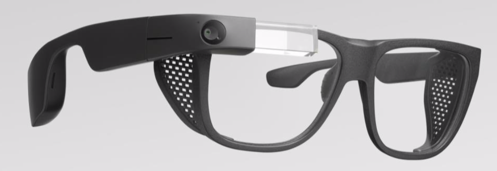
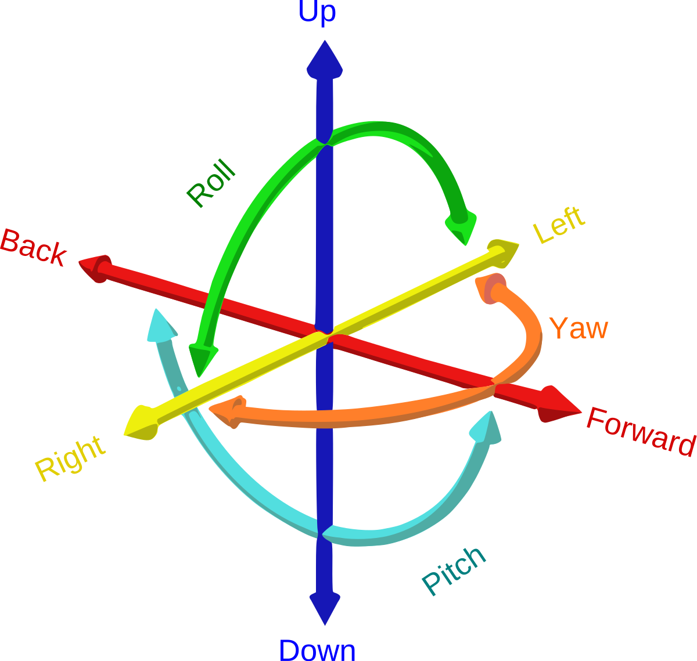
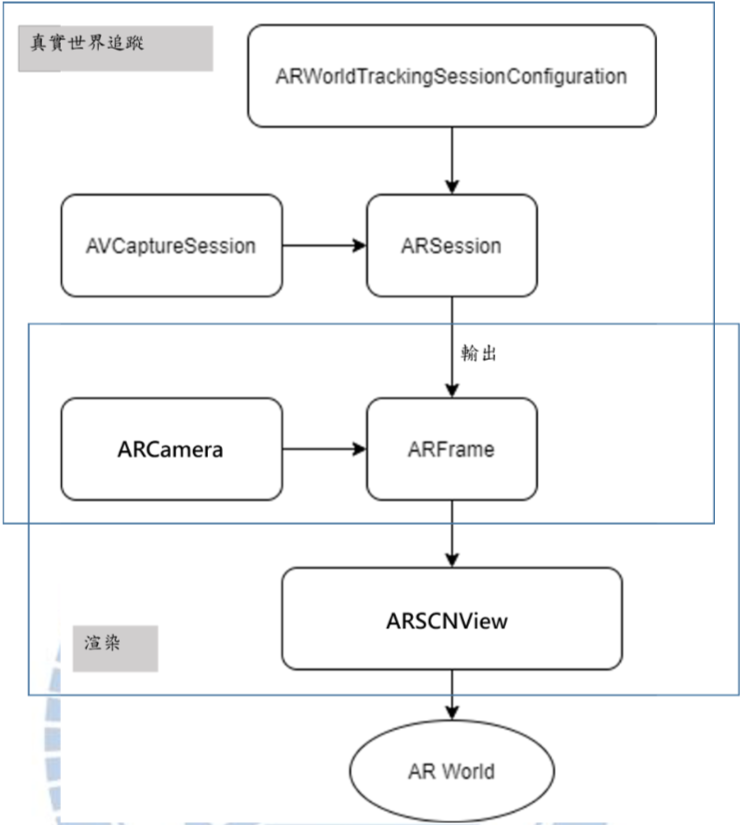
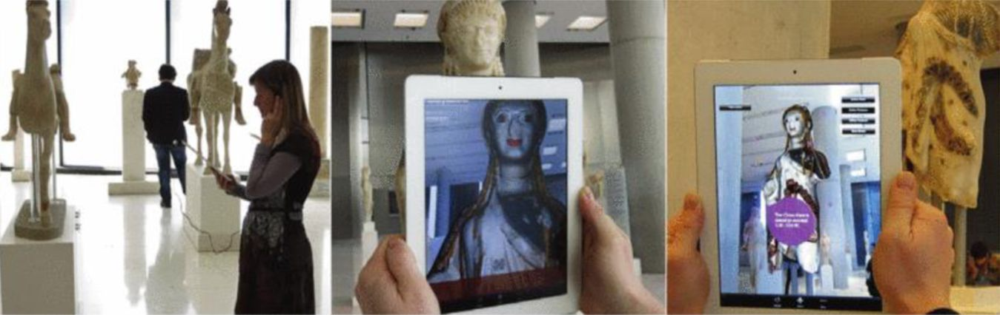
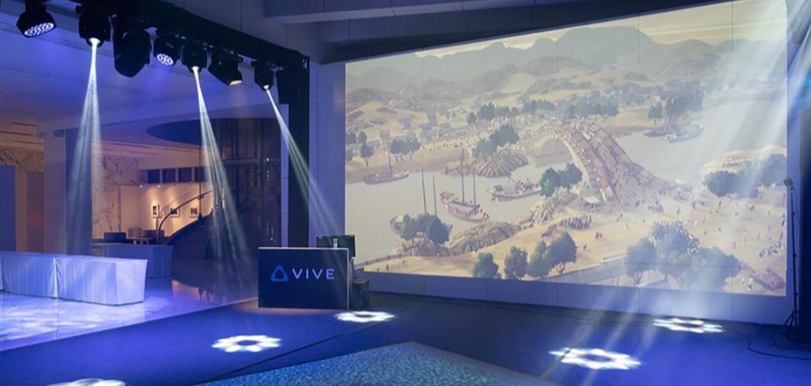
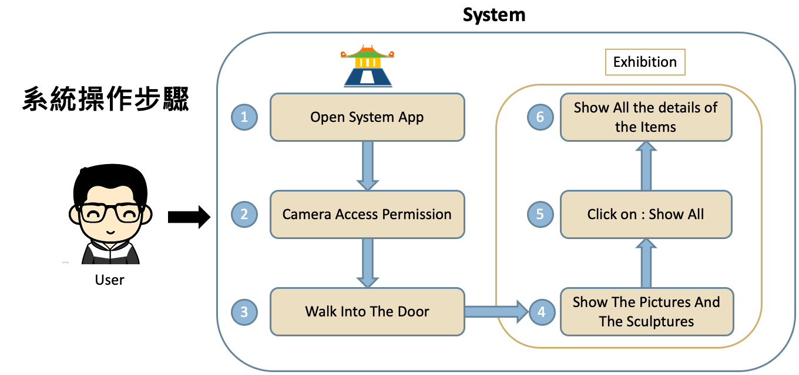
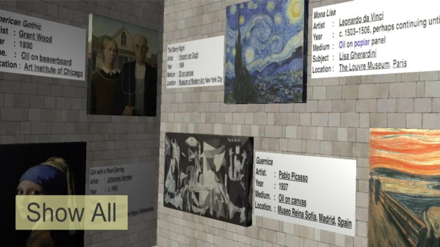
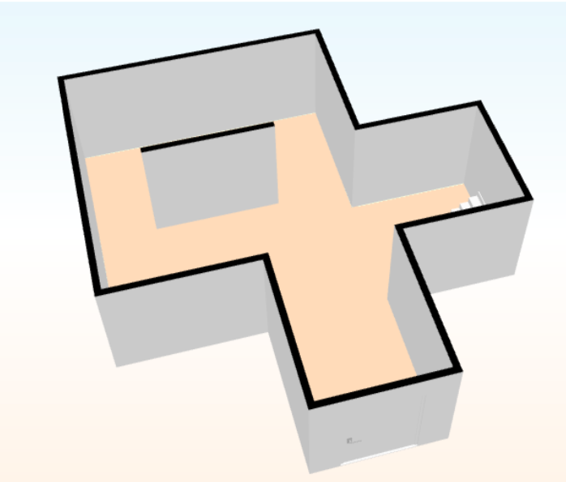
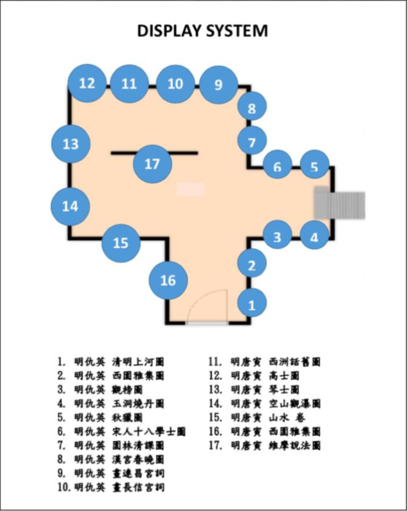

> The Immersive Exhibition System for the National Palace Museum brings an exhibition hall onto your mobile device. Users can walk through a virtually built exhibition without any geographical limits, which makes museum-going more fun and cuts the cost of attending. The system first collects Chinese paintings from the National Palace Museum's Open Data, famous Western paintings, and Chinese and Western statues, then designs and builds the exhibition space and places the artworks inside it. Finally, ARKit projects the scene onto the mobile device and renders it in real time. If it can be combined with smart glasses in the future, it could open up even more applications.

---

# Introduction

## Motivation and Purpose

According to cultural statistics surveys, many museums today are facing a drop in visitor numbers. That's why major museums hope to use technology to bring the modern and the past together, create contrast, change people's traditional ideas about museums, and build innovative museums that attract more visitors.
Augmented reality (AR) was first used by the military, but as software and hardware have developed, it's now part of daily life and the gaming industry. Apple Inc.'s iOS 13 even ships with an AR tool that measures the size of objects, so users can find out how big something is without a ruler, making AR applications broader and more widespread.
"Immersive" is an emerging concept, commonly defined as "the perception of being physically present in a non-physical world." When people talk about immersive films, they usually mean virtual reality films, where the audience uses a VR device to step into 360° video and surround sound as if they were in another world, sometimes even with smell and touch. For whole-body, all-around sensory experiences, immersive tech-art spaces are a good example: Japan's teamLab, for instance, has used virtual reality installations that let users feel like they're walking through a virtual space.
Classified by what is being immersed, immersion comes in six types: sensory, bodily, playful, spatial-cognitive, emotional, and narrative. These six can be combined with each other or coexist within a single artwork.

Summing up the motivations above, this research has three goals:
(1) Combine ancient paintings from the National Palace Museum's Open Data section and famous Western paintings with reality technology to design an interactive visual system.
(2) Use Unity and SketchUp to build the exhibition space and arrange the exhibits, and integrate ARKit for the reality technology, making the system more interactive.
(3) Plan the exhibition space, build a virtual exhibition, and provide an exhibition map so users can explore it easily

---

## Related Research

With the rapid progress of image processing and hardware performance, augmented reality and virtual reality are no longer just military projects or experiments. In recent years they've become part of everyday life and the gaming industry. Pokémon GO, released worldwide starting in 2016, became a global craze; it wasn't the first mobile game to use AR, but it's the AR game everyone knows. There are also applications in teleconferencing, training, and healthcare.
The boom in AR technology is thanks not only to academic work, but also to more and more business teams researching how to bring it into daily life, making things more convenient and effective and opening up a bigger consumer market. Below are some recent real-world examples of AR applications from industry and academia.

(1) ARKit and ARCore
ARKit, provided by Apple, lets developers create AR scenes without needing to know the complex imaging and positioning technology behind them; they only need to focus on designing the immersive AR experience and building the scene. The idea behind ARKit is that as the user moves the device, the way virtual objects are presented changes accordingly so they can be tracked. ARKit can also track 2D and 3D objects, and users can interact with virtual objects, which is mostly used in the gaming industry. However, ARKit doesn't include any graphics API; it only provides virtual object tracking and surface detection, so it needs to be paired with other Apple frameworks such as RealityKit, SceneKit, and Metal.
ARKit also has software and hardware requirements. On the software side, you need Xcode, iOS 11 or later, and macOS 10.12.4 or later; on the hardware side, you need an iPhone or iPad with an A9 processor or newer (the iPhone 6S uses the A9).
Google has also developed a technology similar to ARKit called "ARCore," which is for Android and also has hardware requirements. Here's a comparison.

(2) Vuforia: Market-Leading Enterprise AR
Vuforia is the AR platform from the well-known mobile chipmaker Qualcomm, and was acquired by PTC in 2015 for US$65 million. Vuforia provides a basic AR SDK that can be used in Unity, letting users build AR apps for a variety of platforms. Earlier AR development tools such as ARToolKit, Lyteshot, and Unifeye had a high barrier to entry and a high price, whereas Vuforia can be downloaded for free for development and testing, so it's relatively easy to get started.

(3) Google Glass
Google Glass is a wearable computer with an optical head-mounted display (OHMD) designed and developed by Google, aimed at creating a mobile device for everyday consumers. It displays all kinds of information hands-free in a way similar to a smartphone, with navigation being its biggest highlight.
The military began researching optical head-mounted devices in 1995. Google started testing and developing various smart glasses features in 2012, and that same year showed off the camera feature for the first time, in a design lighter and thinner than before. Today, the device includes a touchpad, camera, display, traffic information and map services, games, and more.

---

## System Introduction and Features

The system uses ARKit from Apple Inc. as its AR core and Unity as the development platform. Using Unity's built-in ProBuilder, I modeled the exhibition space and placed virtual objects in it, adjusted the building materials, textures, and transparency of each item, and fine-tuned the lighting and shadows inside the hall. This lets visitors enjoy the exhibition instantly and quickly in any open area with just a phone or tablet, and view exhibit info using the buttons at the bottom.
Besides placing digitized images from the National Palace Museum's Open Data section in the exhibition area, the system also adds Chinese-style exhibits (Chinese architecture, terracotta warriors, etc.), plus eight famous Western paintings and famous Western statues (David, Venus, and an athlete) placed on the left side. The goal is to create an East-meets-West contrast and pair it with today's popular reality technology, so users can browse easily and be genuinely wowed.

(1) Users:
For users, the system is simple to operate and runs on just a phone or tablet. In an open area, the user holds the device up in front of their eyes, and as they walk or run, the device calculates their position and distance and shows the relative position of each item in real time. A button in the lower left lets users tap when they want to learn about a work, and its information is displayed instantly, which makes it more fun and helps users understand the paintings better.
 
(2) Developers:
In this research, all the exhibition pieces are built with Unity's built-in ProBuilder. It's easy to use: the developer just sets up the space they want to build and it's generated, the exhibits can be freely dragged into place, and finally you set up ARKit and the items to be displayed, and it's ready to render.

(3) Museums:
The system can be used by visitors planning to visit a museum or exhibition, and also by people who can't get there in person. Museums can also use it before designing an exhibition, and after designing it in the system, to check the interior space and layout, reducing unnecessary costs, while also using it for promotion. In addition, if a museum needs to offer several exhibition halls during an exhibition, it could try hosting them in the cloud for the public to download and check out.

---

# Key Technologies

The key technologies of this system fall into two main parts: ARKit, developed by Apple Inc., and the modeling methods provided by Unity and SketchUp.

## ARKit API

This research is built mainly on ARKit, so here's an explanation of the underlying technology of ARKit.

### Key Technologies of ARKit

ARKit is built on two key technologies: visual-inertial odometry (VIO) and plane detection. With VIO, the system continuously tracks the user's position in space, recording how far the iPhone moves in 6DoF space (6DoF means moving along the x, y, and z axes, plus pitch, yaw, and roll). As shown below, every time the screen refreshes a frame, the motion is immediately recalculated; the refresh rate is 30fps or higher. This calculation is handled by two systems at once: one matches each camera frame against points in the real world to calculate the user's motion; the other tracks motion through the inertial system, using two inertial measurement units (IMUs), a gyroscope and an accelerometer. Finally, a Kalman Filter combines the two to calculate the best estimate of the true position (Ground Truth).
Plane detection uses the ground as a reference to calculate position information, making sure objects sit flat on a surface so virtual objects don't float. Any three points define a plane, and by averaging the feature points, the system gets a reference plane.

---

### ARKit Architecture

ARKit defines a simple API. Its components can be grouped as follows: ARSession, ARSessionConfiguration, ARFrame, ARCamera, and so on. ARSession is the core of the whole system and produces the AR effects, including world tracking and scene understanding, while ARFrame contains the information output by ARSession and is the key data source for rendering. The architecture is shown below.

Real-world tracking: ARKit uses ARWorldTrackingSessionConfiguration to provide the six parameters obtained from 6DoF tracking. Meanwhile, AVCaptureSession captures the video from the camera (frame by frame), and ARSession analyzes the six 6DoF parameters along with the sequence of frames and outputs the result to ARFrame, which then contains everything needed to render the virtual world. ARCamera is a property of ARFrame that provides the width and height (in pixels) of the image captured by the camera, as well as the intrinsics (a 3 x 3 matrix), which are used to map 3D points in the real world onto the captured image.

Rendering: ARSCNView handles the following
(1) Uses the real world as the background.
(2) Processes lighting information and keeps updating the light intensity.
(3) Keeps updating the camera position and angle.
(4) Merges the coordinate system into the AR world's coordinate system and continuously renders the scene into the real-world view.

---

## Scene Design and Object Building

(1) Unity – ProBuilder
The development platform used in this research is Unity, and the scene was built with Unity's ProBuilder. Since its release, ProBuilder has been well received by game developers. It's optimized for building simple geometry and offers a quick and easy way to model, so you can rapidly build prototype structures, complex terrain features, vehicles, weapons, and more. Game developers can pick shapes, freely mix and match materials, textures, and forms, and set the length, width, and height of objects to fit their needs.

(2) SketchUp
For building objects, this research used the modeling software SketchUp, which is suited to computer animation and offers powerful modeling, materials, and simulation, allowing extremely detailed settings for a realistic look.

---

## Comparison with Existing Approaches

(1) AR Museum
From the paper “ A digital look at physical museum exhibits: Designing personalized stories with handheld Augmented Reality in museums ” Jens Keil ; Laia Pujol ; Maria Roussou ; Timo Engelke ; Michael Schmitt ; Ulrich Bockholt ; Stamatia Elefthe 
This project designed stories and animations for the Acropolis Museum in Greece and implemented them with AR. Instead of being limited to text on a page, it adds interactivity and exploration, making the museum more appealing. Its biggest feature is that visitors can hold a phone or tablet and browse their favorite works in the museum on their own; the camera recognizes the piece and displays animations of the exhibit along with the information it's meant to convey.
However, in that study, the exhibits have to be set up in the exhibition space in advance, and there must be physical objects or images for the device to detect, since AR has to recognize something to work. This means users can't use it anywhere they like; it only works where the exhibits are actually placed.

(2) HTC and the National Palace Museum
Since 2015, the National Palace Museum has been working with HTC on virtual reality, developing VR artworks on the VIVE platform, from a virtual calligraphy and painting gallery to "Autobiographical Mind" (Huaisu's *Autobiography*) and "Dream Journey" (Zhao Mengfu's *Autumn Colors on the Qiao and Hua Mountains*), bringing digital art into the museum. Then, on October 15, 2018, it launched the "Legends Reborn – VR Art Experience" special exhibition, debuting the *Along the River During the Qingming Festival* VR, based on the museum's own *Along the River During the Qingming Festival*. It includes painting appreciation and a game experience where you find characters, play games, and get a feel for the lives and wisdom of people in ancient times. In addition, from December 17, 2019 to May 26, 2020, the Southern Branch of the National Palace Museum held "Fantasy Carnival: 21st Century Museum Special Exhibition," working with major museums and galleries around the world to show famous works including *Mona Lisa: Beyond the Glass*, shown this year at the Louvre's *Leonardo da Vinci 500th anniversary exhibition*, and *Monet: The Water Lilies Obsession*, made together with the Musée de l'Orangerie in France.
However, both of these exhibitions require HTC's VR devices for the interactive experience. Without a VR device, you can't experience it at all, and it can easily cause dizziness or nausea. On the design side, the manpower and game design required make development relatively expensive, and this approach demands more from users' hardware while making it less convenient.

---

# System Implementation

## Development Flow

The system was developed using the Rapid Prototyping Model. At first, I used the Incremental Model to build the system, before the detailed and extended features were in place. Then I evaluated the system against its current state, had classmates and teachers test it and give suggestions, made fixes, and moved on to the next step. Every time a feature was added, it was evaluated, and this repeated until all features were done. Finishing the main features first and then designing the extra ones made the process easier to manage and maintain, and kept the system on schedule within the limited time.

(1) Collecting data from the National Palace Museum's Open Data section and Western classic paintings
The system mainly displays ancient paintings from the National Palace Museum and famous Western paintings, so the first step was collecting the museum's ancient paintings. For this collection, I chose the works of Qiu Ying of the Ming dynasty as the theme of the painting area. To find them, I first searched the "Selected Image Downloads" in the National Palace Museum's Open Data section, chose "Paintings" as the category, and searched the keyword "Qiu Ying," which listed all of Qiu Ying's paintings below. Out of the 46 Qiu Ying works that showed up, I picked 5 as the main paintings of this exhibition based on their overall "line complexity" and "color vividness": "Eighteen Scholars (Song dynasty)," "Elegant Gathering in the Western Garden by Qiu Ying (Ming)," "Autumn Hunt by Qiu Ying (Ming)," "Along the River During the Qingming Festival by Qiu Ying (Ming)," and "Viewing the Exam Results by Qiu Ying (Ming)." For the Western paintings, I took 8 well-known famous paintings from The Artists website, searched for the images on Google using "Advanced Search" with "free to use, share or modify," and downloaded them. The chosen paintings are "Mona Lisa," "The Starry Night," "The Scream," "Girl with a Pearl Earring," "A Sunday Afternoon on the Island of La Grande Jatte," "Guernica," "The Kiss," and "American Gothic."

(2) Building the scene and placing the exhibits with Unity-ProBuilder
After searching for "ProBuilder" in the "Asset Store," import "ProBuilder" into Unity and use the "New Shape" function under its panel to create the exhibition space. In this research, the exhibition hall is a rectangular box sized X:10m Y:10m Z:12m. Then set the position of the entrance and use "New Shape" to create the door too; having an entrance makes sure users can use it as the path to walk in and out. With that, the exhibition space is built.
The left side of the screen is the West, where the Western paintings go. So for materials and environment design, the left side is based on marble, plaster, and dark columns: choose "Material Editor" and drop the collected marble and plaster materials into each slot to change the material of each wall and object, creating a Western cultural feel. To put the Western paintings collected in the previous step into the scene, use "New Shape" to create frames, choosing each frame's width and height based on the painting's proportions, and drag the painting into the frame. However, paintings can overlap depending on their reference point; the fix is to click "UV Editor" and readjust the image's starting position or size. After placing the exhibits, I decided to make the front of the hall a statue area. The 3D works on Sketchfab are "free to use, share or modify," and I picked three famous Western statues, "Venus," "David," and "Discobolus," as the hall's statues.
The right side of the screen is the East, where the Chinese paintings go, using materials like wood and clay. The process is the same as above, and I also added Chinese calligraphy, Chinese architecture (modeled in SketchUp), and terracotta warrior statues to give the right side more of an Eastern character.
Finally, create a material, choose "Custom" > "Mask" in the "Shader" property in the right panel, and set the "Render Queue" value to 1999 so the outer walls become invisible. Then assign this material to every side of the exhibition building, making the whole building invisible except for the entrance door.

(3) Integrating ARKit and Unity
The system is developed mainly for iOS, so ARKit is the AR core. Go to "Unity-Technologies / unity-arkit-plugin — Bitbucket," load the ARKit-Plugin into Unity, open "UnityARKitScene" under "Example" in "UnityARKitPlugin" to integrate AR, drag the exhibition hall built earlier into this project, add the "Unity AR Hit Test Example" script to the exhibition model, and set "Hit Transform" to the exhibition hall itself. That completes the integration.

(4) Compiling with Xcode and deploying to an iOS device
The main device for this system runs iOS. To publish, click "Build Settings" under "File," choose iOS, and build. This has to be done on macOS. Open the published project, click "Unity-iPhone.xcodeproj" to open it in Xcode, and choose yourself under Team. Since it's only being developed on my own device and isn't published to the App Store, the Product Name can be anything, and as a result the app only lasts 6 days on the device before it expires. If you want to publish to the App Store, you first need to sign up for Apple Developer and pay the fee. After that, to set the product name and list it, open PlayerSettings under Build Settings in Unity and fill in some settings, like entering the game's name in Product Name (English or Chinese), and Default Icon, which lets developers pick the app icon (this system's icon is based on the exterior of the National Palace Museum). The result shows up on the mobile device's screen; if no icon is chosen, only the Unity logo appears.

(5) Testing and fixing the system
In real-world testing, the system was used by people of different genders and heights, and I ran into a few problems. For example, depending on the user's height and the angle they held the device, the entrance of the exhibition hall appeared too high or too low; adjusting the door height to around the average of 160 cm fixed it. Also, the brightness inside the exhibition was affected by the ambient light outside, so adding light sources inside the hall solved the problem of it being too dark.

---

## Technologies and Tools

(1) C#
C# is an advanced, object-oriented programming language built on the .NET framework. Its syntax is similar to Java, JavaScript, and C++, and it's an ECMA standard. On top of solid performance, it's built on the .NET Framework, which lets programmers develop quickly. C# can be used to develop all kinds of programs, from large operating systems to small embedded systems.

(2) SketchUp
SketchUp is a computer-aided drawing software for games, architecture, modeling, and interior and exterior design. It provides simple, intuitive drawing tools and, compared to other CAD software, has a simpler interface that's easy to pick up. It also has a rich model library with designs from people all over the world available for free download, which saves on the cost of designing small extra objects. It's also highly compatible, able to import and export files in all sorts of formats, such as CAD, 3DMAX, and formats supported by other software. 

(3) Xcode
Xcode is a development platform that lets developers build apps for Apple devices (iPhone, iPad, Mac, etc.), for OS X, iOS, and watchOS. The main programming languages are Swift and Objective-C, and it also supports C++ and C. It includes the iOS SDK, a code editor, debugging tools, and more. It also provides a simulator, so developers can run their app in Xcode without needing an actual phone or tablet.

---

# System Demo

## App Entry

The entry point is an iPhone (or iPad) app made with Unity. I designed the icon myself, based on the exterior of the National Palace Museum.

After tapping the app, you'll see a visualized doorway as the entrance to the exhibition, with the real surroundings visible around it.

---

## How to Use It

Showing exhibit info: after walking through the door, you'll see all the exhibits laid out in front of you. When you want to learn about an exhibit, tap the "Show All" button in the lower left of the screen to display info for all the paintings (artist, date, type, description, etc.).

System demo video: Click On Me

<iframe class="yt" src="https://www.youtube-nocookie.com/embed/y6X5S8tKC08" title="YouTube video" loading="lazy" allow="accelerometer; clipboard-write; encrypted-media; gyroscope; picture-in-picture; web-share" referrerpolicy="strict-origin-when-cross-origin" allowfullscreen></iframe>

---

In addition, this research used the NCTU (National Chiao Tung University) library as a base, modifying it to build a virtual exhibition hall featuring paintings by Qiu Ying and Tang Yin of the Ming dynasty, and provides an exhibition map so users can get an overview of the hall and where each exhibit is placed.

(1) The system's entry icon is a 3D model of the exhibition hall

(2) The system's exhibition map

System demo video: Click On Me

<iframe class="yt" src="https://www.youtube-nocookie.com/embed/spNBQXed0aM" title="YouTube video" loading="lazy" allow="accelerometer; clipboard-write; encrypted-media; gyroscope; picture-in-picture; web-share" referrerpolicy="strict-origin-when-cross-origin" allowfullscreen></iframe>

---

# Future Research and Applications

## Conclusion

The Immersive Exhibition System for the National Palace Museum makes exhibitions more flexible: exhibits can be changed quickly, users can interact with the system and see exhibit details instantly, and it works anywhere without geographical limits. It can also be used to plan an exhibition before it's set up, showing the exhibition's contents in the system ahead of time so you can see what it will look like and catch problems early, reducing costs. Compared with current AR applications, which all require a physical exhibition route and real-object recognition, this really highlights the convenience and portability of the system.
With software and hardware advancing so quickly, AR and VR are set to become a future trend and the mainstream, an indispensable part of life. The beautiful sparks that fly when technology meets ancient artifacts can lead to remarkable applications, not just in Taiwan but all over the world.

---

## Future Research Directions

Museums and art galleries have recently been actively partnering with tech companies to develop innovative applications, storing human history as digital data that can be preserved without taking up physical space, and it makes you wonder how far museums will go in the future. Imagine strolling through a museum or gallery where every glass display case is like the lifelike paintings at Harry Potter's school of magic, interacting with visitors, chatting with them, and even becoming their friends. That would surely draw more visitors and amaze the world.

(1) Cloud integration for swapping exhibits in real time and editing
Right now the system has to be edited in Unity beforehand, changing exhibit positions and scenes inside the software, which is still inconvenient. In the future, I'd like to connect the system to the cloud and store exhibits in a cloud database, so they can be changed and edited in real time within the system and adjusted to fit the exhibition's needs.

(2) Audio guide
Right now, visitors using the system only get visual feedback with no audio interaction. In the future, I'd like to add an audio guide, triggered by a button or played automatically, to make the exhibition more vivid and help visitors better understand the exhibits and the purpose of the exhibition.

(3) Smart glasses
Right now the system only works on phones and tablets. To avoid the hassle of holding a device and achieve a more immersive interaction, it could use the smart glasses that major companies are currently developing, so that once users put on the glasses, the exhibits appear right in front of them with a full 360° surround view.

(4) Turning it into a game for entertainment
Right now the system is limited to visiting and browsing, but in the future I hope to combine the exhibition content with games, offering story-driven or educational games. For example, if the exhibition theme is the Qin dynasty, visitors could play as a Qin official, interact with local residents, learn about the small seal script and the unification of weights and measures developed at the time, and explore the Qin palace.

(5) Applying it to other fields for economic value
The concept of this system isn't limited to showing artworks; it can be extended to healthcare, architecture, entertainment, and more. Take architecture: you could use the system to build an immersive model of a building, view the structure and interior layout in advance, and meet the client's needs before construction starts, avoiding gaps between ideas and expectations and keeping clients happy.

---

# References

[1] Policy plans, statistics, and research reports, 2020. Retrieved from National Palace Museum – Museum Administration: https://www.npm.gov.tw/Article.aspx?sNo=03006230
[2] The Universe Within: The Biology of the Mind, 2016. Retrieved from National Museum of Natural Science: http://web2.nmns.edu.tw/Exhibits/105/Brain/
[3] Art Through the River – National Palace Museum x Weiwuying New Media Art Exhibition, 2019. Retrieved from National Palace Museum Past Exhibitions: https://theme.npm.edu.tw/exh108/npmweiwuying/
[4] Lin, Yi-Ching (2019). Design of a Smart Museum Guide System on LINE. Master's thesis, Institute of Information Management, National Chiao Tung University.
[5] Pokémon Go, retrieved from Wikipedia : https://en.wikipedia.org/wiki/Pokemon_Go
[6] Augmented Reality : ARKit3, retrieved from Apple Developer : https://developer.apple.com/augmented-reality/
[7] Vuforia: Market-Leading Enterprise AR, retrieved from PTC : https://www.vuforia.com
[8] Google Glass : DISCOVER GLASS ENTERPRISE EDITION, retrieved from Google : https://www.google.com/glass/start/
[9] National Palace Museum Open Data – free government open data downloads, retrieved from National Palace Museum : https://theme.npm.edu.tw/opendata/
[10] 8 Most Famous Paintings In Western Art, retrieved from The Artists : https://www.the-artists.org/most-famous-paintings-in-western-art/?fbclid=IwAR3PS6rCe7qIdUSr22kHIvRmBwHdGiDa84yhBzdvY906qf7N-tKPxIBBedI
[11] Jens Keil ; Laia Pujol ; Maria Roussou ; Timo Engelke ; Michael Schmitt ; Ulrich Bockholt ; Stamatia Elefthe (2013) , A digital look at physical museum exhibits: Designing personalized stories with handheld Augmented Reality in museums
[12] Legends Reborn – VR Art Exhibition, retrieved from National Palace Museum: https://theme.npm.edu.tw/exh107/VRart/
[13] Fantasy Carnival – 21st Century Museum Special Exhibition, retrieved from National Palace Museum Southern Branch: https://south.npm.gov.tw/ExhibitionsDetailC003110.aspx?Cond=6d4d3215-793a-48e1-b450-f2e41116e6e5&appname=Exhibition3112
[14] Sketchfab official website, retrieved from Sketchfab: https://sketchfab.com/
[15] Terracotta warrior statue, retrieved from Thingiverse: https://www.thingiverse.com/thing:1028560/
[16] ARKit-Plugin, retrieved from Unity: https://bitbucket.org/Unity-Technologies/unity-arkit-plugin/src/default/
[17] Introduction to the C# language, retrieved from Duran's Tech Forge (Duran 的技術冶煉廠): http://dog0416.blogspot.com/2017/08/cvisual-studio-c.html
[18] SketchUp tutorial, retrieved from CG Digital Learning (CG 數位學習網): http://www.cg.com.tw/SketchUp/Content/SketchUp_01.php
[19] Swift for Beginners Part 1: Build Your First iOS App, retrieved from APPCODA: https://www.appcoda.com.tw/hello-world-app-swift/
