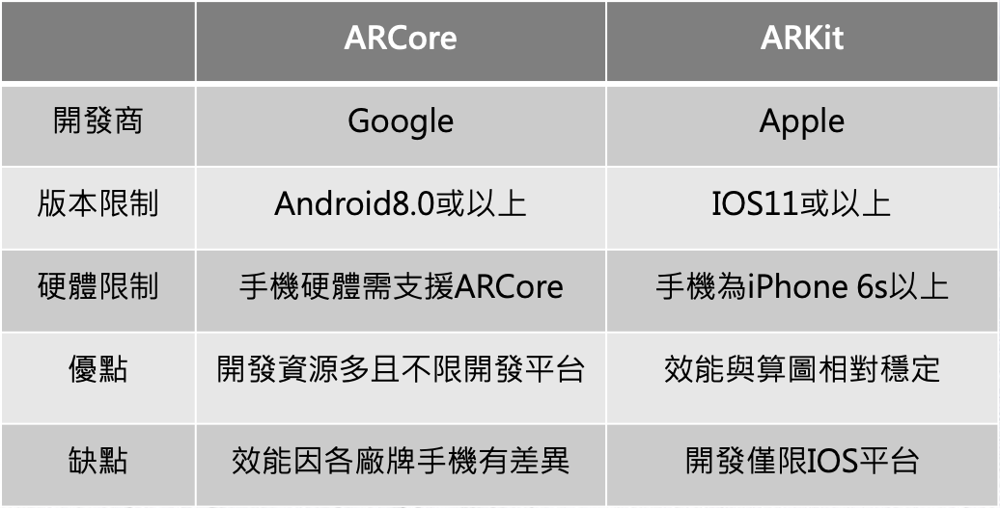
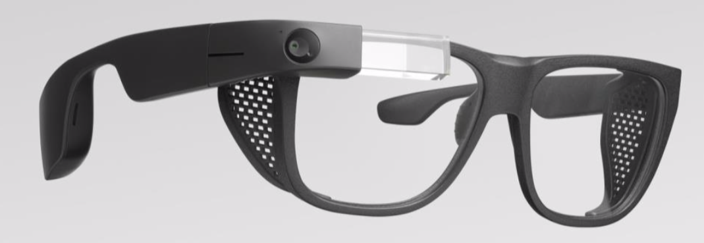
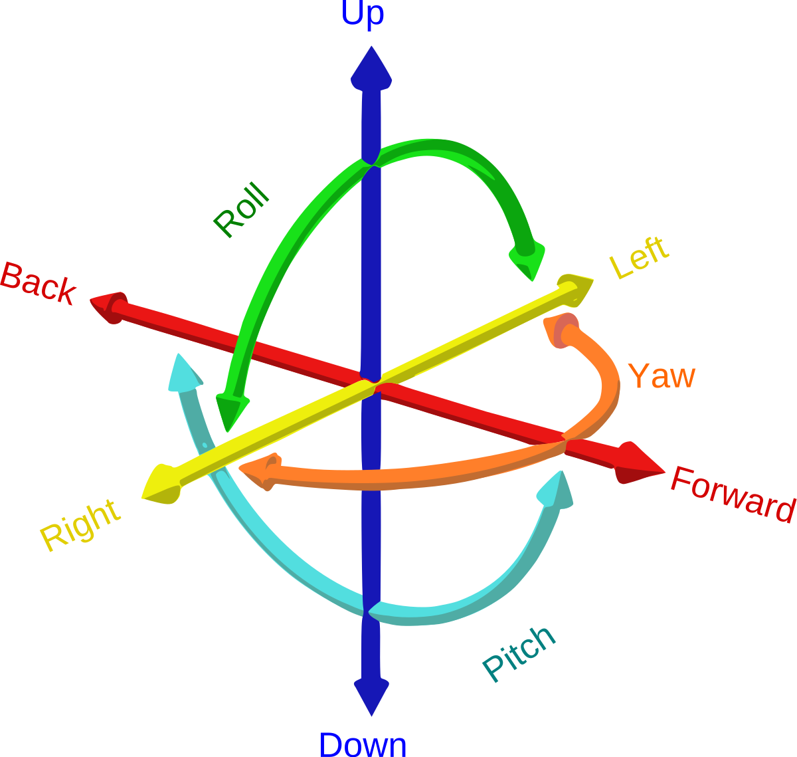
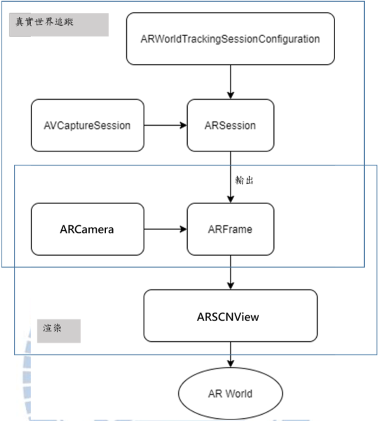
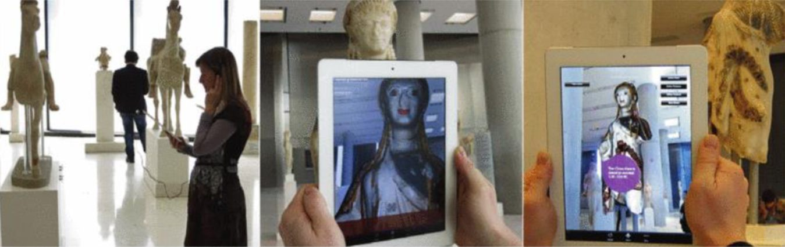
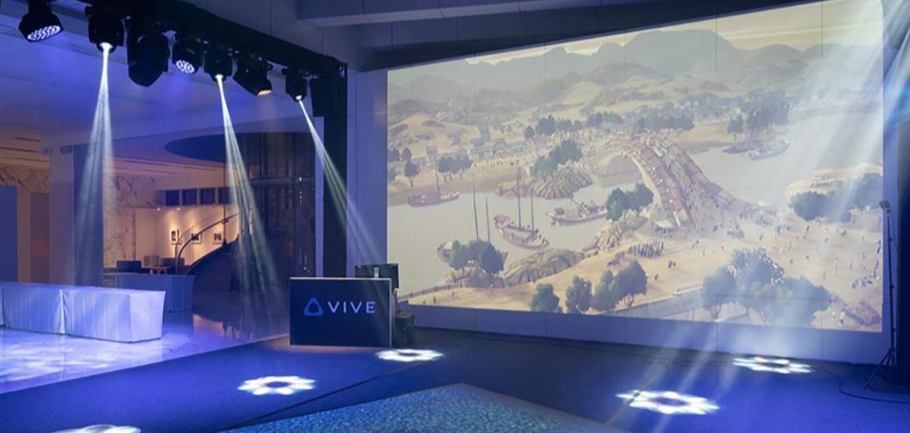
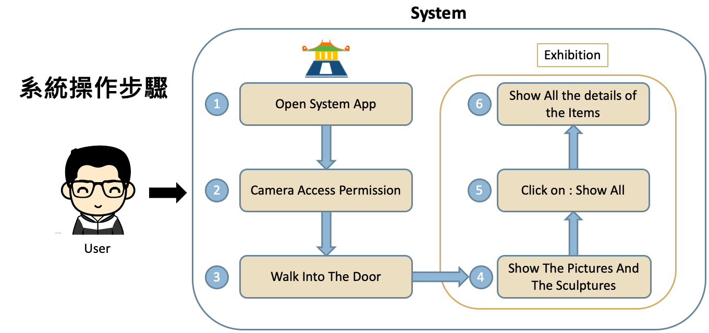
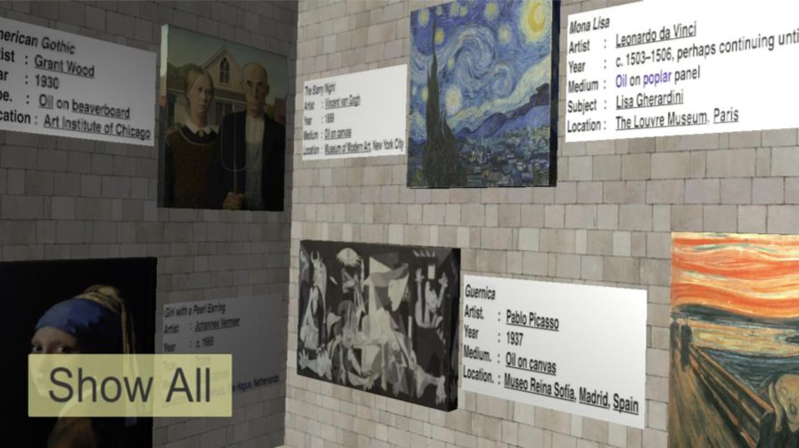
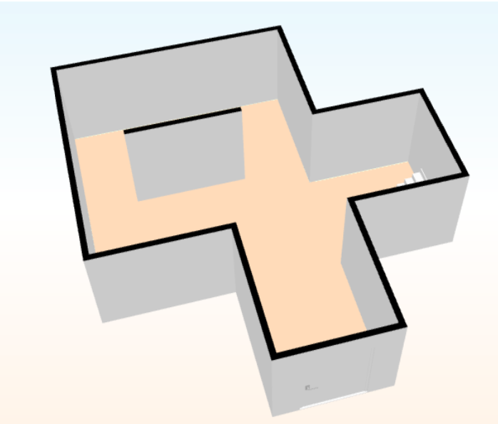
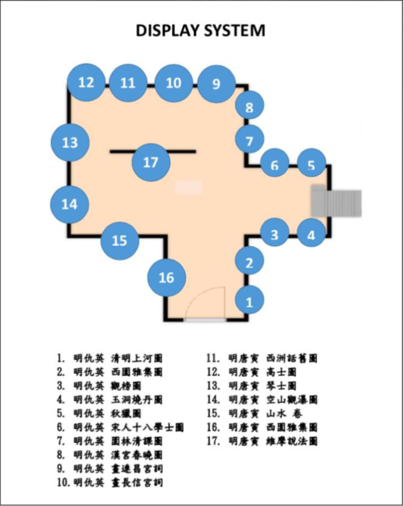

> 故宮沉浸式展場系統將展場環境呈現於行動裝置中，使用者 能走訪於虛擬搭建的展場，且不受地域限制，提升博物館觀光的趣味，降低參展 的成本。本系統先將故宮 Open Data 之中國畫作、國外知名畫作及中西方雕像進 行蒐集，再將展場空間設計搭建，並放置畫作於展場空間內。最後透過 ARKit 技術將畫面投射至行動裝置中，即時呈現影像。未來若可結合智慧眼鏡，將可帶來更 多應用。

---

# 緒論

## 動機與目的

依據文化統計調查顯示，現今許多博物館皆面臨瀏覽人次減少問題，因此各大博物館希望透過 科技，建置現代結合過去，製造反差，改變大家以往對博物館的傳統思想，打造 創新的博物館，吸引更多遊客前來參觀。
過去擴增實境 (AR) 最早用於軍事方面，但隨著軟硬體的發展，目前應用在 日常生活及遊戲產業中，Apple Inc. 推出的 iOS13 版本內，搭載以 AR 量測物體大 小及尺寸的工具，使用者不須透過尺規即可得知物體大小，使 AR 應用更為寬廣及 普及。
沉浸式一詞為新興的概念，通俗定義為「物理存在於非物理世界中的感知」， 在提到沉浸式電影時，通常意指虛擬實境電影，也就是觀眾可透過 VR 裝置進入 360 的影像以及環繞音響中，仿如置身於另外的世界中，有時甚至還有嗅覺與觸覺 的體驗。在強調全身及全方位的感官體驗上，以科技藝術空間沉浸體驗為例，如 過去日本 teamLab 的作品也透過虛擬實境裝置提供使用者彷如在虛擬空間行走。
若用沉浸感受的對象作區分，可分為以下六種不同類型:感官、本體、趣味感、 空間認知、情緒沉浸以及敘事沉浸等。這六種可同時作相互搭配，或同時存在一 個藝術作品中。

總結以上研究動機，本研究之研究目的有三點 :
(1) 結合故宮 Open Data 專區之古畫、西方著名畫作與實境技術結合，設計一 影像互動式系統。
(2) 使用 Unity 及 SketchUp 軟體建立展場空間與擺設展品，並結合 ARKit 做實境技術運用，使系統更具有互動性。
(3) 將規劃展場空間，實作虛擬展場，並提供參展地圖，予使用者方便走訪

---

## 相關研究

影像處理及硬體性能高速發展下，擴增實境、虛擬實境已不再只有軍事發展 或實驗而已，近年來更加入人們的日常生活及遊戲產業中，如 2016 年起於世界各 地發行的寶可夢盛行全球，雖然其非首度應用擴增實境技術之手機遊戲，但卻為 眾人皆知的擴增實境遊戲，還有其他包括遠程會議、培訓及醫療上的應用。
擴增實境技術的蓬勃發展，除了歸功於學術上的努力，也使更多商業團隊致 力於研究如何結合日常生活，加速便利性與有效性，以此開拓更廣大的消費市場。 以下列出近來商業界與學術界中，擴增實境相關應用的實際案例。

(1) ARKit 與ARCore技術 
Apple 公司所提供 ARKit，讓開發者實現 AR 的畫面，但不需要知道背後複 雜的成像及定位技術，只需要專注在如何設計 AR 的身歷其境經驗及場景搭建。 ARKit 原理是使用者可以在移動裝置下，同時改變虛擬物件的呈現方式，以追蹤虛 擬物件，再者，ARKit 可以執行 2D 和 3D 物件的追蹤效果，使用者可以與虛擬物 件做互動，更多可運用於遊戲產業。然而，ARKit 並不包含任何圖型 API，只提供 追蹤虛擬物件與表面偵測的能力，所以需要搭配 RealityKit、SceneKit、Metal 之類 Apple 的其他 Framework。
而 ARKit 也有其軟硬體的限制，軟體限制為開發工具為 Xcode、iOS11 版本或以上、 macOS 10.12.4 或以上版本;硬體限制為處理器 A9 或以上的 iPhone 或iPad 設備( iPhone 6S 為 A9 處理器)。
此外，Google 也有開發類似 ARKit 的技術，稱為「ARCore」，此技術可開發 於 Android 系統中，且有硬體設備的限制，其比較如下。

(2) Vuforia: Market-Leading Enterprise AR
Vuforia 為知名手機晶片大廠高通(Qualcomm)公司的 AR 擴增實境平台，於 2015 年 PTC 參數科技以 6500 萬美元收購。Vuforia 提供基本的 SDK 軟體開發擴 增實境應用程式套件可於 Unity 上進行使用，讓使用者製作各種平台的開發與擴 增實境應用。過去 AR 開發工具 ARToolKit、Lyteshot、Unifeye 等軟體的入門門 檻高且價格高，然而 Vuforia 可以免費下載提供開發者開發測試，相對容易入門。

(3) Google Glass
Google 眼鏡是一款由 Google 設計開發，裝配有光學式頭戴顯示器(OHMD) 的可穿戴電腦，其宗旨為能製造出符合普羅大眾消費者的行動裝置。其以免手持、 並與智慧型手機相似之方式顯示各種資訊，尤其導航功能是最大的看點。
軍方從 1995 年起著手於研究光學式頭戴型裝置，而後 Google 於 2012 年起開 始測試並研發有關智慧眼鏡的各項功能應用，並於同年首次展示拍攝功能且相較 過去更輕薄。現今，其裝置已涵蓋觸控板、相機、顯示器、交通資訊和地圖服務 及遊戲等。

---

## 本系統簡介與特色

此系統以 Apple Inc. 所提供的 ARKit 為擴增實境主體，以 Unity 為開發媒介， 運用其內部所提供之 ProBuilder 為展場空間建模並擺放虛擬物件於展場空間，在其 中針對各物品的建材、材質、透明度做調整，以及展場內部光影強弱微調，使遊 客可以直接透過手機或平板，在空曠地區，即時地、快速地欣賞展場，並可以透 過下方按鈕顯示展品資訊。
此系統除了將故宮 Open Data 專區的數位化圖像放置於展區，也加入了具中國 風之展品(中式建築、兵馬俑等)，更加入西方著名八幅畫作與西方著名雕 像(大衛像、維納斯像、運動員)放置於左側，期望達到中西對比，與目前熱門 的實境技術結合，達到使用者可方便瀏覽，同時得到相當驚豔的效果。

(1) 使用者端:
對於使用者而言，此系統操作簡單，只需透過一台手機或平板即可運行，在空曠的場域中，使用者手持裝置，放置於眼前，裝置即可因為使用者行走、奔跑，計算所在位置與距離，即時呈現各個物品之相對位置，在系統左下方設置按鈕提供使用者在想了解作品時點擊，即時顯示作品資訊，能因此增加趣味，同時讓使用者增加對畫作的了解。
 
(2) 開發者端:
本研究將各項展覽作品透過 Unity 內部提供之 ProBuilder 建造而成，其操作簡單，只需隨開發者欲建置的空間設定，就能產生空間，並透過各展品 自由拉移擺放，並於最後設定 ARKit 與預期顯示之項目，即可呈現。

(3) 博物館端:
此系統提供欲參訪博物館或展場的遊客使用、還有無法到達的民眾可以使用，同時能給予博物館設計展場前、設計此系統後，觀看內部空間與擺設狀態，以降低不必要的成本，同時提供此作為宣傳目的。另外，博物館若需在展覽時提供多種展場，可嘗試建立於雲端中，供民眾下載參考。

---

# 系統關鍵技術

本系統的關鍵技術主要分成兩大部分，一為 Apple Inc. 所開發的 ARKit 技術，另一為 Unity 及 SketchUp 所提供的建模方法。

## ARKit API

本研究主要針對 ARKit 作為開發支持，在此說明 ARKit 之底層技術。

### ARKit 的關鍵技術

ARKit 其中的技術原理為視覺慣性測量(VIO)系統及平面檢測兩大關鍵 技術，視覺慣性測量(VIO)即系統會隨時追蹤使用者在空間的位置，其記錄 著 iPhone 在 6DoF 空間中經過的距離(6DoF 即沿著 xyz 軸移動，加上俯仰、 旋轉、滾動等)，如下圖，螢幕在每幀畫面刷新時，動作會被立即重新計 算，畫面的刷新率為每秒 30fps 或以上，而這個刷新計算會同時被兩個系統 所計算，一為照相鏡頭與現實世界中的點將每幀畫面相匹配，此時使用者 動作會被計算。另一為動作被慣性系統所追蹤，以陀螺儀及加速度計兩慣 性測量單位(IMU)實作。最後透過卡爾曼濾波器(Kalman Filter)將其進行整 合，並計算出最佳真實位置(Ground Truth)。
平面檢測即以地面做為參考物以計算位置訊息，藉此確立物體能平放 於平面上，以避免虛擬物體漂浮。任三點決定一平面，通過計算將特徵點 平均化，得到參考平面。

---

### ARKit 的架構

ARKit 定義了簡單的 API，以下對 ARKit 組成進行分類，如: ARSession、ARSessionConfiguration、ARFrame、ARCamera 等。其中 ARSession 為整個系統核心，其實現了 AR 效果，包括世界追蹤及場景解析等，而 ARFrame 包含有 ARSession 所輸出的資訊，為渲染關鍵資料來源，其架構如下圖。

真實世界追蹤 : ARKit 在此使用 ARWorldTrackingSessionConfiguration 提供 6DoF 追蹤取得的六個參數，同時，AVCaptureSession 獲取照相機所拍 攝的影片(一幀一幀的圖像)，ARSession 根據獲取 6DoF 的 6 個參數及一幀 一幀的圖像序列進行分析，輸出給 ARFrame，此時 ARFrame 就包含有渲染 虛擬世界所需的訊息。ARCamera 為 ARFrame 中的一個屬性，其提供相機 捕捉到的圖像長度及寬度(以像素為單位)，以及 intrinsics (為 3 x 3 之矩陣)， 目的將現實世界中三維座標的點映射至相機捕捉的圖像中。

渲染 : ARSCNView 進行以下事件
(1) 將真實世界作為背景。
(2) 處理光照訊息，不斷更新光照強度。
(3) 不斷更新相機位置及角度。
(4) 將座標系結合到 AR 世界的座標系中，不斷渲染場景到真實世界的畫面中。

---

## 本文場景設計與物體搭建

(1) Unity – ProBuilder
本研究所使用開發媒介為 Unity，場景建置為 Unity 所提供之ProBuilder，ProBuilder 自開發以來，廣受遊戲開發者好評，針對 簡單的幾何結構建構進行優化，提供簡單快速的建模方式，快速構建原型 結構、複雜地形特徵、車輛和武器等。提供遊戲開發者選擇外型，可針對材質、紋理、形狀做任意搭配，並 可設定物體長度、寬度、高度，以達需求。

(2) SketchUp
本研究在物體建構中，運用模型建構軟體 SketchUp，適用於電腦動畫，擁有強大的建模、材質、模擬，其可達極為精細的設定，達到擬真效果。

---

## 本文方法與現有方法之比較

(1) AR 美術館
取自論文“ A digital look at physical museum exhibits: Designing personalized stories with handheld Augmented Reality in museums ” Jens Keil ; Laia Pujol ; Maria Roussou ; Timo Engelke ; Michael Schmitt ; Ulrich Bockholt ; Stamatia Elefthe 
將希臘的衛城博物館 (Acropolis Museum) 設計故事及動畫，並運用 AR 實作，不侷限在白紙黑字上，其添加互動及探索性，使博物館更具吸引力。其最大的特點為遊客可手持手機或平板，自行在博物館中觀覽自己喜 愛的作品，透過照相機辨識，並可顯示展品動畫與其欲傳達之資訊。
然而在此研究中，展品須事先搭建於展場中，且須有實體物品或圖像 給予裝置感應，這也是 AR 技術必須透過辨識才能達成其目的，而此方法無 法提供使用者於任意地點使用，使其侷限於只有展品擺放的地點才能使用。

(2) HTC 與故宮合作
自 2015 年，故宮開始與 HTC 合作開發虛擬實境，在 VIVE 平台開發VR 的藝術作品，從虛擬書畫展廳到「自敘心境」(懷素《自敘帖》)、「神遊 幻境」(趙孟頫《鵲華秋色圖》)，將數位藝術帶入博物館。而後，於 2018 年 10 月 15 日推出「再現傳奇-VR 藝術體驗特展」，發表清明上河圖 VR，以故宮《清明上河圖》為本，包含畫作欣賞及遊戲體驗等，尋人物、玩遊戲、體會古人生活與智慧。另外，2019 年 12 月 17 日至 2020 年 5 月 26 日，推出《故宮南院奇幻嘉年華:21 世紀博物館特展》，故宮南院與全世界各大博物館、美術館合作，展出包括今年於法國羅浮宮《達 文西 500 週年特展》展出的《蒙娜麗莎:越界視野》、法國橘園美術館齊力 完成的《莫內:傾慕睡蓮》等著名巨作。
然而，於這兩次的展覽中，皆須透過 HTC 的 VR 裝置進行互動體驗，若在沒有 VR 裝置下，無法進行體驗，甚至容易造成頭暈、想吐等狀況;另外，在設計上，開發所需的人力及遊戲設計，開發成本相對較高，利用此 方法對於使用者的裝置硬體需求較高，同時降低便利性。

---

# 系統實作

## 開發流程

本系統之系統開發模式採用快速雛型法(Rapid Prototyping Model)。初期，採用漸進模型(Incremental Model)將系統做開發，其細部功能及擴充功能尚未建立，而 後再對系統與現況做評估，透過給同學及老師實測並給予建議後做修正，再進行 下一步驟的流程，每次增加一個功能就評估一次，遞增至所有的功能都做完，透 過將主要功能完成後再進行附加功能的設計，可使流程更方便管理、維護，同時 更能在有限的時間內將系統達成進度。

(1) 國立故宮博物院 Open Data 專區資料及西方古畫蒐集
本系統主要透過故宮古畫及西方知名畫作做為展品陳列，因此首先蒐集故宮古畫。在此次資料蒐集中，將明朝仇英之畫作做為本次畫展區展覽 主題，找尋明朝仇英之畫作的第一步驟為透過故宮博物院的 Open Data 專區 中的「精選圖像下載」進行搜尋，在類別中選擇「繪畫」，再以關鍵字搜尋 「仇英」，在下方顯示所有仇英之繪畫，從顯示資料中出現的 46 筆仇英畫 作中，以圖畫整體的「線條複雜度」及「色彩鮮豔度」為依據，挑選 5 張 做為本次展場中主要的畫作，分別為「宋人十八學士圖」、「明仇英西園雅 集圖」、「明仇英秋獵圖」、「明仇英清明上河圖」、「明仇英觀榜圖」。 另外，在西方畫作中，從 The Artists 網站中將耳熟能詳的 8 幅著名畫 作，在 Google 以「進階搜尋」選擇「可任意使用、分享或修改」， 搜尋圖片後，進行下載，其中選擇的畫作為 「Mona Lisa」 、 「The Starry Night」 、 「The Scream」 、 「Girl with a Pearl Earring」 、 「A Sunday Afternoon on the Island of La Grande Jatte」、「Guernica」、「The Kiss」、 「American Gothic」。

(2) Unity-ProBuilder 場景搭建及展品擺放 
從「Asset Store」搜尋「ProBuilder」後，將「ProBuilder」導入至 Unity中，使用其欄位下方之「New Shape」功能，建立展場空間，在本研究之展 場建立為一長方體空間，其設定大小為 X:10m Y:10m Z:12m，並確立門口的 位置，將門口也透過「New Shape」產生門，建立門口確保使用者可以以這 門口為動線，進出該門，在此即搭建完成展場空間。
將系統畫面左邊做為西方，即西方畫作的擺設，故透過材質選用及環 境設計時，將畫面左邊以大理石、石膏及玄柱為基礎，選擇「Material Editor」，將所蒐集到的大理石、石膏材質放置於各欄位中，即可轉化各個 牆面及物品的材質，打造出西方文化氣息;同時欲將上步驟所蒐集的西方 畫作放置於場景中，選擇「New Shape」功能建立相框，在此，依各個畫作 的比例，選擇畫框的長寬度，並將畫作拖拉至相框內，然而，畫作會因參 考點位置，而產生重疊狀況，克服方法為點選「UV Editor」，可以透過重新 調整畫面起始位置或修正大小，達成目的。另外，在放置完展品 後，決定將展場前方設定為雕像陳列區，Sketchfab 網站所提供之 3D 作品為「可任意使用、分享或修改」，並選擇西方著名的三個雕像，分別為 「Venus」、「David」、「Discobolus」，作為展場雕像。
而系統畫面的右邊作為東方，即中國畫作的擺設，材質選用木材、陶 土等，其做法與上述相同，在此同時，加入中國書法、中式建築(透過 SketchUp 軟體建模)等，並加入兵馬俑雕像，使畫面右邊更具東方特色。
最後，建立材質球，在右方欄位的「Shader」屬性中選擇「Custom」的「Mask」，並把「Render Queue」數值調成 1999，目的是達成外牆不可見， 而後將此材質指配到展場建築物的四面八方，使建築物整體不可視，只留下通道的門。

(3) ARKit 與 Unity 整合設計
此系統主要以 iOS 為核心開發，因此以 ARKit 為 AR 核心，到「Unity-Technologies / unity-arkit-plugin — Bitbucket」，將 ARKit-Plugin 載入 Unity 中，將其檔案內的「UnityARKitPlugin」之「Example」的 「UnityARKitScene」 點選進行 AR 整合，並將先前製作的展場拉入此專案 中，並在展場模型建立「Unity AR Hit Test Example」的 Script，並將「Hit Transform」指定展場本身，即完成整合。

(4) Xcode 編譯並發布至 iOS 裝置中
此系統主要的隨身裝置為 iOS 系統，在發布時，點選 「File」的「Build Settings」，並選擇 iOS 裝置，並進行建置。這過程必須於 iOS 系統中完成， 將所發布的專案開啟，點選「Unity-iPhone.xcodeproj」，透過 Xcode 開啟， 在 Team 選項中選擇自己，因為只在自己的裝置上開發，此並無發布於 App Store 中，故 Product Name 可自行選擇，也因此產品從安裝於裝置到失效只 有 6 天的時間，若有需發布於 App Store 中，需先申請 Apple Developer，並繳付費用。而後欲設定產品名稱並上架等，需開啟 Unity 中 Build Settings 的 PlayerSettings 設定，在部分設定中填寫，如在 Product Name 中輸入遊戲的名稱(可為英文或中文)，而 Default Icon 是讓開發者選 擇應用程式的圖示(本系統以故宮外觀製作為圖示)，結果將會出現在行動裝 置的畫面中，如果沒有選擇圖示，則只會出現 Unity 的 Logo。

(5) 系統測試並修正 
本系統在實際測試中，給予不同性別及身高的使用者使用，面臨幾個問題，例如: 當使用者身高的不同以及手拿裝置的角度不同出現展場的門口過高或過低，因此透過調整門口高度至平均值上下 160 公分左右，即可得到改善，另外，在展場環境中的亮度會受到外在環境光線的影響，因此透過加入光源於展場中，即可解決光度不足的問題。

---

## 使用技術與工具

(1) C#
C#是基於.NET 框架、物件導向的進階程式語言。其語法與 Java、 JavaScript、C++相似，為 ECMA 標準。其效能不錯外，又具有.NET Framework 作為根基，因此能讓程式設計師進行快速開發。C#可作為各種程式的開發 工具，從大型作業系統到小型嵌入式系統都可使用。

(2) SketchUp
SketchUp 是適用於遊戲、建築、模型、室內外設計的一套電腦輔助繪圖軟體。其提供簡易、直觀的繪圖工具，相較於其他 CAD 軟體，介面更簡 單、容易上手。此外，它擁有豐富的模型資料庫，來自世界各地人們的模 型設計，提供免費下載，可節省額外小物件的設計成本，同時軟體介面相 容性高，可導入及匯出各種形式的檔案如 CAD、3DMAX 及其他軟體支援 的檔案格式以供使用。 

(3) Xcode
Xcode 是一個提供開發人員為 Apple 開發應用程式的工具應用平台如(iPhone、iPad、Mac 等)，用於 OS X、iOS、watchOS，程式語言主要為 Swift 及Objective-C，同時包含 C++與 C。內含有 iOS SDK、程式編輯器、除錯等 工具。其中，更提供模擬器功能，使開發者不需直接以手機或平板，即可 於 Xcode 中模擬執行 App。

---

# 系統展示

## 系統入口

系統入口為 Unity 作成之 iPhone(或 iPad)的 App，其圖示為參考國立故宮博物院之外觀後，自行設計。

點擊 App 後，可見到視覺化的門口作為展場的入口，同時周圍可看到真實的場景。

---

## 系統操作步驟

顯示展品資訊 走入門口後，即可見到所有展品陳列於使用者眼前，當使用者想了解展品資訊時，在螢幕左下方有「Show All」的按鈕，即可展示所有畫作的資 訊(作者、時間、類型、描述等)，以呈現給使用者。

系統Demo影片 : Click On Me

<iframe class="yt" src="https://www.youtube-nocookie.com/embed/y6X5S8tKC08" title="YouTube video" loading="lazy" allow="accelerometer; clipboard-write; encrypted-media; gyroscope; picture-in-picture; web-share" referrerpolicy="strict-origin-when-cross-origin" allowfullscreen></iframe>

---

此外，本研究以交大圖書館為基礎，修改、建置一虛擬展場，以明仇英與明 唐寅的畫作為展品，並提供展場地圖予使用者了解展場概況與展品擺置位置等。

(1) 本系統的入口以展場 3D 樣式為圖示

(2) 本系統的展場地圖

系統Demo影片 : Click On Me

<iframe class="yt" src="https://www.youtube-nocookie.com/embed/spNBQXed0aM" title="YouTube video" loading="lazy" allow="accelerometer; clipboard-write; encrypted-media; gyroscope; picture-in-picture; web-share" referrerpolicy="strict-origin-when-cross-origin" allowfullscreen></iframe>

---

# 未來研究方向與應用

## 結論

故宮沉浸式展場系統可以增加展場的彈性運用，不僅可以快速調整展品內 容，更能讓使用者與系統做互動，即時顯示展品內容，並不受地域限制，隨處皆 可操作系統。此外可應用於佈展前做為展場的規劃，事先將展場的內容呈現於系 統，及時了解展出時的狀態及所遇到的問題，降低成本。相較於現今的 AR 系統相 關應用，皆需有實際展場動線與實體辨識，反而凸顯故宮沉浸式展場系統的方便性 與可攜帶性。
AR、VR 在軟硬體的高速發展，使其將成為未來的趨勢及主流，扮演生活中 不可或缺的一部分，藉由結合科技與古代文物所激發出的美麗火花，不僅在台灣， 更能成為世界各地非同凡響的應用。

---

## 未來研究方向

近來，博物館及美術館正積極與科技廠商合作並發展創新應用，可將人類歷 史存在數位資料中，可不佔空間的保存於世，也開始讓人好奇博物館未來將發展 到何種地步。想像漫步於博物館或美術館中，各個透明櫥窗如哈利波特魔法學校 內的畫作栩栩如生，並且跟觀眾互動，能與遊客對話聊天，甚至還能當朋友，想 必能吸引更多遊客、更驚艷世人。

(1) 結合雲端即時變換展品與提供編輯功能
目前本系統需事先在 Unity 中編輯，在軟體中更動展品位置及場景等，然而此操作仍有其不便之處，因此希望在未來能將系統結合雲端的方式，將展品存於雲端資料庫中，方便於系統中即時更改、編輯，並根據展場需求做調整。

(2) 提供語音資訊導覽 
在遊客瀏覽此系統時，目前僅有視覺上的反饋，而無語音上的互動，因此希望未來能添加語音導覽的方式，可透過按鈕或即時播放的方式，讓展覽更生動，使遊客更了解整個展品內容與展場目的等。

(3) 結合智慧眼鏡 
在操作此系統時，目前僅限於手機或平板等，為了省去手持所造成的不便，並期望達到更沉浸的互動模式，可透過目前各大廠商在開發的智慧眼鏡， 提供使用者在戴上眼鏡後，呈現展品內容於使用者眼前，且能感受到環景 360 的效果。

(4) 製成遊戲提供娛樂性 
在此系統中，目前僅止於參觀與瀏覽，然而未來希望能把展覽內容結合遊戲，提供具有故事性或益智性的遊戲，例如: 展場的主題為秦朝，遊客可 以化身為秦朝官員，與當地的居民互動，了解當時發展的小篆文字與度量衡 統一等，並探索秦朝宮殿。

(5) 應用於其他領域提供經濟價值 
在此系統，其概念不僅止於美術展品的呈現，在醫療、建築、娛樂等，皆能應用此系統的概念做為延伸，舉例建築，可透過系統的沉浸式建立建築模型，並事先觀看建築架構與室內規劃，並於開工前達成消費者需求，避免想法及預期落差，以滿足消費者期望。

---

# 參考文獻

[1] 施政計畫、業務統計及研究報告，2020. 取自國立故宮博物院博物館行政: https://www.npm.gov.tw/Article.aspx?sNo=03006230
[2] 腦中乾坤 : 心智的生物學，2016. 取自國立自然科學博物館
[3] 上河藝影—故宮 x 衛武營新媒體藝術展，2019. 取自國立故宮博物院展覽回 顧: https://theme.npm.edu.tw/exh108/npmweiwuying/
[4] 林逸清(2019)，一 LINE 上博物館智能導覽系統設計，國立交通大學資訊管理 所碩士論文。
[5] Pokémon Go，取自 Wikipedia : https://en.wikipedia.org/wiki/Pokemon_Go
[6] Augmented Reality : ARKit3，取自 Apple Developer : https://developer.apple.com/augmented-reality/
[7] Vuforia: Market-Leading Enterprise AR，取自 PTC : https://www.vuforia.com
[8] Google Glass : DISCOVER GLASS ENTERPRISE EDITION，取自 Google : https://www.google.com/glass/start/
[9] 國立故宮博物院 Open Data 政府資料開放免費下載，取自國立故宮博物院 : https://theme.npm.edu.tw/opendata/
[10] 8 Most Famous Paintings In Western Art ，取自 The Artists : https://www.the-artists.org/most-famous-paintings-in-western-art/?fbclid=IwAR3PS6rCe7qIdUSr22kHIvRmBwHdGiDa84yhBzdvY906qf7N-tKPxIBBedI
[11] Jens Keil ; Laia Pujol ; Maria Roussou ; Timo Engelke ; Michael Schmitt ; Ulrich Bockholt ; Stamatia Elefthe (2013) , A digital look at physical museum exhibits: Designing personalized stories with handheld Augmented Reality in museums
[12] 再現傳奇 - VR 藝術特展，取自國立故宮博物院: https://theme.npm.edu.tw/exh107/VRart/
[13] 奇幻嘉年華-21世紀博物館特展，取自國立故宮博物院南部院區: https://south.npm.gov.tw/ExhibitionsDetailC003110.aspx?Cond=6d4d3215-793a-48e1-b450-f2e41116e6e5&appname=Exhibition3112
[14] Sketchfab官網，取自Sketchfab:https://sketchfab.com/
[15] 兵馬俑雕像，取自Thingiverse:https://www.thingiverse.com/thing:1028560/
[16] ARKit-Plugin，取自Unity
[17] C# 語言簡介，取自 Duran 的技術冶煉廠: http://dog0416.blogspot.com/2017/08/cvisual-studio-c.html
[18] SketchUp 教學，取自 CG 數位學習網: http://www.cg.com.tw/SketchUp/Content/SketchUp_01.php
[19] Swift 新手系列之一: 打造你的第一個 iOSApp，取自APPCODA: https://www.appcoda.com.tw/hello-world-app-swift/