> People in Chiang Mai are so friendly
> We got lucky: it only rained on the last day, and the weather was great the rest of the time

Trip videos

<iframe class="yt short" src="https://www.youtube-nocookie.com/embed/FVwDx9CRbL8" title="YouTube video" loading="lazy" allow="accelerometer; clipboard-write; encrypted-media; gyroscope; picture-in-picture; web-share" referrerpolicy="strict-origin-when-cross-origin" allowfullscreen></iframe>
<iframe class="yt short" src="https://www.youtube-nocookie.com/embed/saS3HHk0i9I" title="YouTube video" loading="lazy" allow="accelerometer; clipboard-write; encrypted-media; gyroscope; picture-in-picture; web-share" referrerpolicy="strict-origin-when-cross-origin" allowfullscreen></iframe>
<iframe class="yt short" src="https://www.youtube-nocookie.com/embed/XQIewn7oDW0" title="YouTube video" loading="lazy" allow="accelerometer; clipboard-write; encrypted-media; gyroscope; picture-in-picture; web-share" referrerpolicy="strict-origin-when-cross-origin" allowfullscreen></iframe>

# Preparation

1. June to October in particular is the rainy season, so plan some extra rainy-day activities for each day
2. Packing list reference: https://www.tattpe.org.tw/HowToGo.html
3. You need to fill out the TDAC before entering Thailand, see: https://blog.eztravel.com.tw/thailand-entry-guide/
4. For exchanging Thai baht, I recommend this place in Chiang Mai. I checked out a ton of exchange shops and none of them beat its rate

<iframe src="https://www.google.com/maps/embed?pb=!1m18!1m12!1m3!1d2312.302663280039!2d98.99525315798228!3d18.787704707138047!2m3!1f0!2f0!3f0!3m2!1i1024!2i768!4f13.1!3m3!1m2!1s0x30da3aa46a2a9805%3A0x91a4e37a07c84752!2smr.pierre%20money%20exchange!5e0!3m2!1szh-TW!2stw!4v1784887629582!5m2!1szh-TW!2stw" width="600" height="450" style="border:0;" allowfullscreen="" loading="lazy" referrerpolicy="strict-origin-when-cross-origin"></iframe>

We didn't buy checked baggage on the way to Chiang Mai, just 7 kg of carry-on.
For the return flight we bought a suitcase in Chiang Mai and had 20 kg of checked baggage

# Itinerary

Here's a map of Chiang Mai as a whole. You can plan one area per day and wander around slowly. There are lots of unexpected surprises, and you really get to feel the laid-back local vibe
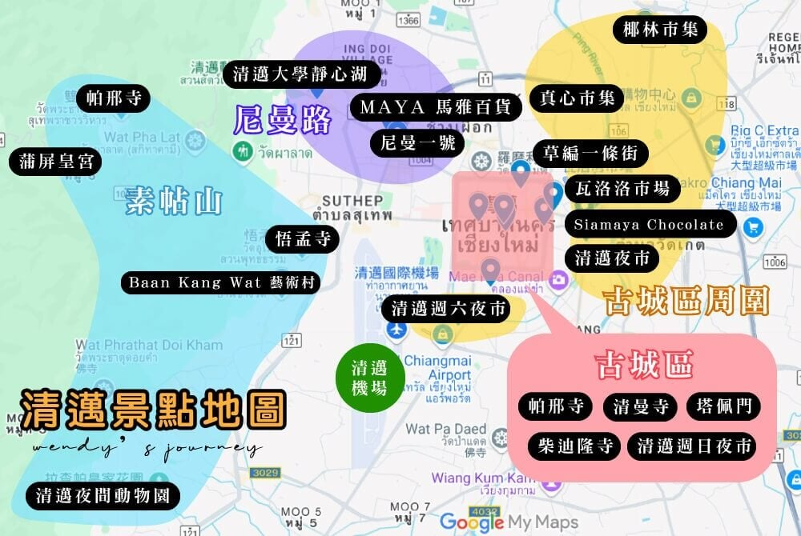

## Day 1

We landed around 10 p.m., dropped our bags at the guesthouse, and went to a nearby night market for dinner.

Our guesthouse was WERUN NIMBLY AN ORDINARY HOUSE CHIANG MAI. Highly recommended, and super cheap
<iframe src="https://www.google.com/maps/embed?pb=!1m18!1m12!1m3!1d20957.069169351584!2d98.97626297510458!3d18.78362644129409!2m3!1f0!2f0!3f0!3m2!1i1024!2i768!4f13.1!3m3!1m2!1s0x30da3b1db4f45cc9%3A0x29ce14b8e423b1cd!2sWERUN%20NIMBLY%20AN%20ORDINARY%20HOUSE%20CHIANG%20MAI!5e0!3m2!1szh-TW!2stw!4v1784886299148!5m2!1szh-TW!2stw" width="600" height="450" style="border:0;" allowfullscreen="" loading="lazy" referrerpolicy="strict-origin-when-cross-origin"></iframe>

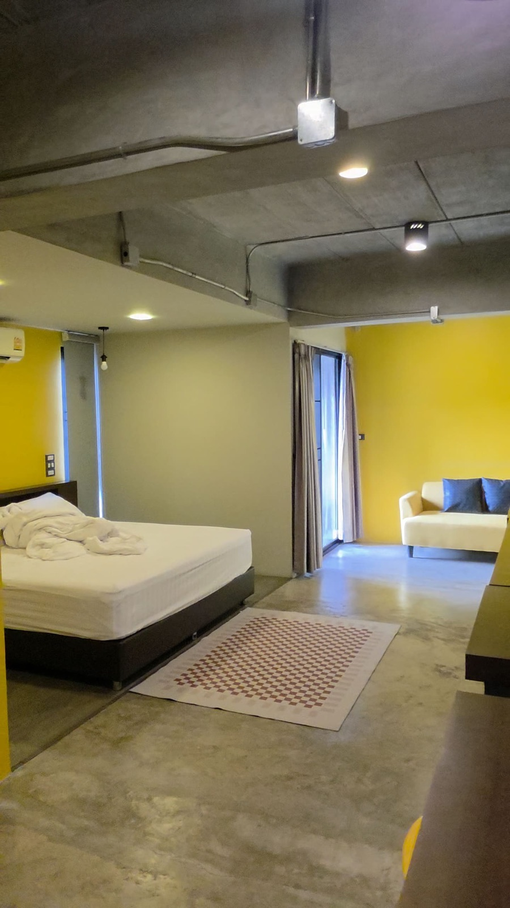

The nearby night market: Chang Phuak Market

<iframe src="https://www.google.com/maps/embed?pb=!1m18!1m12!1m3!1d1811.6029807302612!2d98.985538467011!3d18.79508399296758!2m3!1f0!2f0!3f0!3m2!1i1024!2i768!4f13.1!3m3!1m2!1s0x30da3a9129fc858d%3A0x6fc6d33ee0ea5b19!2sChang%20Phuak%20Market!5e0!3m2!1szh-TW!2stw!4v1784886362052!5m2!1szh-TW!2stw" width="600" height="450" style="border:0;" allowfullscreen="" loading="lazy" referrerpolicy="strict-origin-when-cross-origin"></iframe>

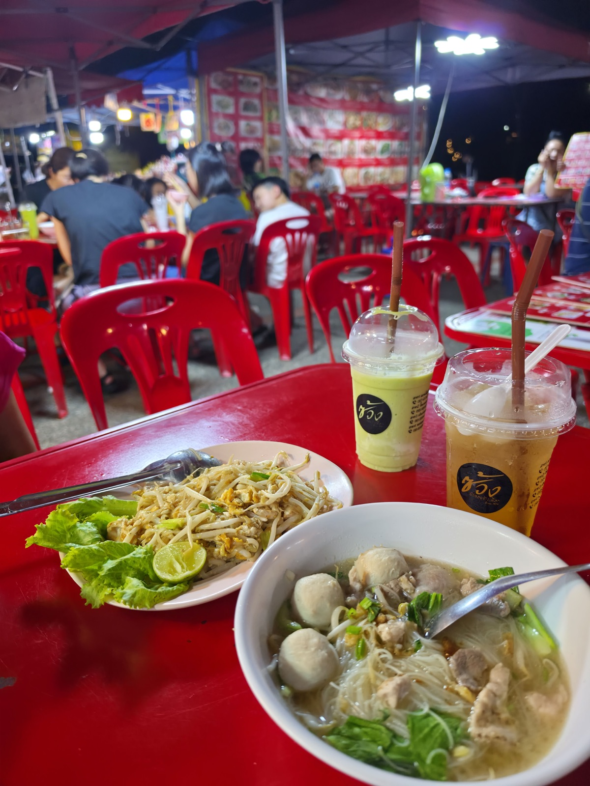

We happened to pass by a famous temple, Wat Lok Moli. At night it feels really solemn

<iframe src="https://www.google.com/maps/embed?pb=!1m18!1m12!1m3!1d8029.346597291533!2d98.98117272380368!3d18.79326794237528!2m3!1f0!2f0!3f0!3m2!1i1024!2i768!4f13.1!3m3!1m2!1s0x30da3a9100c30075%3A0x37241441d3264a00!2z576F5pGp5Yip5a-6!5e0!3m2!1szh-TW!2stw!4v1784886527709!5m2!1szh-TW!2stw" width="600" height="450" style="border:0;" allowfullscreen="" loading="lazy" referrerpolicy="strict-origin-when-cross-origin"></iframe>

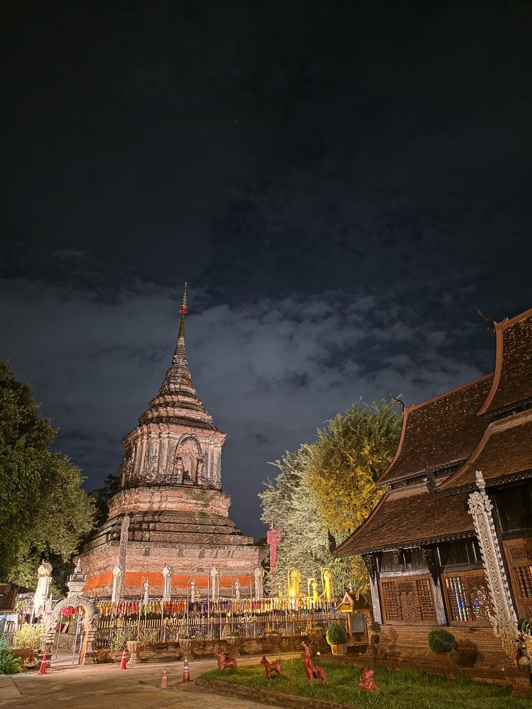

## Day 2

The plan for today was to explore the whole Old City.

On the way we stopped by Wat Phra Singh, a 14th-century Buddhist temple with gilded bronze Buddha statues, murals and ancient manuscripts.

<iframe src="https://www.google.com/maps/embed?pb=!1m18!1m12!1m3!1d7554.219219606661!2d98.98117272380368!3d18.79326794237528!2m3!1f0!2f0!3f0!3m2!1i1024!2i768!4f13.1!3m3!1m2!1s0x30da3a9b6e4a246f%3A0x9656d9e717cd54e9!2z5biV6YKi5a-6!5e0!3m2!1szh-TW!2stw!4v1784886874069!5m2!1szh-TW!2stw" width="600" height="450" style="border:0;" allowfullscreen="" loading="lazy" referrerpolicy="strict-origin-when-cross-origin"></iframe>

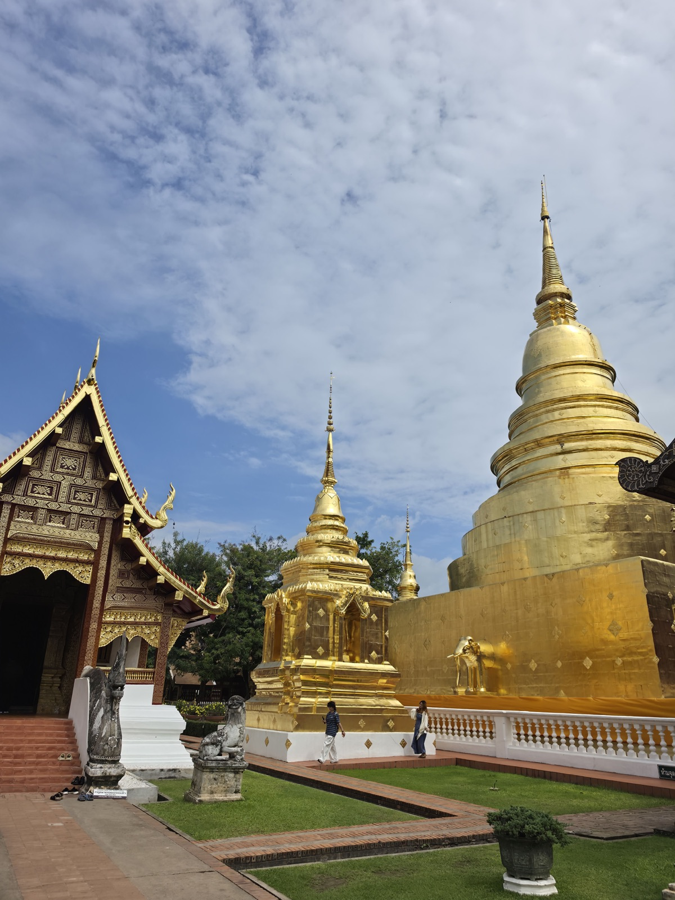

Next we ate at SO SOOD the good noodles l Authentic Thai-style l ก๋วยเตี๋ยวอร่อยโซซู้ด. Recommended, it's delicious.

<iframe src="https://www.google.com/maps/embed?pb=!1m18!1m12!1m3!1d7533.493047731483!2d98.98183624811841!3d18.78902631860651!2m3!1f0!2f0!3f0!3m2!1i1024!2i768!4f13.1!3m3!1m2!1s0x30da3b5f5aa9d6e5%3A0xa4919cb95b0794d4!2zU08gU09PRCB0aGUgZ29vZCBub29kbGVzIGwgQXV0aGVudGljIFRoYWktc3R5bGUgbCDguIHguYvguKfguKLguYDguJXguLXguYvguKLguKfguK3guKPguYjguK3guKLguYLguIvguIvguLnguYnguJQ!5e0!3m2!1szh-TW!2stw!4v1784886927604!5m2!1szh-TW!2stw" width="600" height="450" style="border:0;" allowfullscreen="" loading="lazy" referrerpolicy="strict-origin-when-cross-origin"></iframe>

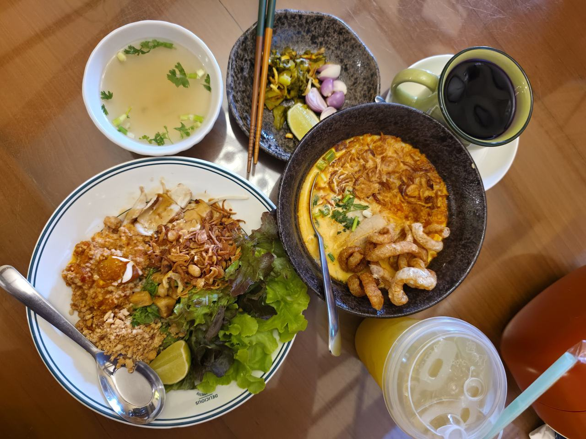

Then we visited Kalm​ Village​ Chiang Mai, a well-known arts village. You can relax in its library with a book or get some work done on your laptop

<iframe src="https://www.google.com/maps/embed?pb=!1m18!1m12!1m3!1d9995.735545889724!2d98.9807242154045!3d18.789748029775637!2m3!1f0!2f0!3f0!3m2!1i1024!2i768!4f13.1!3m3!1m2!1s0x30da3b9224fbb52d%3A0x2d7dfbab98925684!2zS2FsbeKAiyBWaWxsYWdl4oCLIENoaWFuZyBNYWk!5e0!3m2!1szh-TW!2stw!4v1784887032305!5m2!1szh-TW!2stw" width="600" height="450" style="border:0;" allowfullscreen="" loading="lazy" referrerpolicy="strict-origin-when-cross-origin"></iframe>

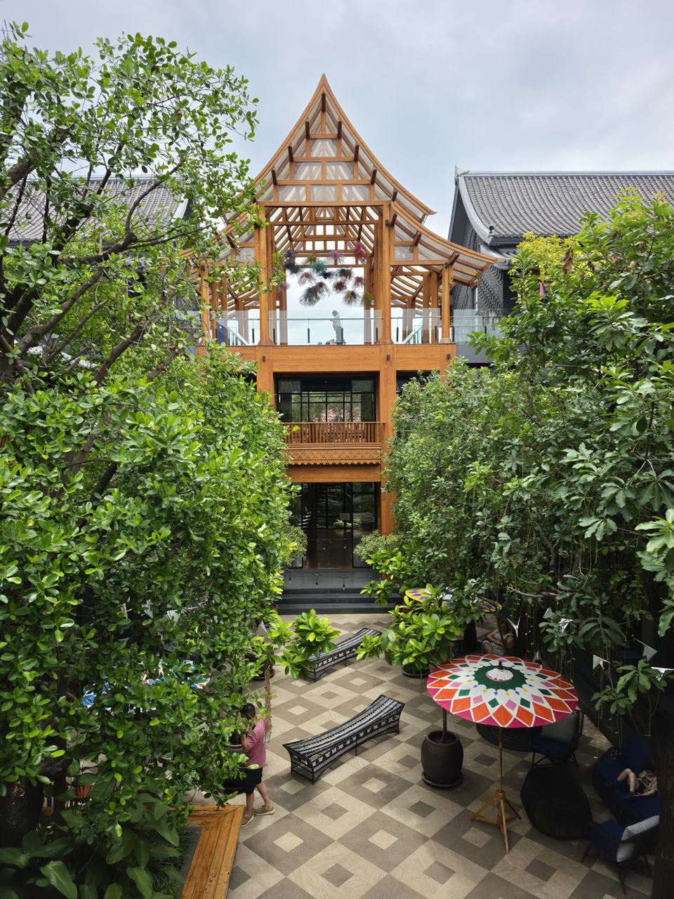

After that we went to Wat Chedi Luang. Tickets are 100 THB per person. It's a temple complex where one of the chedis partially collapsed in the 15th century, and it also has the pillar believed to protect the city.

<iframe src="https://www.google.com/maps/embed?pb=!1m18!1m12!1m3!1d9995.735545889724!2d98.9807242154045!3d18.789748029775637!2m3!1f0!2f0!3f0!3m2!1i1024!2i768!4f13.1!3m3!1m2!1s0x30da3a9933111415%3A0x5cf7709a044ba8ba!2z5p-06L-q6ZqG5a-6!5e0!3m2!1szh-TW!2stw!4v1784887107409!5m2!1szh-TW!2stw" width="600" height="450" style="border:0;" allowfullscreen="" loading="lazy" referrerpolicy="strict-origin-when-cross-origin"></iframe>

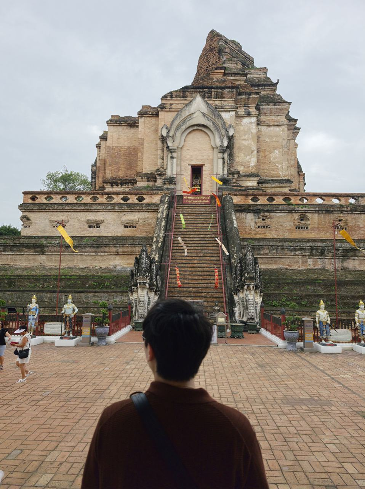

Then we wandered past the coin museum and popped in to look around (and enjoy the AC)

Later we headed to the Old City walls to take photos

<iframe src="https://www.google.com/maps/embed?pb=!1m18!1m12!1m3!1d2312.3018949838506!2d98.99228448891127!3d18.78776066828479!2m3!1f0!2f0!3f0!3m2!1i1024!2i768!4f13.1!3m3!1m2!1s0x30da3aa23421c875%3A0x9d3b8fabe43926f6!2sTha%20Phae%20Gate!5e0!3m2!1szh-TW!2stw!4v1784887508192!5m2!1szh-TW!2stw" width="600" height="450" style="border:0;" allowfullscreen="" loading="lazy" referrerpolicy="strict-origin-when-cross-origin"></iframe>

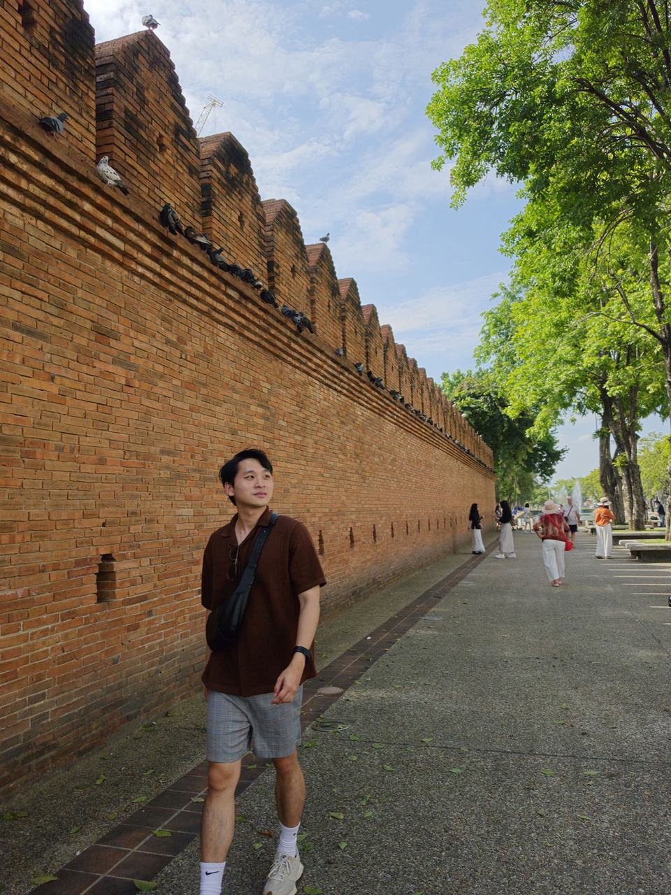

Then we passed the money exchange, the place with the best rate

<iframe src="https://www.google.com/maps/embed?pb=!1m18!1m12!1m3!1d2312.302663280039!2d98.99525315798228!3d18.787704707138047!2m3!1f0!2f0!3f0!3m2!1i1024!2i768!4f13.1!3m3!1m2!1s0x30da3aa46a2a9805%3A0x91a4e37a07c84752!2smr.pierre%20money%20exchange!5e0!3m2!1szh-TW!2stw!4v1784887629582!5m2!1szh-TW!2stw" width="600" height="450" style="border:0;" allowfullscreen="" loading="lazy" referrerpolicy="strict-origin-when-cross-origin"></iframe>

Off to the Chiang Mai Night Bazaar, passing lots of shops along the way. There's so much stuff here, and it's cheap

<iframe src="https://www.google.com/maps/embed?pb=!1m18!1m12!1m3!1d5350.6628612042905!2d98.99829890646457!3d18.781385098539126!2m3!1f0!2f0!3f0!3m2!1i1024!2i768!4f13.1!3m3!1m2!1s0x30da3aa60ca74a5b%3A0xb2ef5007f26b01d!2z5riF6YKB5aSc5biC!5e0!3m2!1szh-TW!2stw!4v1784887789132!5m2!1szh-TW!2stw" width="600" height="450" style="border:0;" allowfullscreen="" loading="lazy" referrerpolicy="strict-origin-when-cross-origin"></iframe>

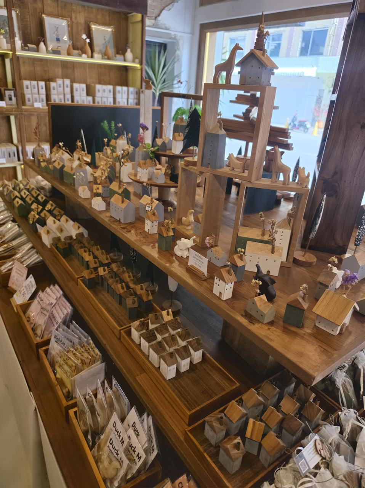

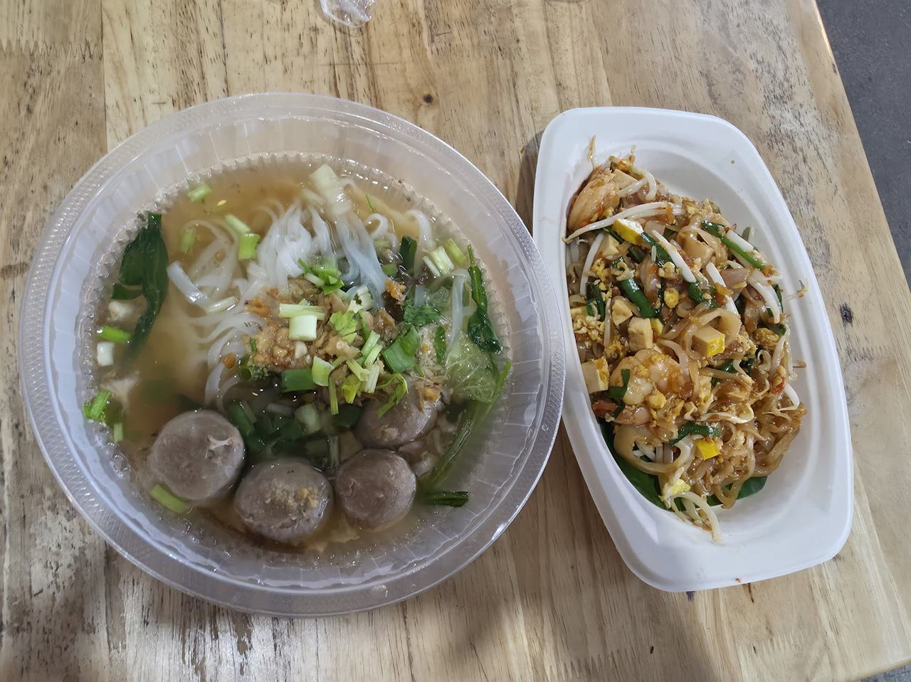

Finally we went on a big shopping run at Big C and bought lots of souvenirs and gifts, plus a suitcase! Suitcases here are super cheap: a medium-sized one is only 699. We went back to the hotel fully loaded, and then tried our first massage: 700 THB per person for 90 minutes

## Day 3

In the morning we did an elephant experience camp. Totally worth it, highly recommended! You get to make vitamin balls for the elephants, feed them, hang out with them, give them a bath and more~ We booked the tour on Klook for about 1,200 per person, including pickup and lunch.

<iframe src="https://www.google.com/maps/embed?pb=!1m18!1m12!1m3!1d241388.8379773271!2d98.77437996483445!3d19.032910612586072!2m3!1f0!2f0!3f0!3m2!1i1024!2i768!4f13.1!3m3!1m2!1s0x30da169a9fecb14f%3A0x3892025b0cb51a49!2sMaerim%20Elephant%20Sanctuary!5e0!3m2!1szh-TW!2stw!4v1784888364025!5m2!1szh-TW!2stw" width="600" height="450" style="border:0;" allowfullscreen="" loading="lazy" referrerpolicy="strict-origin-when-cross-origin"></iframe>

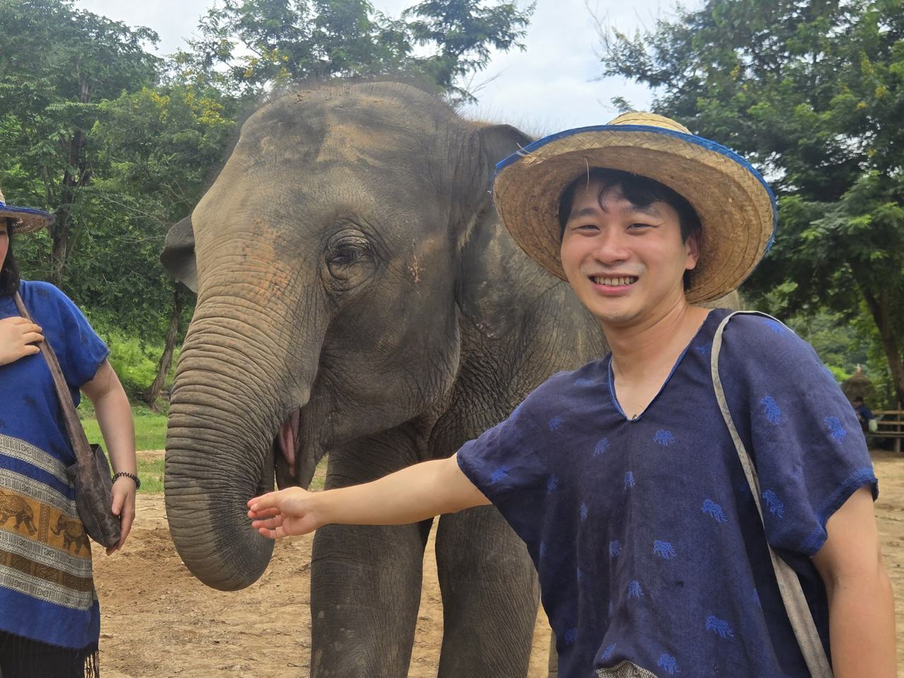

In the afternoon we rested at the hotel for a bit, then went to a nearby café
It claims 97% cocoa, and it really is super thick

<iframe src="https://www.google.com/maps/embed?pb=!1m18!1m12!1m3!1d8605.981648477044!2d98.98296530602299!3d18.78658311132267!2m3!1f0!2f0!3f0!3m2!1i1024!2i768!4f13.1!3m3!1m2!1s0x30da3b209cb41555%3A0xc5e3380e0de3ed8e!2s97%25%20Nothing%20But%20Cocoa!5e0!3m2!1szh-TW!2stw!4v1784888448261!5m2!1szh-TW!2stw" width="600" height="450" style="border:0;" allowfullscreen="" loading="lazy" referrerpolicy="strict-origin-when-cross-origin"></iframe>

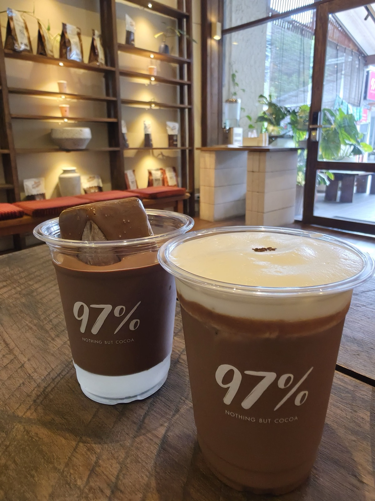

Then to the Silver Temple for some photos

<iframe src="https://www.google.com/maps/embed?pb=!1m18!1m12!1m3!1d5025.9501467987675!2d98.98300913481246!3d18.77996103887466!2m3!1f0!2f0!3f0!3m2!1i1024!2i768!4f13.1!3m3!1m2!1s0x30da3076509e5cf3%3A0x196337361614f763!2sWat%20Sri%20Suphan%20-%20Silver%20Temple!5e0!3m2!1szh-TW!2stw!4v1784888545943!5m2!1szh-TW!2stw" width="600" height="450" style="border:0;" allowfullscreen="" loading="lazy" referrerpolicy="strict-origin-when-cross-origin"></iframe>

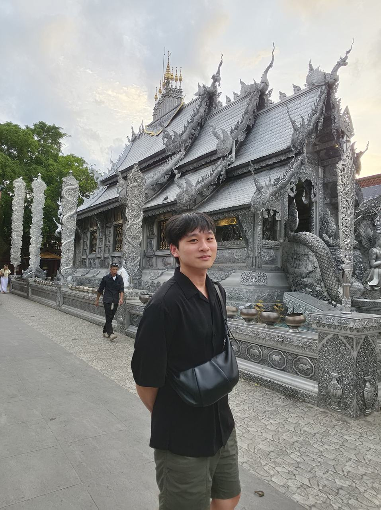

Then we walked to a super local night market for dinner. Dinner here is really cheap and tasty

<iframe src="https://www.google.com/maps/embed?pb=!1m18!1m12!1m3!1d8824.015909736629!2d98.97792603251649!3d18.775416510962618!2m3!1f0!2f0!3f0!3m2!1i1024!2i768!4f13.1!3m3!1m2!1s0x30da307aa315f9b3%3A0x4887c95501fd934d!2sKadmanee%20Market!5e0!3m2!1szh-TW!2stw!4v1784888582195!5m2!1szh-TW!2stw" width="600" height="450" style="border:0;" allowfullscreen="" loading="lazy" referrerpolicy="strict-origin-when-cross-origin"></iframe>

## Day 4

Today's plan was a stroll around One Nimman

First up, a Michelin-listed spot every influencer goes to: khao soi, the Northern Thai curry noodles. Tasty and on the spicy side, and still really cheap

<iframe src="https://www.google.com/maps/embed?pb=!1m18!1m12!1m3!1d8822.86248770335!2d98.96927969118532!3d18.797434891198897!2m3!1f0!2f0!3f0!3m2!1i1024!2i768!4f13.1!3m3!1m2!1s0x30da3a8c1eaccca9%3A0x45f0468a756c49e8!2sKhao%20Soi%20Maesai!5e0!3m2!1szh-TW!2stw!4v1784888711865!5m2!1szh-TW!2stw" width="600" height="450" style="border:0;" allowfullscreen="" loading="lazy" referrerpolicy="strict-origin-when-cross-origin"></iframe>

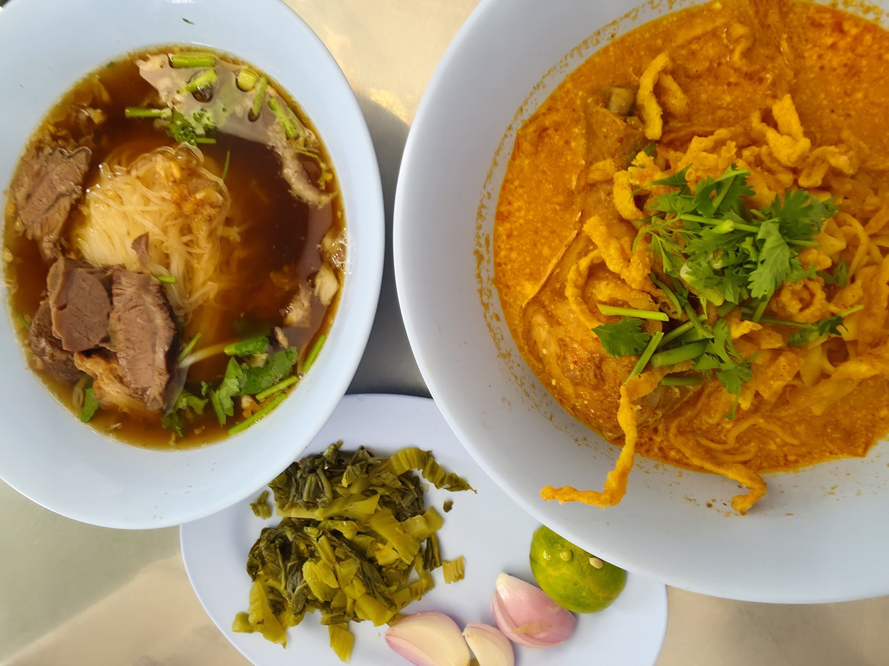

Then we started shopping around the lovely One Nimman. Prices here are relatively high, so think it over before you buy

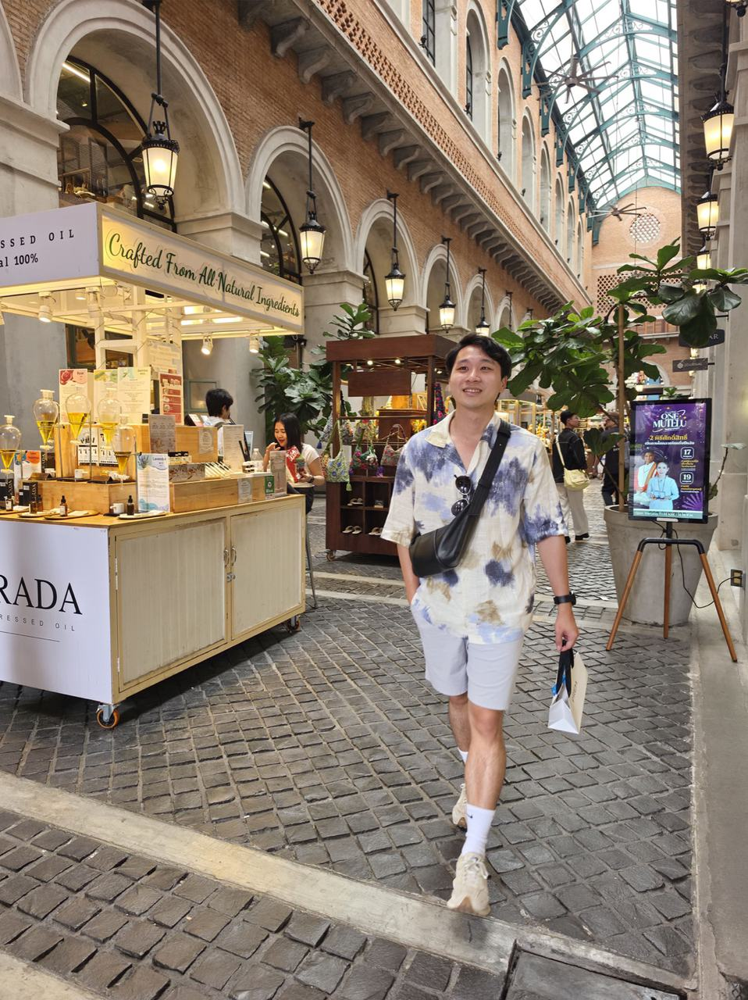

We had dinner at a night market near One Nimman. It's a very local market and everything is cheap

<iframe src="https://www.google.com/maps/embed?pb=!1m18!1m12!1m3!1d9641.632066693039!2d98.96544952197613!3d18.793855436826558!2m3!1f0!2f0!3f0!3m2!1i1024!2i768!4f13.1!3m3!1m2!1s0x30da3b006f59847d%3A0x1b14452fe2822933!2sThae%20Market%20CNX!5e0!3m2!1szh-TW!2stw!4v1784908510585!5m2!1szh-TW!2stw" width="600" height="450" style="border:0;" allowfullscreen="" loading="lazy" referrerpolicy="strict-origin-when-cross-origin"></iframe>

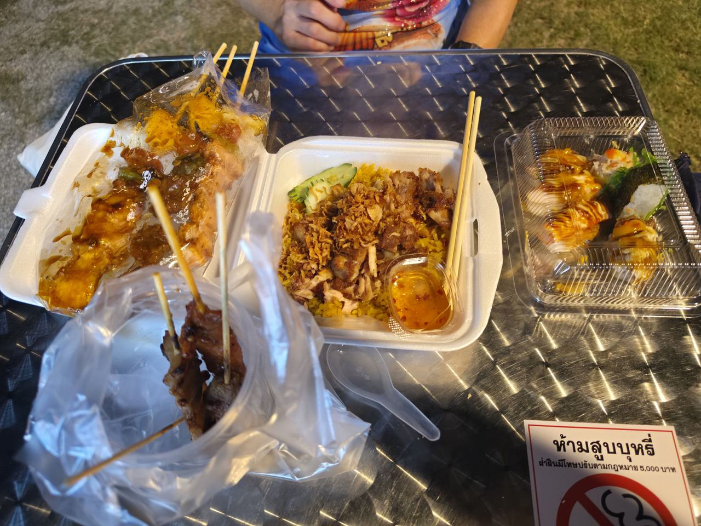

## Day 5

Since we were going to the zoo in the afternoon, we decided to spend the morning at a market north of the Old City

Breakfast was a more Western-style sandwich. A bit pricier, but I really liked it

<iframe src="https://www.google.com/maps/embed?pb=!1m18!1m12!1m3!1d9641.544464026136!2d98.97708901383821!3d18.79538511504291!2m3!1f0!2f0!3f0!3m2!1i1024!2i768!4f13.1!3m3!1m2!1s0x30da3b5174e271c5%3A0xbfb96f9a8aeb11fd!2sTUA%20CRAFT%20KRUB!5e0!3m2!1szh-TW!2stw!4v1784909928824!5m2!1szh-TW!2stw" width="600" height="450" style="border:0;" allowfullscreen="" loading="lazy" referrerpolicy="strict-origin-when-cross-origin"></iframe>

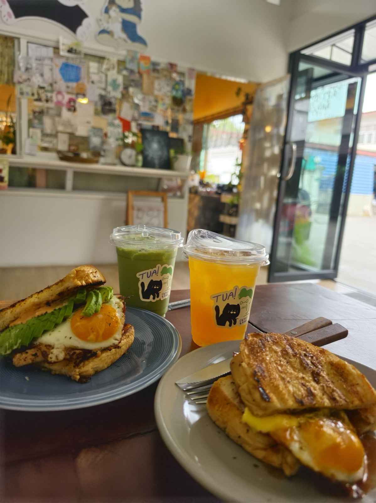

Then we went to the local market to browse the food and the stuff locals sell

<iframe src="https://www.google.com/maps/embed?pb=!1m18!1m12!1m3!1d9641.121213040482!2d98.98160787538474!3d18.80277404288477!2m3!1f0!2f0!3f0!3m2!1i1024!2i768!4f13.1!3m3!1m2!1s0x30da3a93528c42c7%3A0x46fa3229ce4545bc!2sSiri%20Wattana%20Market!5e0!3m2!1szh-TW!2stw!4v1784910001062!5m2!1szh-TW!2stw" width="600" height="450" style="border:0;" allowfullscreen="" loading="lazy" referrerpolicy="strict-origin-when-cross-origin"></iframe>

We found a local Michelin-listed noodle shop. On the spicy side, but delicious

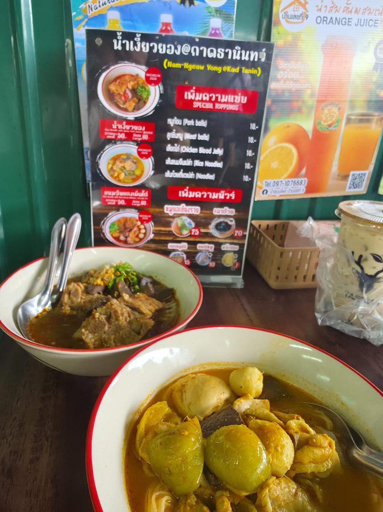

We went back to the hotel to rest a bit, and at 3 p.m. the tour we'd booked picked us up for the zoo

It's a night zoo (the Chiang Mai Night Safari), but even so I'd suggest arriving around 3 p.m. A lot of the activities run between 4 and 8 p.m., and if you come too late you'll miss many of them

<iframe src="https://www.google.com/maps/embed?pb=!1m18!1m12!1m3!1d30226.00399824386!2d98.90036914132519!3d18.742344624682797!2m3!1f0!2f0!3f0!3m2!1i1024!2i768!4f13.1!3m3!1m2!1s0x30da37293ac232bf%3A0xcaafc0bee2a3f81a!2z5riF6YKB5aSc6ZaT5YuV54mp5ZyS!5e0!3m2!1szh-TW!2stw!4v1784910132333!5m2!1szh-TW!2stw" width="600" height="450" style="border:0;" allowfullscreen="" loading="lazy" referrerpolicy="strict-origin-when-cross-origin"></iframe>

My favorite part was the tram ride through the savanna animals, where you get to feed the animals and interact with them

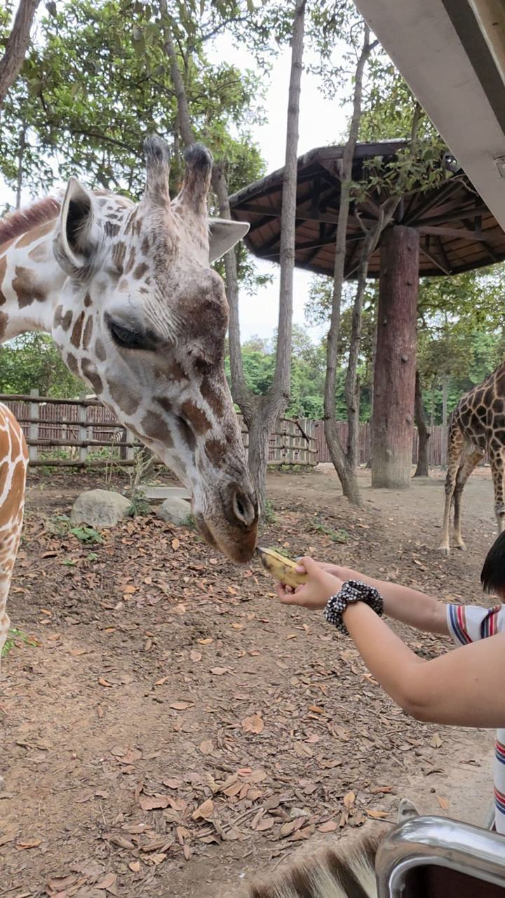

Back in town we had dinner at a Thai restaurant. A bit pricey and strongly seasoned, but really good

<iframe src="https://www.google.com/maps/embed?pb=!1m18!1m12!1m3!1d4127.718670256446!2d98.98199639180768!3d18.786033775451372!2m3!1f0!2f0!3f0!3m2!1i1024!2i768!4f13.1!3m3!1m2!1s0x30da3b2a09eeabe3%3A0x67d01b281536a753!2sLookbua%20thai%20food%20Restaurant!5e0!3m2!1szh-TW!2stw!4v1784910344574!5m2!1szh-TW!2stw" width="600" height="450" style="border:0;" allowfullscreen="" loading="lazy" referrerpolicy="strict-origin-when-cross-origin"></iframe>

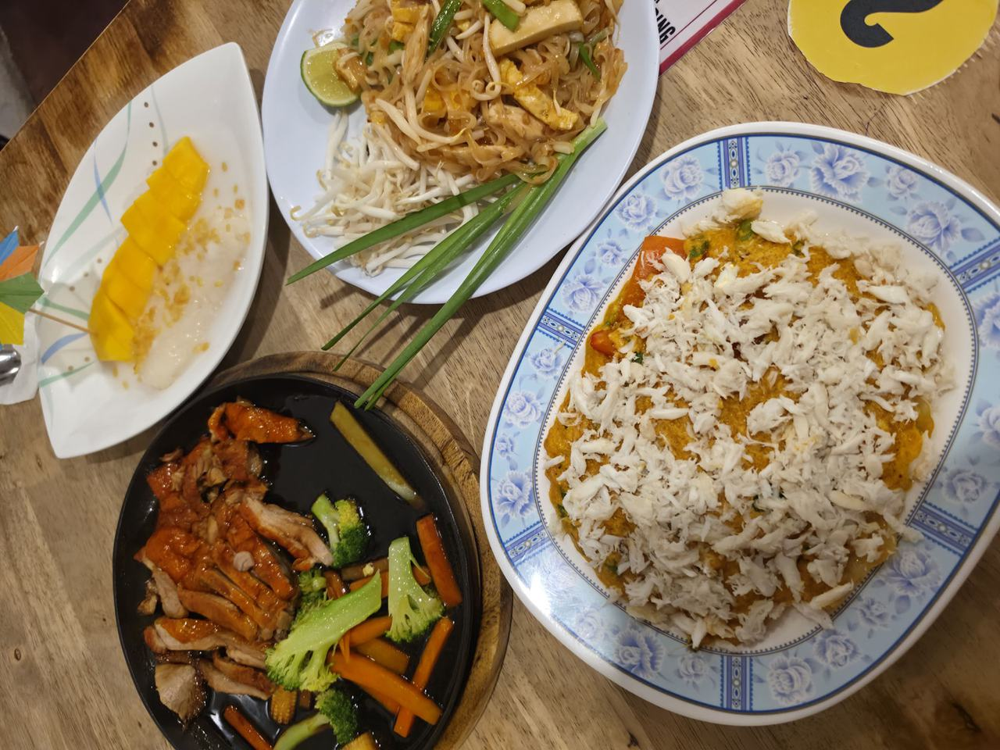

## Day 6 Chiang Rai Day Trip

We did this on a Saturday. I originally wanted to check out the Chiang Rai night market, but that wasn't part of the tour. It also rained nonstop in Chiang Rai that day

First stop was the Long Neck Village, then some nearby hot springs

### Wat Rong Khun (White Temple)

Next was the White Temple, the part I was most looking forward to. The handcrafted details and the all-white buildings make it especially captivating

<iframe src="https://www.google.com/maps/embed?pb=!1m18!1m12!1m3!1d3753.394196499903!2d99.76013357461352!3d19.82326688154133!2m3!1f0!2f0!3f0!3m2!1i1024!2i768!4f13.1!3m3!1m2!1s0x30d7b7dfce59940f%3A0x2afcd50d8eacb7a3!2z55m96b6N5a-6!5e0!3m2!1szh-TW!2stw!4v1784910707073!5m2!1szh-TW!2stw" width="600" height="450" style="border:0;" allowfullscreen="" loading="lazy" referrerpolicy="strict-origin-when-cross-origin"></iframe>

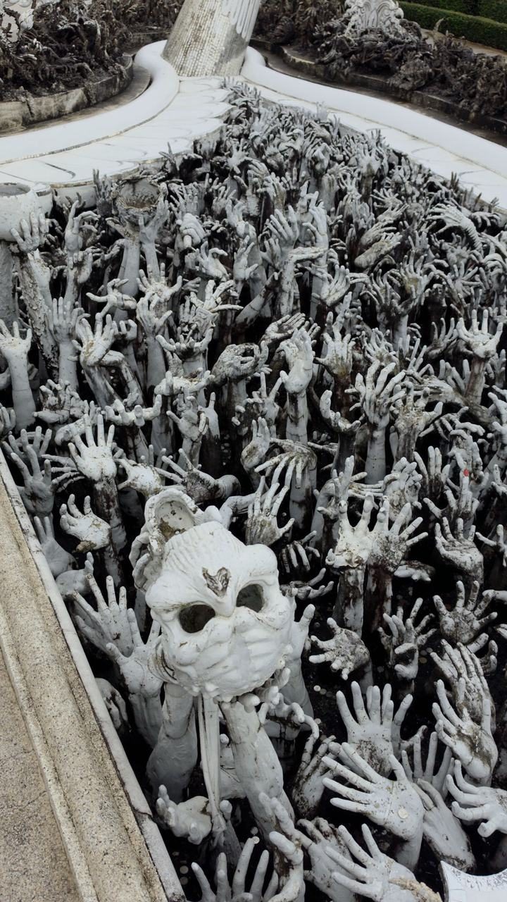

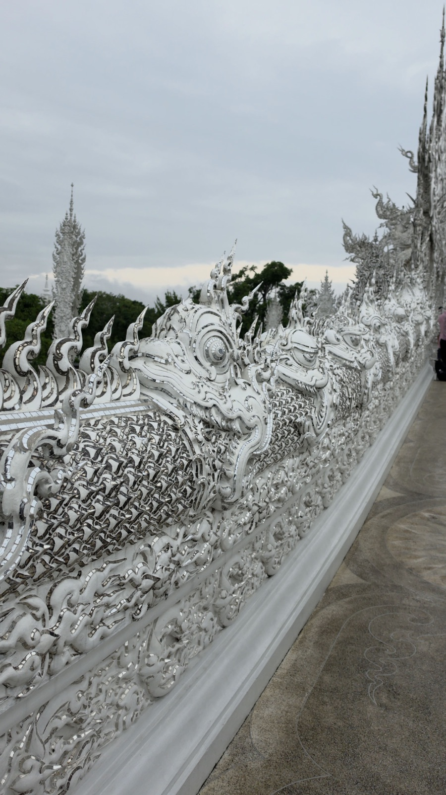

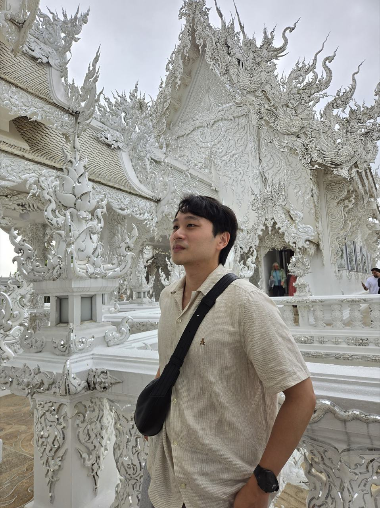

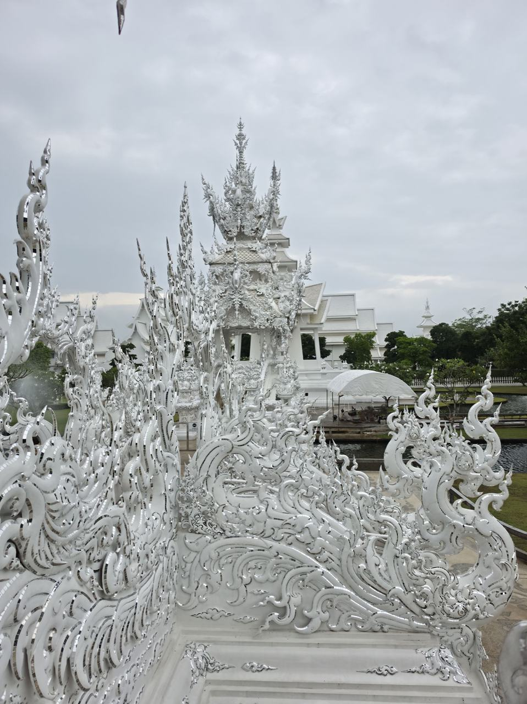

### Blue Temple

Then we arrived at the Blue Temple. The craftsmanship is really fine

<iframe src="https://www.google.com/maps/embed?pb=!1m18!1m12!1m3!1d3751.025444240106!2d99.8391580746164!3d19.9233325814636!2m3!1f0!2f0!3f0!3m2!1i1024!2i768!4f13.1!3m3!1m2!1s0x30d70700425011f9%3A0x30e6a8a31348764d!2z5riF6JCK6JeN5buf!5e0!3m2!1szh-TW!2stw!4v1784910787241!5m2!1szh-TW!2stw" width="600" height="450" style="border:0;" allowfullscreen="" loading="lazy" referrerpolicy="strict-origin-when-cross-origin"></iframe>

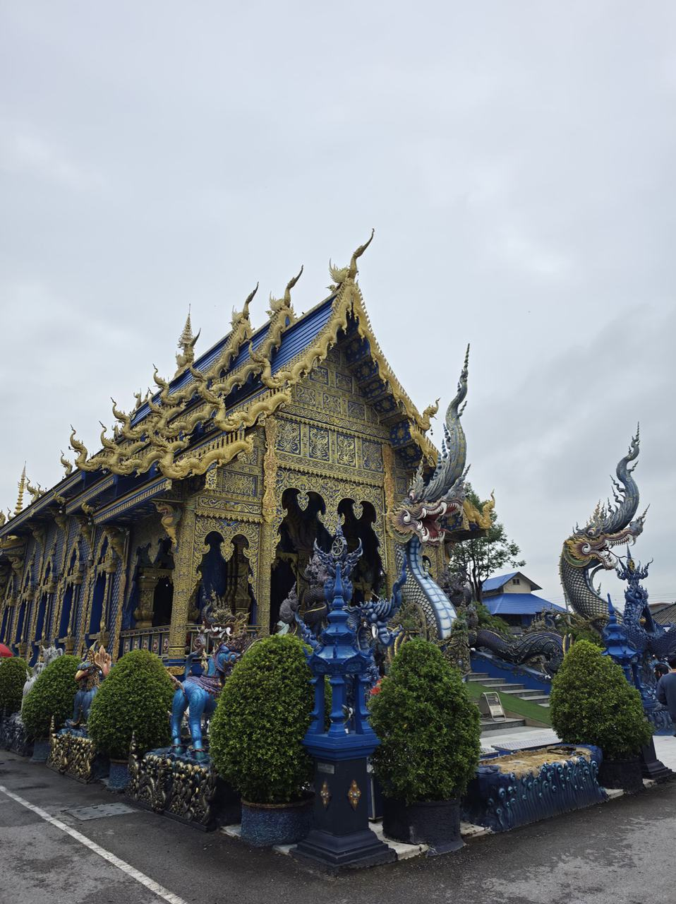

### Baan Dam Museum (Black House)

Our last stop was the Black House. It's a collection of many wooden buildings, displaying works by Thawan Duchanee and other contemporary Thai artists.

<iframe src="https://www.google.com/maps/embed?pb=!1m18!1m12!1m3!1d3749.391483740269!2d99.8602155!3d19.9920776!2m3!1f0!2f0!3f0!3m2!1i1024!2i768!4f13.1!3m3!1m2!1s0x30d7005000000001%3A0x817acc24f7e9bb96!2z6buR5bGL5Y2a54mp6aSo!5e0!3m2!1szh-TW!2stw!4v1784910958461!5m2!1szh-TW!2stw" width="600" height="450" style="border:0;" allowfullscreen="" loading="lazy" referrerpolicy="strict-origin-when-cross-origin"></iframe>

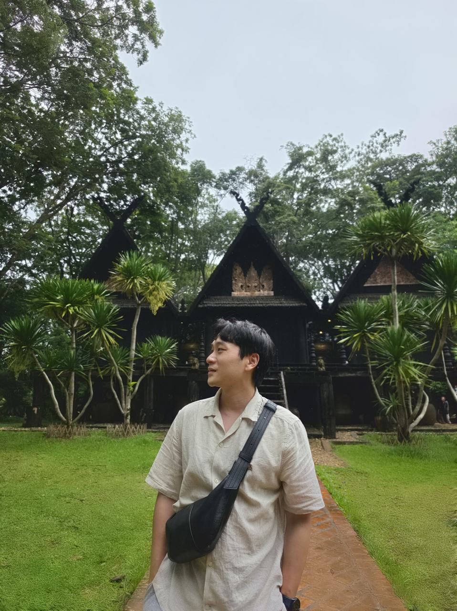

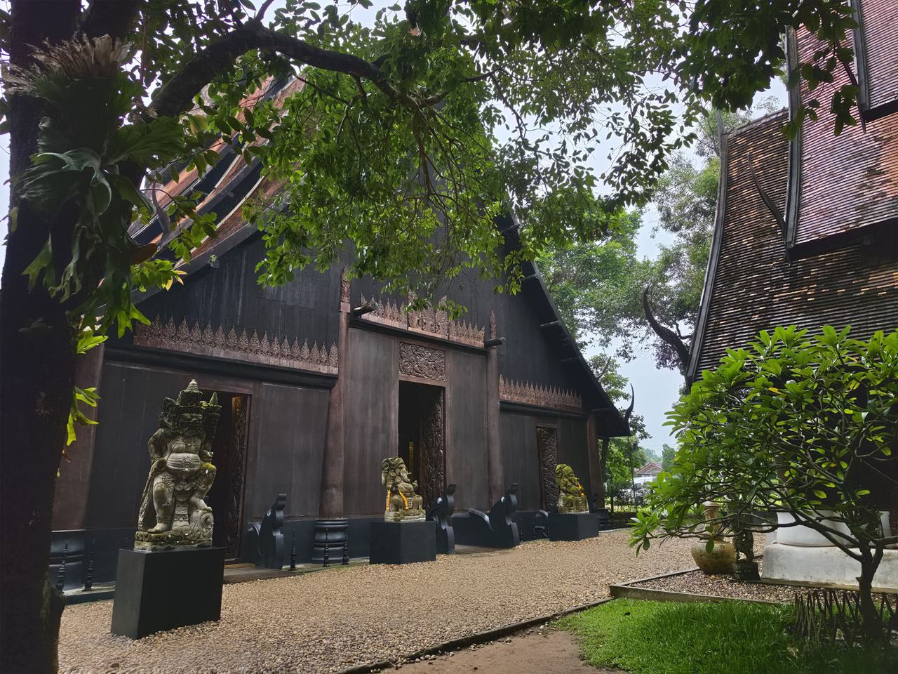

Back in Chiang Mai, we went to the Saturday night market. Cheap, tasty food and lots to browse

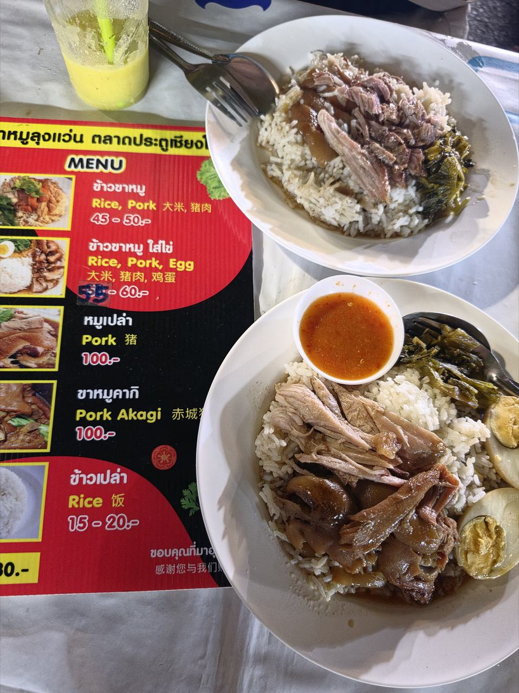

## Day 7

We walked around Jing Jai Market. There are lots of small accessories, clothes and so on, but I also found the prices on the high side. My mom and I just browsed quickly and at most grabbed lunch there before leaving, but for a lot of girls this is the kind of place where you totally lose control of your wallet

<iframe src="https://www.google.com/maps/embed?pb=!1m18!1m12!1m3!1d24783.578309747973!2d98.98169586717447!3d18.78976765884111!2m3!1f0!2f0!3f0!3m2!1i1024!2i768!4f13.1!3m3!1m2!1s0x30da3ac0cb5efccd%3A0x9fbfb1d2cc918b06!2sJing%20Jai%20Market%20Chiang%20Mai!5e0!3m2!1szh-TW!2stw!4v1784911227494!5m2!1szh-TW!2stw" width="600" height="450" style="border:0;" allowfullscreen="" loading="lazy" referrerpolicy="strict-origin-when-cross-origin"></iframe>

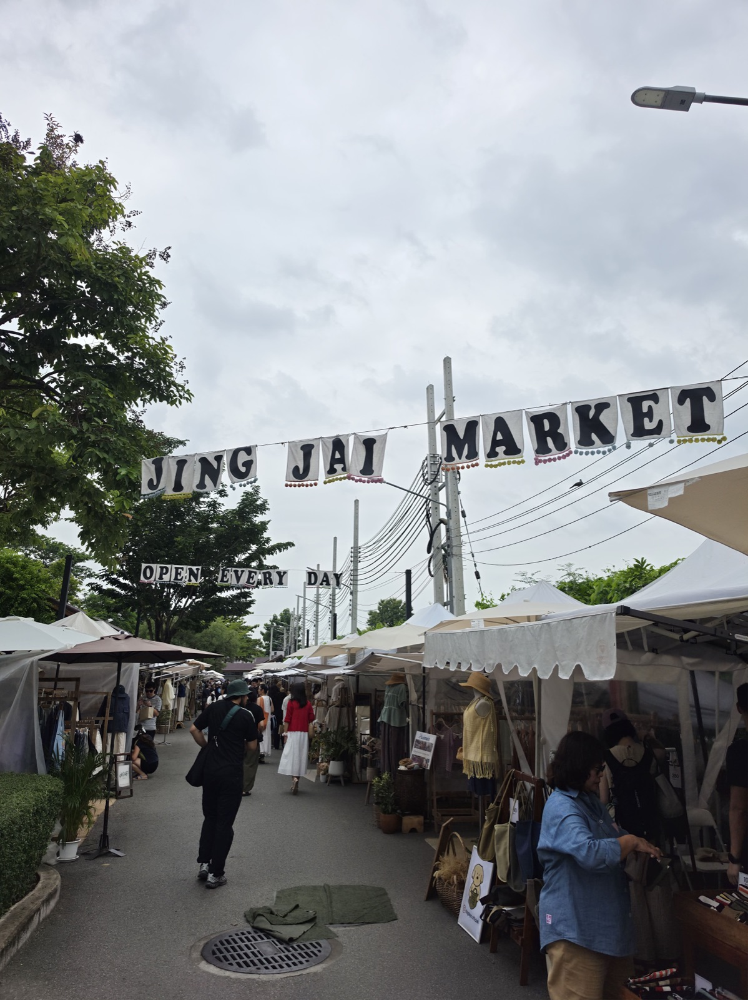

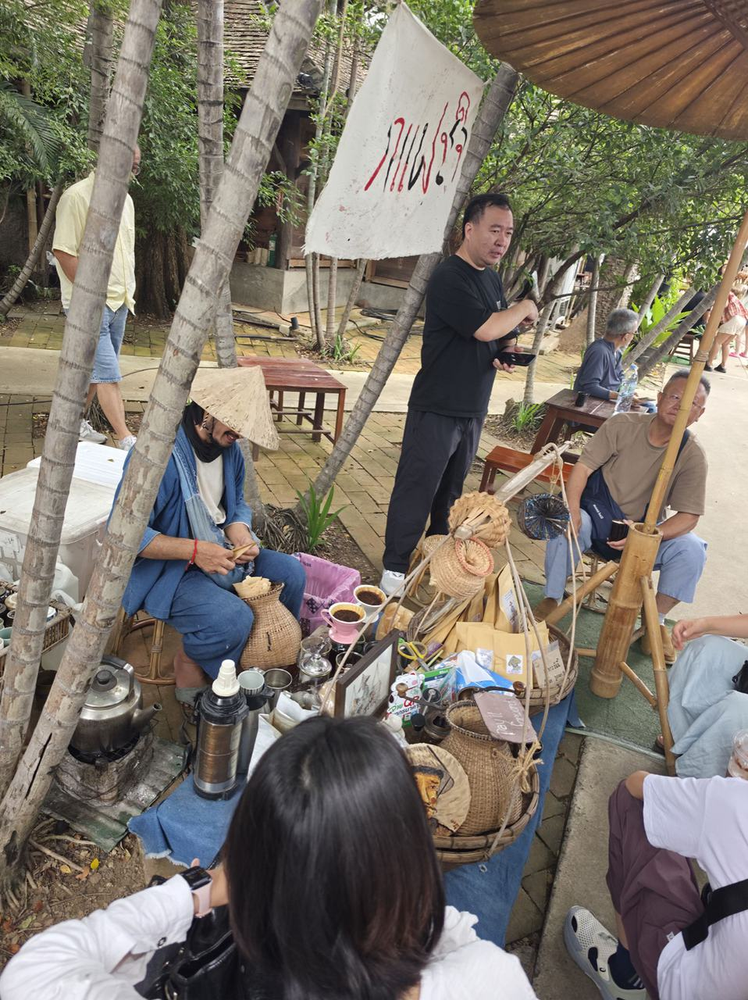

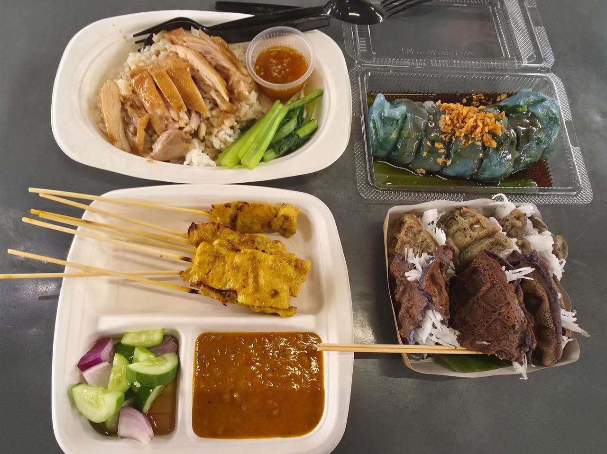

On the walk back to the Old City there were lots of cheap secondhand clothes

We passed the bamboo-weaving street, which has tons of bamboo goods. The most famous shop is Chou Kuei Fa (周桂發), where lots of influencers come to take photos

<iframe src="https://www.google.com/maps/embed?pb=!1m18!1m12!1m3!1d5032.670313525297!2d98.99339929650216!3d18.78842453217269!2m3!1f0!2f0!3f0!3m2!1i1024!2i768!4f13.1!3m3!1m2!1s0x30da3b015c988b4f%3A0x58d48ac076b02ebe!2z5ZGo5qGC55m8!5e0!3m2!1szh-TW!2stw!4v1784911257527!5m2!1szh-TW!2stw" width="600" height="450" style="border:0;" allowfullscreen="" loading="lazy" referrerpolicy="strict-origin-when-cross-origin"></iframe>

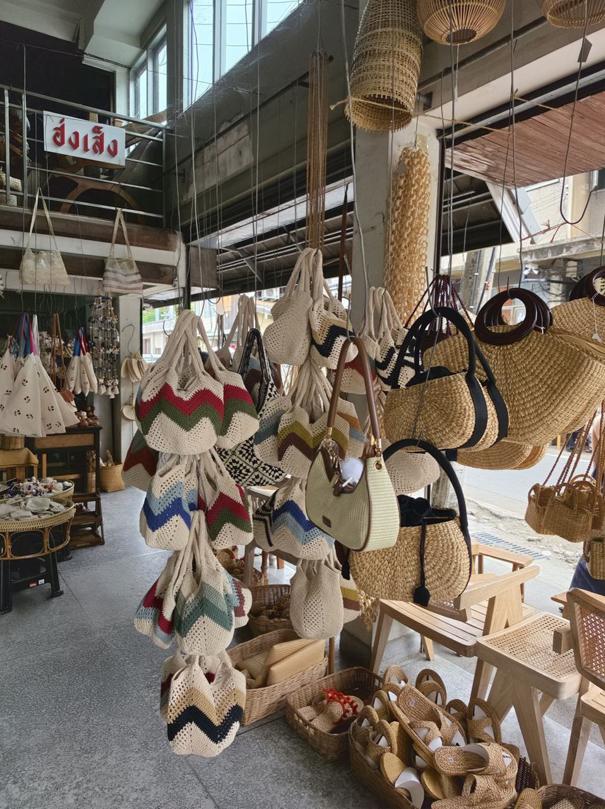

Here we tried Tok Sen, a wooden-mallet massage. It feels a lot like getting chopped hard on the back with the side of a hand, and some spots really hurt

<iframe src="https://www.google.com/maps/embed?pb=!1m18!1m12!1m3!1d1074.2509300232753!2d98.99573665752757!3d18.78761665706035!2m3!1f0!2f0!3f0!3m2!1i1024!2i768!4f13.1!3m3!1m2!1s0x30da3aa392cebc6b%3A0xcf1092d4ad3a47a1!2sWat%20Mahawan!5e0!3m2!1szh-TW!2stw!4v1784911401329!5m2!1szh-TW!2stw" width="600" height="450" style="border:0;" allowfullscreen="" loading="lazy" referrerpolicy="strict-origin-when-cross-origin"></iframe>

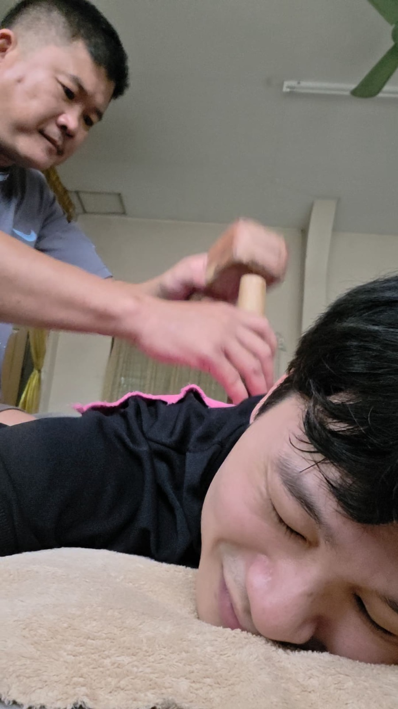

Then we explored the Chiang Mai Sunday night market. It's absolutely huge, like everyone in Chiang Mai comes to set up a stall. There are thousands of vendors, though a lot of them sell similar stuff. Prices are relatively low, so it's a good place to hunt for bargains

It starts at the Old City gate, and pretty much everything down from there is part of the market

<iframe src="https://www.google.com/maps/embed?pb=!1m18!1m12!1m3!1d2939.011227472366!2d98.99109289338996!3d18.787630447592065!2m3!1f0!2f0!3f0!3m2!1i1024!2i768!4f13.1!3m3!1m2!1s0x30da3aa23421c875%3A0x9d3b8fabe43926f6!2sTha%20Phae%20Gate!5e0!3m2!1szh-TW!2stw!4v1784911621775!5m2!1szh-TW!2stw" width="600" height="450" style="border:0;" allowfullscreen="" loading="lazy" referrerpolicy="strict-origin-when-cross-origin"></iframe>

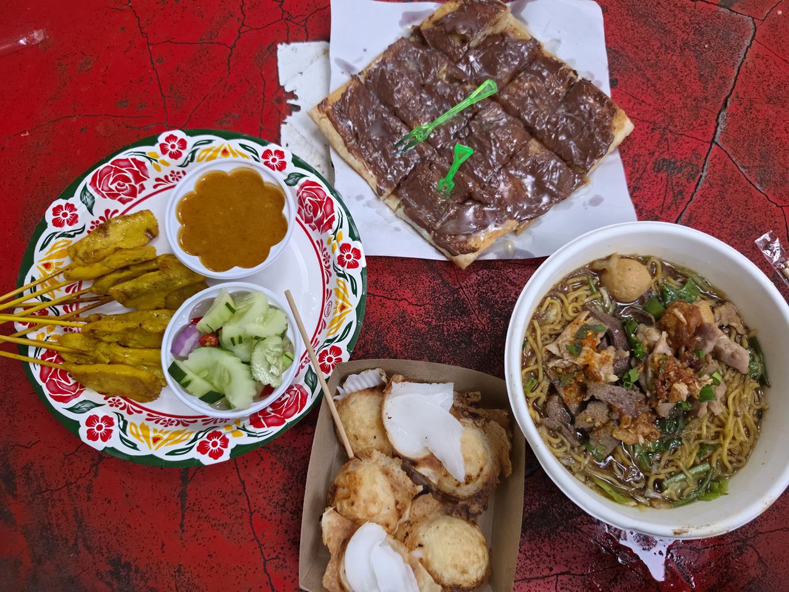

## Day 8

First thing this morning we went to Wat Chiang Man, the oldest temple in the Old City

<iframe src="https://www.google.com/maps/embed?pb=!1m18!1m12!1m3!1d8062.907504143433!2d98.98616820098404!3d18.791210448216006!2m3!1f0!2f0!3f0!3m2!1i1024!2i768!4f13.1!3m3!1m2!1s0x30da3a97936133d7%3A0x6e33b1cdc659f2dd!2z5riF5pu85a-6!5e0!3m2!1szh-TW!2stw!4v1784911696163!5m2!1szh-TW!2stw" width="600" height="450" style="border:0;" allowfullscreen="" loading="lazy" referrerpolicy="strict-origin-when-cross-origin"></iframe>

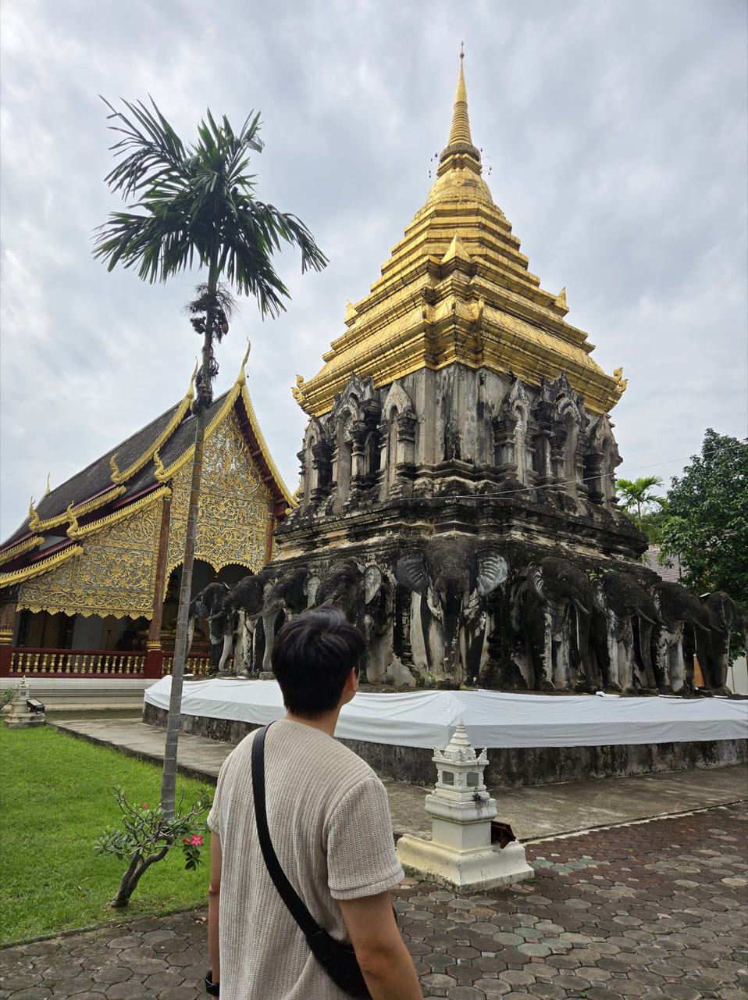

We had the traditional Northern Thai breakfast that lots of people online recommend. The highlight is the pandan custard with bread, which is amazing

<iframe src="https://www.google.com/maps/embed?pb=!1m18!1m12!1m3!1d8062.86078564419!2d98.99067995712598!3d18.792186117027192!2m3!1f0!2f0!3f0!3m2!1i1024!2i768!4f13.1!3m3!1m2!1s0x30da3b1eb73bcfc9%3A0xd5900dcc3e547009!2sTai%20Thun%20Baan!5e0!3m2!1szh-TW!2stw!4v1784911816297!5m2!1szh-TW!2stw" width="600" height="450" style="border:0;" allowfullscreen="" loading="lazy" referrerpolicy="strict-origin-when-cross-origin"></iframe>

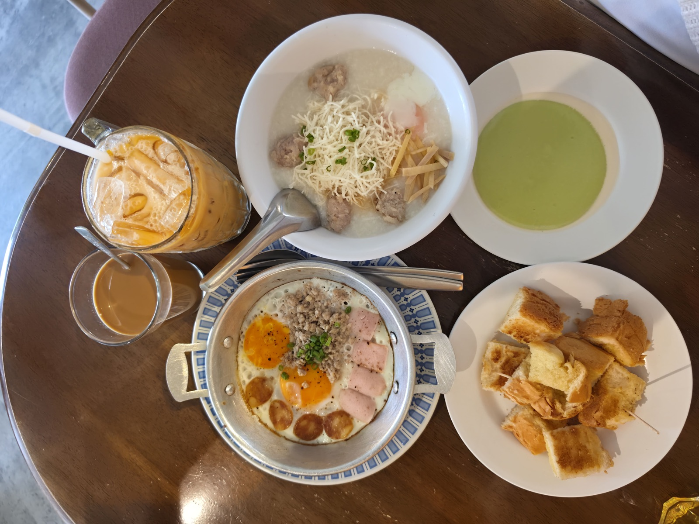

Then we went to Warorot Market. It's a great place to buy gifts and dried fruit, much cheaper than the supermarkets. My mom and I bought lots of dried mango and dried coconut, plus some pharmacy and beauty products

<iframe src="https://www.google.com/maps/embed?pb=!1m18!1m12!1m3!1d8062.86078564419!2d98.99067995712598!3d18.792186117027192!2m3!1f0!2f0!3f0!3m2!1i1024!2i768!4f13.1!3m3!1m2!1s0x30da3b3a2f7c7151%3A0x24c07f18fcb56c40!2sWaroros%20Market!5e0!3m2!1szh-TW!2stw!4v1784911846496!5m2!1szh-TW!2stw" width="600" height="450" style="border:0;" allowfullscreen="" loading="lazy" referrerpolicy="strict-origin-when-cross-origin"></iframe>

After shopping we had Hainanese chicken rice here. Super tasty and very reasonably priced

<iframe src="https://www.google.com/maps/embed?pb=!1m18!1m12!1m3!1d7358.325026429738!2d98.9919468778969!3d18.782204270802364!2m3!1f0!2f0!3f0!3m2!1i1024!2i768!4f13.1!3m3!1m2!1s0x30da31c3b4729ab7%3A0xbb8cdf3d8b5bdc49!2z5riF6YKB5p2R5rCR6be55Zi06LGG5rW35Y2X6Zue6aOv!5e0!3m2!1szh-TW!2stw!4v1784911965654!5m2!1szh-TW!2stw" width="600" height="450" style="border:0;" allowfullscreen="" loading="lazy" referrerpolicy="strict-origin-when-cross-origin"></iframe>

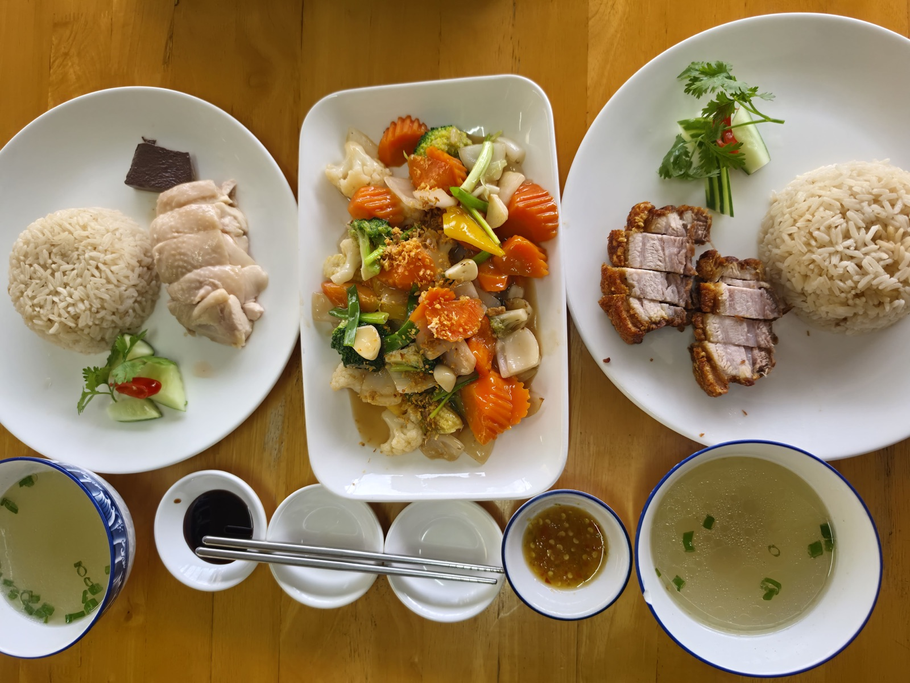

Next was the famous Mae Kha Canal, a riverside area that was renovated a while back. It feels a little bit like Japan

<iframe src="https://www.google.com/maps/embed?pb=!1m18!1m12!1m3!1d7358.325026429738!2d98.9919468778969!3d18.782204270802364!2m3!1f0!2f0!3f0!3m2!1i1024!2i768!4f13.1!3m3!1m2!1s0x30da3bb458d9dc27%3A0x2989451c5630692f!2sMae%20Kha%20Canal!5e0!3m2!1szh-TW!2stw!4v1784912070803!5m2!1szh-TW!2stw" width="600" height="450" style="border:0;" allowfullscreen="" loading="lazy" referrerpolicy="strict-origin-when-cross-origin"></iframe>

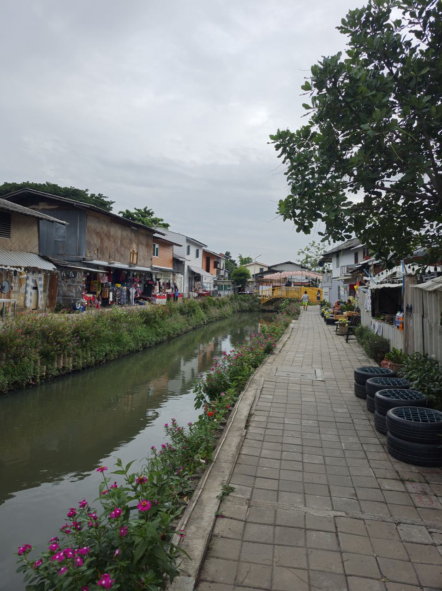

Here we tried a little craft activity turning a spoon into a ring. Really cheap, only 99 THB each

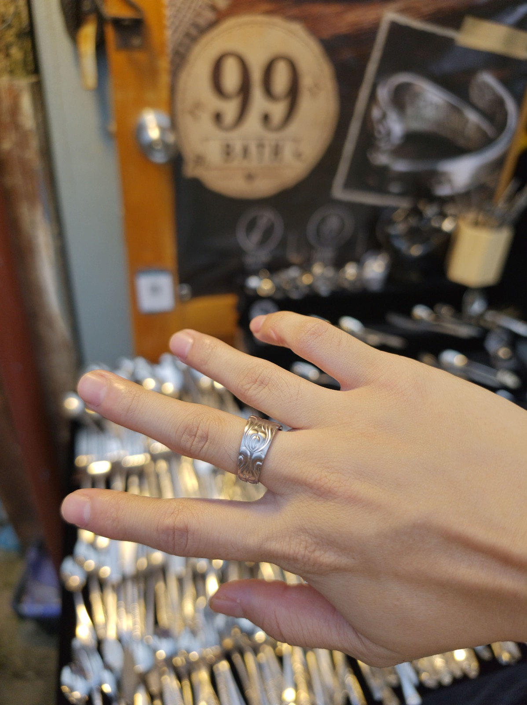

## Day 9

On the last day we tried the pad kra pao (basil pork rice) that influencers rave about. We took a number and waited almost an hour and a half for our turn. Honestly, it is tasty, but not worth that long a wait

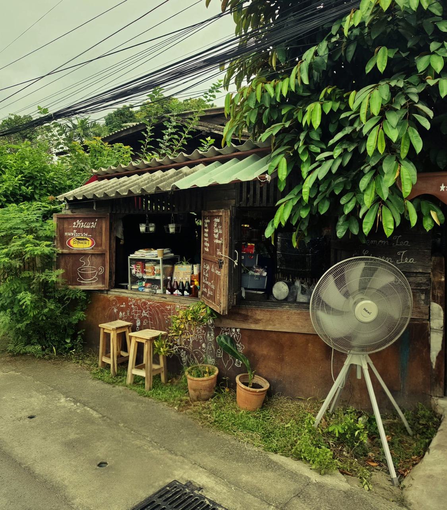

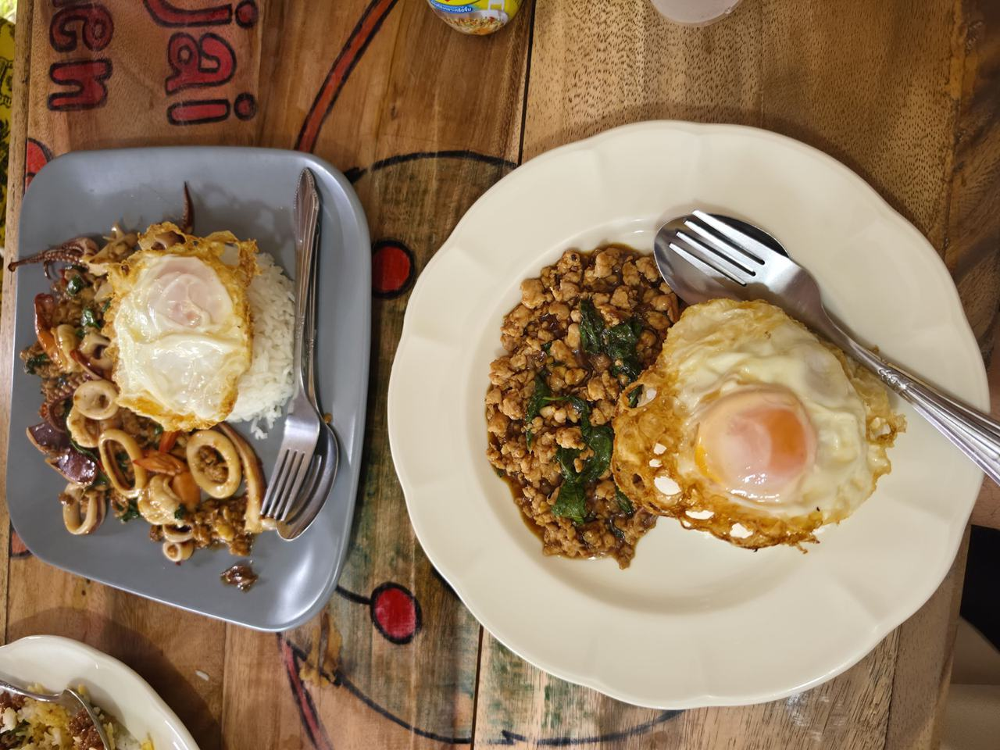

Then we took a ride to Wat Umong, a famous cave temple. Very solemn and very beautiful

<iframe src="https://www.google.com/maps/embed?pb=!1m18!1m12!1m3!1d21044.242477729298!2d98.95697634234276!3d18.784975533724815!2m3!1f0!2f0!3f0!3m2!1i1024!2i768!4f13.1!3m3!1m2!1s0x30da3a706f40689d%3A0xedef9aa39d595059!2z5oKf5a2f5a-6!5e0!3m2!1szh-TW!2stw!4v1784912387107!5m2!1szh-TW!2stw" width="600" height="450" style="border:0;" allowfullscreen="" loading="lazy" referrerpolicy="strict-origin-when-cross-origin"></iframe>

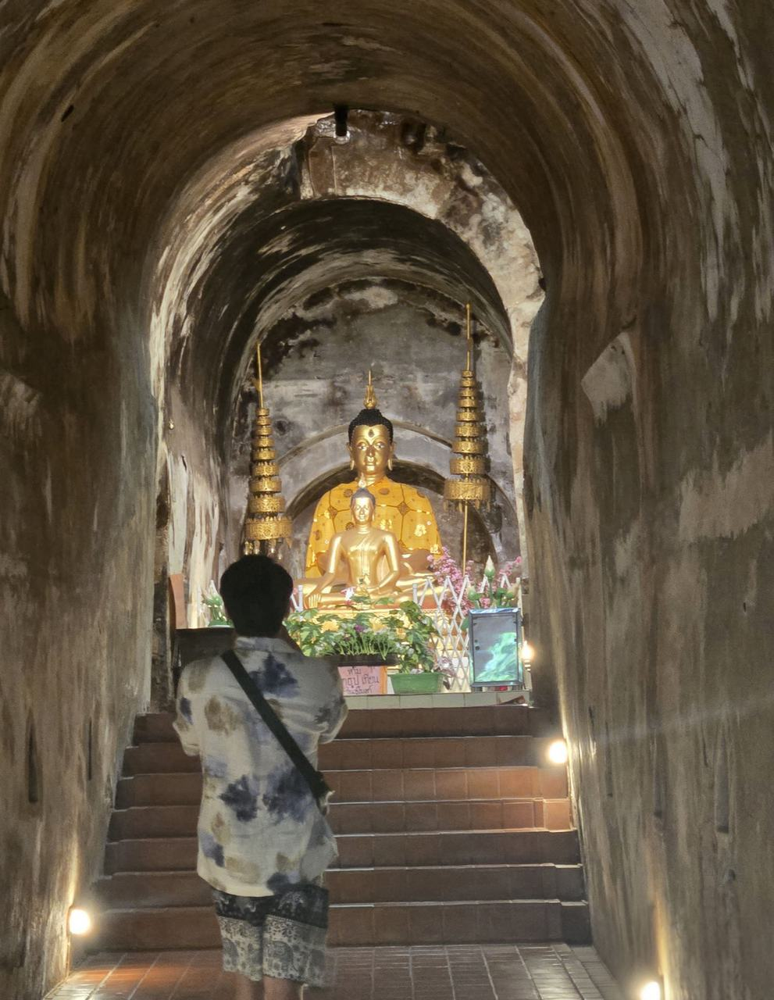

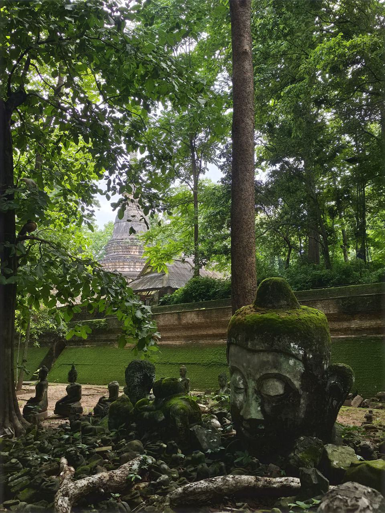

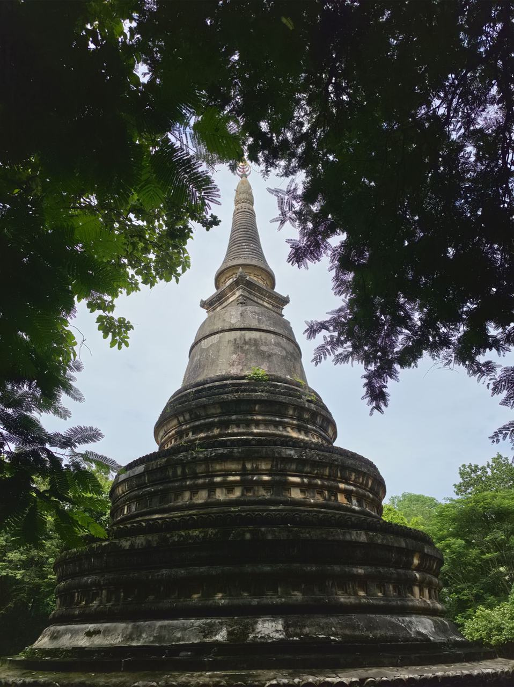

Our final stop was Baan Kang Wat. It's full of cute little shops and great for photos, but things are on the pricey side, so we just wandered around taking pictures

<iframe src="https://www.google.com/maps/embed?pb=!1m18!1m12!1m3!1d21044.67368971286!2d98.95362905526454!3d18.781523563263253!2m3!1f0!2f0!3f0!3m2!1i1024!2i768!4f13.1!3m3!1m2!1s0x30da3135abcf1377%3A0x5b0f6ce47286ce9f!2sBaan%20Kang%20Wat!5e0!3m2!1szh-TW!2stw!4v1784912498107!5m2!1szh-TW!2stw" width="600" height="450" style="border:0;" allowfullscreen="" loading="lazy" referrerpolicy="strict-origin-when-cross-origin"></iframe>

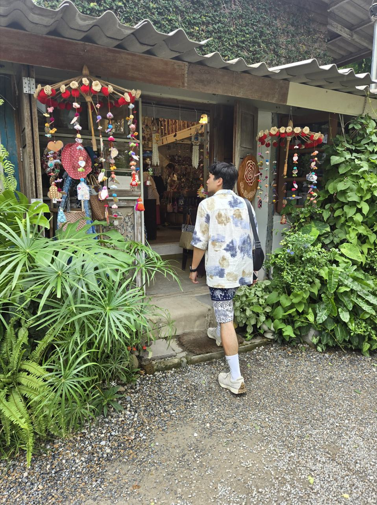

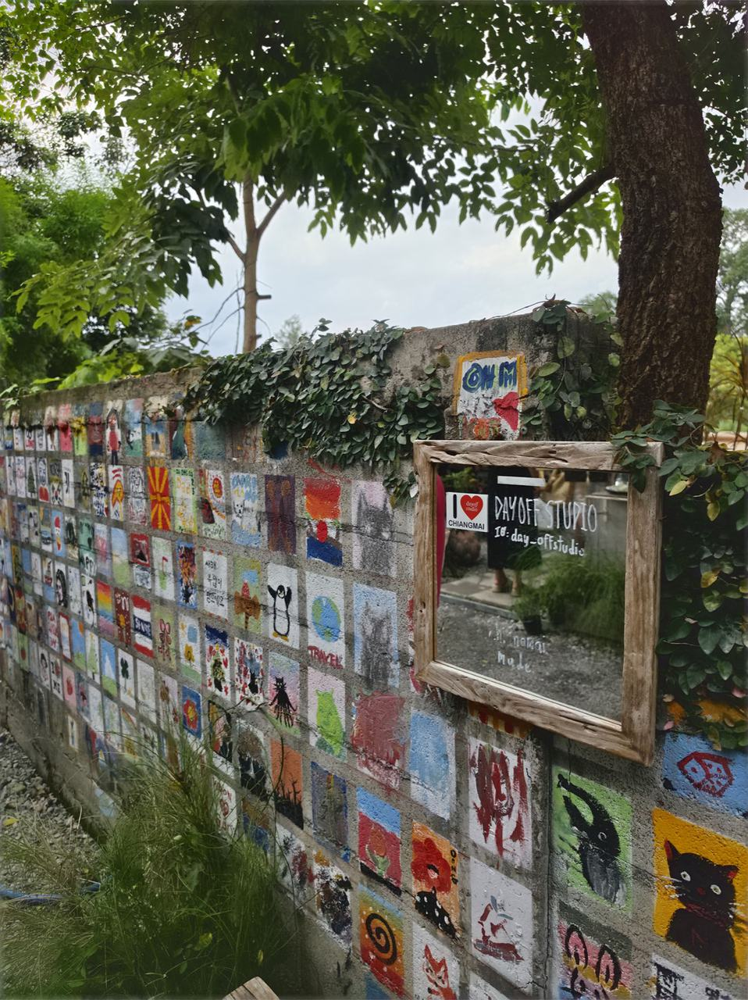

That evening, before our flight, we squeezed in one last massage. Massages here are so cheap: my mom and I got five in total

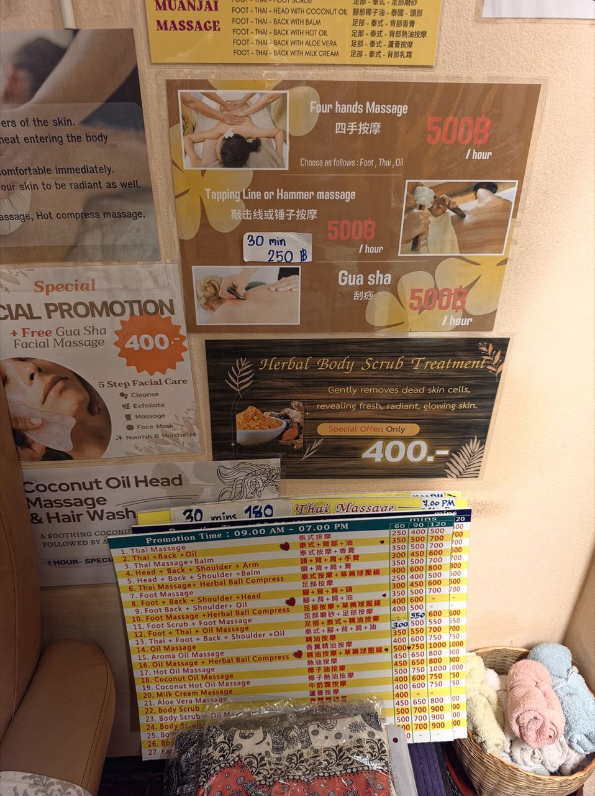

# Total Cost

Everything added up to about 56,000 for the two of us

1. Flights for two: about 24,000 (including one checked bag for the return; flights are so expensive these days)
2. Souvenirs and gifts: about 6,000 in total
3. Accommodation for 9 days for two: about 7,300 in total
4. Chiang Rai tour, elephant camp tour and Night Safari tickets: 5,500 in total for two
5. Massages: about 5,000 in total
6. Food, transportation, etc. for 9 days: under 9,000

# Thoughts

I really recommend spending a bit more time in Chiang Mai. Nine days felt just right for me. Honestly a lot of the markets are pretty similar, but each spot has its own character and photo spots. It felt like there were more foreigners than locals here, mostly Europeans and Americans. But the people of Chiang Mai are so friendly and honest. Some of the people I met even wanted to treat me to food for free, and they're honest in business too. I love the people and everything about this place. Thank you, Chiang Mai, for such wonderful memories~
