> 清邁人好親切
> 運氣很好，只有最後一天下雨，其他時候天氣都很好

[旅遊影片回憶：YouTube](https://www.youtube.com/shorts/FVwDx9CRbL8)

[旅遊影片回憶：YouTube](https://www.youtube.com/shorts/saS3HHk0i9I)

[旅遊影片回憶：YouTube](https://www.youtube.com/shorts/XQIewn7oDW0)

# 行前準備

1. 尤其在6~10月是雨季，所以每天多規劃好雨天行程
2. 行李可參考： https://www.tattpe.org.tw/HowToGo.html
3. 入境前需填寫TDAC，可參考： https://blog.eztravel.com.tw/thailand-entry-guide/
4. 換泰幣推薦在清邁這家換，看過超多家，沒有一家匯率好過他

<iframe src="https://www.google.com/maps/embed?pb=!1m18!1m12!1m3!1d2312.302663280039!2d98.99525315798228!3d18.787704707138047!2m3!1f0!2f0!3f0!3m2!1i1024!2i768!4f13.1!3m3!1m2!1s0x30da3aa46a2a9805%3A0x91a4e37a07c84752!2smr.pierre%20money%20exchange!5e0!3m2!1szh-TW!2stw!4v1784887629582!5m2!1szh-TW!2stw" width="600" height="450" style="border:0;" allowfullscreen="" loading="lazy" referrerpolicy="strict-origin-when-cross-origin"></iframe>

我們去清邁的時候沒有買托運行李，只有7公斤手提行李。
回程在清邁買行李箱，有20KG托運

# 行程規劃

清邁的整個環境圖，可以每天規劃一個區域慢慢閒逛，有許多意想不到的驚喜，也可以感受當地慢活的氛圍
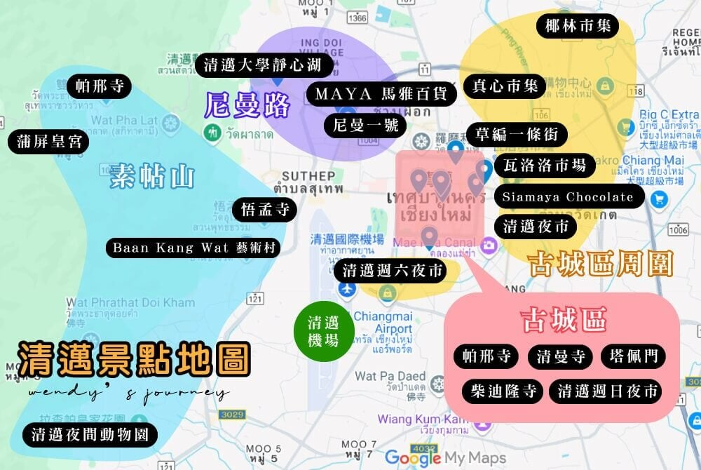

## Day 1

落地時間已經晚上10點，到民宿安置行李就去附近的夜市吃晚餐。

民宿是WERUN NIMBLY AN ORDINARY HOUSE CHIANG MAI，超級推薦，又超級便宜
<iframe src="https://www.google.com/maps/embed?pb=!1m18!1m12!1m3!1d20957.069169351584!2d98.97626297510458!3d18.78362644129409!2m3!1f0!2f0!3f0!3m2!1i1024!2i768!4f13.1!3m3!1m2!1s0x30da3b1db4f45cc9%3A0x29ce14b8e423b1cd!2sWERUN%20NIMBLY%20AN%20ORDINARY%20HOUSE%20CHIANG%20MAI!5e0!3m2!1szh-TW!2stw!4v1784886299148!5m2!1szh-TW!2stw" width="600" height="450" style="border:0;" allowfullscreen="" loading="lazy" referrerpolicy="strict-origin-when-cross-origin"></iframe>

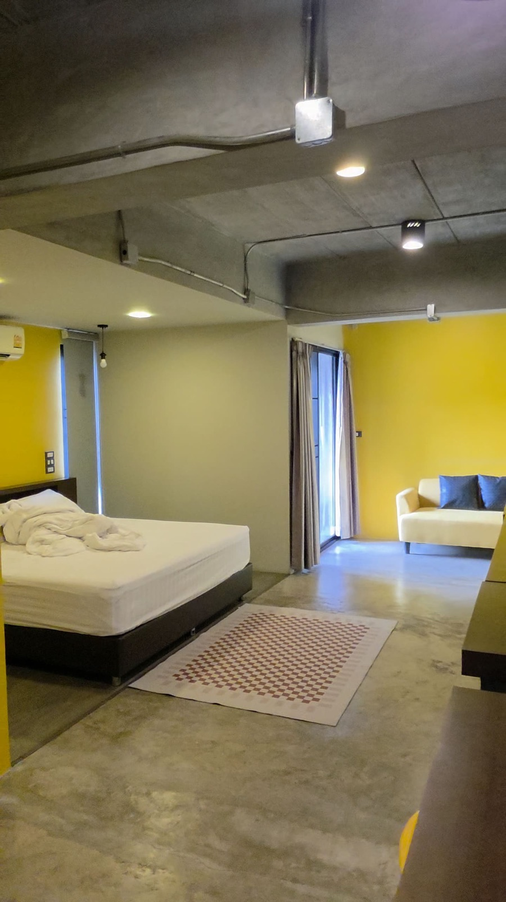

附近夜市 Chang Phuak Market

<iframe src="https://www.google.com/maps/embed?pb=!1m18!1m12!1m3!1d1811.6029807302612!2d98.985538467011!3d18.79508399296758!2m3!1f0!2f0!3f0!3m2!1i1024!2i768!4f13.1!3m3!1m2!1s0x30da3a9129fc858d%3A0x6fc6d33ee0ea5b19!2sChang%20Phuak%20Market!5e0!3m2!1szh-TW!2stw!4v1784886362052!5m2!1szh-TW!2stw" width="600" height="450" style="border:0;" allowfullscreen="" loading="lazy" referrerpolicy="strict-origin-when-cross-origin"></iframe>

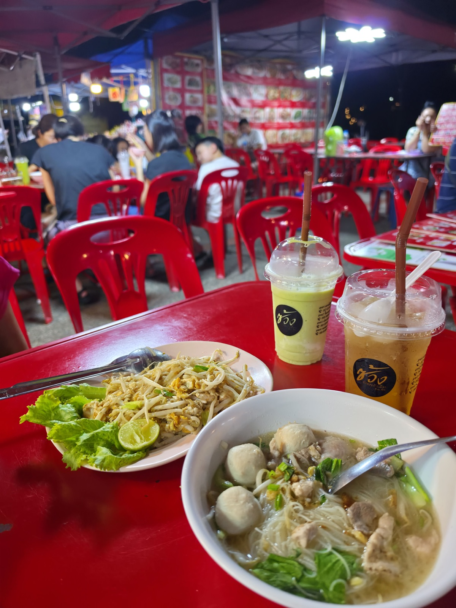

剛好路過有名的寺廟：羅摩利寺，晚上有莊嚴的感受

<iframe src="https://www.google.com/maps/embed?pb=!1m18!1m12!1m3!1d8029.346597291533!2d98.98117272380368!3d18.79326794237528!2m3!1f0!2f0!3f0!3m2!1i1024!2i768!4f13.1!3m3!1m2!1s0x30da3a9100c30075%3A0x37241441d3264a00!2z576F5pGp5Yip5a-6!5e0!3m2!1szh-TW!2stw!4v1784886527709!5m2!1szh-TW!2stw" width="600" height="450" style="border:0;" allowfullscreen="" loading="lazy" referrerpolicy="strict-origin-when-cross-origin"></iframe>

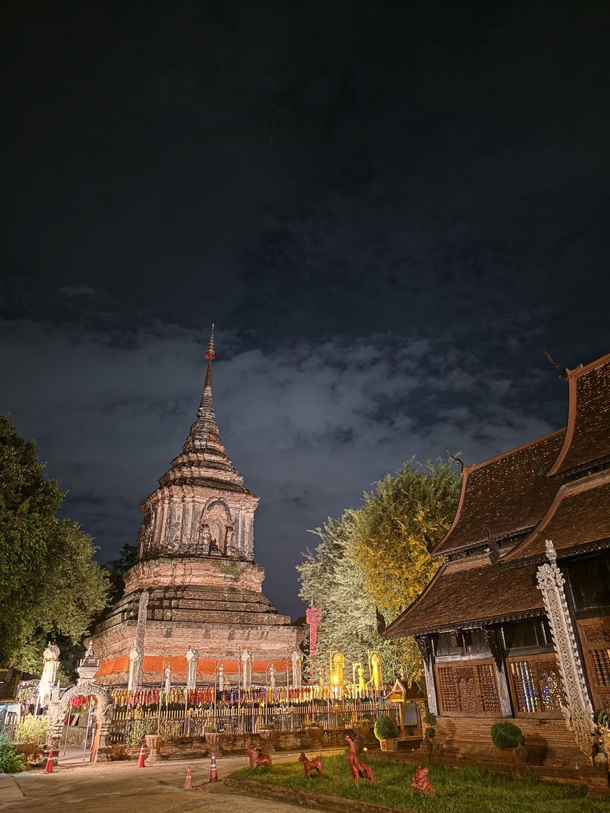

## Day 2

這天打算逛遍古城區。

順路經過帕邢寺，14 世紀的佛寺，擁有金銅佛像、壁畫和古代手稿。

<iframe src="https://www.google.com/maps/embed?pb=!1m18!1m12!1m3!1d7554.219219606661!2d98.98117272380368!3d18.79326794237528!2m3!1f0!2f0!3f0!3m2!1i1024!2i768!4f13.1!3m3!1m2!1s0x30da3a9b6e4a246f%3A0x9656d9e717cd54e9!2z5biV6YKi5a-6!5e0!3m2!1szh-TW!2stw!4v1784886874069!5m2!1szh-TW!2stw" width="600" height="450" style="border:0;" allowfullscreen="" loading="lazy" referrerpolicy="strict-origin-when-cross-origin"></iframe>

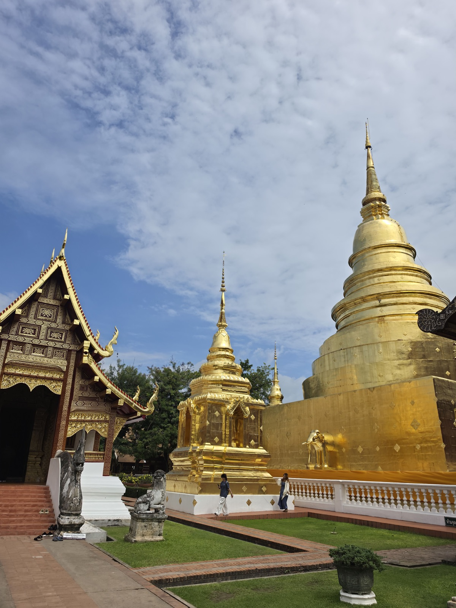

接著吃SO SOOD the good noodles l Authentic Thai-style l ก๋วยเตี๋ยวอร่อยโซซู้ด，推薦好吃。

<iframe src="https://www.google.com/maps/embed?pb=!1m18!1m12!1m3!1d7533.493047731483!2d98.98183624811841!3d18.78902631860651!2m3!1f0!2f0!3f0!3m2!1i1024!2i768!4f13.1!3m3!1m2!1s0x30da3b5f5aa9d6e5%3A0xa4919cb95b0794d4!2zU08gU09PRCB0aGUgZ29vZCBub29kbGVzIGwgQXV0aGVudGljIFRoYWktc3R5bGUgbCDguIHguYvguKfguKLguYDguJXguLXguYvguKLguKfguK3guKPguYjguK3guKLguYLguIvguIvguLnguYnguJQ!5e0!3m2!1szh-TW!2stw!4v1784886927604!5m2!1szh-TW!2stw" width="600" height="450" style="border:0;" allowfullscreen="" loading="lazy" referrerpolicy="strict-origin-when-cross-origin"></iframe>

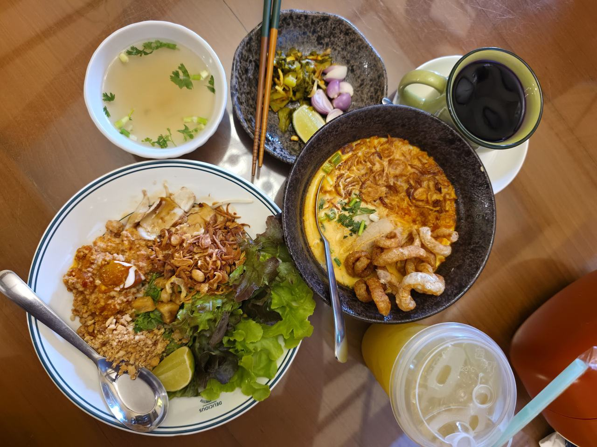

接著參觀 Kalm​ Village​ Chiang Mai，是很有名的藝術村，可以在裡面圖書館悠閒看書、弄電腦

<iframe src="https://www.google.com/maps/embed?pb=!1m18!1m12!1m3!1d9995.735545889724!2d98.9807242154045!3d18.789748029775637!2m3!1f0!2f0!3f0!3m2!1i1024!2i768!4f13.1!3m3!1m2!1s0x30da3b9224fbb52d%3A0x2d7dfbab98925684!2zS2FsbeKAiyBWaWxsYWdl4oCLIENoaWFuZyBNYWk!5e0!3m2!1szh-TW!2stw!4v1784887032305!5m2!1szh-TW!2stw" width="600" height="450" style="border:0;" allowfullscreen="" loading="lazy" referrerpolicy="strict-origin-when-cross-origin"></iframe>

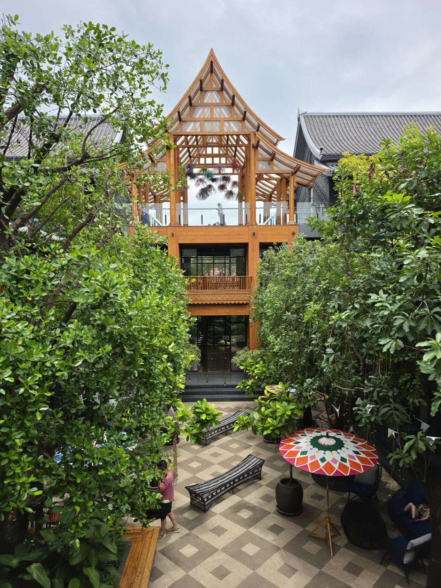

再去柴迪隆寺參觀，門票100泰銖一人，寺廟建築群，其中一座舍利塔於 15 世紀部分倒塌，還有據信保護城市的支柱。

<iframe src="https://www.google.com/maps/embed?pb=!1m18!1m12!1m3!1d9995.735545889724!2d98.9807242154045!3d18.789748029775637!2m3!1f0!2f0!3f0!3m2!1i1024!2i768!4f13.1!3m3!1m2!1s0x30da3a9933111415%3A0x5cf7709a044ba8ba!2z5p-06L-q6ZqG5a-6!5e0!3m2!1szh-TW!2stw!4v1784887107409!5m2!1szh-TW!2stw" width="600" height="450" style="border:0;" allowfullscreen="" loading="lazy" referrerpolicy="strict-origin-when-cross-origin"></iframe>

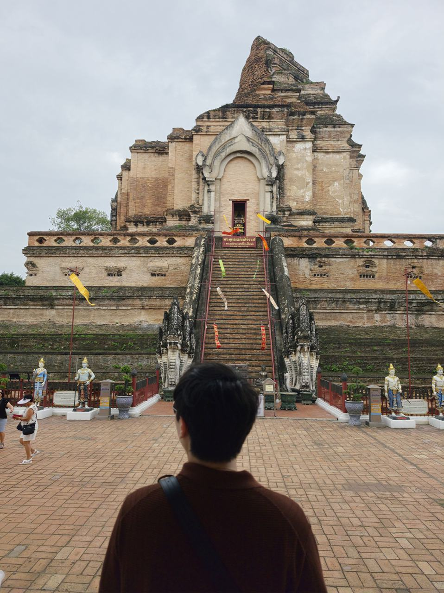

接著漫步路過錢幣博物館，在裡面吹冷氣參觀了一下

後來前往古城城牆拍照

<iframe src="https://www.google.com/maps/embed?pb=!1m18!1m12!1m3!1d2312.3018949838506!2d98.99228448891127!3d18.78776066828479!2m3!1f0!2f0!3f0!3m2!1i1024!2i768!4f13.1!3m3!1m2!1s0x30da3aa23421c875%3A0x9d3b8fabe43926f6!2sTha%20Phae%20Gate!5e0!3m2!1szh-TW!2stw!4v1784887508192!5m2!1szh-TW!2stw" width="600" height="450" style="border:0;" allowfullscreen="" loading="lazy" referrerpolicy="strict-origin-when-cross-origin"></iframe>

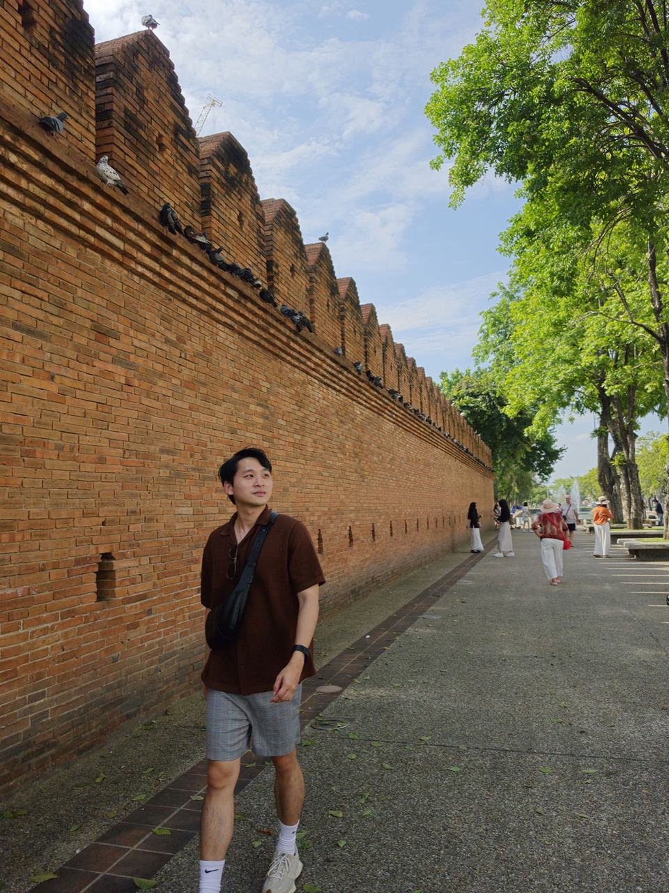

後來經過換幣地點，這裡是匯率最好的地方

<iframe src="https://www.google.com/maps/embed?pb=!1m18!1m12!1m3!1d2312.302663280039!2d98.99525315798228!3d18.787704707138047!2m3!1f0!2f0!3f0!3m2!1i1024!2i768!4f13.1!3m3!1m2!1s0x30da3aa46a2a9805%3A0x91a4e37a07c84752!2smr.pierre%20money%20exchange!5e0!3m2!1szh-TW!2stw!4v1784887629582!5m2!1szh-TW!2stw" width="600" height="450" style="border:0;" allowfullscreen="" loading="lazy" referrerpolicy="strict-origin-when-cross-origin"></iframe>

前往清邁夜市，路過很多商家，這裡東西很多又便宜

<iframe src="https://www.google.com/maps/embed?pb=!1m18!1m12!1m3!1d5350.6628612042905!2d98.99829890646457!3d18.781385098539126!2m3!1f0!2f0!3f0!3m2!1i1024!2i768!4f13.1!3m3!1m2!1s0x30da3aa60ca74a5b%3A0xb2ef5007f26b01d!2z5riF6YKB5aSc5biC!5e0!3m2!1szh-TW!2stw!4v1784887789132!5m2!1szh-TW!2stw" width="600" height="450" style="border:0;" allowfullscreen="" loading="lazy" referrerpolicy="strict-origin-when-cross-origin"></iframe>

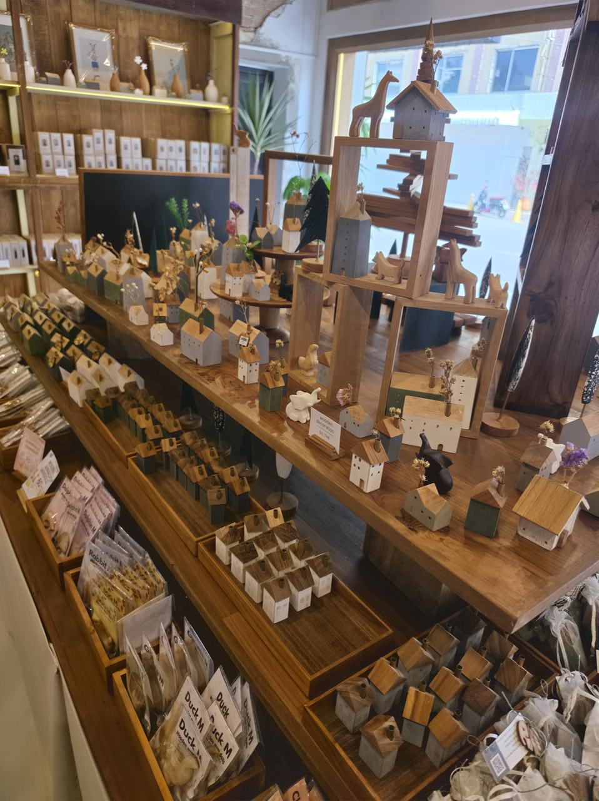

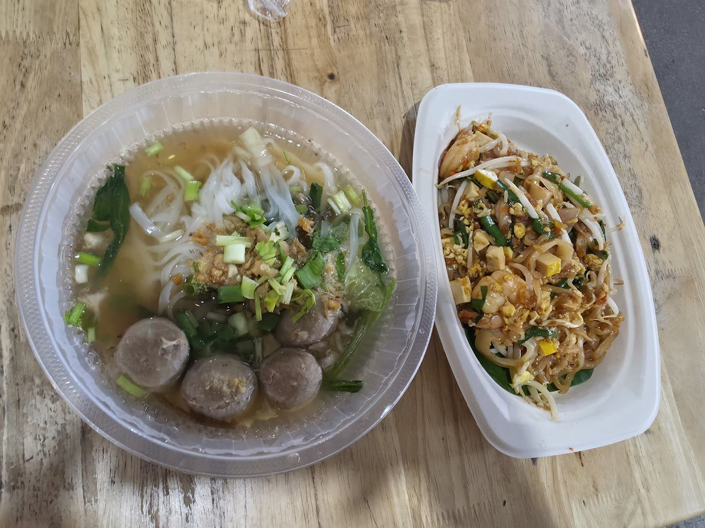

最後在 Big C 大採購，買了很多紀念品跟伴手禮，還有行李箱！這裡行李箱超便宜，只要699就有一個中型行李箱，滿載而歸飯店，並體驗第一次按摩，花了700泰銖一人90分鐘

## Day 3

早上安排，大象體驗營，超級值得推薦，可以幫大象做維他命球、餵食、互動、洗澡等等～我們在Klook上面購買行程，一個人大概1200左右，包含接送跟午餐。

<iframe src="https://www.google.com/maps/embed?pb=!1m18!1m12!1m3!1d241388.8379773271!2d98.77437996483445!3d19.032910612586072!2m3!1f0!2f0!3f0!3m2!1i1024!2i768!4f13.1!3m3!1m2!1s0x30da169a9fecb14f%3A0x3892025b0cb51a49!2sMaerim%20Elephant%20Sanctuary!5e0!3m2!1szh-TW!2stw!4v1784888364025!5m2!1szh-TW!2stw" width="600" height="450" style="border:0;" allowfullscreen="" loading="lazy" referrerpolicy="strict-origin-when-cross-origin"></iframe>

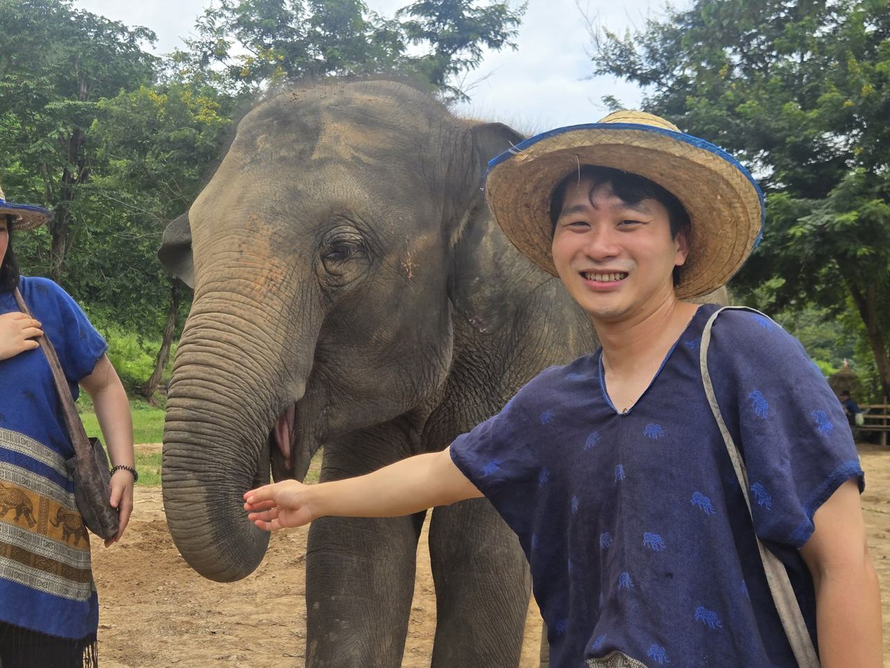

下午回飯店休息一下，前往附近咖啡廳
號稱97%的巧克力濃度，真的很濃稠

<iframe src="https://www.google.com/maps/embed?pb=!1m18!1m12!1m3!1d8605.981648477044!2d98.98296530602299!3d18.78658311132267!2m3!1f0!2f0!3f0!3m2!1i1024!2i768!4f13.1!3m3!1m2!1s0x30da3b209cb41555%3A0xc5e3380e0de3ed8e!2s97%25%20Nothing%20But%20Cocoa!5e0!3m2!1szh-TW!2stw!4v1784888448261!5m2!1szh-TW!2stw" width="600" height="450" style="border:0;" allowfullscreen="" loading="lazy" referrerpolicy="strict-origin-when-cross-origin"></iframe>

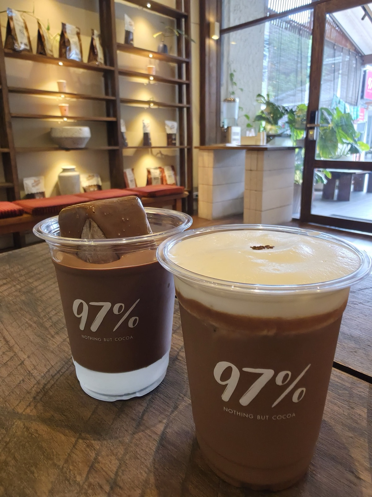

前往銀廟拍照打卡

<iframe src="https://www.google.com/maps/embed?pb=!1m18!1m12!1m3!1d5025.9501467987675!2d98.98300913481246!3d18.77996103887466!2m3!1f0!2f0!3f0!3m2!1i1024!2i768!4f13.1!3m3!1m2!1s0x30da3076509e5cf3%3A0x196337361614f763!2sWat%20Sri%20Suphan%20-%20Silver%20Temple!5e0!3m2!1szh-TW!2stw!4v1784888545943!5m2!1szh-TW!2stw" width="600" height="450" style="border:0;" allowfullscreen="" loading="lazy" referrerpolicy="strict-origin-when-cross-origin"></iframe>

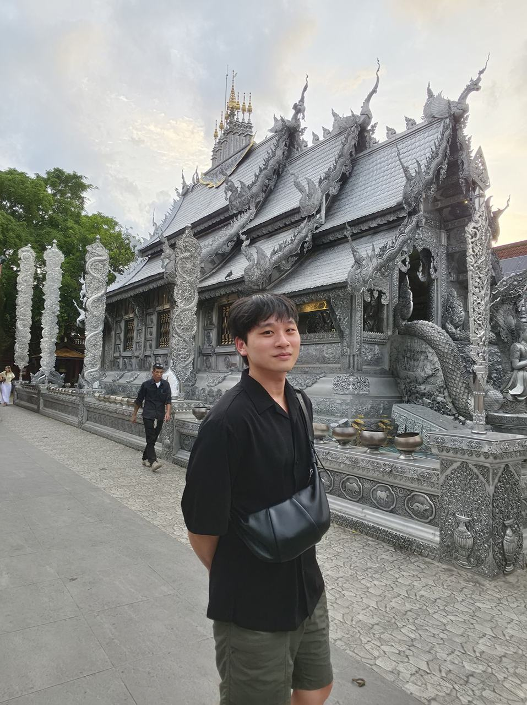

再走到一個超級local的夜市吃晚餐，這裡晚餐非常便宜好吃

<iframe src="https://www.google.com/maps/embed?pb=!1m18!1m12!1m3!1d8824.015909736629!2d98.97792603251649!3d18.775416510962618!2m3!1f0!2f0!3f0!3m2!1i1024!2i768!4f13.1!3m3!1m2!1s0x30da307aa315f9b3%3A0x4887c95501fd934d!2sKadmanee%20Market!5e0!3m2!1szh-TW!2stw!4v1784888582195!5m2!1szh-TW!2stw" width="600" height="450" style="border:0;" allowfullscreen="" loading="lazy" referrerpolicy="strict-origin-when-cross-origin"></iframe>

## Day 4

今天是規劃在尼曼一號漫步

先去網紅打卡必吃的米其林餐廳，泰北咖哩麵，好吃偏辣，且價格還是很便宜

<iframe src="https://www.google.com/maps/embed?pb=!1m18!1m12!1m3!1d8822.86248770335!2d98.96927969118532!3d18.797434891198897!2m3!1f0!2f0!3f0!3m2!1i1024!2i768!4f13.1!3m3!1m2!1s0x30da3a8c1eaccca9%3A0x45f0468a756c49e8!2sKhao%20Soi%20Maesai!5e0!3m2!1szh-TW!2stw!4v1784888711865!5m2!1szh-TW!2stw" width="600" height="450" style="border:0;" allowfullscreen="" loading="lazy" referrerpolicy="strict-origin-when-cross-origin"></iframe>

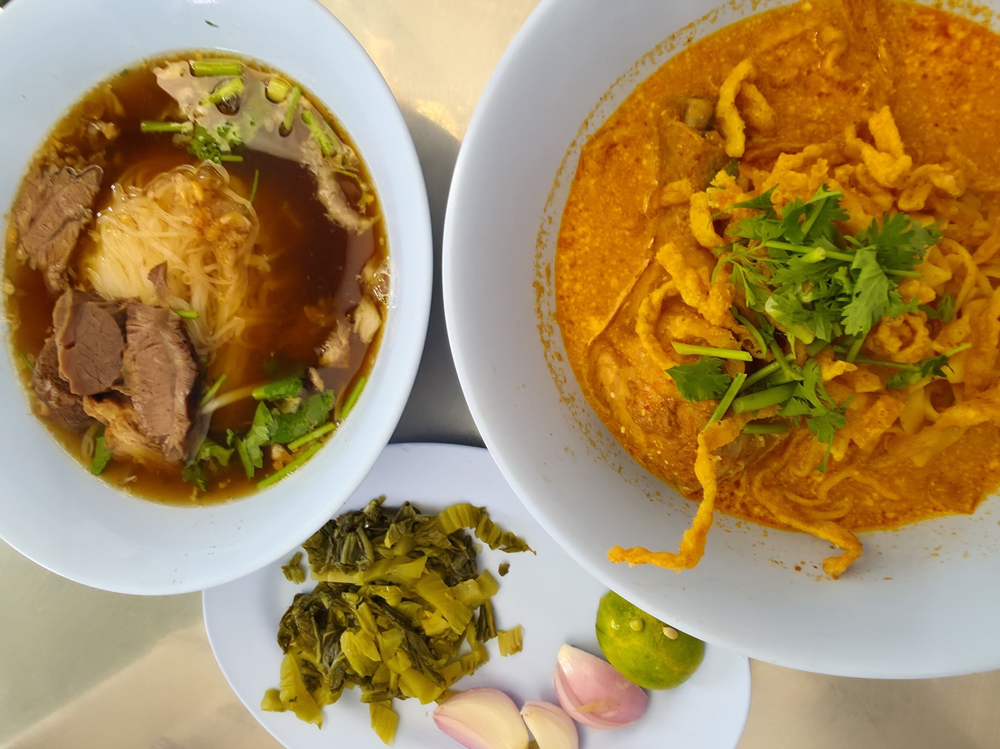

開始在美麗的尼曼一號逛街，這裡東西相對價格較高，可以衡量一下

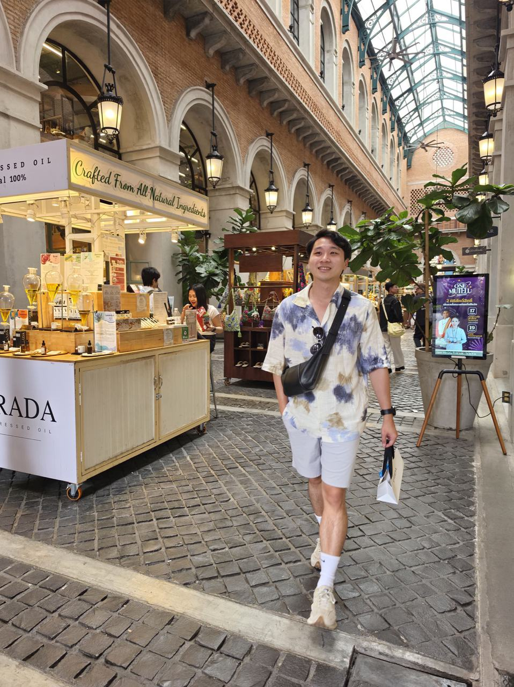

晚餐在尼曼一號附近的夜市吃晚餐，這是一個非常在地的夜市，東西都很便宜

<iframe src="https://www.google.com/maps/embed?pb=!1m18!1m12!1m3!1d9641.632066693039!2d98.96544952197613!3d18.793855436826558!2m3!1f0!2f0!3f0!3m2!1i1024!2i768!4f13.1!3m3!1m2!1s0x30da3b006f59847d%3A0x1b14452fe2822933!2sThae%20Market%20CNX!5e0!3m2!1szh-TW!2stw!4v1784908510585!5m2!1szh-TW!2stw" width="600" height="450" style="border:0;" allowfullscreen="" loading="lazy" referrerpolicy="strict-origin-when-cross-origin"></iframe>

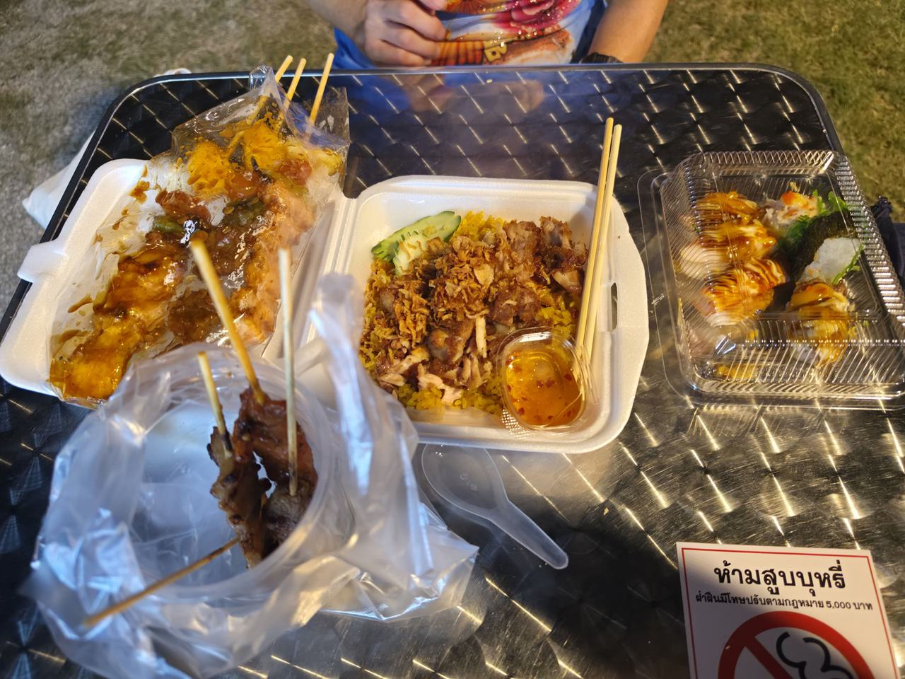

## Day 5

下午規劃要去動物園的關係，早上決定在古城北邊的市場逛逛

早餐吃比較西式的三明治早餐，價格較高一點，但我滿喜歡的

<iframe src="https://www.google.com/maps/embed?pb=!1m18!1m12!1m3!1d9641.544464026136!2d98.97708901383821!3d18.79538511504291!2m3!1f0!2f0!3f0!3m2!1i1024!2i768!4f13.1!3m3!1m2!1s0x30da3b5174e271c5%3A0xbfb96f9a8aeb11fd!2sTUA%20CRAFT%20KRUB!5e0!3m2!1szh-TW!2stw!4v1784909928824!5m2!1szh-TW!2stw" width="600" height="450" style="border:0;" allowfullscreen="" loading="lazy" referrerpolicy="strict-origin-when-cross-origin"></iframe>

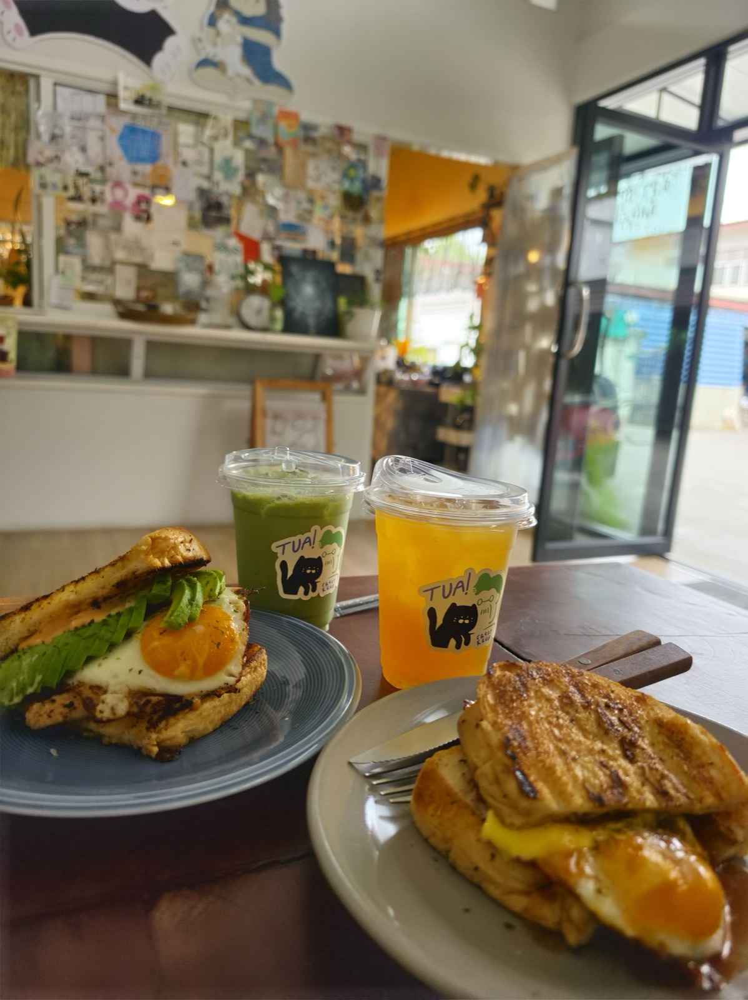

前往在地市場，逛逛美食跟在地販售的東西

<iframe src="https://www.google.com/maps/embed?pb=!1m18!1m12!1m3!1d9641.121213040482!2d98.98160787538474!3d18.80277404288477!2m3!1f0!2f0!3f0!3m2!1i1024!2i768!4f13.1!3m3!1m2!1s0x30da3a93528c42c7%3A0x46fa3229ce4545bc!2sSiri%20Wattana%20Market!5e0!3m2!1szh-TW!2stw!4v1784910001062!5m2!1szh-TW!2stw" width="600" height="450" style="border:0;" allowfullscreen="" loading="lazy" referrerpolicy="strict-origin-when-cross-origin"></iframe>

我們找到一家在地米其林的麵食館，東西偏辣，但好吃

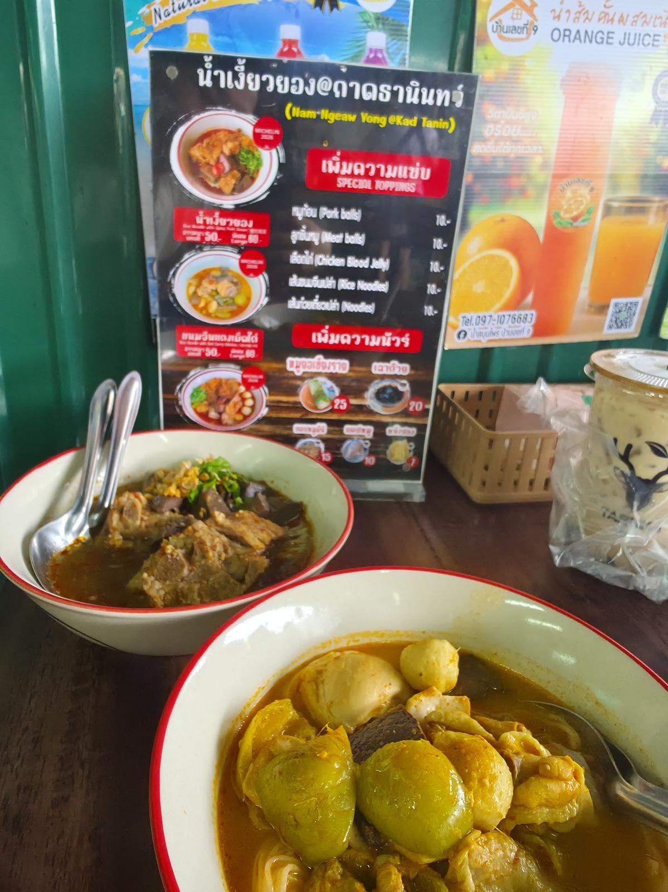

回飯店休息一下，下午3點，購買的行程前來接送我們去動物園

這是一個夜間動物園，雖然是夜間，但建議在3點左右抵達，許多活動都是在16~20期間，太晚很多設施都體驗不到

<iframe src="https://www.google.com/maps/embed?pb=!1m18!1m12!1m3!1d30226.00399824386!2d98.90036914132519!3d18.742344624682797!2m3!1f0!2f0!3f0!3m2!1i1024!2i768!4f13.1!3m3!1m2!1s0x30da37293ac232bf%3A0xcaafc0bee2a3f81a!2z5riF6YKB5aSc6ZaT5YuV54mp5ZyS!5e0!3m2!1szh-TW!2stw!4v1784910132333!5m2!1szh-TW!2stw" width="600" height="450" style="border:0;" allowfullscreen="" loading="lazy" referrerpolicy="strict-origin-when-cross-origin"></iframe>

我最喜歡在草原動物的遊行車，可以體驗動物餵食，跟他們互動

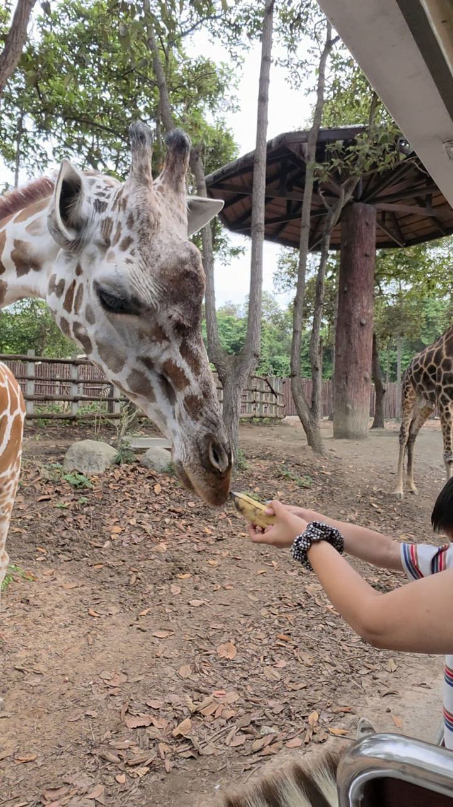

晚餐回來吃泰式餐廳，價格偏高，口味偏重，但很好吃

<iframe src="https://www.google.com/maps/embed?pb=!1m18!1m12!1m3!1d4127.718670256446!2d98.98199639180768!3d18.786033775451372!2m3!1f0!2f0!3f0!3m2!1i1024!2i768!4f13.1!3m3!1m2!1s0x30da3b2a09eeabe3%3A0x67d01b281536a753!2sLookbua%20thai%20food%20Restaurant!5e0!3m2!1szh-TW!2stw!4v1784910344574!5m2!1szh-TW!2stw" width="600" height="450" style="border:0;" allowfullscreen="" loading="lazy" referrerpolicy="strict-origin-when-cross-origin"></iframe>

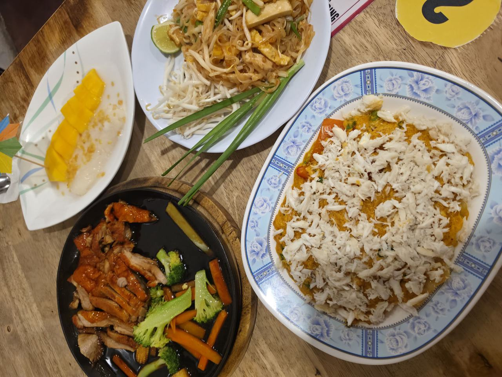

## Day 6 清萊一日遊

我們規劃星期六，原本想體驗清萊夜市，但這並不在行程中，這天也是清萊一直下雨

一開始先抵達長頸村，後來前往附近溫泉

### 白龍寺（白廟）

再來抵達白廟，是我最期待的部分，裡面的手作細節跟全白建築，顯得格外有魅力

<iframe src="https://www.google.com/maps/embed?pb=!1m18!1m12!1m3!1d3753.394196499903!2d99.76013357461352!3d19.82326688154133!2m3!1f0!2f0!3f0!3m2!1i1024!2i768!4f13.1!3m3!1m2!1s0x30d7b7dfce59940f%3A0x2afcd50d8eacb7a3!2z55m96b6N5a-6!5e0!3m2!1szh-TW!2stw!4v1784910707073!5m2!1szh-TW!2stw" width="600" height="450" style="border:0;" allowfullscreen="" loading="lazy" referrerpolicy="strict-origin-when-cross-origin"></iframe>

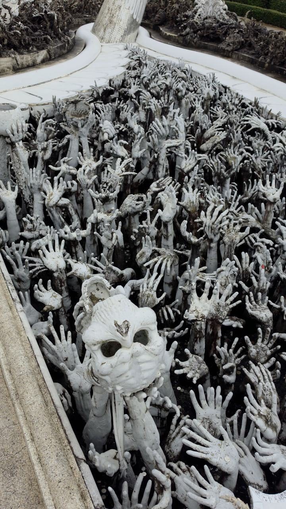

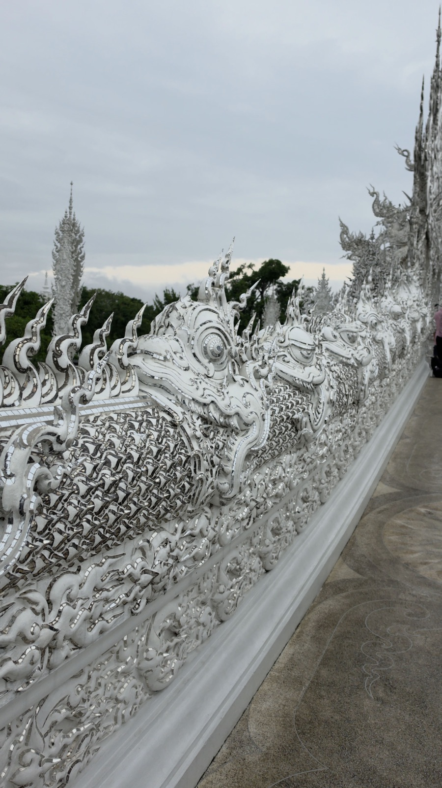

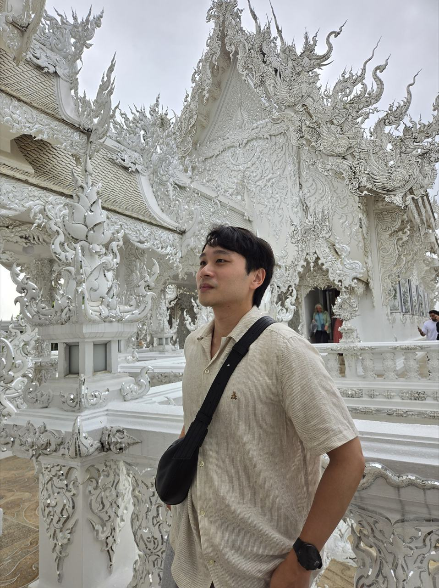

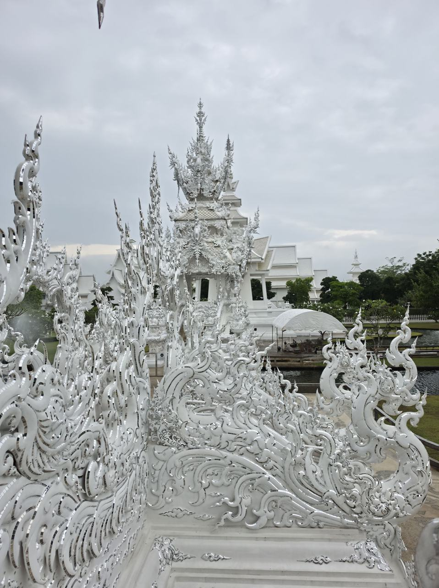

### 藍廟

再來抵達藍廟，做工精細

<iframe src="https://www.google.com/maps/embed?pb=!1m18!1m12!1m3!1d3751.025444240106!2d99.8391580746164!3d19.9233325814636!2m3!1f0!2f0!3f0!3m2!1i1024!2i768!4f13.1!3m3!1m2!1s0x30d70700425011f9%3A0x30e6a8a31348764d!2z5riF6JCK6JeN5buf!5e0!3m2!1szh-TW!2stw!4v1784910787241!5m2!1szh-TW!2stw" width="600" height="450" style="border:0;" allowfullscreen="" loading="lazy" referrerpolicy="strict-origin-when-cross-origin"></iframe>

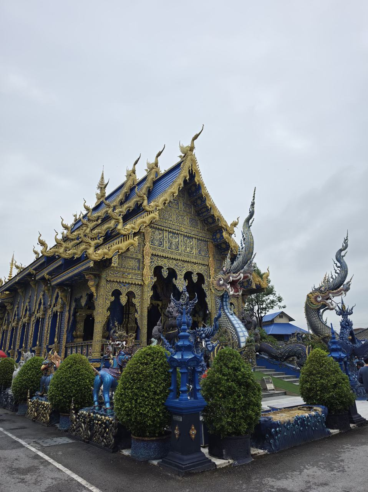

### 黑屋博物館（黑廟）

最後一站抵達黑廟，這處景點匯集眾多木造建築，內部陳列塔萬杜查尼和其他當代泰國藝術家的作品。

<iframe src="https://www.google.com/maps/embed?pb=!1m18!1m12!1m3!1d3749.391483740269!2d99.8602155!3d19.9920776!2m3!1f0!2f0!3f0!3m2!1i1024!2i768!4f13.1!3m3!1m2!1s0x30d7005000000001%3A0x817acc24f7e9bb96!2z6buR5bGL5Y2a54mp6aSo!5e0!3m2!1szh-TW!2stw!4v1784910958461!5m2!1szh-TW!2stw" width="600" height="450" style="border:0;" allowfullscreen="" loading="lazy" referrerpolicy="strict-origin-when-cross-origin"></iframe>

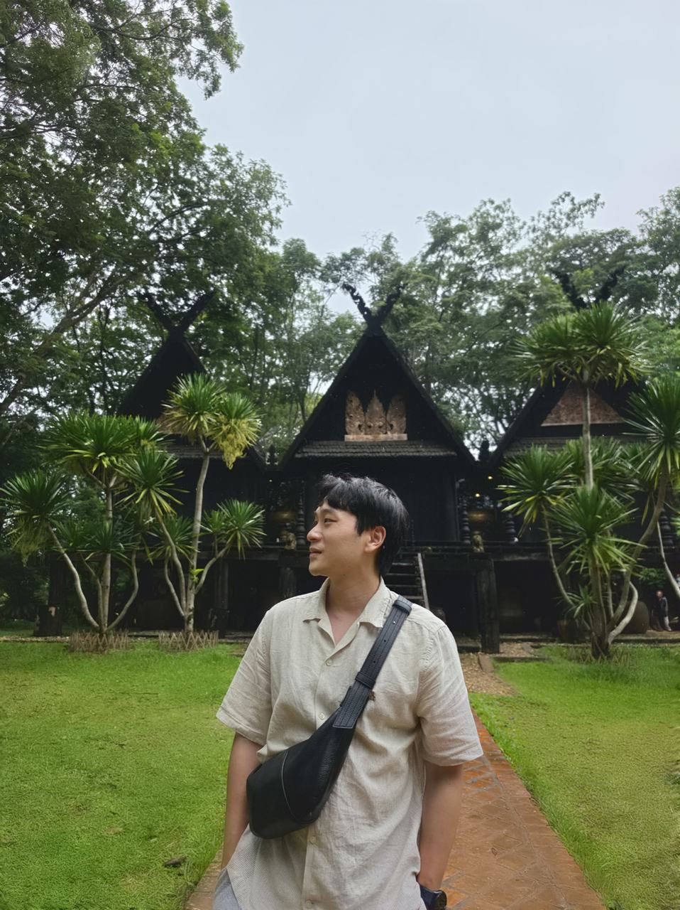

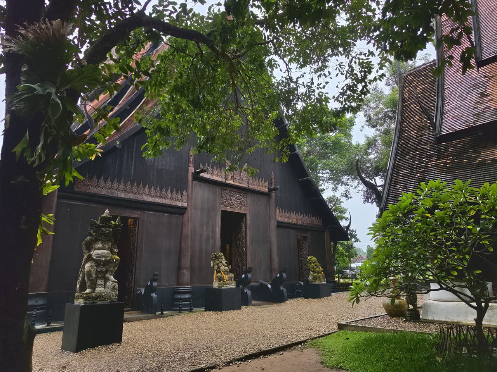

返回清邁後，前往週六夜市，食物便宜好吃，又很多逛的

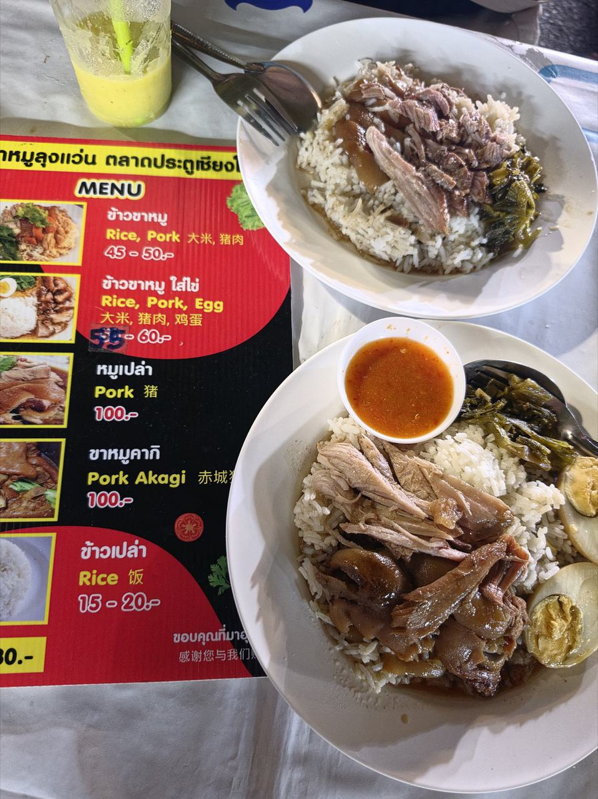

## Day 7

在真心市集附近逛逛，這裡有很多小飾品或衣服等等，但價格我也認為偏高，我跟媽媽都是走馬看花，最後頂多在這裡吃午餐，就離開，但對女生是會失心瘋的地方

<iframe src="https://www.google.com/maps/embed?pb=!1m18!1m12!1m3!1d24783.578309747973!2d98.98169586717447!3d18.78976765884111!2m3!1f0!2f0!3f0!3m2!1i1024!2i768!4f13.1!3m3!1m2!1s0x30da3ac0cb5efccd%3A0x9fbfb1d2cc918b06!2sJing%20Jai%20Market%20Chiang%20Mai!5e0!3m2!1szh-TW!2stw!4v1784911227494!5m2!1szh-TW!2stw" width="600" height="450" style="border:0;" allowfullscreen="" loading="lazy" referrerpolicy="strict-origin-when-cross-origin"></iframe>

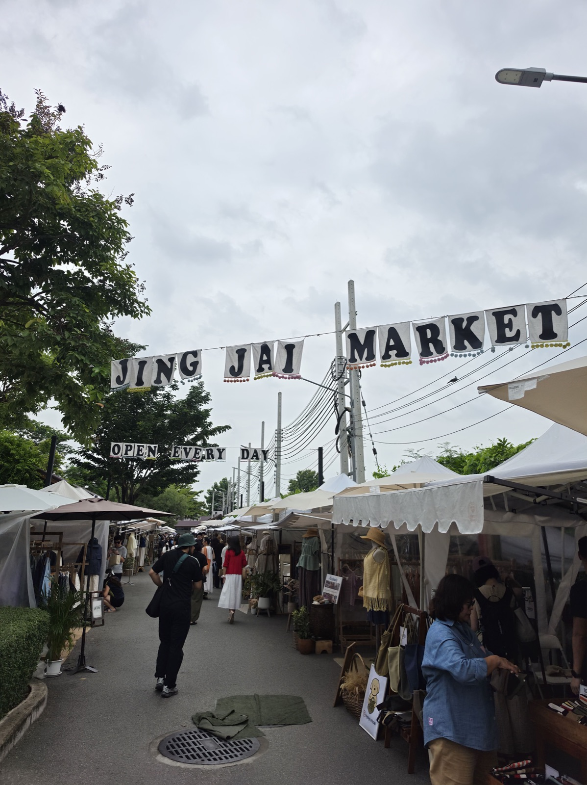

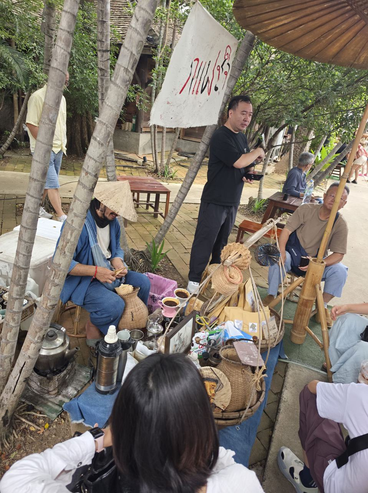

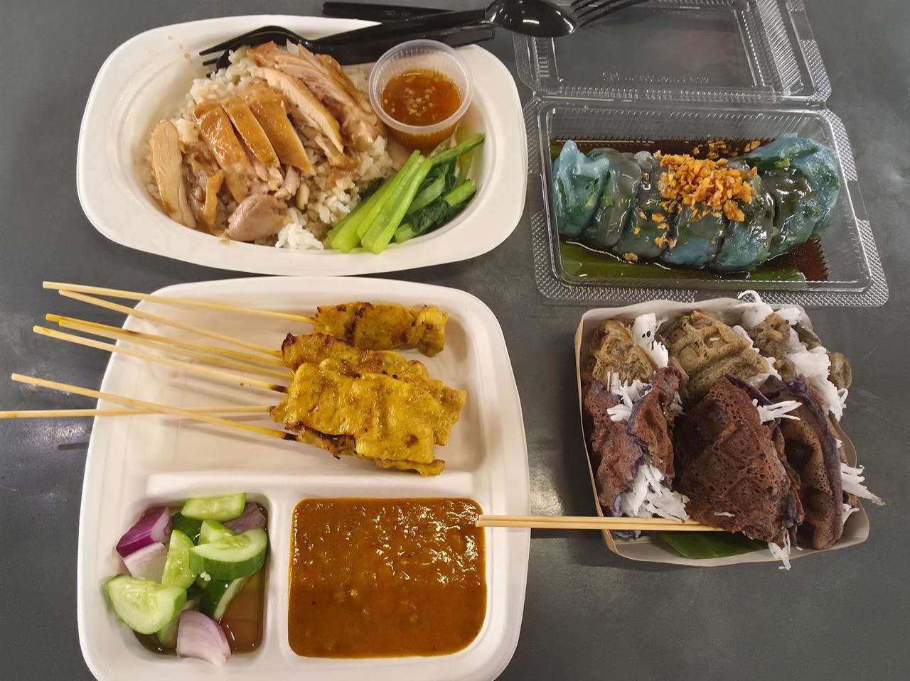

沿路走回古城路上，有許多便宜的二手衣物

經過竹編一條街，這裡有許多竹編物品，最著名的是周桂發，有許多網美會在這裡拍照

<iframe src="https://www.google.com/maps/embed?pb=!1m18!1m12!1m3!1d5032.670313525297!2d98.99339929650216!3d18.78842453217269!2m3!1f0!2f0!3f0!3m2!1i1024!2i768!4f13.1!3m3!1m2!1s0x30da3b015c988b4f%3A0x58d48ac076b02ebe!2z5ZGo5qGC55m8!5e0!3m2!1szh-TW!2stw!4v1784911257527!5m2!1szh-TW!2stw" width="600" height="450" style="border:0;" allowfullscreen="" loading="lazy" referrerpolicy="strict-origin-when-cross-origin"></iframe>

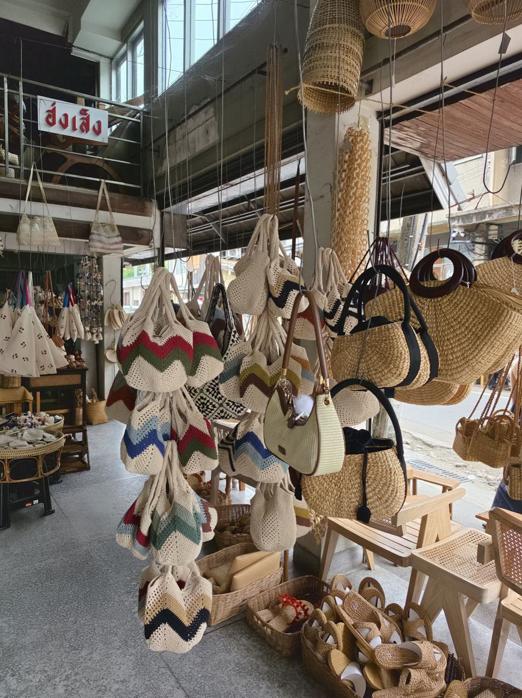

在這裡體驗 Tok Sen，木槌按摩，很像用手刀用力拍打背部，有些地方真的會很痛

<iframe src="https://www.google.com/maps/embed?pb=!1m18!1m12!1m3!1d1074.2509300232753!2d98.99573665752757!3d18.78761665706035!2m3!1f0!2f0!3f0!3m2!1i1024!2i768!4f13.1!3m3!1m2!1s0x30da3aa392cebc6b%3A0xcf1092d4ad3a47a1!2sWat%20Mahawan!5e0!3m2!1szh-TW!2stw!4v1784911401329!5m2!1szh-TW!2stw" width="600" height="450" style="border:0;" allowfullscreen="" loading="lazy" referrerpolicy="strict-origin-when-cross-origin"></iframe>

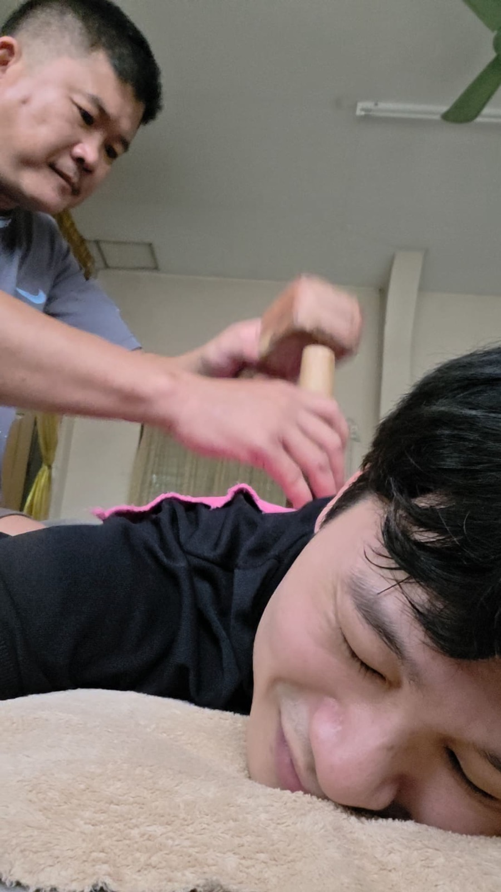

在清邁週日夜市逛，這裡真的超級大，感覺全清邁人都來這裡擺攤，攤販數好幾千家，但同質性很高，價格相對較低，可以在這裡撿便宜

從古城門口開始，一路往下幾乎都是夜市的範圍

<iframe src="https://www.google.com/maps/embed?pb=!1m18!1m12!1m3!1d2939.011227472366!2d98.99109289338996!3d18.787630447592065!2m3!1f0!2f0!3f0!3m2!1i1024!2i768!4f13.1!3m3!1m2!1s0x30da3aa23421c875%3A0x9d3b8fabe43926f6!2sTha%20Phae%20Gate!5e0!3m2!1szh-TW!2stw!4v1784911621775!5m2!1szh-TW!2stw" width="600" height="450" style="border:0;" allowfullscreen="" loading="lazy" referrerpolicy="strict-origin-when-cross-origin"></iframe>

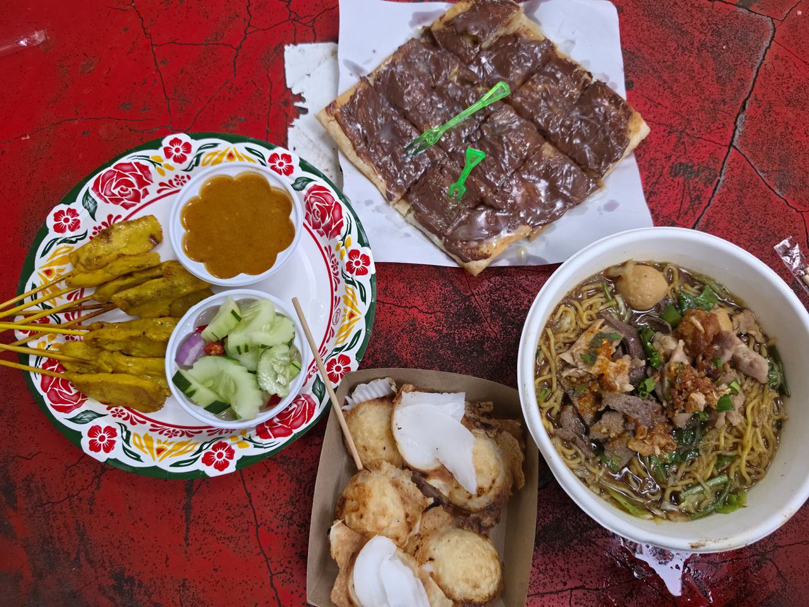

## Day 8

今天一早前往清曼寺，這裡是古城區內最古老的寺廟

<iframe src="https://www.google.com/maps/embed?pb=!1m18!1m12!1m3!1d8062.907504143433!2d98.98616820098404!3d18.791210448216006!2m3!1f0!2f0!3f0!3m2!1i1024!2i768!4f13.1!3m3!1m2!1s0x30da3a97936133d7%3A0x6e33b1cdc659f2dd!2z5riF5pu85a-6!5e0!3m2!1szh-TW!2stw!4v1784911696163!5m2!1szh-TW!2stw" width="600" height="450" style="border:0;" allowfullscreen="" loading="lazy" referrerpolicy="strict-origin-when-cross-origin"></iframe>

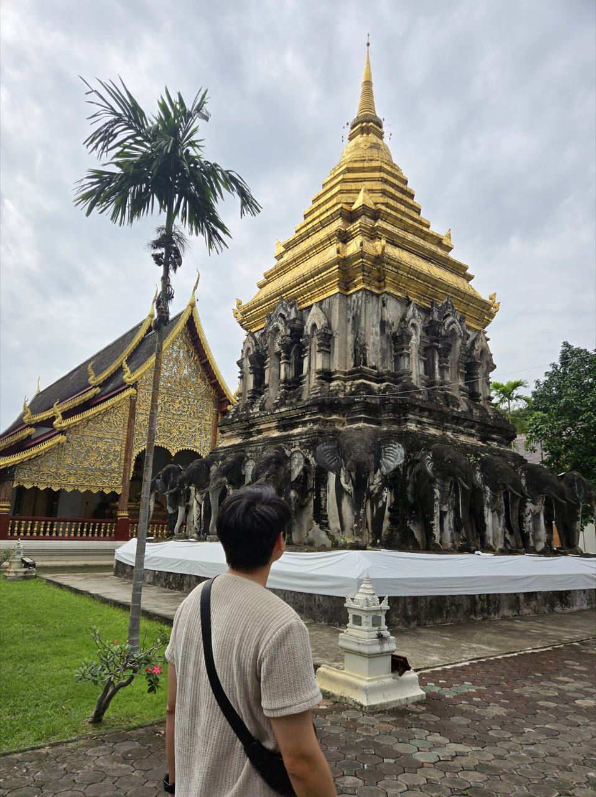

吃網路上看到很多人推薦的泰北傳統早餐，主要是他的斑蘭葉醬配麵包超好吃

<iframe src="https://www.google.com/maps/embed?pb=!1m18!1m12!1m3!1d8062.86078564419!2d98.99067995712598!3d18.792186117027192!2m3!1f0!2f0!3f0!3m2!1i1024!2i768!4f13.1!3m3!1m2!1s0x30da3b1eb73bcfc9%3A0xd5900dcc3e547009!2sTai%20Thun%20Baan!5e0!3m2!1szh-TW!2stw!4v1784911816297!5m2!1szh-TW!2stw" width="600" height="450" style="border:0;" allowfullscreen="" loading="lazy" referrerpolicy="strict-origin-when-cross-origin"></iframe>

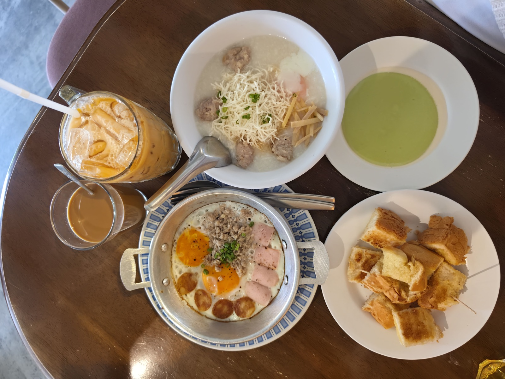

後來前往瓦洛洛市集，這裡很推薦購買伴手禮、果乾類，在這裡價格比超市便宜很多，我跟媽媽買了很多芒果乾跟椰子乾，還有一些藥妝品

<iframe src="https://www.google.com/maps/embed?pb=!1m18!1m12!1m3!1d8062.86078564419!2d98.99067995712598!3d18.792186117027192!2m3!1f0!2f0!3f0!3m2!1i1024!2i768!4f13.1!3m3!1m2!1s0x30da3b3a2f7c7151%3A0x24c07f18fcb56c40!2sWaroros%20Market!5e0!3m2!1szh-TW!2stw!4v1784911846496!5m2!1szh-TW!2stw" width="600" height="450" style="border:0;" allowfullscreen="" loading="lazy" referrerpolicy="strict-origin-when-cross-origin"></iframe>

逛完前往這間吃海南雞飯，超級好吃，價格也很實惠

<iframe src="https://www.google.com/maps/embed?pb=!1m18!1m12!1m3!1d7358.325026429738!2d98.9919468778969!3d18.782204270802364!2m3!1f0!2f0!3f0!3m2!1i1024!2i768!4f13.1!3m3!1m2!1s0x30da31c3b4729ab7%3A0xbb8cdf3d8b5bdc49!2z5riF6YKB5p2R5rCR6be55Zi06LGG5rW35Y2X6Zue6aOv!5e0!3m2!1szh-TW!2stw!4v1784911965654!5m2!1szh-TW!2stw" width="600" height="450" style="border:0;" allowfullscreen="" loading="lazy" referrerpolicy="strict-origin-when-cross-origin"></iframe>

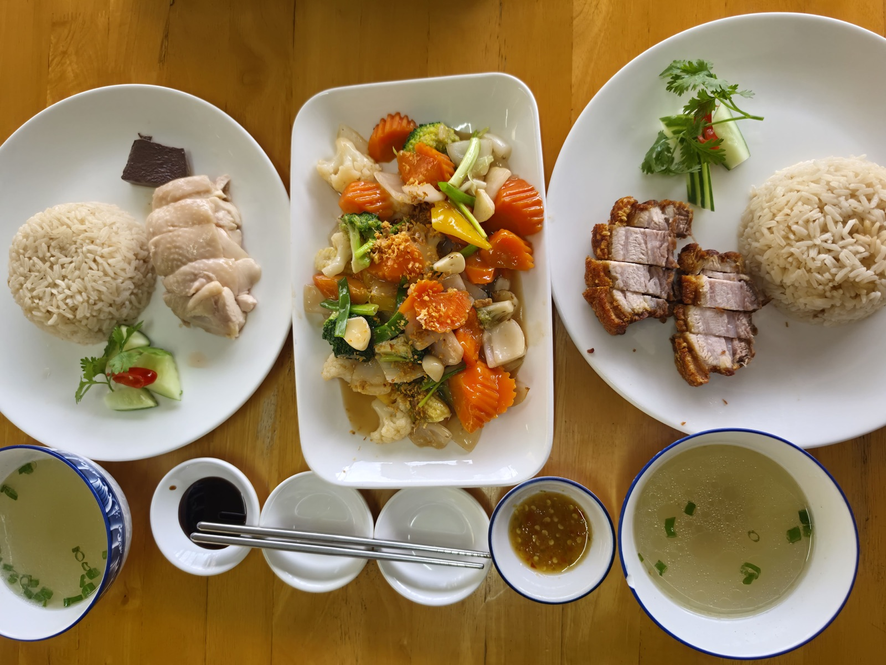

前往著名的景點 Mae Kha Canal，是後來被整修翻新的河岸景點，這裡有點日本的感覺

<iframe src="https://www.google.com/maps/embed?pb=!1m18!1m12!1m3!1d7358.325026429738!2d98.9919468778969!3d18.782204270802364!2m3!1f0!2f0!3f0!3m2!1i1024!2i768!4f13.1!3m3!1m2!1s0x30da3bb458d9dc27%3A0x2989451c5630692f!2sMae%20Kha%20Canal!5e0!3m2!1szh-TW!2stw!4v1784912070803!5m2!1szh-TW!2stw" width="600" height="450" style="border:0;" allowfullscreen="" loading="lazy" referrerpolicy="strict-origin-when-cross-origin"></iframe>

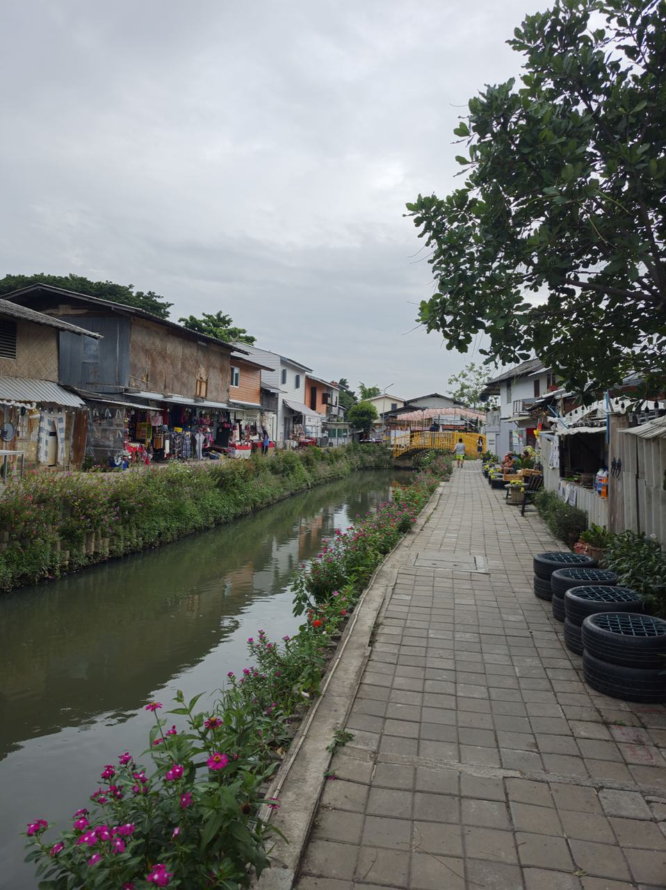

在這裡體驗到從湯匙變戒指的文創，很便宜，一次才99泰銖

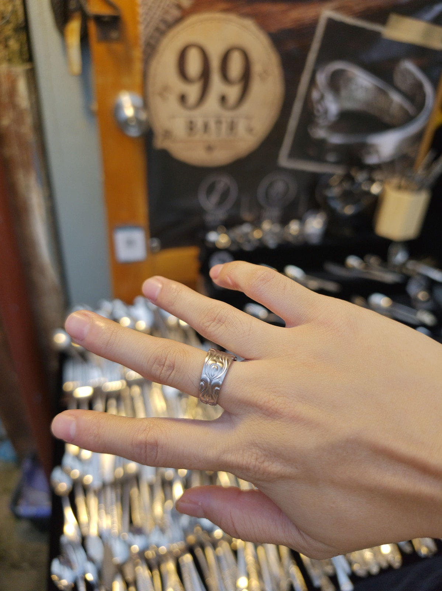

## Day 9

最後一天來品嚐網紅推薦的打拋豬飯，我們拿號碼牌等了將近一個半小時才到我們，說實話我覺得的確好吃，但不值得我排那麼久

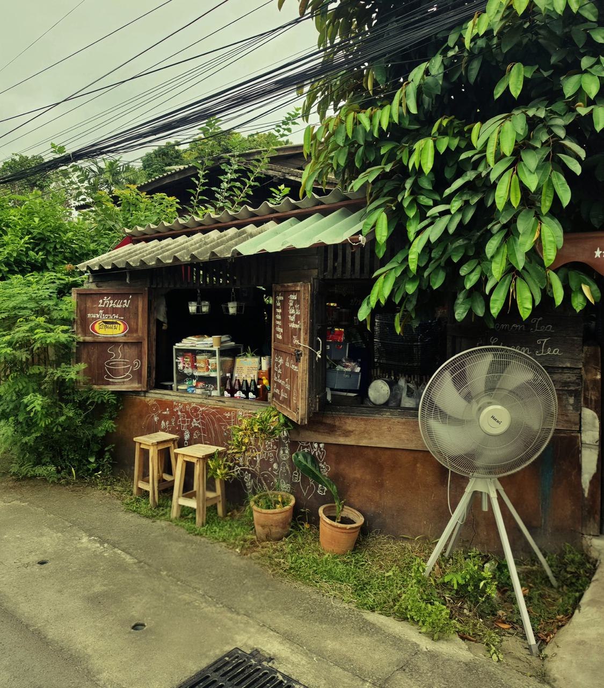

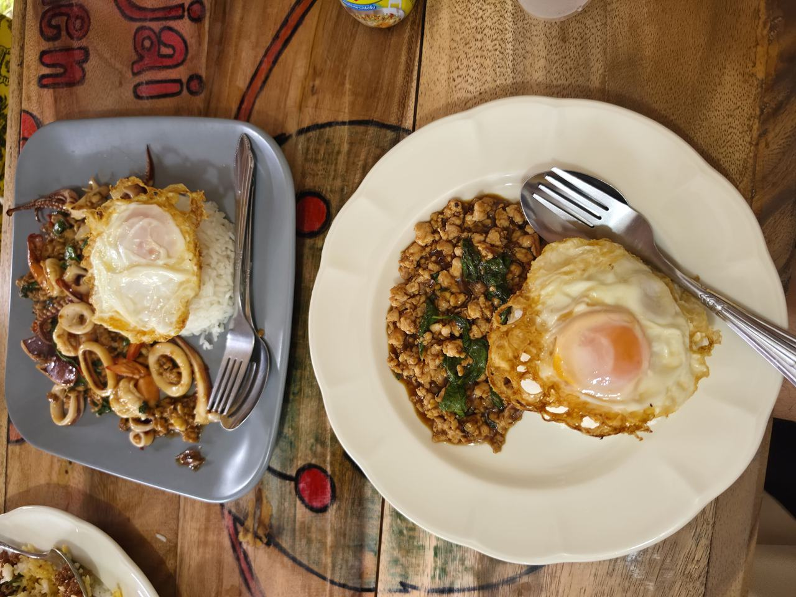

後來坐車前往悟孟寺，這裡是著名的洞穴寺廟，很莊嚴又很美麗

<iframe src="https://www.google.com/maps/embed?pb=!1m18!1m12!1m3!1d21044.242477729298!2d98.95697634234276!3d18.784975533724815!2m3!1f0!2f0!3f0!3m2!1i1024!2i768!4f13.1!3m3!1m2!1s0x30da3a706f40689d%3A0xedef9aa39d595059!2z5oKf5a2f5a-6!5e0!3m2!1szh-TW!2stw!4v1784912387107!5m2!1szh-TW!2stw" width="600" height="450" style="border:0;" allowfullscreen="" loading="lazy" referrerpolicy="strict-origin-when-cross-origin"></iframe>

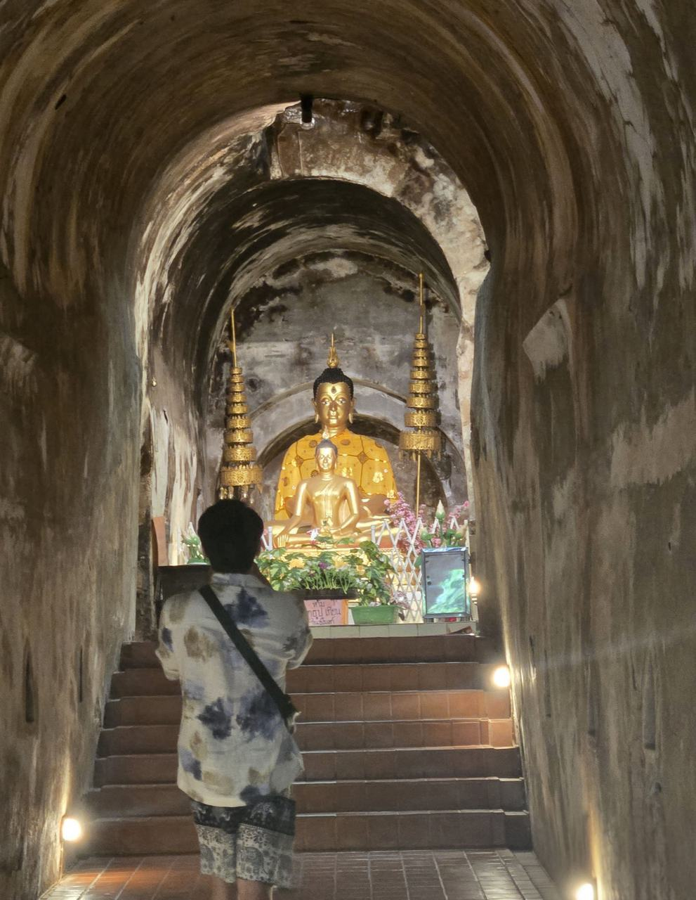

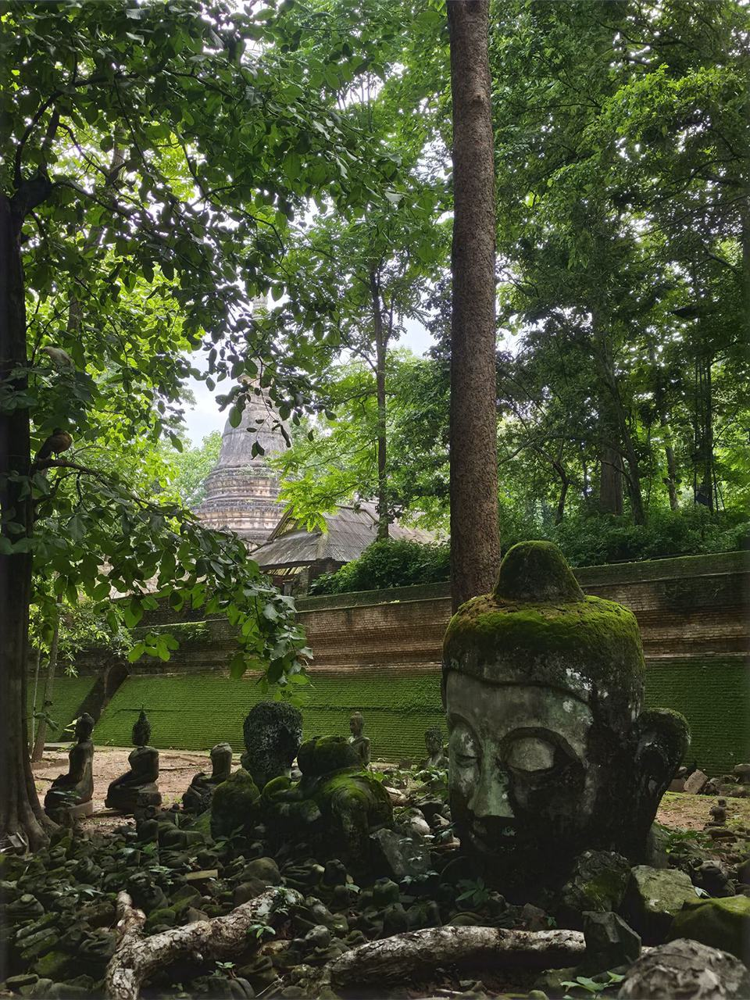

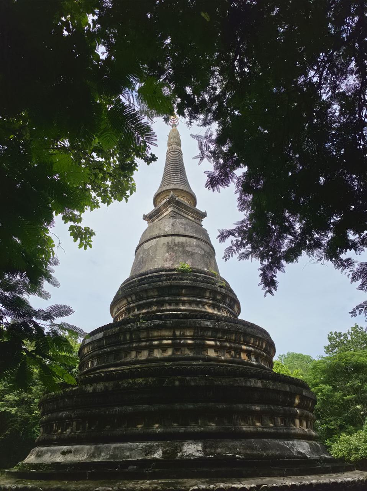

接著前往最後一個行程 Baan Kang Wat，這裡很多可愛的小店面，很適合拍照，但東西都偏貴，我們到處拍照瀏覽

<iframe src="https://www.google.com/maps/embed?pb=!1m18!1m12!1m3!1d21044.67368971286!2d98.95362905526454!3d18.781523563263253!2m3!1f0!2f0!3f0!3m2!1i1024!2i768!4f13.1!3m3!1m2!1s0x30da3135abcf1377%3A0x5b0f6ce47286ce9f!2sBaan%20Kang%20Wat!5e0!3m2!1szh-TW!2stw!4v1784912498107!5m2!1szh-TW!2stw" width="600" height="450" style="border:0;" allowfullscreen="" loading="lazy" referrerpolicy="strict-origin-when-cross-origin"></iframe>

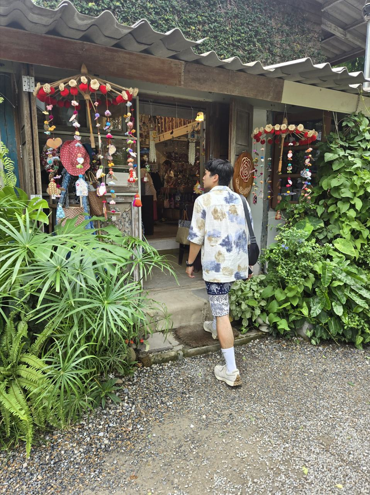

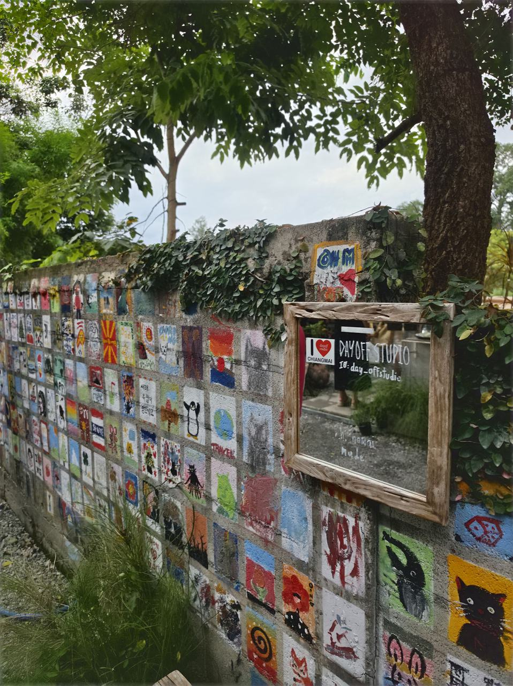

最後晚上搭飛機前，最後一次體驗按摩，這裡按摩真的好便宜，我跟媽媽總共按摩5次

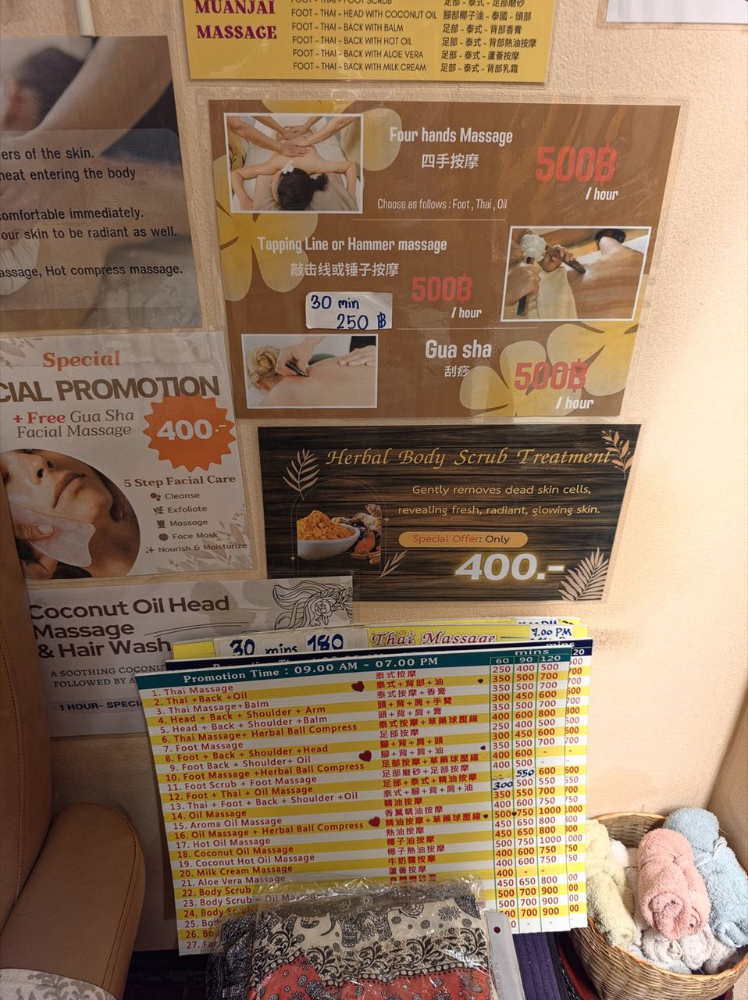

# 總花費

所有花費計算下來兩人 56000左右 

1. 機票兩人 24000左右 （有買一個回程行李，現在機票都好貴）
2. 伴手禮總共花費 6000 左右
3. 住宿9天兩人總共 7300左右
4. 買了清萊行程、大象體驗營行程、夜間動物園門票 兩人總共 5500
5. 按摩總共 5000左右
6. 吃飯、交通等 9天共 9000以內

# 心得

清邁建議真的可以多待一點時間，我感覺9天剛剛好，其實很多市集大同小異，但每個點都有他的特色跟拍照點，這裡外國人比本地人多的感覺，歐美人最多，但清邁人都很友善又很誠實，我遇到甚至都還想免費請我吃東西，做生意也很誠實，喜歡這裡的人事物，謝謝清邁給我那麼美好的回憶～

