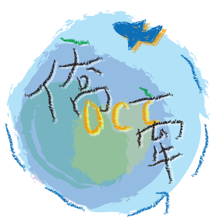
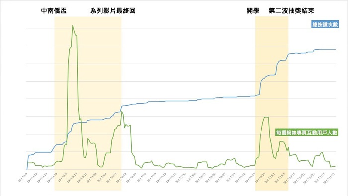
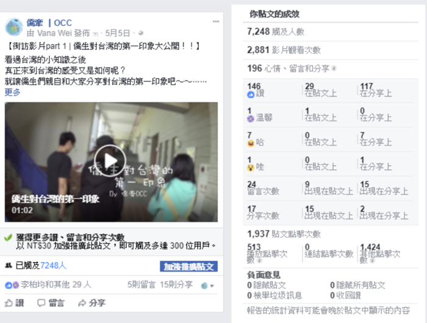

> National Chi Nan University has the highest proportion of international students of any school in Taiwan, and a big share of them are overseas Chinese students
> Our everyday life with our overseas Chinese classmates is full of warmth, laughter, and plenty of unexpected fun
> "Chiau Chian" is the platform we built for them

[Facebook page: Chiau Chian ｜ OCC](https://www.facebook.com/ChiauChian.OCC/) 

# Concept and Current Situation:
---
According to data released by the Ministry of Education's Department of Statistics, there are nearly 12,000 overseas Chinese students in Taiwan, and the number grows quickly by about 10% every year. However, before coming to Taiwan, the information they can gather is mostly limited to official regulations, policies, and school admission brochures, and there are very few articles about everyday life they can refer to. After they arrive, they face differences in culture and lifestyle, and even academic struggles, and mostly rely on their peers for advice and support.
After comparing the most relevant exchange platforms, we chose to build the "Chiau Chian" forum. Not only does it give us enough room to organize and present information, it's also great for asking questions and having discussions. And since social media is so popular these days, we also use Facebook as a promotion channel to reach more people.
We hope to use a Facebook fan page to attract users and promote events, and use the forum to collect official and unofficial information, offer a space for questions, and share content close to daily life. That way, overseas Chinese students already in Taiwan can share their experiences, newly arrived students can settle into life in Taiwan more easily, and those planning to come can get a first look at Taiwan. Going further, we hope Taiwanese students can also learn about the different cultures and customs of overseas Chinese students, boosting international exchange and broadening everyone's global perspective. 

# Procedure and Results
---

## Steps:
Step1. Build the fan page
Step2. Promotion and events
Step3. Build the forum

## Results:
---
 

# Written Report
---
[Learn more about this project](https://drive.google.com/drive/folders/126sHSHVP27LjqDtpRQmMCpdwN5nUHcUu)
