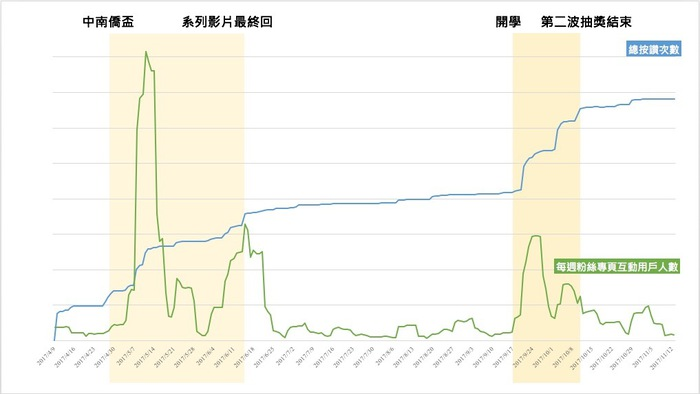
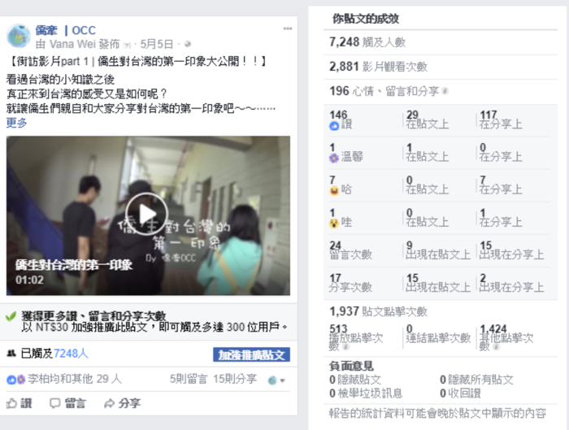

> 暨南大學是全台外籍生比例最高的學校 其中有非常大一部分是僑生
> 我們和僑生同學相處的日常 有溫馨、有歡笑、也有很多意想不到的趣事
> 「 僑牽 」是我們為僑生同學們打造的平台

[粉專 僑牽 ｜ ＯＣＣ](https://www.facebook.com/ChiauChian.OCC/) 

# 想法與現況：
---
依據教育部統計處發布資料顯示，臺灣現有近 12,000 名僑生，每年 約以 10%的比例快速成長。然而僑生來台前的資訊蒐集，多限於官方的 法規、政策、各校簡章等，生活問題少有相關文章可供參考。而來台後 面對文化與生活習慣差異，甚至是學業問題，多是仰賴同儕之間交流與 扶持。
在經過比較相關性高的各大交流平台中，我們選擇建立「僑牽」論 壇，除了可以讓資料有足夠地方可以彙整呈現，對於發問、交流等需求 也相當出色。另外現行社群媒體盛行，我們也將使用臉書作為推廣管道， 以觸及更多族群。
我們期盼透過創立臉書粉絲專頁以達到招攬使用者、宣傳活動等功 能;創立論壇以達到官方及非官方資訊彙整提供、諮詢空間、生活貼近 度等呈現。讓已來台僑生提供生活經驗分享，初來台之僑生更能融入台 灣的生活，欲來台僑生可初步認識台灣。更進一步希望台灣生也能了解 僑生們的不同文化民情，增進國際交流，擴展國際視野。 

# 進行步驟及活動成效
---

## 步驟：
Step1. 建立粉絲專頁
Step2. 宣傳活動
Step3. 建置論壇

## 成效：
---
 

# 書面資料
---
[了解更多此專題](https://drive.google.com/drive/folders/126sHSHVP27LjqDtpRQmMCpdwN5nUHcUu)
