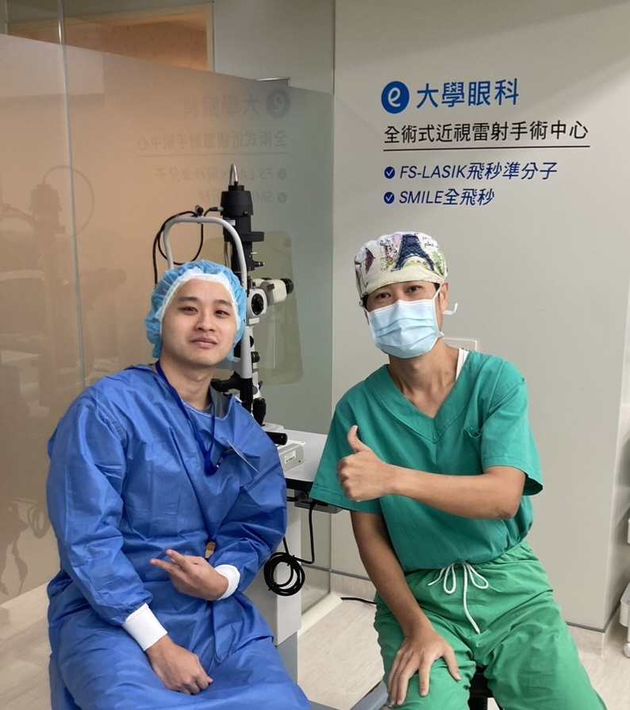

# Why

1. I love outdoor activities, and glasses get in the way
2. I've always thought I look better without glasses
3. Glasses, contact lenses, and lens solution add up to a lot of money, and wearing contacts a lot also raises the risk of bacterial infections or styes
4. I was always too worried about side effects to do it, but SMILE actually leaves a relatively small incision and is less likely to cause dry eye
5. Clearing up my doubts: 1. Even if you've had laser vision correction, you can still have surgery for glaucoma or cataracts later, because they're done in different places 2. If I get presbyopia later on, we'll evaluate it then
6. Seeing that the clinic director and almost all of the staff had had the surgery is what finally put my mind at ease
7. I finally saved up enough money for the surgery

# Why I chose SMILE and the University Eye Clinic

1. Smaller incision and faster recovery
2. Less likely to cause dry eye
3. Short surgery time
4. Super close to home
5. The doctor has a great reputation

# Price

smile pro : NT$125,000 (supposedly done in 10s)
smile : NT$115,000 (takes 23~25s)

# Before the Surgery

1. No contact lenses for the week before
2. No eye drops of any kind
3. Get a good night's sleep the night before, but I was too excited to sleep well

# The Procedure

1. First they check your vision again, then you take a painkiller
2. Before going into the operating room, they disinfect around your eyes, put in numbing drops, and you change into a surgical gown
3. In the operating room you lie flat. I kept worrying something out of Final Destination would happen XD
4. You keep staring at a point of light until everything in front of you turns white (the doctor tells you to zone out). They say it's 20~25 seconds per eye, but it felt like over a minute to me XD, because the doctor also has to take out the piece of cornea that was cut, which takes quite a while haha
5. During the procedure it just feels like someone is touching your eyeball, a little prickly, but it doesn't hurt
6. When it's over and you open your eyes, everything is foggy, like you're in a steam room
7. The doctor checks your eyes with a machine, and once everything's fine you take a photo together and you're done
8. Remember to put on protective goggles before heading home

PS: The doctor was even chatting with the people next to him during the surgery. He must be really relaxed haha

# Aftercare

1. Your eyes can't get wet after surgery, so it's best to wash your hair and shower before the surgery
2. Wear the protective goggles for the whole first day to keep out dust and debris
3. There are three eye drops: a steroid (helps the incision heal), an antibiotic (prevents inflammation and infection), and artificial tears (prevents dryness). You must use them
4. Rest with your eyes closed as much as possible (listen to podcasts or music)
5. There's a follow-up visit the next day. Basically, once the doctor says everything's fine, you can get your eyes wet and stop wearing the goggles
6. No food restrictions, but I ate extra protein anyway

# Changes

1. When I woke up and could see everything clearly, I almost thought I'd forgotten to take my contacts out XD
2. At first everything looked a little misty, but it gradually got better

