> Foreigners everywhere, mostly Europeans and Americans
> New Year's Eve was an absolute blast🎇
> Honestly, people in Hanoi aren't as fierce as I'd imagined

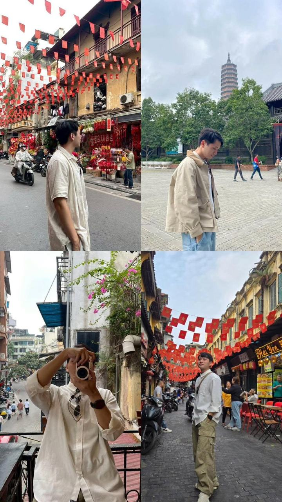

# Preparation

- Winter weather in Hanoi is about the same as Taipei. We actually packed quite a lot of clothes, but watch out for the big temperature swings🥶. Dressing in layers is the way to go.
- We didn't bring much cash💴: just NT$10,000 for the two of us, and paid by card for everything else. Note that some shops add a 3% surcharge for cards.
- You need to apply for a visa in advance; it takes about 3–10 days to be issued. Website: [E-VISA](https://evisa.gov.vn/)
- See also: [A must-read for independent travel in Vietnam! This is the only Vietnam packing guide you need](https://www.outo.co/blogs/articles/vietnam-travel-packing-list)

# Itinerary

## Day 1

Our flight landed in Hanoi around 11:30 a.m. After immigration and baggage claim, we took a car to our Airbnb, got there around 1:00 p.m. and dropped off our bags.
This time we stayed near Hoan Kiem Lake, the most expensive and most bustling area in Hanoi. The New Year's Eve celebration is held here too, so that's why we chose it as our base.
We went straight to a place near the Airbnb to exchange money💰. Location: https://maps.app.goo.gl/tvLv8q8iSpSz39FP8
For lunch we found a restaurant near [Ta Hien Beer Street](https://maps.app.goo.gl/Pm6PuWu8ccMDrVd76). The view was amazing!

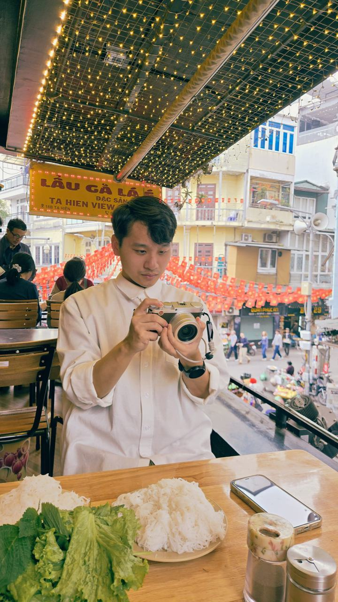
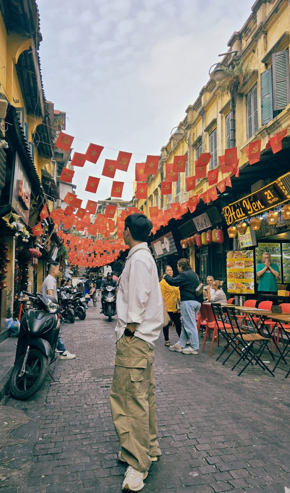
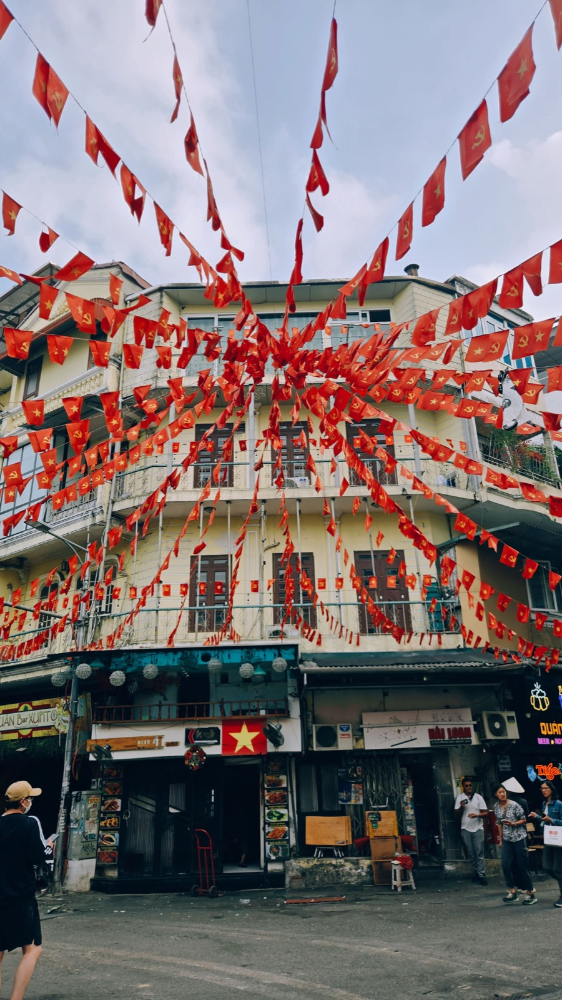

Then we went to a famous sight: [Tran Quoc Pagoda](https://maps.app.goo.gl/rETqcT6Q8Lk7ipBWA). It's super beautiful and super photogenic.

The history of Tran Quoc Pagoda dates back to the 6th century under Emperor Ly Nam De (Lý Nam Đế), and it's widely recognized as the oldest Buddhist temple in Hanoi. It was originally named Khai Quoc Pagoda (Chùa Khai Quốc) and stood on the banks of the Red River (Sông Hồng). In 1615 it was moved to Kim Ngu Island (Đảo Kim Ngư) on West Lake (Hồ Tây) to protect it from erosion. Over time the pagoda was renamed several times, each name reflecting a different period of history.
Throughout its history, the pagoda has welcomed many royal visits and important cultural exchanges. In 1959, Indian President Rajendra Prasad gifted a Bodhi tree grafted from the sacred tree under which the Buddha attained enlightenment, symbolizing the deep Buddhist bond between Vietnam and India. Today Tran Quoc Pagoda is a revered landmark that carries the nation's spiritual and architectural heritage. (source:https://www.vietnamairlines.com/tw/zh-tw/plan-book/travel/travel-guide/tran-quoc-pagoda)

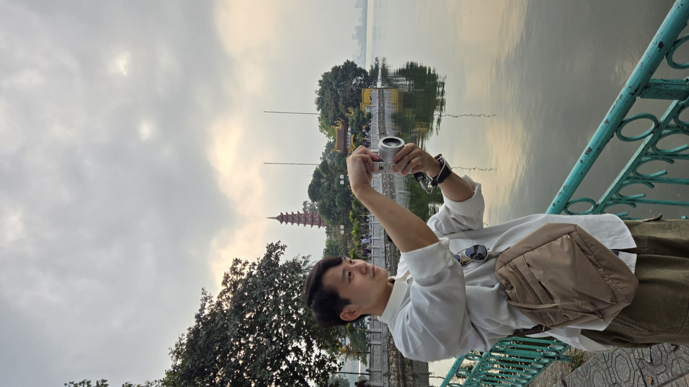

The eleven-story stupa, built in 1998, is the pagoda's most eye-catching feature, standing 15 meters tall. Its symmetrical design is decorated with finely carved lotus motifs symbolizing spiritual awakening. Each of the eleven levels has six arched windows, and each window holds an Amitabha Buddha (Phật A Di Đà) statue carefully carved from gemstone, 66 in total.
The top of the stupa is a nine-tiered lotus pedestal, also made of gemstone, symbolizing spiritual ascension. This architectural masterpiece sits in harmony with the sacred tree gifted in 1959 by Indian President Rajendra Prasad, grafted from the original Bodhi tree at Bodh Gaya (Bồ Đề Đạo Tràng) where the Buddha attained enlightenment, deepening the temple's spiritual significance.
(source:https://www.vietnamairlines.com/tw/zh-tw/plan-book/travel/travel-guide/tran-quoc-pagoda)
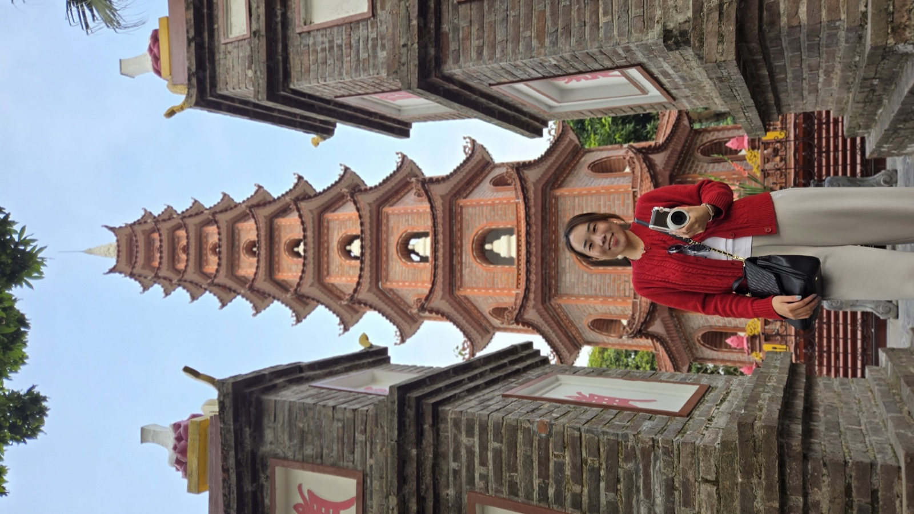

Afterwards we headed back into central Hanoi to see the Catholic cathedral, [St. Joseph Cathedral](https://maps.app.goo.gl/MYqobPe61erGe3NS6). It was just a few days after Christmas, so the Christmas tree was still up outside, and there were fewer people at night.
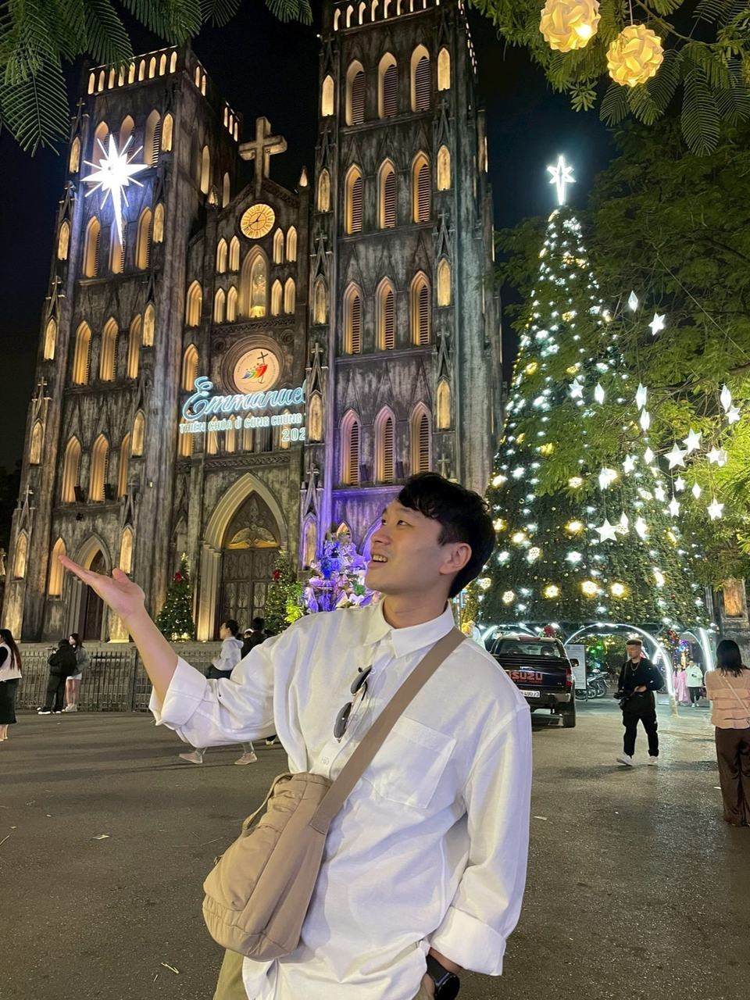

Then we walked to the famous [Hanoi Train Street](https://maps.app.goo.gl/bVYmPjvnyqm6supg8). I'd suggest getting there 30–60 minutes before the train comes through.

<iframe class="yt short" src="https://www.youtube-nocookie.com/embed/3xjEDx9t3Gc" title="YouTube video" loading="lazy" allow="accelerometer; clipboard-write; encrypted-media; gyroscope; picture-in-picture; web-share" referrerpolicy="strict-origin-when-cross-origin" allowfullscreen></iframe>

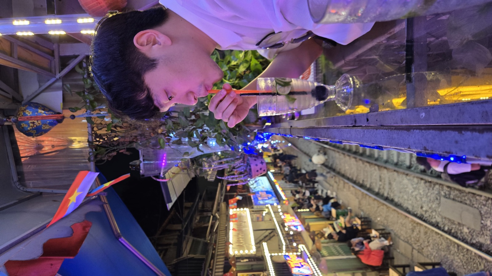

After that we tried a Vietnamese-style hair wash (turns out they scrub your scalp hard with their nails!), then went back to our place.

## Day 2 (Trang An)

Today we headed to Trang An. In Taiwan people call it "Ha Long Bay on land" (陸龍灣), but Vietnamese people call it the Trang An Landscape Complex. It's not only a UNESCO World Heritage Site, but also a filming location for the movie "Kong: Skull Island".
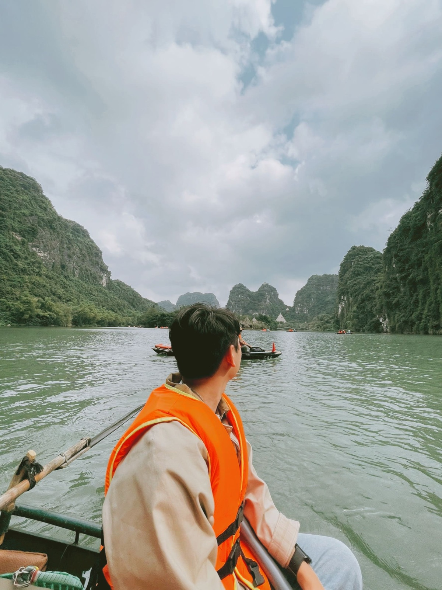
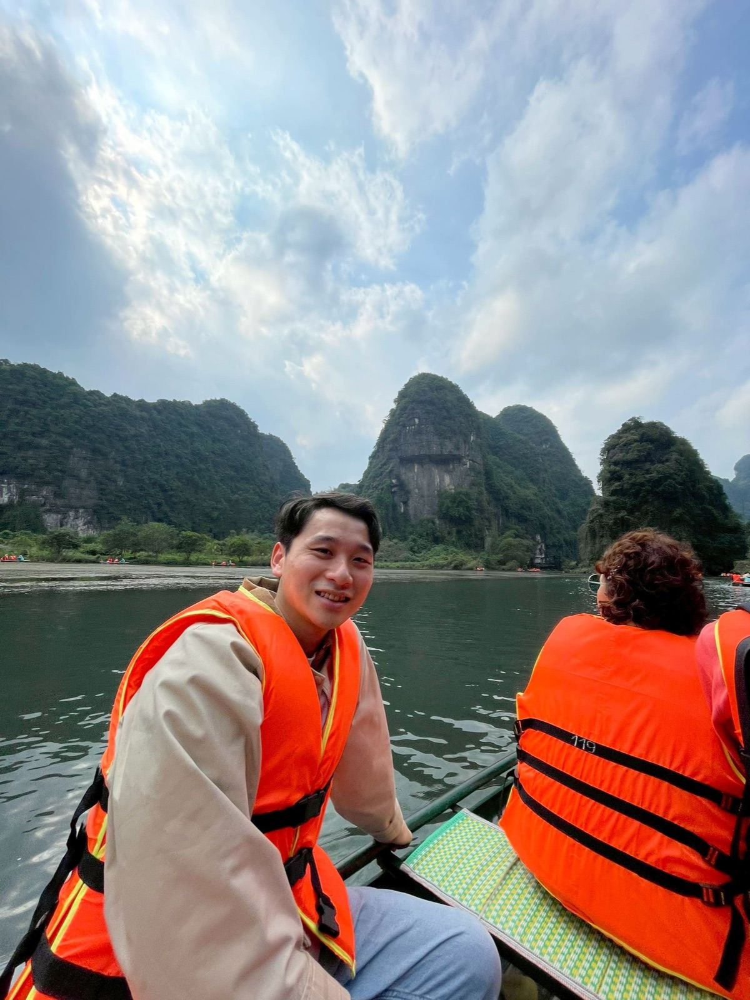

We visited Bai Dinh Pagoda, the largest Buddhist site in Vietnam, number one in the country for both its size and its collection. We saw the Korean stars Kim Seon-ho and Jisoo here.
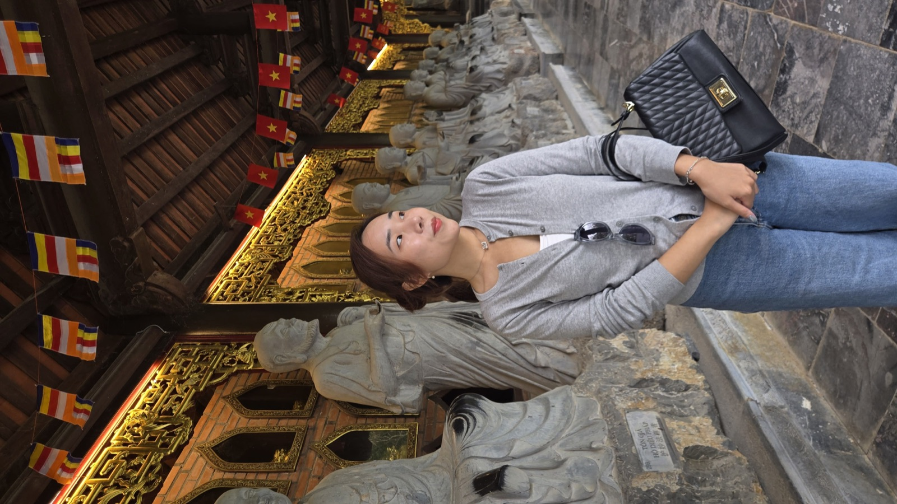
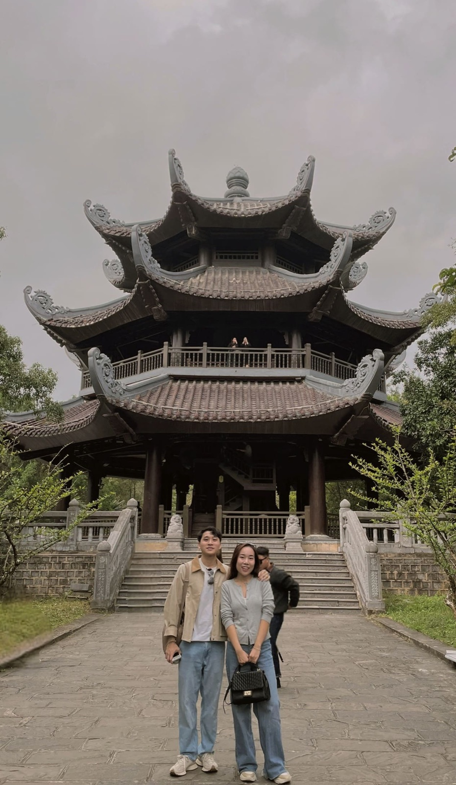

At Mua Cave in Ninh Binh, we climbed up to the viewpoint
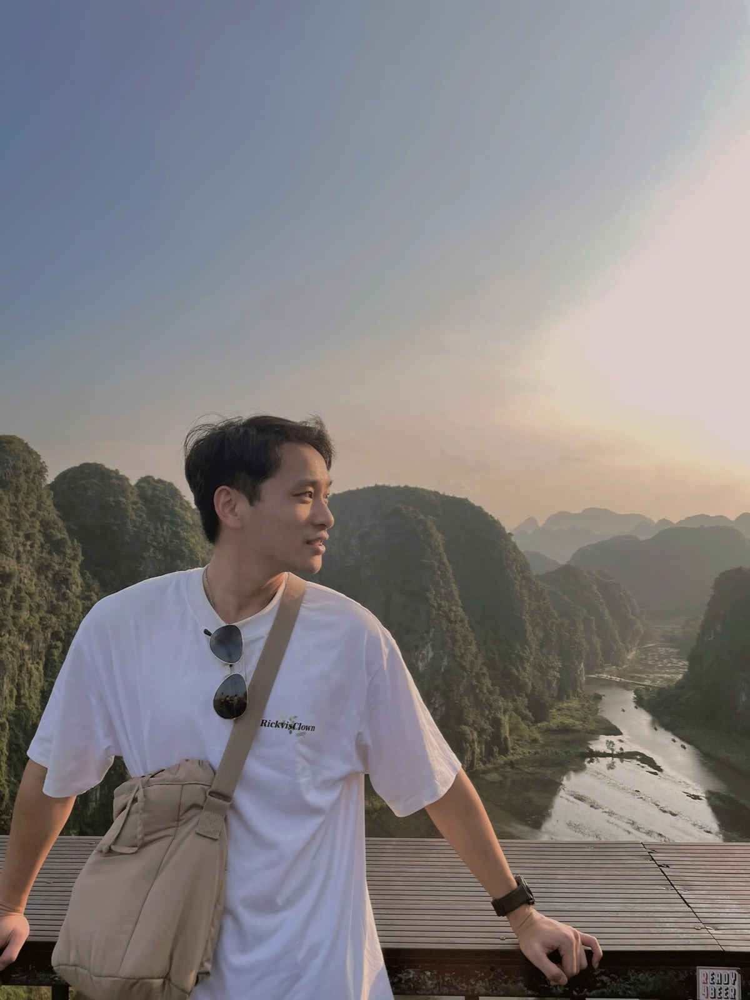

> The Trang An trip was my favorite part of the whole trip. That day we didn't just see Kim Seon-ho and Jisoo, we saw Alan Walker too!

That night we joined the New Year's Eve festivities, counting down while eating at a street stall. New Year's Eve in Vietnam is an absolute blast.

<iframe class="yt short" src="https://www.youtube-nocookie.com/embed/q6dic_H1Asg" title="YouTube video" loading="lazy" allow="accelerometer; clipboard-write; encrypted-media; gyroscope; picture-in-picture; web-share" referrerpolicy="strict-origin-when-cross-origin" allowfullscreen></iframe>

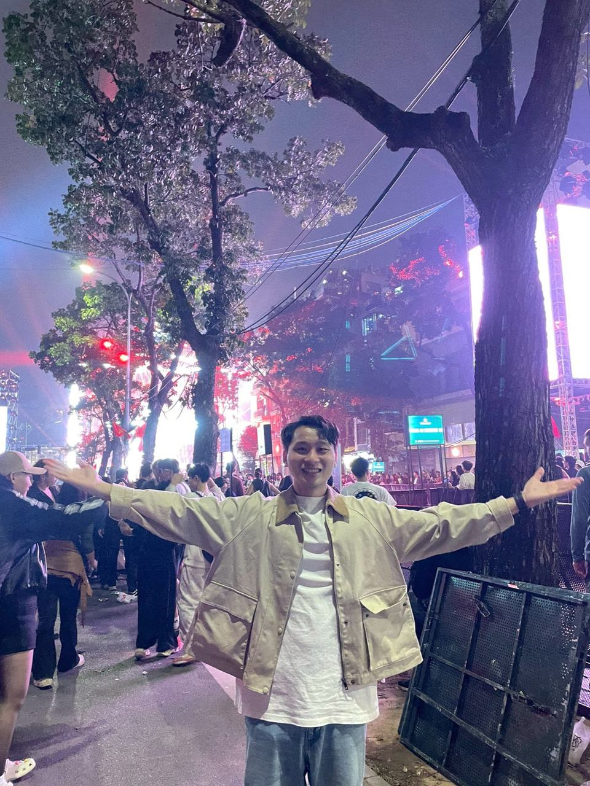

After the countdown we went for another Vietnamese hair wash, but this time the experience wasn't great: they straight up asked us for a tip.

## Day 3

Today we slept in and went straight to lunch: frog hot pot.
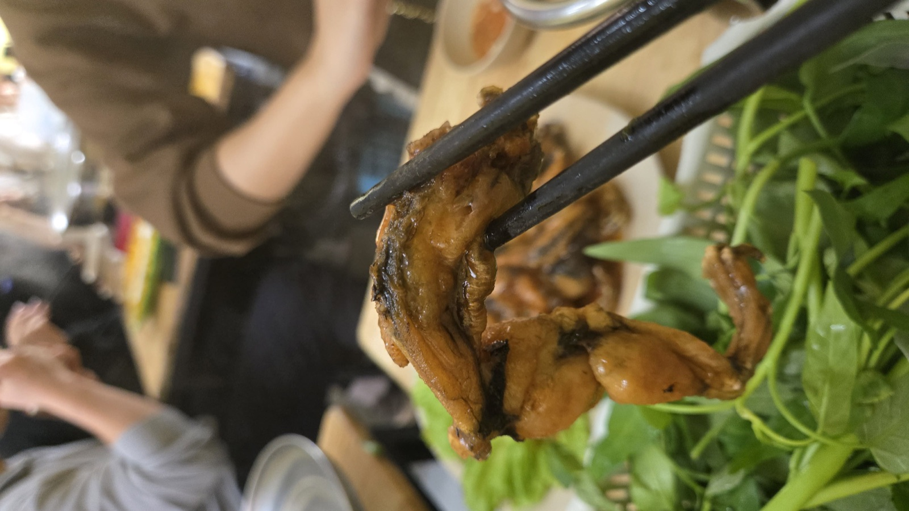

We wandered the streets of Vietnam. The traditional Vietnamese markets and the streets themselves are beautiful and well worth exploring.
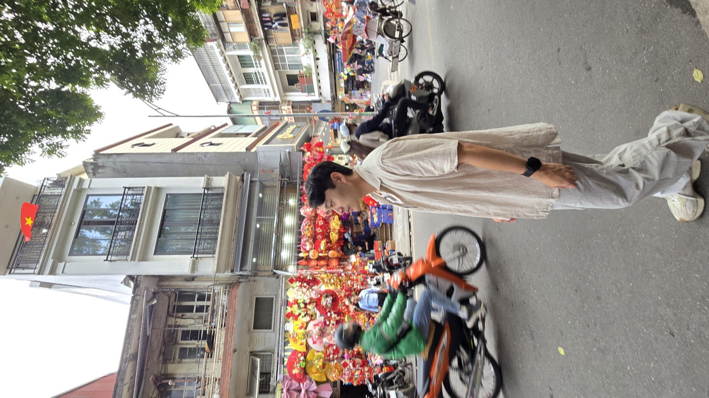

## Day 4 (Ha Long Bay)

Ha Long Bay is beautiful, but way too crowded!
The cruise ship was pretty nice inside and out~
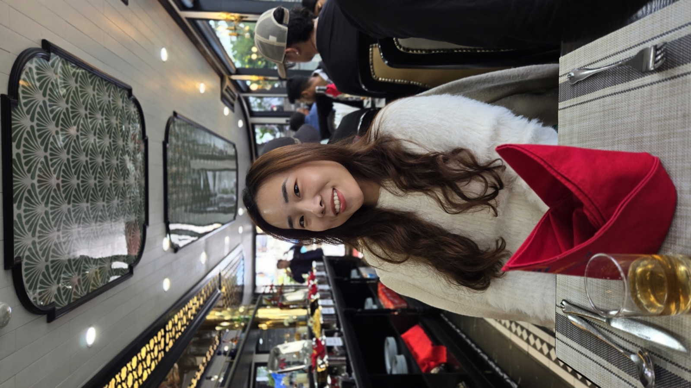
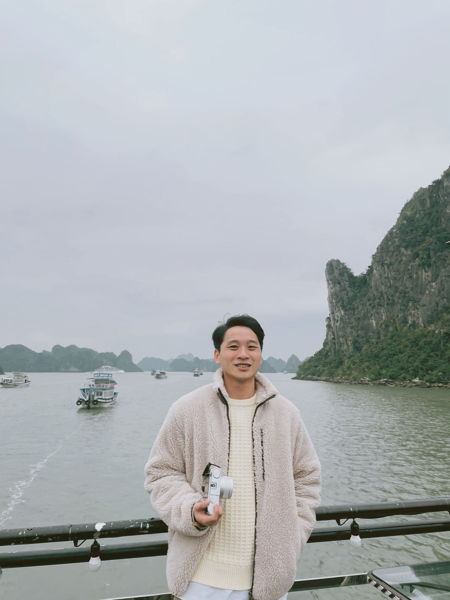
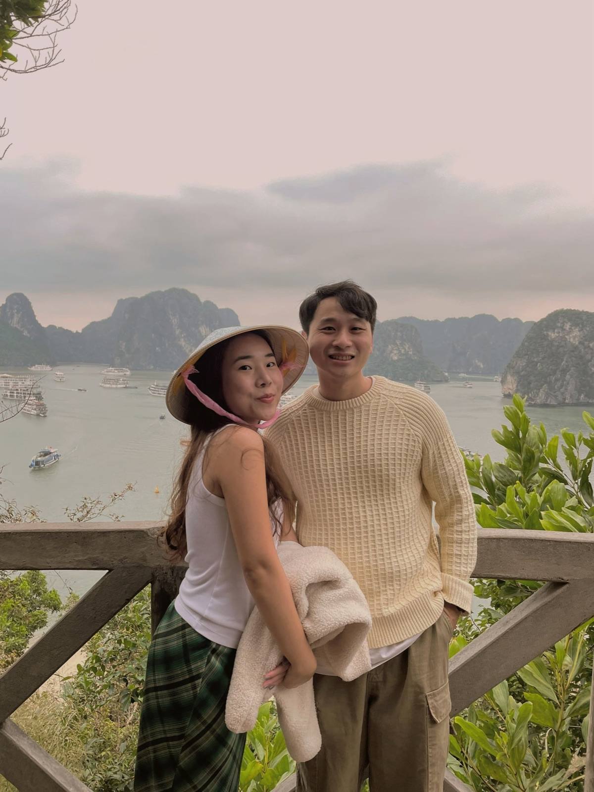

Back in Hanoi, we made the most of our last bit of time buying souvenirs and getting foot massages. I really enjoyed our time here.

[Little diary]: Something unexpected happened today. On the way to Ha Long Bay, my girlfriend spilled coffee on herself and her whole lower half was soaked. And we hadn't brought any tissues or wet wipes, so we were totally desperate. Luckily there were some Taiwanese people sitting in front of us, so we borrowed some tissues from them, did a quick wipe-down, and when we got to the rest stop she rushed to the restroom to clean up. I stayed with her through the whole thing and told her I'd be right there with her and we'd sort out her clothes together, to help her feel at ease and stay positive. I learned a lot~

## Day 5

In the morning we tried a local breakfast here. It's kind of like a batter-style egg crepe, but filled with minced meat, and you dip it in fish sauce with cilantro. I loved it.
Then we grabbed a coffee and took a car to the airport, wrapping up a wonderful trip to Hanoi.

# Thoughts

I'll really miss the people and everything about this place, especially the lady who washed our hair on the first day. She recommended lots of local food and spots to my girlfriend. Thanks also to everyone we met here for being so kind and sincere. The food was great, and even someone with a sensitive stomach like me didn't get sick. We ran into celebrities abroad, and it was also my first time celebrating New Year's Eve with my girlfriend.
Wishing everyone all their wishes come true and good health in 2026~

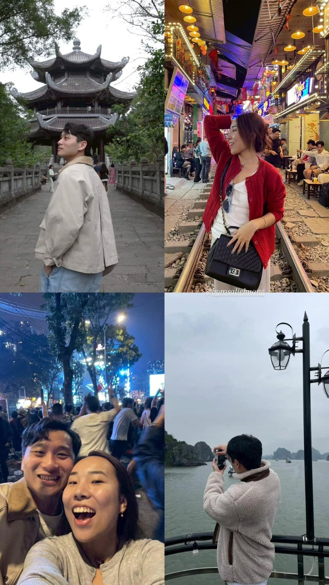
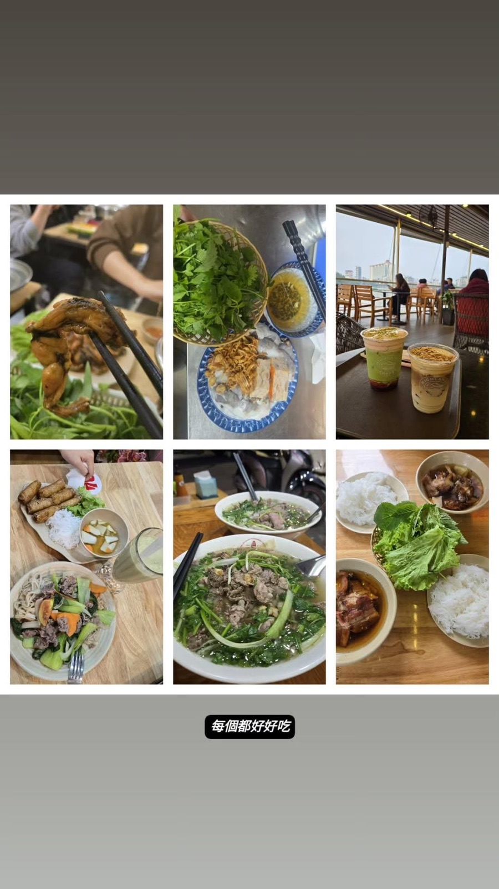

# Total Cost

Costs for two people:
810 ➜ visa (just me)
18000 ➜ airplane
5700 ➜ airbnb
2750 ➜ Trang An
310 ➜ sim (just me)
2930 ➜ Ha Long Bay
2000 ➜ card payments
10000 ➜ cash

 **Total: 43000**
