> 到處都是外國人，歐美人偏多
> 跨年超級嗨🎇
> 其實河內人沒想像中兇

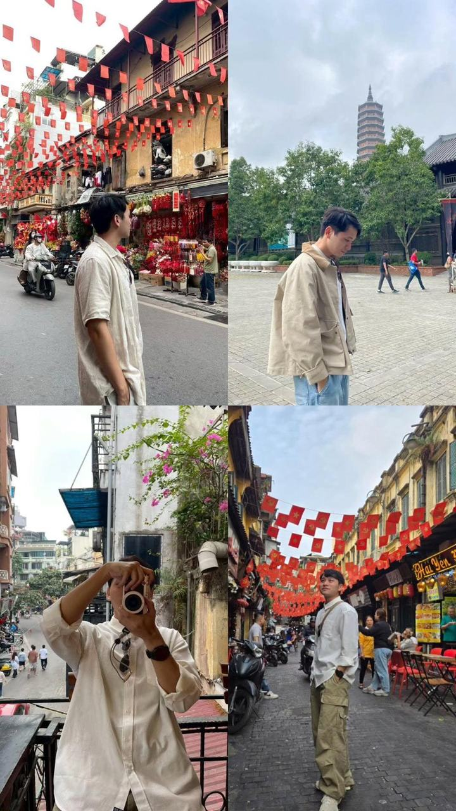

# 行前準備

- 河內冬季天氣跟台北差不多，其實衣物也帶不少，但要注意溫差大🥶，建議洋蔥式穿法。
- 現金💴我們其實帶不多，兩個人只花一萬塊台幣，其他都是刷卡，要注意有些店家刷卡會多收3%。
- 需要先申請簽證，大概3~10天會核發下來，網址：[E-VISA](https://evisa.gov.vn/)
- 請參考：[越南自由行必讀！越南自由行打包行李攻略看這篇就夠了](https://www.outo.co/blogs/articles/vietnam-travel-packing-list)

# 行程

## Day 1

飛機抵達河內約中午11:30，入境領行李，坐車到Airbnb約13:00抵達，放妥行李。
這次我們住還劍湖附近，是河內最貴也是最繁華的區域，因為跨年也在這裡舉辦，因此我們選擇這裡落腳。
我們直接到Airbnb附近的地方換💰，地點：https://maps.app.goo.gl/tvLv8q8iSpSz39FP8
中午我們在[Ta Hien Beer Street](https://maps.app.goo.gl/Pm6PuWu8ccMDrVd76)附近找餐廳吃飯，景色超級讚！

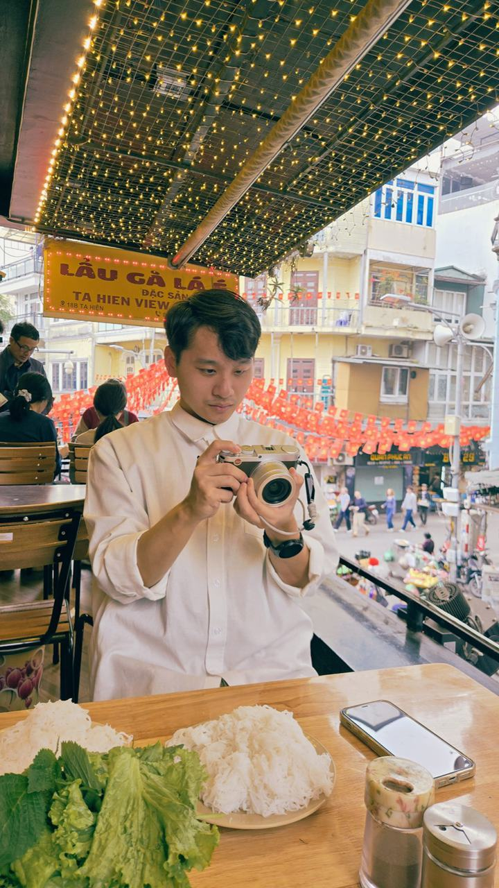
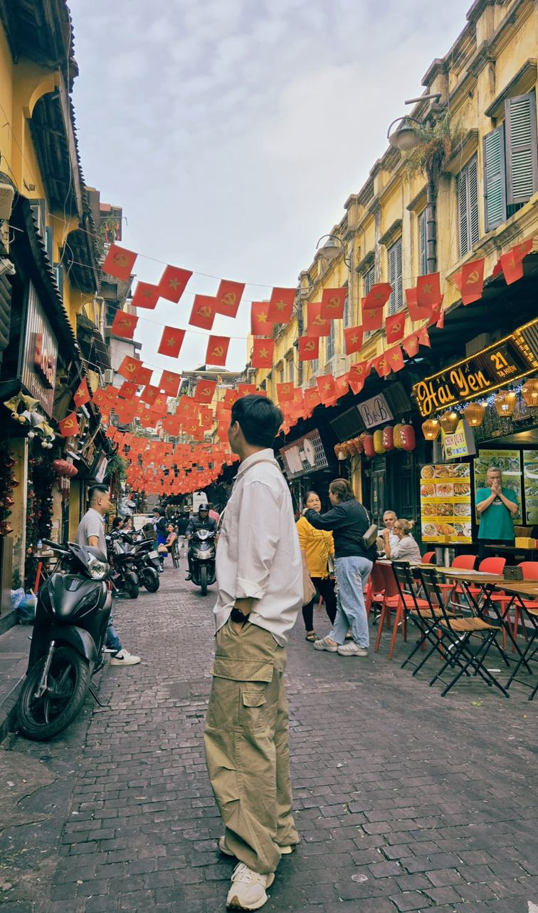
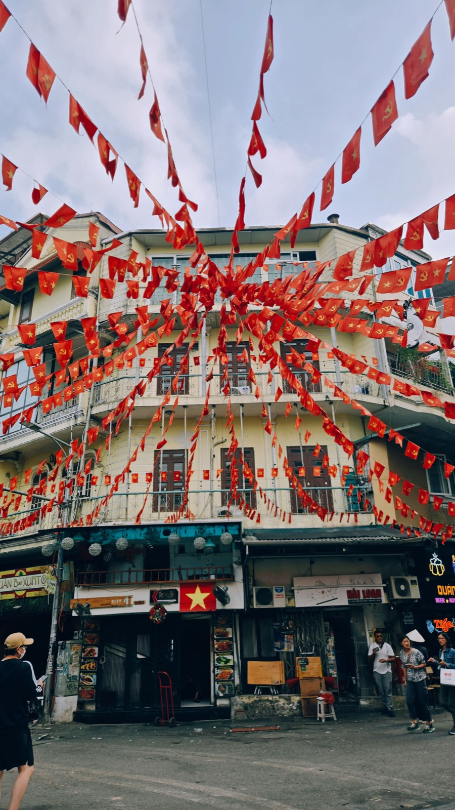

之後去到著名景點：[鎮國寺](https://maps.app.goo.gl/rETqcT6Q8Lk7ipBWA)，這裡景色超美也超好拍。

鎮國寺的歷史可追溯至第六世紀的李南帝 (Lý Nam Đế) 時期，被公認為河內最古老的佛寺。最初名為開國寺 (Chùa Khai Quốc)，寺廟原址位於紅河 (Sông Hồng) 沿岸，後於1615年為防止侵蝕而遷至西湖 (Hồ Tây) 的金魚島 (Đảo Kim Ngư)。隨著時間的推移，寺廟曾多次更名，每一次都反映了不同的歷史階段。
縱觀其歷史，寺廟曾迎接過多次皇室參訪及重要的文化交流。1959年，印度總統拉金德拉·普拉薩德 (Rajendra Prasad) 贈予一棵從佛陀悟道的聖樹上嫁接而來的菩提樹，象徵著越南與印度之間深厚的佛教情誼。如今，鎮國寺是一處備受敬仰的地標，承載著民族的心靈與建築遺產。(source:https://www.vietnamairlines.com/tw/zh-tw/plan-book/travel/travel-guide/tran-quoc-pagoda)

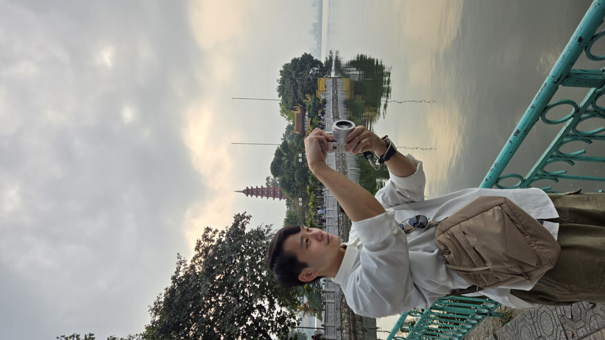

建於1998年的十一層寶塔是鎮國寺最引人注目的特徵，高達15公尺。其對稱的設計裝飾著精雕細琢的蓮花圖案，象徵著心靈的覺悟。十一層的每一層都設有六扇拱形窗戶，每扇窗內都供奉著一尊由寶石精心雕琢的阿彌陀佛 (Phật A Di Đà) 像，總計66尊。
寶塔頂端是一座九層蓮台，同樣由寶石製成，象徵著心靈的升華。這座建築傑作與1959年印度總統拉金德拉·普拉薩德 (Rajendra Prasad) 所贈、從佛陀證道的菩提伽耶 (Bồ Đề Đạo Tràng) 原始菩提樹嫁接而來的聖樹和諧相伴，更深化了寺廟的心靈意義。
(source:https://www.vietnamairlines.com/tw/zh-tw/plan-book/travel/travel-guide/tran-quoc-pagoda)
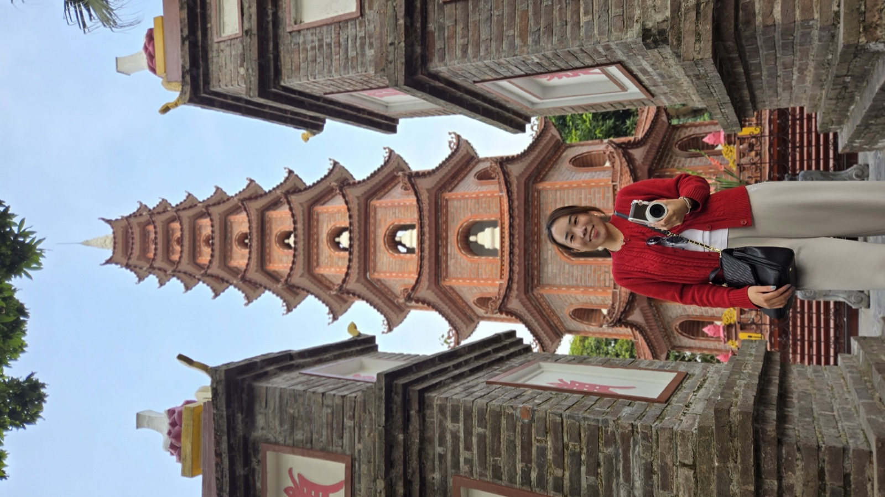

離開後回到河內市區，欣賞天主教堂[St. Joseph Cathedral](https://maps.app.goo.gl/MYqobPe61erGe3NS6)，剛好又是聖誕節後幾天，外面還有聖誕樹，晚上人潮也較少。
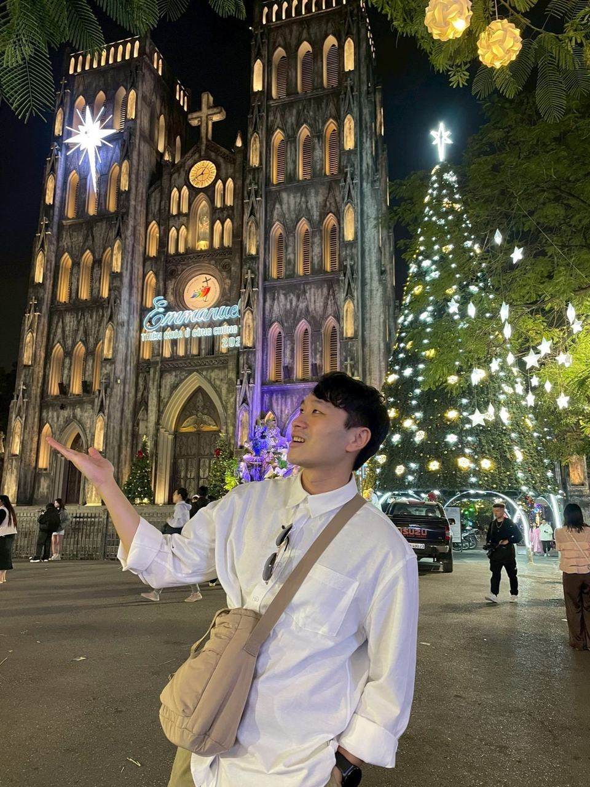

再步行抵達著名的[河內火車街](https://maps.app.goo.gl/bVYmPjvnyqm6supg8)，建議在火車班次前提早30~60分鐘抵達。

<iframe class="yt short" src="https://www.youtube-nocookie.com/embed/3xjEDx9t3Gc" title="YouTube video" loading="lazy" allow="accelerometer; clipboard-write; encrypted-media; gyroscope; picture-in-picture; web-share" referrerpolicy="strict-origin-when-cross-origin" allowfullscreen></iframe>

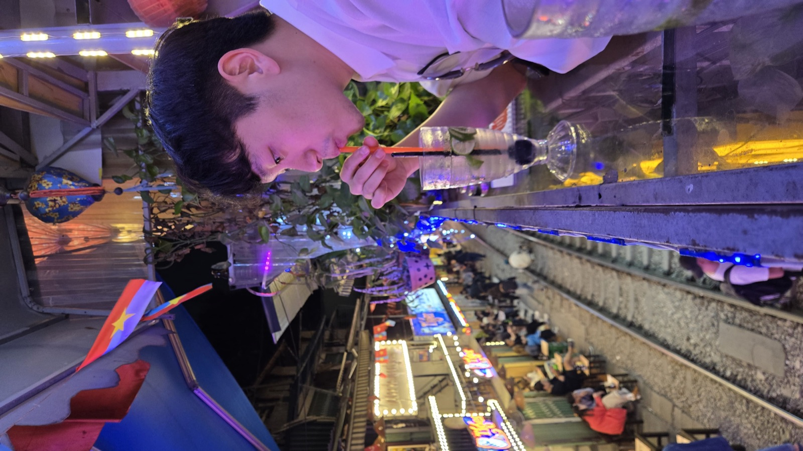

結束後，體驗了越式洗頭（原來洗頭都是用指甲用力清洗），回民宿。

## Day 2 (長安：陸龍灣)

今天行程前往陸龍灣，其實這是台灣講法，越南人都稱作長安名勝群，這裡不僅是聯合國教科文組織世界遺產，也是電影《金剛：骷髏島》的取景地。
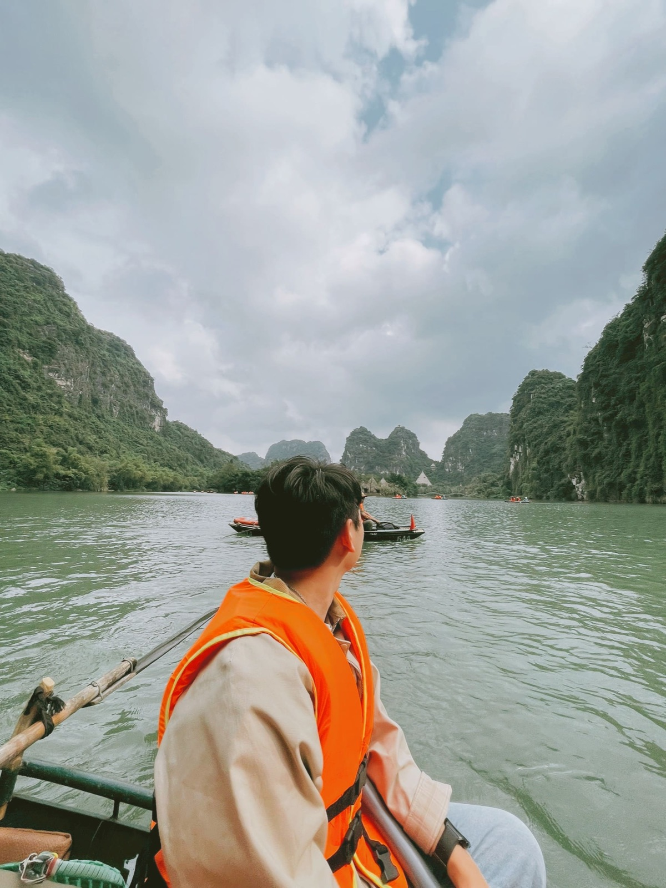
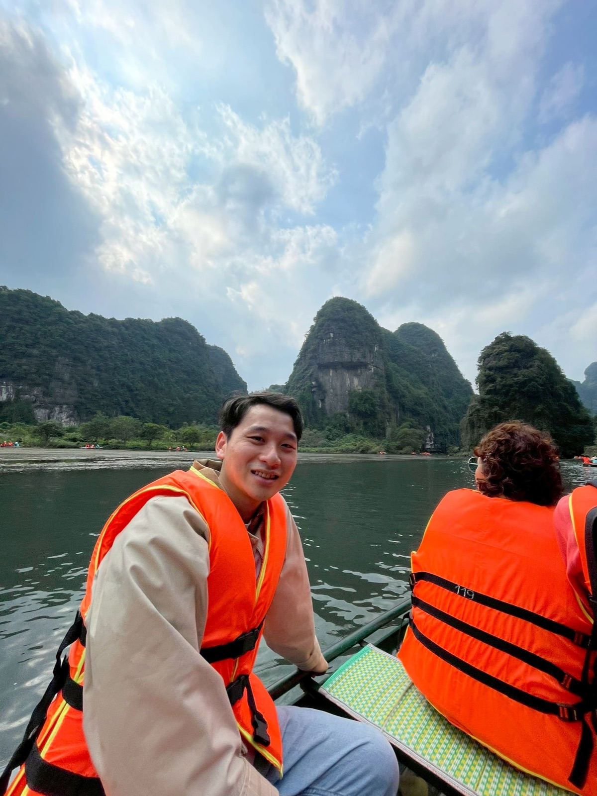

參訪越南最大的佛教聖地白亭寺，其規模與藏物皆為越南第一。在這裡看到韓星金宣虎跟智秀。
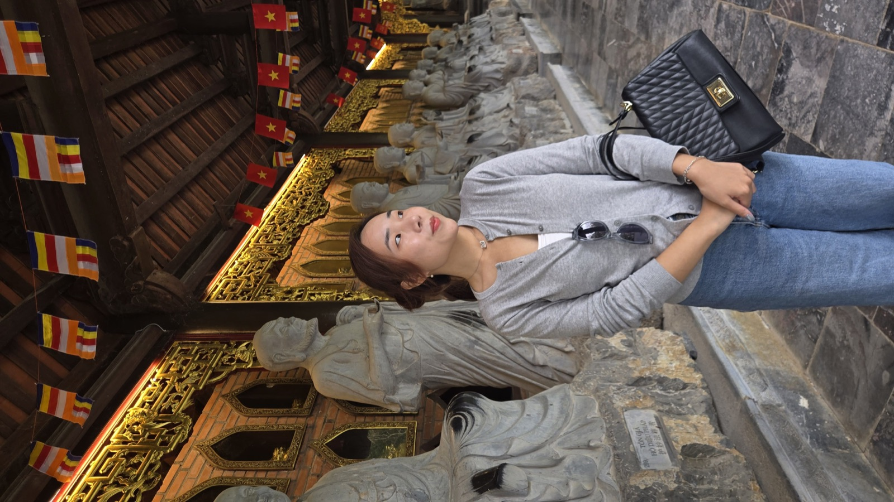
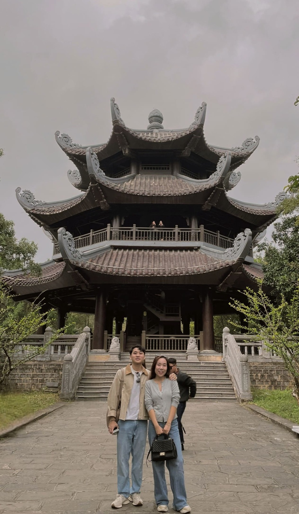

寧平碧洞 (Mua Cave)，登上觀景台
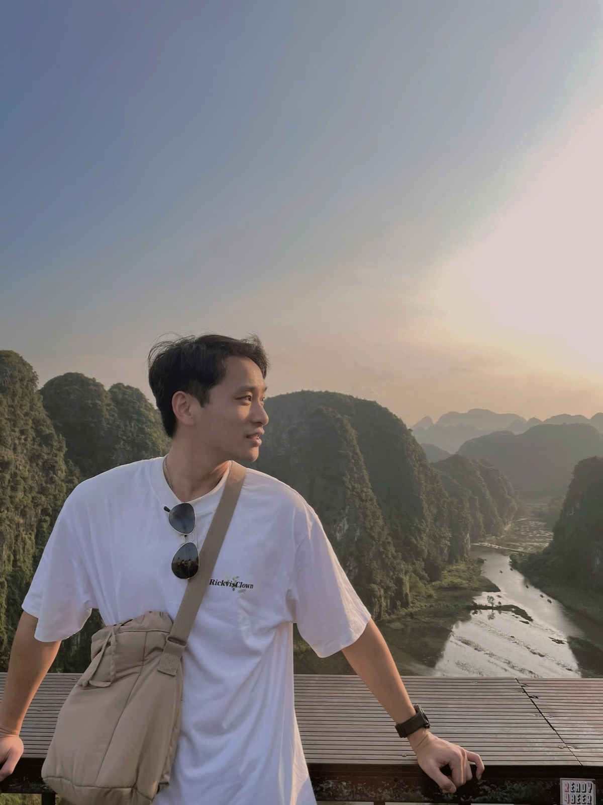

> 陸龍灣行程是我最喜歡的行程，在這天不只看到金宣虎跟智秀，也看到Alan Walker!

參加晚上的跨年行程，體驗在路邊攤邊吃東西邊跨年，越南跨年超級嗨。

<iframe class="yt short" src="https://www.youtube-nocookie.com/embed/q6dic_H1Asg" title="YouTube video" loading="lazy" allow="accelerometer; clipboard-write; encrypted-media; gyroscope; picture-in-picture; web-share" referrerpolicy="strict-origin-when-cross-origin" allowfullscreen></iframe>

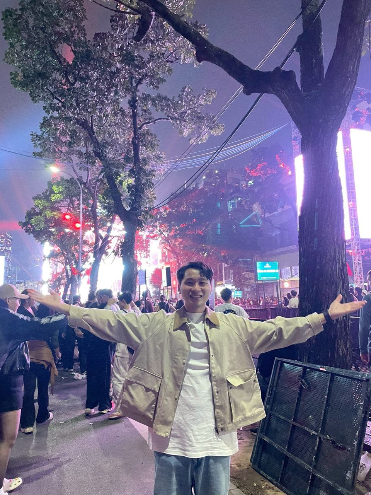

跨年結束後也去越南洗頭，但這次體驗沒有很好，直接被要小費。

## Day 3

今天睡到自然醒，直接午餐去吃青蛙火鍋。
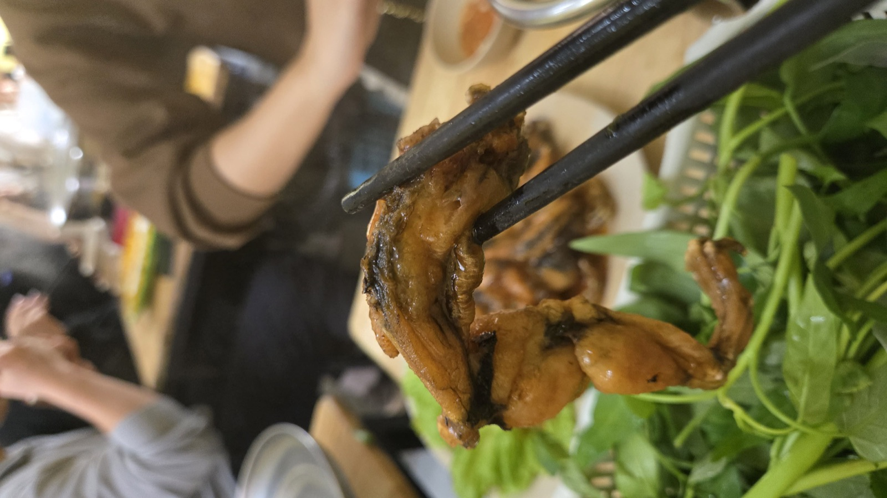

在越南街頭到處逛街，越南的傳統超市及越南的街頭都很美也很值得逛逛。
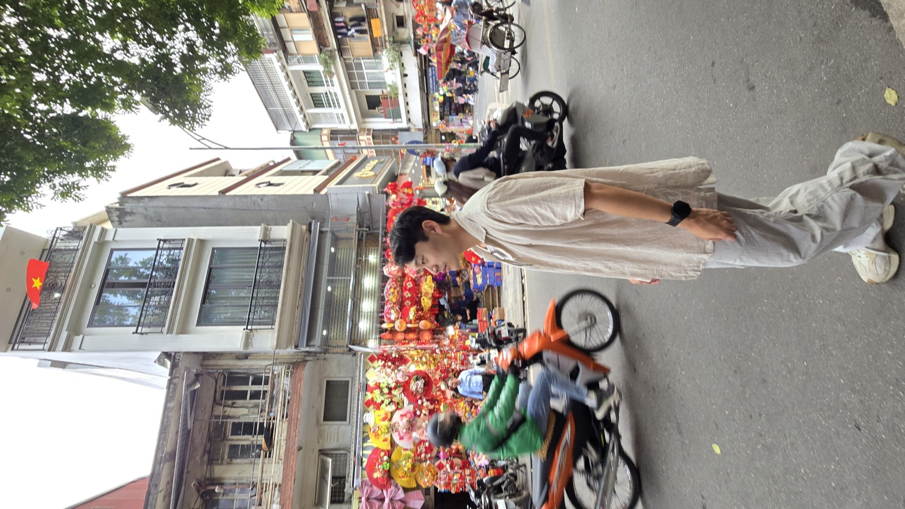

## Day 4 (下龍灣)

下龍灣很美但是人太多了！
郵輪外觀跟裡面都滿美的～
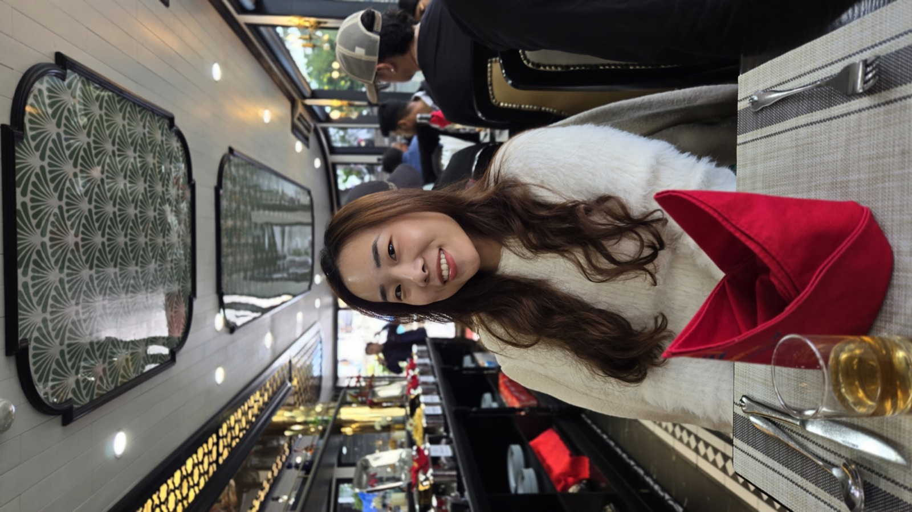
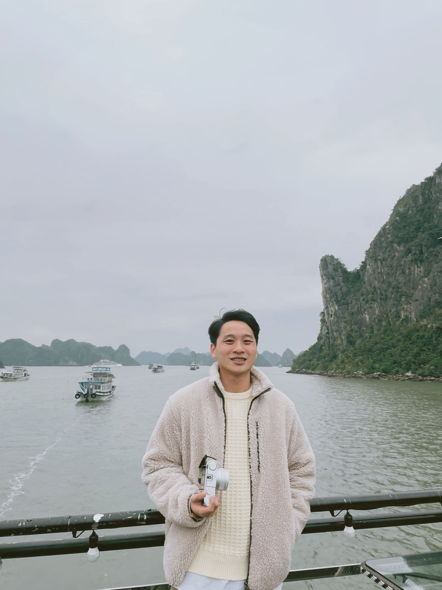
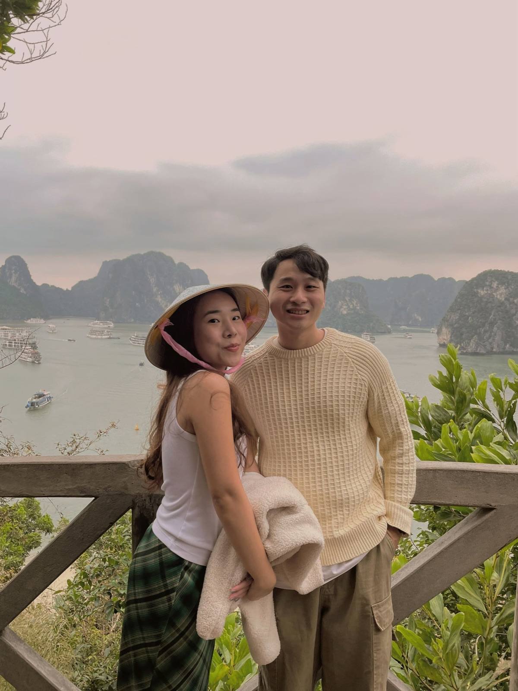

回到河內後，我們把握最後時間購買紀念品跟腳底按摩，非常享受在這裡的時間。

[小日記]: 今天遇到突發狀況，坐車前往下龍灣路上，女友把咖啡打翻在衣服上，整個下半身都浸濕在咖啡中，而且我們又沒帶衛生紙也沒帶濕紙巾，非常絕望，還好前面坐台灣人，我們跟他借衛生紙，簡單擦拭後，在抵達休息站時，快速到洗手間清理。這過程我全程陪伴著女友也告訴她我會陪在她身邊，我們可以處理好衣服的，讓她安心，也讓她保持樂觀，學到很多～

## Day 5

早上在這裡體驗當地早餐，有點像麵糊蛋餅，但裡面是包肉末，沾魚露跟香菜吃，我很喜歡。
再買杯咖啡，就搭車前往機場，結束美好的河內之旅。

# 心得

我會很懷念這裡的人事物，尤其是第一天洗頭的姊姊，她推薦女友很多在地美食跟景點，也謝謝我們在這裡遇到的人都很善良也很誠懇，食物都很好吃就算我這種腸胃敏感的人也沒拉肚子。在國外遇到明星，也是第一次跟女友一起跨年。
祝大家在2026年都能心想事成，身體健康～

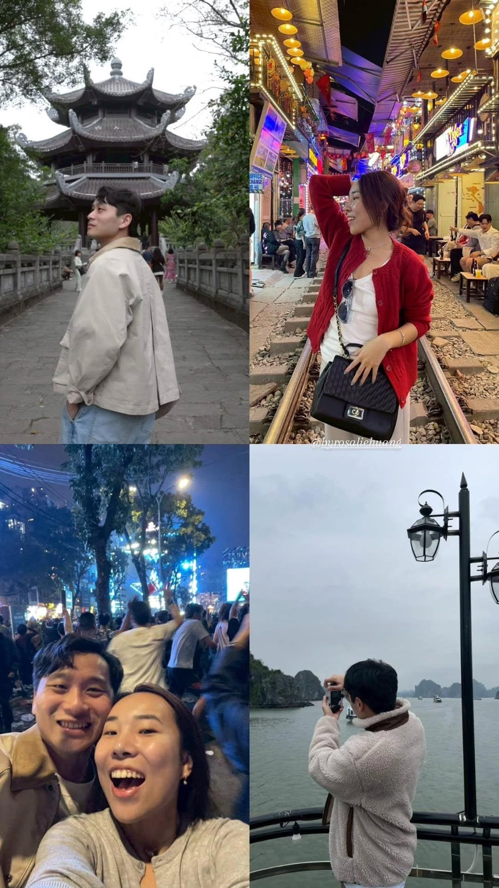
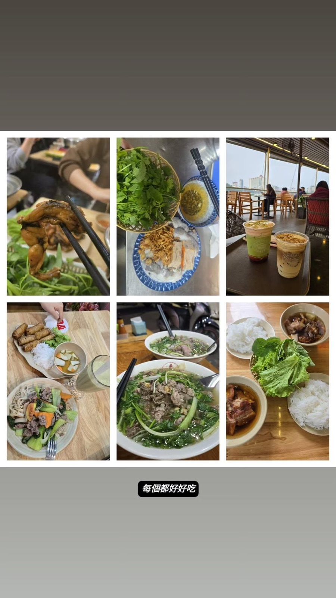

# 總花費

以下為兩人花費：
810 ➜ visa （只有我）
18000 ➜ airplane
5700 ➜ airbnb
2750 ➜ 長安
310 ➜ sim （只有我）
2930 ➜ 下龍灣
2000 ➜ 刷卡
10000 ➜ 現金

 **總共：43000**

