> Idaho is the most comfortable place I've ever stayed — the roads and houses are all big and spacious
> It's an almost entirely white state

Travel video memories 1

<iframe class="yt short" src="https://www.youtube-nocookie.com/embed/d23OiaHArWg" title="YouTube video" loading="lazy" allow="accelerometer; clipboard-write; encrypted-media; gyroscope; picture-in-picture; web-share" referrerpolicy="strict-origin-when-cross-origin" allowfullscreen></iframe>

Travel video memories 2

<iframe class="yt short" src="https://www.youtube-nocookie.com/embed/l0jXuHfz_4c" title="YouTube video" loading="lazy" allow="accelerometer; clipboard-write; encrypted-media; gyroscope; picture-in-picture; web-share" referrerpolicy="strict-origin-when-cross-origin" allowfullscreen></iframe>

# Day 1 Boise

By the time my flight from San Diego landed in Boise it was already 1pm. The main reason I came to this state is that my college friend Stanley lives here, so for the rest of the trip I just tagged along with him

First stop was the Boise Depot, where you can take in a beautiful night view over the whole city. Boise is the biggest city in Idaho, but compared to other cities its population is still much smaller. You can really feel the warmth of the people here, and everyone looks out for each other

<iframe src="https://www.google.com/maps/embed?pb=!1m18!1m12!1m3!1d5691.578882854175!2d-116.2193188983555!3d43.60225603838062!2m3!1f0!2f0!3f0!3m2!1i1024!2i768!4f13.1!3m3!1m2!1s0x54aef860262ae78f%3A0x68dc9eba08d5c82c!2sBoise%20Depot!5e0!3m2!1szh-TW!2stw!4v1779589904042!5m2!1szh-TW!2stw" width="600" height="450" style="border:0;" allowfullscreen="" loading="lazy" referrerpolicy="no-referrer-when-downgrade"></iframe>

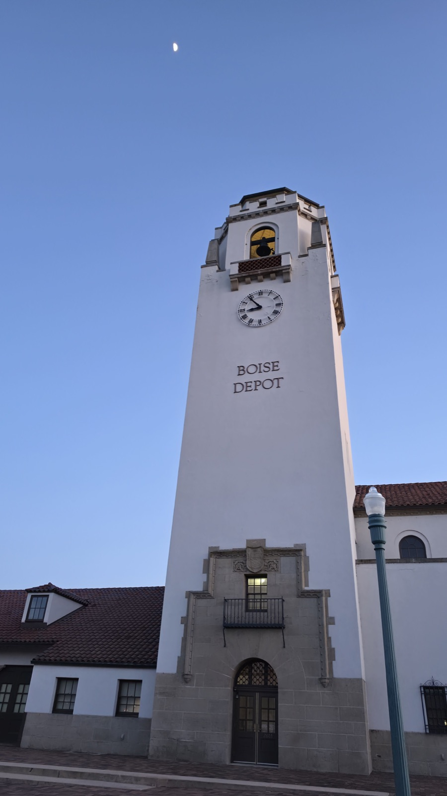

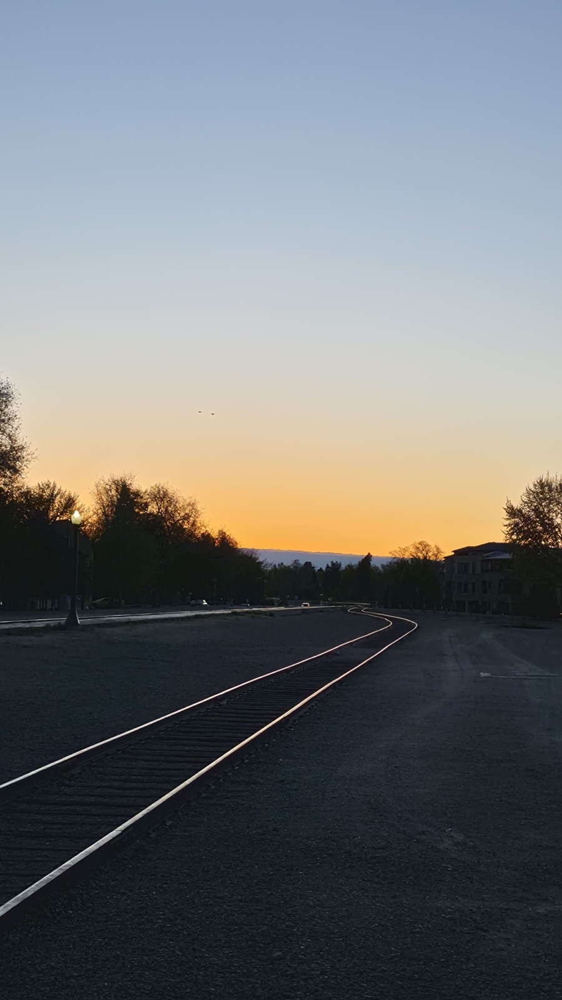

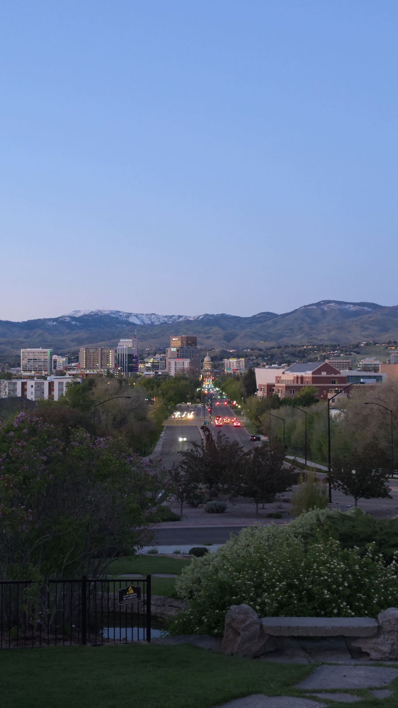

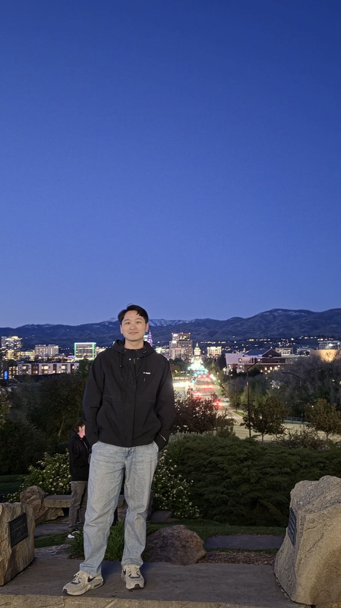

# Day 2, Day 3 Boise

These two days happened to be the weekend. Stanley had a pickleball match — it was my first time watching pickleball, and I had no idea it could get so intense. There's even a pro-level league that plays here. So much fun to watch!

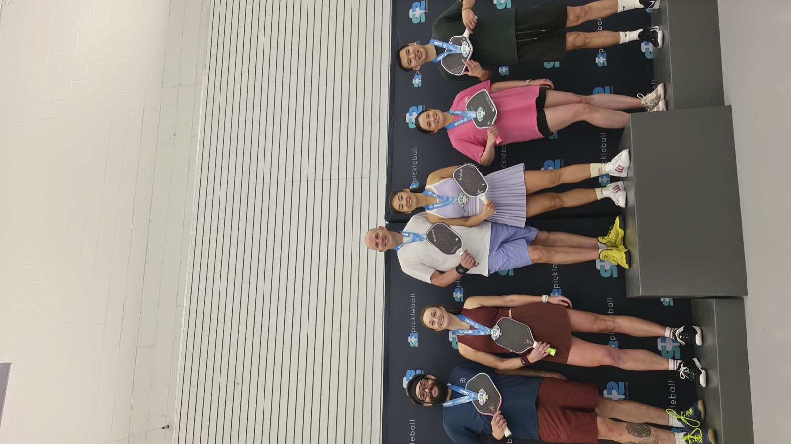

We also went to Costco these two days. Supplements are super cheap, about half the price in Taiwan

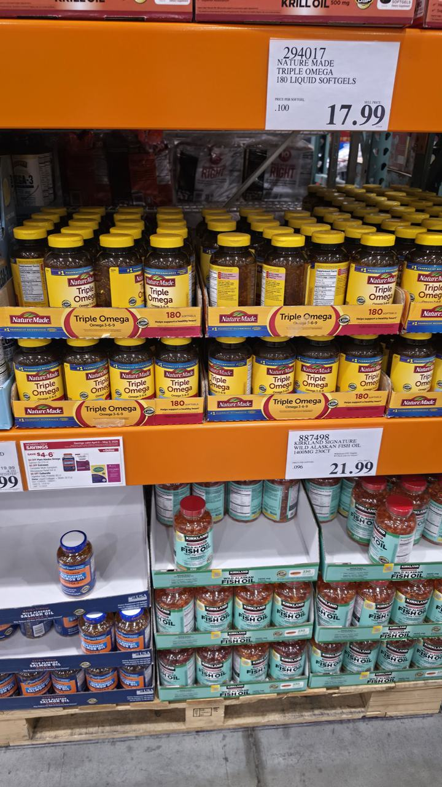

For dinner we went to a well-known restaurant in downtown Boise, The Brickyard. Tasty but pricey~ about 50 USD per person

<iframe src="https://www.google.com/maps/embed?pb=!1m18!1m12!1m3!1d2452.2912271802347!2d-116.20354709621895!3d43.61410185023286!2m3!1f0!2f0!3f0!3m2!1i1024!2i768!4f13.1!3m3!1m2!1s0x54aef8e4b4da309f%3A0xcfa10b08e19b17d5!2sThe%20Brickyard!5e0!3m2!1szh-TW!2stw!4v1779590612532!5m2!1szh-TW!2stw" width="600" height="450" style="border:0;" allowfullscreen="" loading="lazy" referrerpolicy="no-referrer-when-downgrade"></iframe>

On Sunday we went to the home of Stanley's former host mom. Their steak was so good I was speechless!

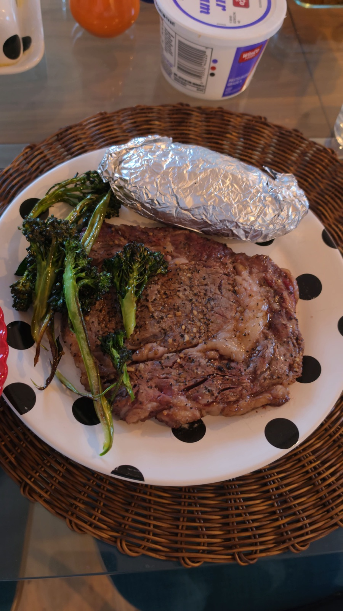

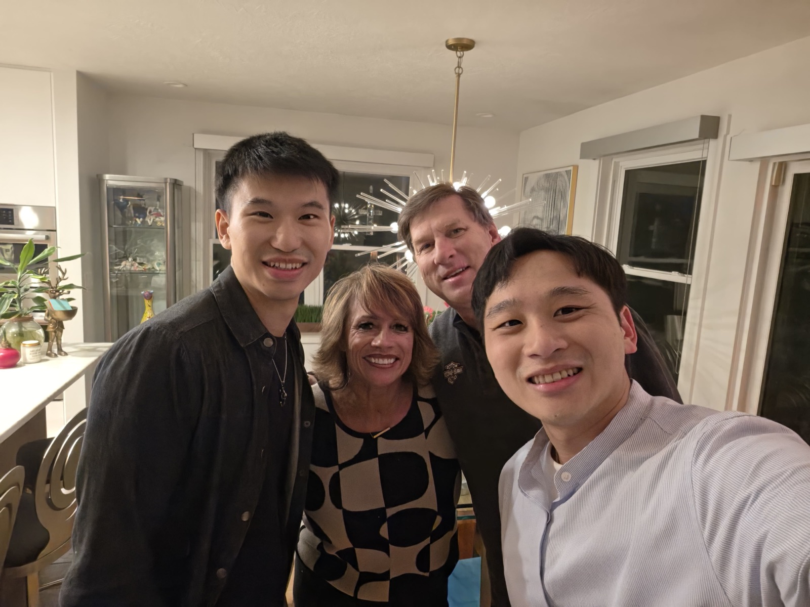

# Day 4 Boise

In the morning I prepped for a gig I'd taken on for that night — helping teach a class. It was the first time in my life I'd been hired to teach

In the afternoon, once Stanley got back, I joined him for CrossFit. It was insanely hard, and I was completely wiped out

In the evening I helped teach a three-hour class

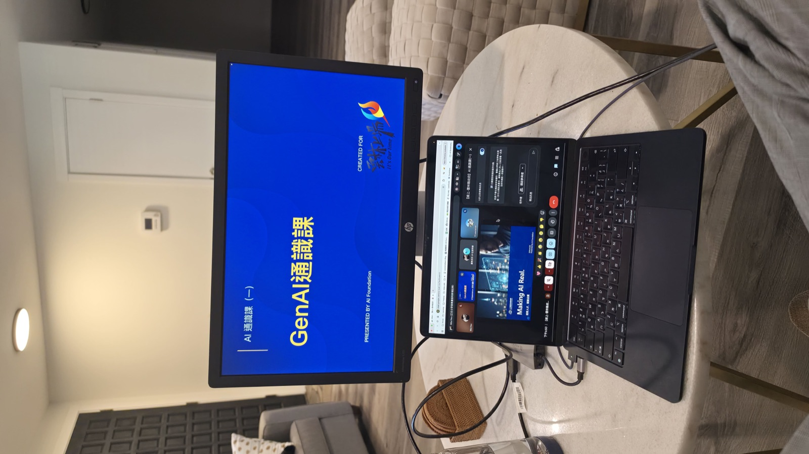

# Day 5 Twin Falls

My legs were rock-stiff from the previous day's CrossFit. In the morning I helped mow the lawn and do laundry
Achievement unlocked: first time mowing a lawn

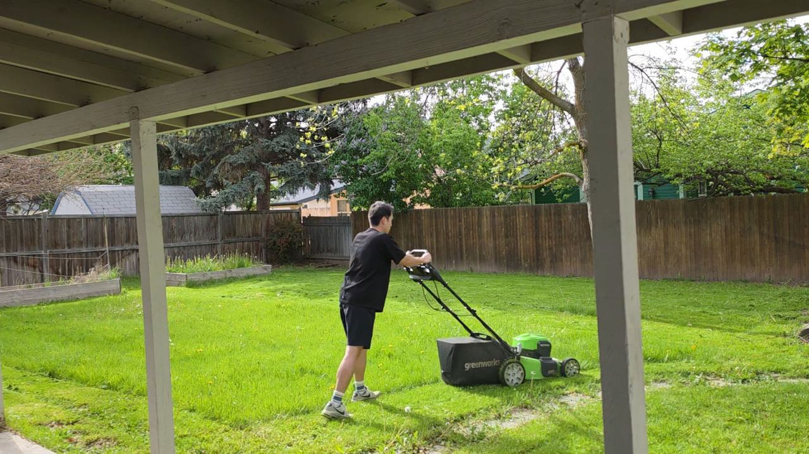

In the afternoon we went to see a spectacular waterfall

<iframe src="https://www.google.com/maps/embed?pb=!1m18!1m12!1m3!1d46981.24445684448!2d-114.45707509114641!3d42.6120039430165!2m3!1f0!2f0!3f0!3m2!1i1024!2i768!4f13.1!3m3!1m2!1s0x54aca1b0eba07461%3A0x1d298d93ca046551!2sShoshone%20Falls%20Park!5e0!3m2!1szh-TW!2stw!4v1779591729822!5m2!1szh-TW!2stw" width="600" height="450" style="border:0;" allowfullscreen="" loading="lazy" referrerpolicy="no-referrer-when-downgrade"></iframe>

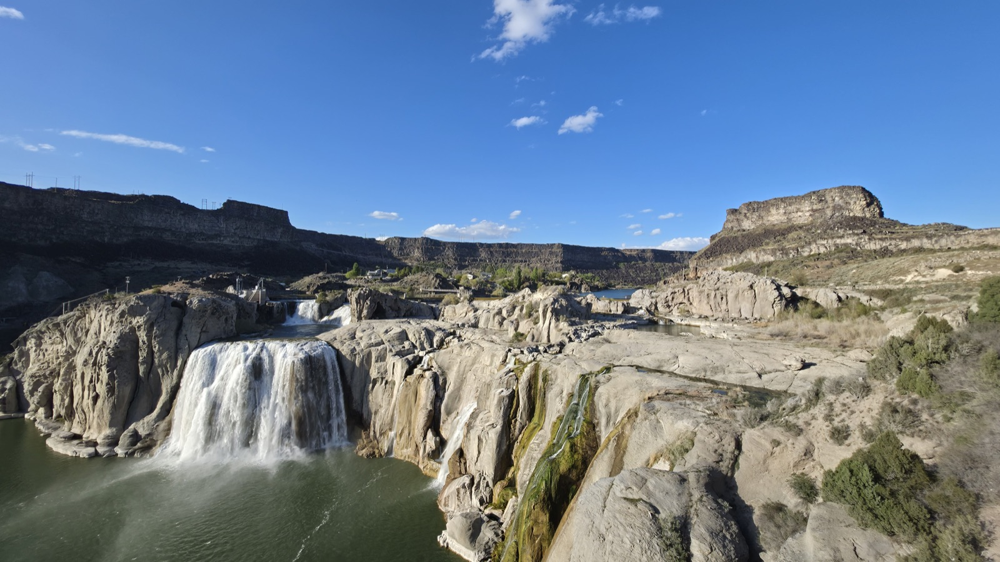

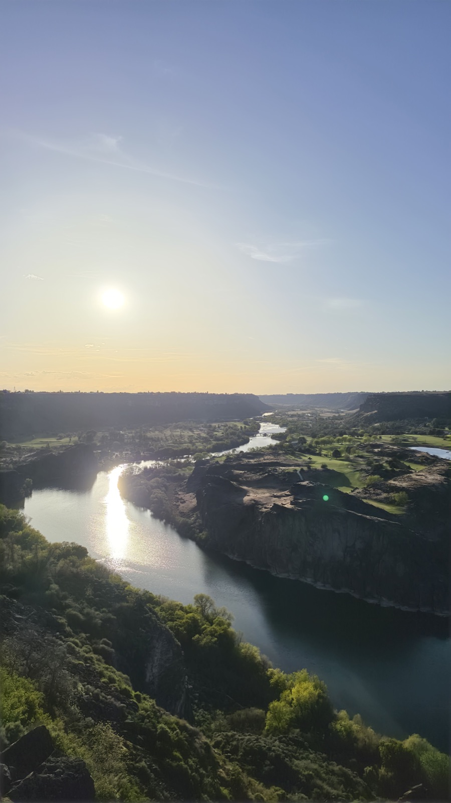

# Day 6 Boise Table Rock

In the morning I finished mowing the rest of the lawn
In the afternoon we went hiking, but my legs were still really sore, so I could only slowly inch my way up Table Rock

<iframe src="https://www.google.com/maps/embed?pb=!1m18!1m12!1m3!1d11557.505212173835!2d-116.15805942581288!3d43.59870592711512!2m3!1f0!2f0!3f0!3m2!1i1024!2i768!4f13.1!3m3!1m2!1s0x54aef9c1ff41fc3f%3A0x2d4f352472a2bf03!2sTable%20Rock!5e0!3m2!1szh-TW!2stw!4v1779591943228!5m2!1szh-TW!2stw" width="600" height="450" style="border:0;" allowfullscreen="" loading="lazy" referrerpolicy="no-referrer-when-downgrade"></iframe>

After the hike we went back and walked the dog for Stanley's boss — such an adorable way to spend the afternoon

# Day 7 Coeur d'Alene

For the next two days we headed to Coeur d'Alene in North Idaho for a getaway!
There are several natural lakes here and they're stunning. The weather in early May is really pleasant, and the lake is way bigger than Sun Moon Lake. It's a perfect vacation spot, which is why you see lots of mansions and private yachts around here

<iframe src="https://www.google.com/maps/embed?pb=!1m18!1m12!1m3!1d42961.63391192473!2d-116.83337642692534!3d47.70185489063896!2m3!1f0!2f0!3f0!3m2!1i1024!2i768!4f13.1!3m3!1m2!1s0x5361b4f8ba557c8f%3A0x5fe5995b05bf5290!2z576O5ZyL5oSb6YGU6I2356eR6YGU5YCr!5e0!3m2!1szh-TW!2stw!4v1779592133171!5m2!1szh-TW!2stw" width="600" height="450" style="border:0;" allowfullscreen="" loading="lazy" referrerpolicy="no-referrer-when-downgrade"></iframe>

It's a 6-plus-hour drive with gorgeous scenery the whole way, and it was also my first time on such a long drive

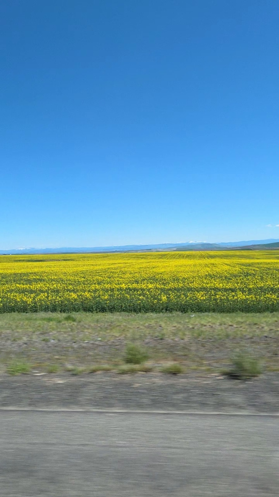

We arrived at beautiful Coeur d'Alene Lake — it's absolutely huge and breathtaking, and strolling around here is so relaxing

<iframe src="https://www.google.com/maps/embed?pb=!1m18!1m12!1m3!1d4413.332829764445!2d-116.7789170754845!3d47.66893183768178!2m3!1f0!2f0!3f0!3m2!1i1024!2i768!4f13.1!3m3!1m2!1s0x5361c6616b65c7ef%3A0x37578d9c69d0a7ec!2sTubbs%20Hill!5e0!3m2!1szh-TW!2stw!4v1779592374393!5m2!1szh-TW!2stw" width="600" height="450" style="border:0;" allowfullscreen="" loading="lazy" referrerpolicy="no-referrer-when-downgrade"></iframe>

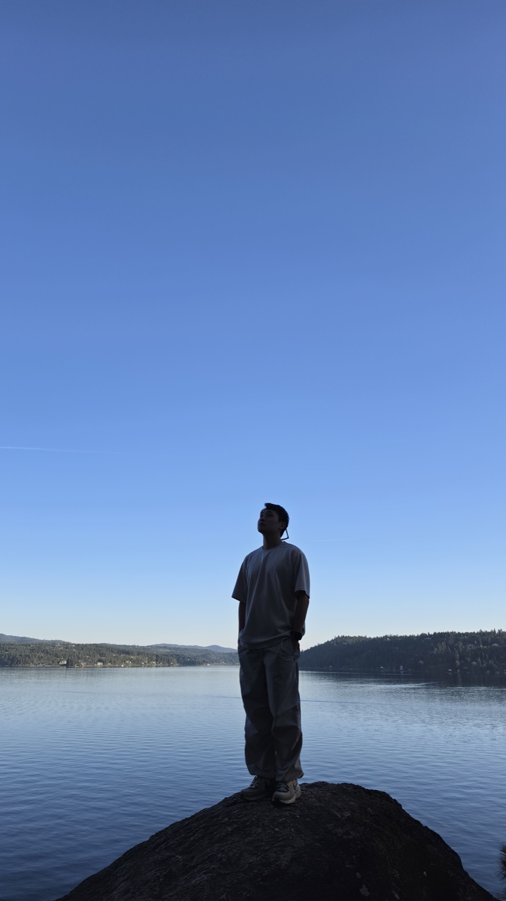

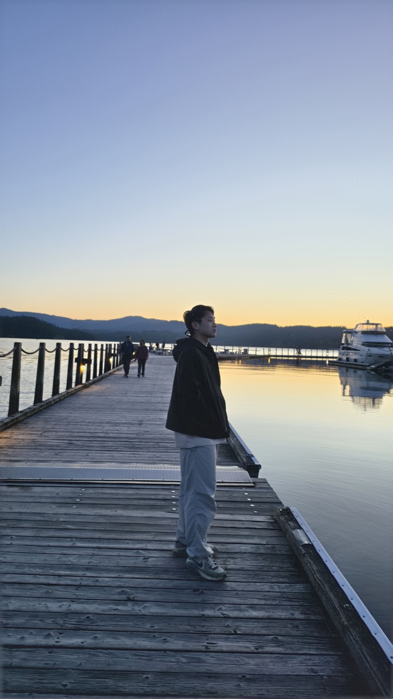

# Day 8 Coeur d'Alene

We kept exploring Coeur d'Alene — there's so much beautiful scenery

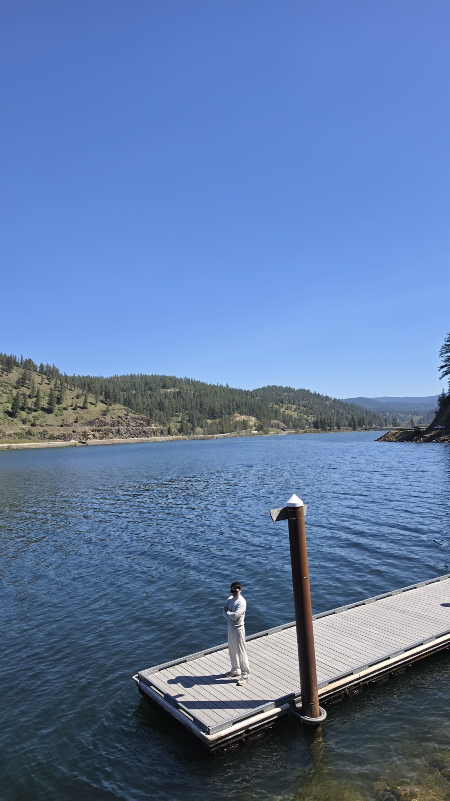

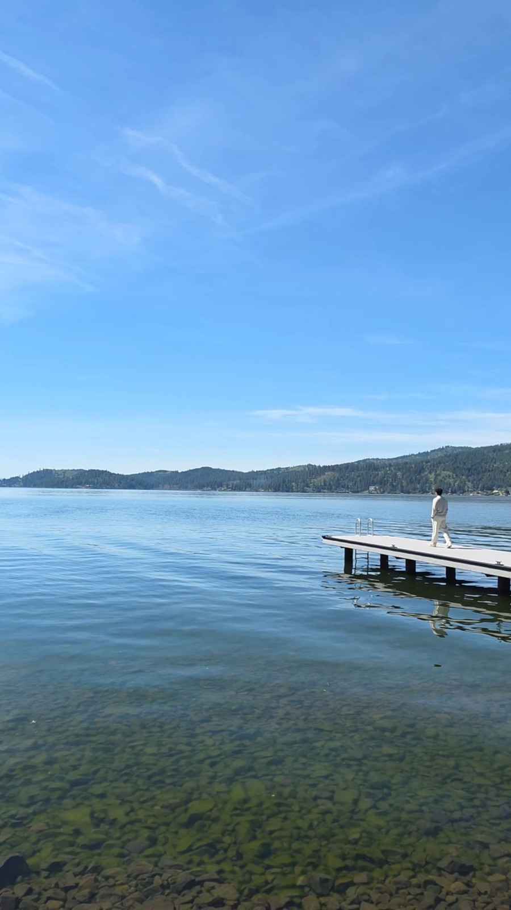

In the afternoon we went to check out Spokane, the second-largest city in Washington State. It's only about a half-hour to an hour's drive, but you cross a state line

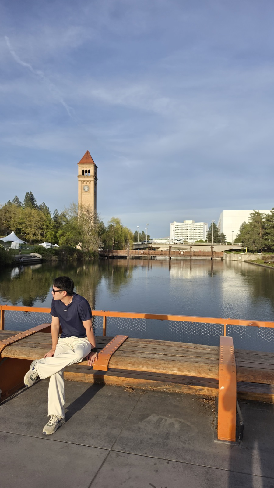

Back at our RV we enjoyed the night view — Coeur d'Alene at night is hard to leave

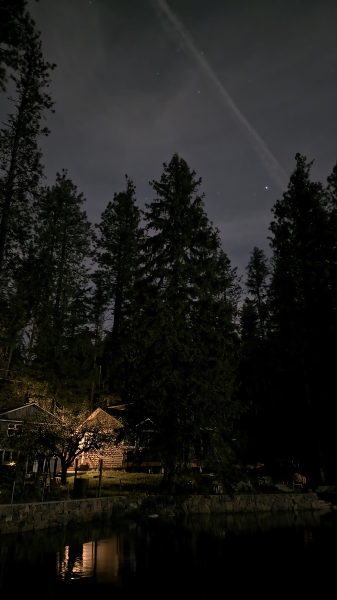

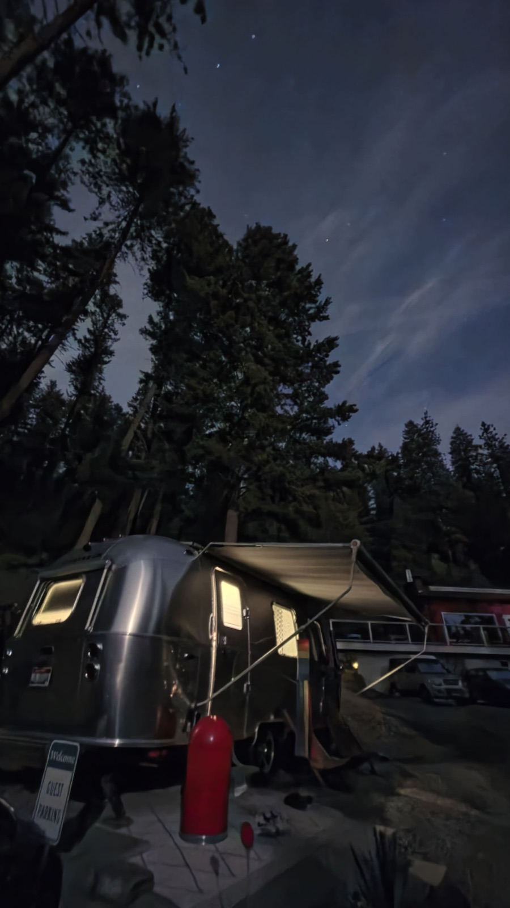

# Day 9 Sandpoint

We were about to leave our RV, and the morning view out the window was gorgeous!

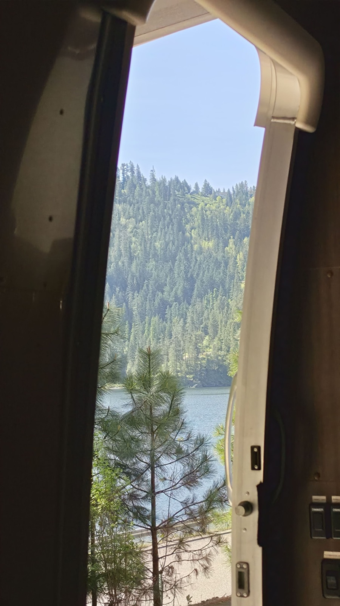

We drove two hours to Sandpoint, a ski destination in winter with beautiful lake views. There were tons of kids around — it's a perfect place to bring kids: lots of space, a comfortable environment, and so close to nature

<iframe src="https://www.google.com/maps/embed?pb=!1m18!1m12!1m3!1d42478.39660739735!2d-116.60173532045442!3d48.285543756636386!2m3!1f0!2f0!3f0!3m2!1i1024!2i768!4f13.1!3m3!1m2!1s0x5363d1332dff4541%3A0xab5434ebcfe9717b!2zODM4NjTnvo7lnIvmhJvpgZTojbfmoZHlvrfms6Llm6Dnibk!5e0!3m2!1szh-TW!2stw!4v1779593175192!5m2!1szh-TW!2stw" width="600" height="450" style="border:0;" allowfullscreen="" loading="lazy" referrerpolicy="no-referrer-when-downgrade"></iframe>

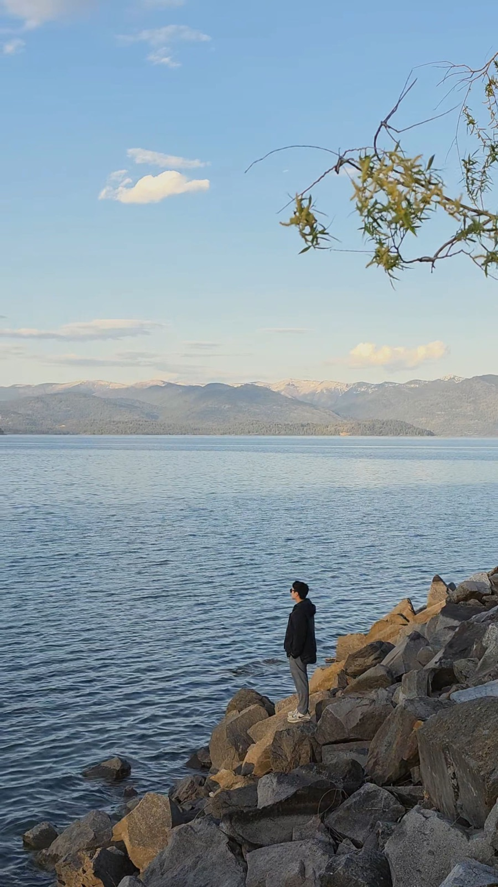

<iframe class="yt short" src="https://www.youtube-nocookie.com/embed/l0jXuHfz_4c" title="YouTube video" loading="lazy" allow="accelerometer; clipboard-write; encrypted-media; gyroscope; picture-in-picture; web-share" referrerpolicy="strict-origin-when-cross-origin" allowfullscreen></iframe>

A beautiful sunset

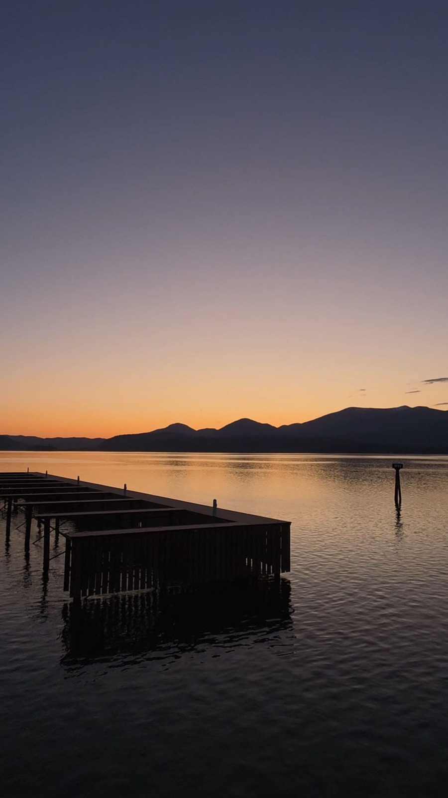

# Final Thoughts

People in Idaho are warm and friendly, it's very safe, and you don't smell weed or cigarette smoke on the street. The scenery is stunning, with beautiful lakes, huge forests, and snow-capped peaks. Everyone patiently listens when you share your stories, and wealthy people don't have that arrogance — instead they're really approachable, happy to share, listen, and respect others. I even saw people saving seats with their phones and wallets, just like in Taiwan. The birth rate is high here and you see kids everywhere, so it's a great place to raise children. Taxes are relatively low (6%), but eating out is still expensive. I'd originally assumed this would be a place with serious racism, but people here are actually very respectful of each other. I really love it here.
