> Idaho是我待過最舒服的城市，道路房屋都大且寬
> 幾乎都是白人的州

旅遊影片回憶1

<iframe class="yt short" src="https://www.youtube-nocookie.com/embed/d23OiaHArWg" title="YouTube video" loading="lazy" allow="accelerometer; clipboard-write; encrypted-media; gyroscope; picture-in-picture; web-share" referrerpolicy="strict-origin-when-cross-origin" allowfullscreen></iframe>

旅遊影片回憶2

<iframe class="yt short" src="https://www.youtube-nocookie.com/embed/l0jXuHfz_4c" title="YouTube video" loading="lazy" allow="accelerometer; clipboard-write; encrypted-media; gyroscope; picture-in-picture; web-share" referrerpolicy="strict-origin-when-cross-origin" allowfullscreen></iframe>

# Day 1 Boise

從聖地牙哥坐飛機抵達Boise已是下午1點，在這個州主要是我的大學朋友Stanley住在這，所以之後的行程都是跟著他跑

第一站前往Boise Depot，這裡可以眺望美麗夜景跟整個城市，Boise是愛達荷州最大的城市，但跟其他城市相比人口還是少很多，在這裡可以感受到滿滿的人情味，大家也都互相扶持

<iframe src="https://www.google.com/maps/embed?pb=!1m18!1m12!1m3!1d5691.578882854175!2d-116.2193188983555!3d43.60225603838062!2m3!1f0!2f0!3f0!3m2!1i1024!2i768!4f13.1!3m3!1m2!1s0x54aef860262ae78f%3A0x68dc9eba08d5c82c!2sBoise%20Depot!5e0!3m2!1szh-TW!2stw!4v1779589904042!5m2!1szh-TW!2stw" width="600" height="450" style="border:0;" allowfullscreen="" loading="lazy" referrerpolicy="no-referrer-when-downgrade"></iframe>

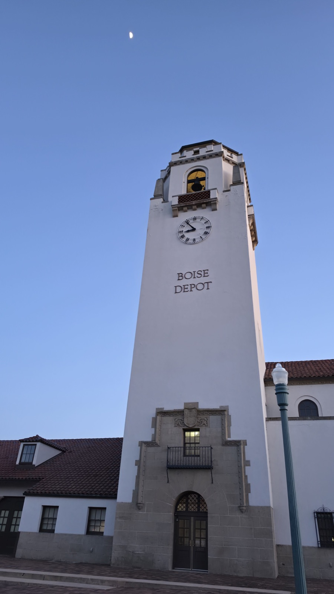

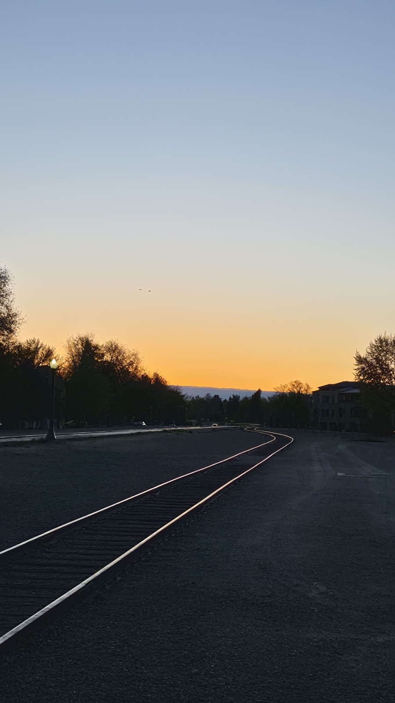

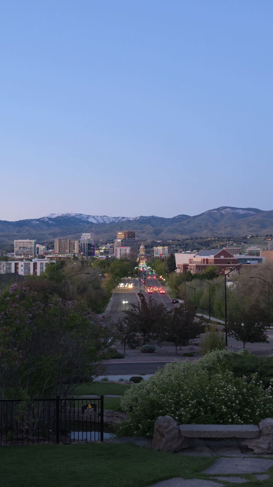

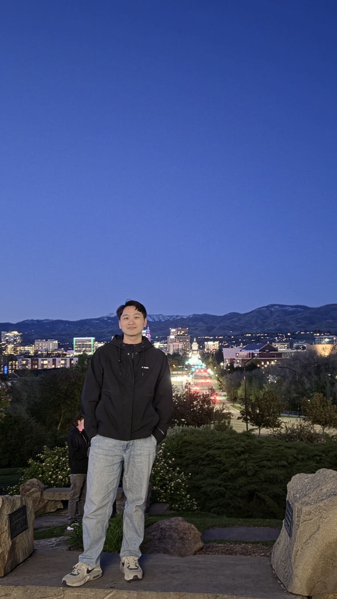

# Day 2, Day 3 Boise

這兩天剛好是六日。Stanley有匹克球比賽，我第一次看匹克球比賽，原來可以那麼激烈，還有職業級別聯盟在這裡比賽，看得很過癮！

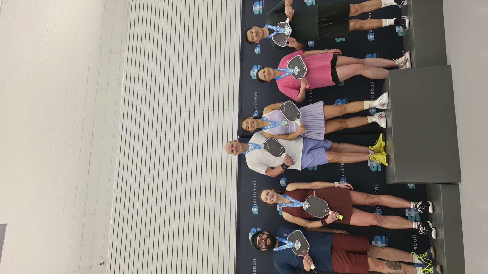

這兩天去逛了Costco, 保健食品超級便宜，是台灣的一半價格

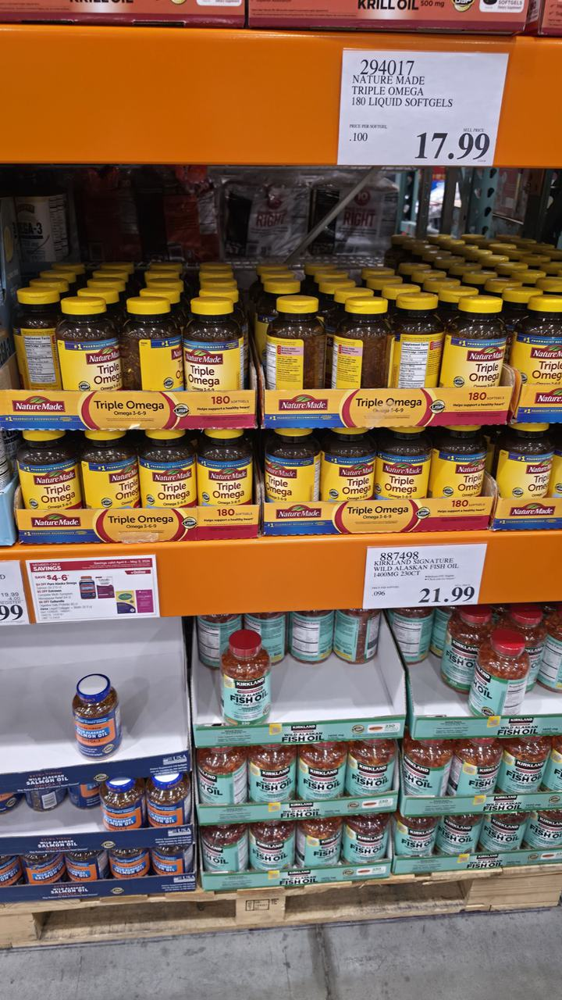

晚餐去Boise downtown吃了有名的餐廳 Brickyard，好吃但很貴～一個人大概50usd

<iframe src="https://www.google.com/maps/embed?pb=!1m18!1m12!1m3!1d2452.2912271802347!2d-116.20354709621895!3d43.61410185023286!2m3!1f0!2f0!3f0!3m2!1i1024!2i768!4f13.1!3m3!1m2!1s0x54aef8e4b4da309f%3A0xcfa10b08e19b17d5!2sThe%20Brickyard!5e0!3m2!1szh-TW!2stw!4v1779590612532!5m2!1szh-TW!2stw" width="600" height="450" style="border:0;" allowfullscreen="" loading="lazy" referrerpolicy="no-referrer-when-downgrade"></iframe>

禮拜天去Stanley以前寄宿家庭的host mom家，他們的牛排好吃到說不出話來！

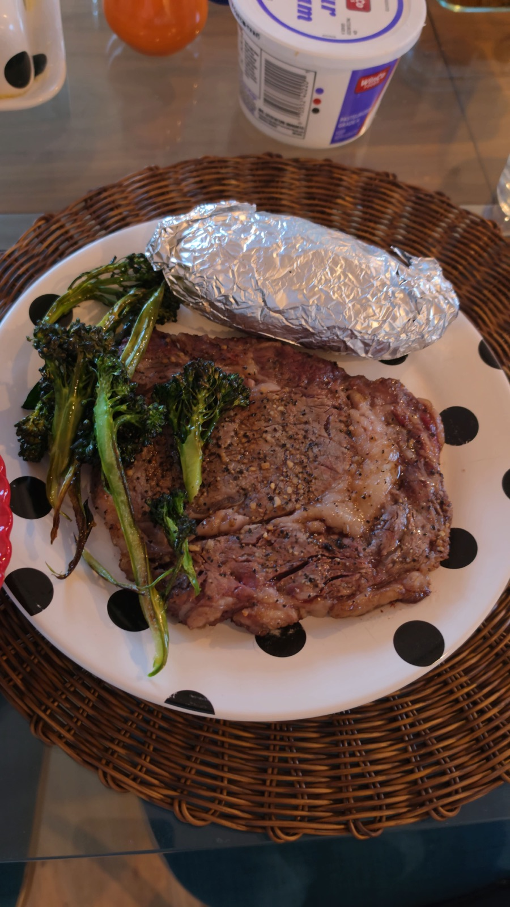

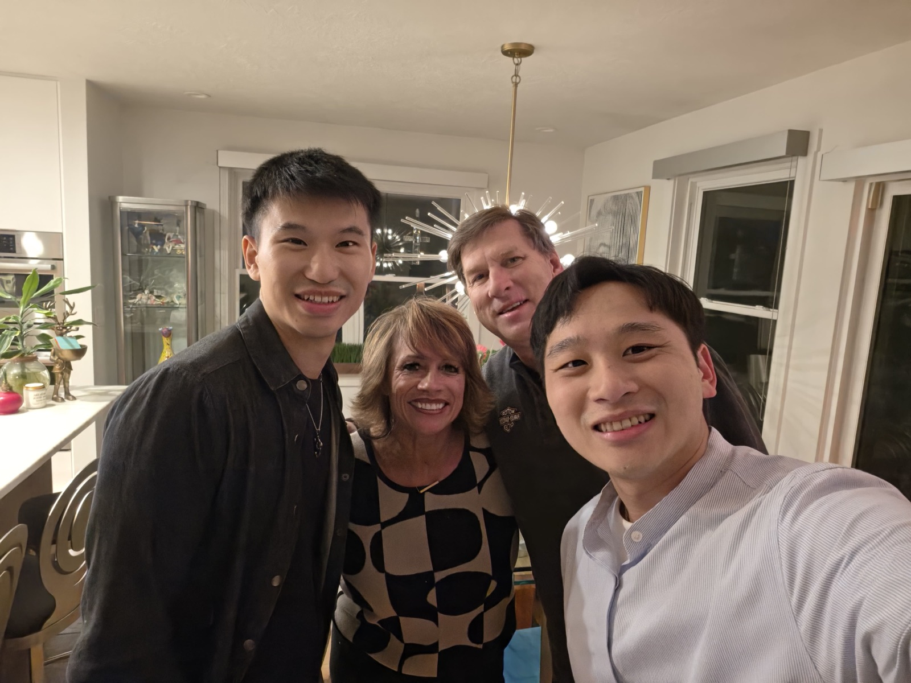

# Day 4 Boise

早上準備今晚接的專案，要幫忙上課，是我人生第一次接案上課

下午等Stanley回來後就跟他一起上CrossFit，超級無敵硬，我整個癱在那

晚上幫忙上了三小時的課程

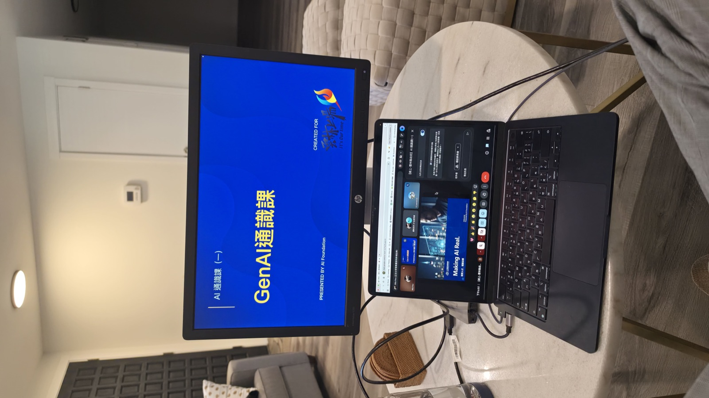

# Day 5 Twin Falls

前一天的CrossFit，腳鐵到不行，早上來幫忙除草＋洗衣服
人生第一次除草成就達成

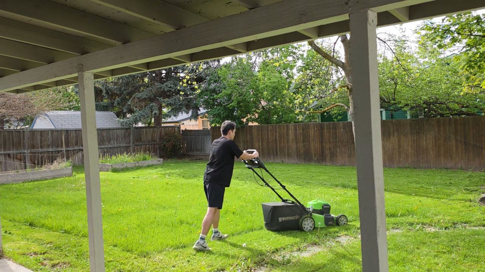

下午去看壯觀的瀑布

<iframe src="https://www.google.com/maps/embed?pb=!1m18!1m12!1m3!1d46981.24445684448!2d-114.45707509114641!3d42.6120039430165!2m3!1f0!2f0!3f0!3m2!1i1024!2i768!4f13.1!3m3!1m2!1s0x54aca1b0eba07461%3A0x1d298d93ca046551!2sShoshone%20Falls%20Park!5e0!3m2!1szh-TW!2stw!4v1779591729822!5m2!1szh-TW!2stw" width="600" height="450" style="border:0;" allowfullscreen="" loading="lazy" referrerpolicy="no-referrer-when-downgrade"></iframe>

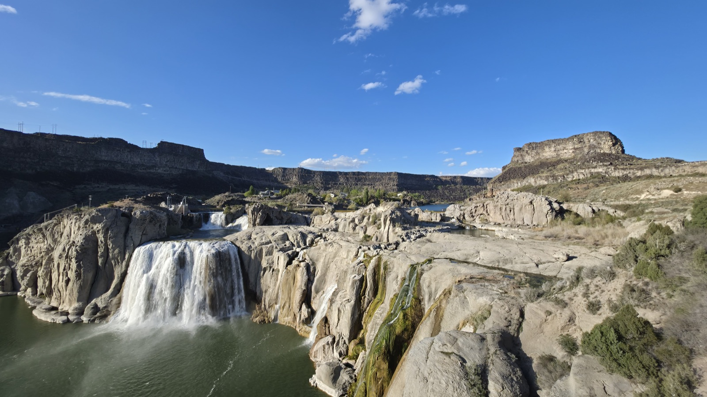

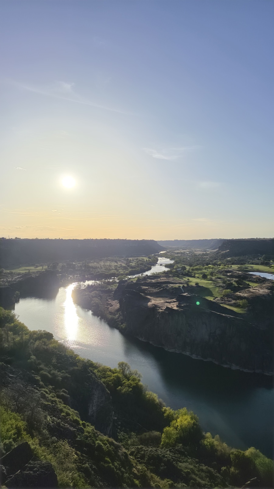

# Day 6 Boise Table Rock

早上繼續把草除完
下午爬山，腳還是非常酸痛，因此都只能慢慢一點點爬Table Rock

<iframe src="https://www.google.com/maps/embed?pb=!1m18!1m12!1m3!1d11557.505212173835!2d-116.15805942581288!3d43.59870592711512!2m3!1f0!2f0!3f0!3m2!1i1024!2i768!4f13.1!3m3!1m2!1s0x54aef9c1ff41fc3f%3A0x2d4f352472a2bf03!2sTable%20Rock!5e0!3m2!1szh-TW!2stw!4v1779591943228!5m2!1szh-TW!2stw" width="600" height="450" style="border:0;" allowfullscreen="" loading="lazy" referrerpolicy="no-referrer-when-downgrade"></iframe>

爬完回去，幫Stanley的老闆遛狗，超級可愛的行程

# Day 7 Coeur d'Alene

這兩天都要到北愛達荷州的Coeur d'Alene度假！
這裡有多個天然湖泊，非常壯觀，5月初的天氣非常舒服，比日月潭大得多，也非常適合度假，所以在這裡看到很多豪宅、私人遊艇等

<iframe src="https://www.google.com/maps/embed?pb=!1m18!1m12!1m3!1d42961.63391192473!2d-116.83337642692534!3d47.70185489063896!2m3!1f0!2f0!3f0!3m2!1i1024!2i768!4f13.1!3m3!1m2!1s0x5361b4f8ba557c8f%3A0x5fe5995b05bf5290!2z576O5ZyL5oSb6YGU6I2356eR6YGU5YCr!5e0!3m2!1szh-TW!2stw!4v1779592133171!5m2!1szh-TW!2stw" width="600" height="450" style="border:0;" allowfullscreen="" loading="lazy" referrerpolicy="no-referrer-when-downgrade"></iframe>

要開6個多小時的車，一路上的美景不斷，但也第一次體驗開那麼久的車

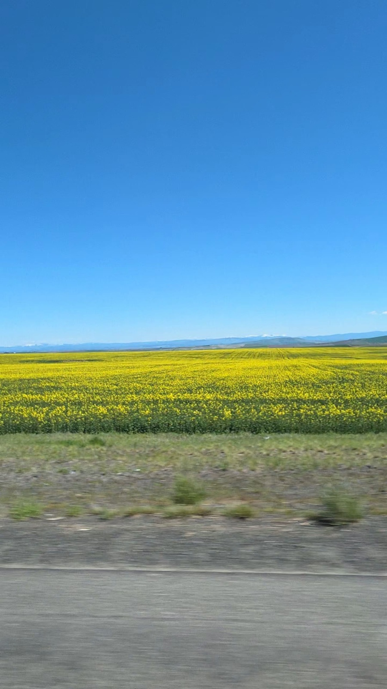

抵達美麗的Coeur d'Alene Lake，超級無敵大，也嘆為觀止，在這裡漫步非常舒服

<iframe src="https://www.google.com/maps/embed?pb=!1m18!1m12!1m3!1d4413.332829764445!2d-116.7789170754845!3d47.66893183768178!2m3!1f0!2f0!3f0!3m2!1i1024!2i768!4f13.1!3m3!1m2!1s0x5361c6616b65c7ef%3A0x37578d9c69d0a7ec!2sTubbs%20Hill!5e0!3m2!1szh-TW!2stw!4v1779592374393!5m2!1szh-TW!2stw" width="600" height="450" style="border:0;" allowfullscreen="" loading="lazy" referrerpolicy="no-referrer-when-downgrade"></iframe>

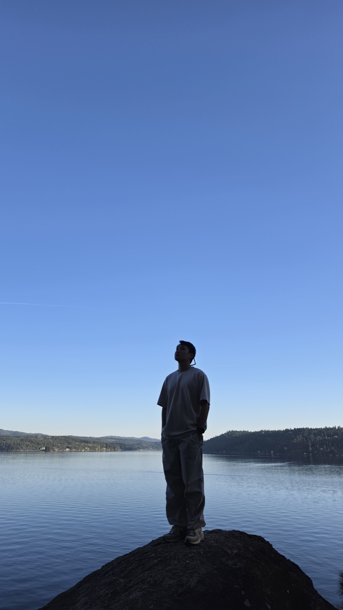

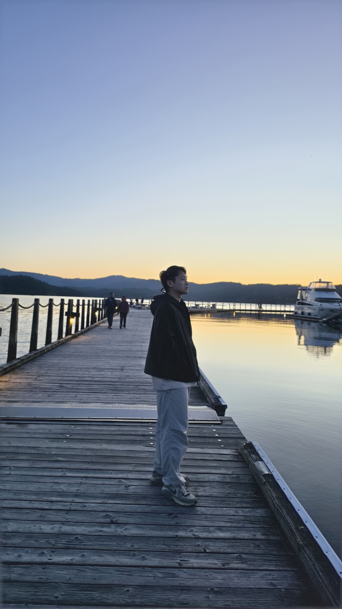

# Day 8 Coeur d'Alene

繼續探索Coeur d'Alene，真的很多美景

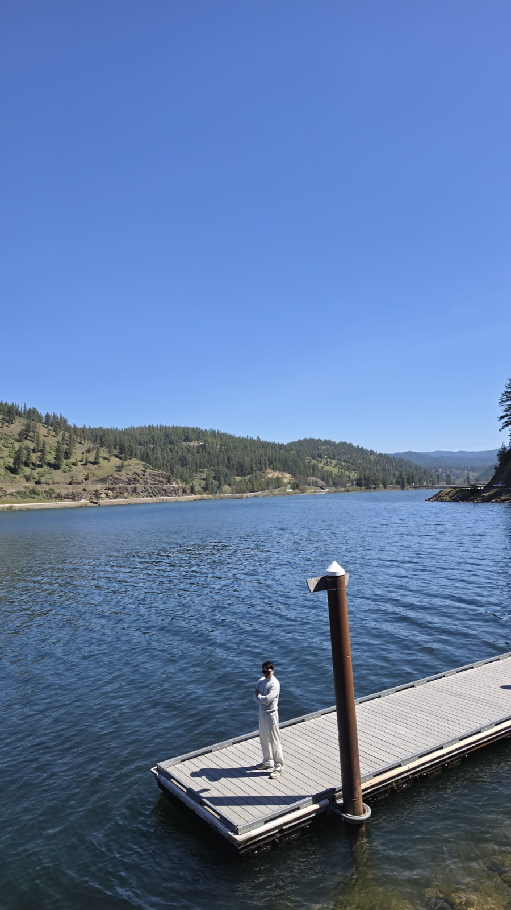

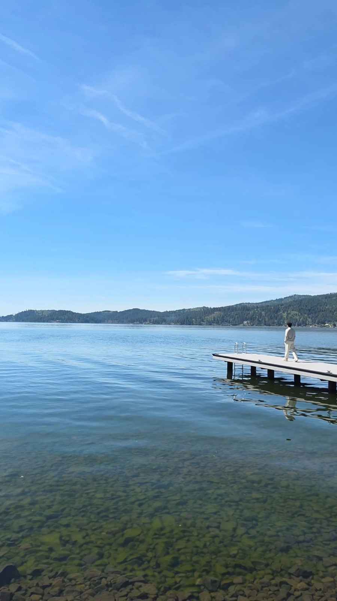

下午前往Spokane逛逛，是Washington State第二大城市，車程大概半小時到一小時，但跨了一個州

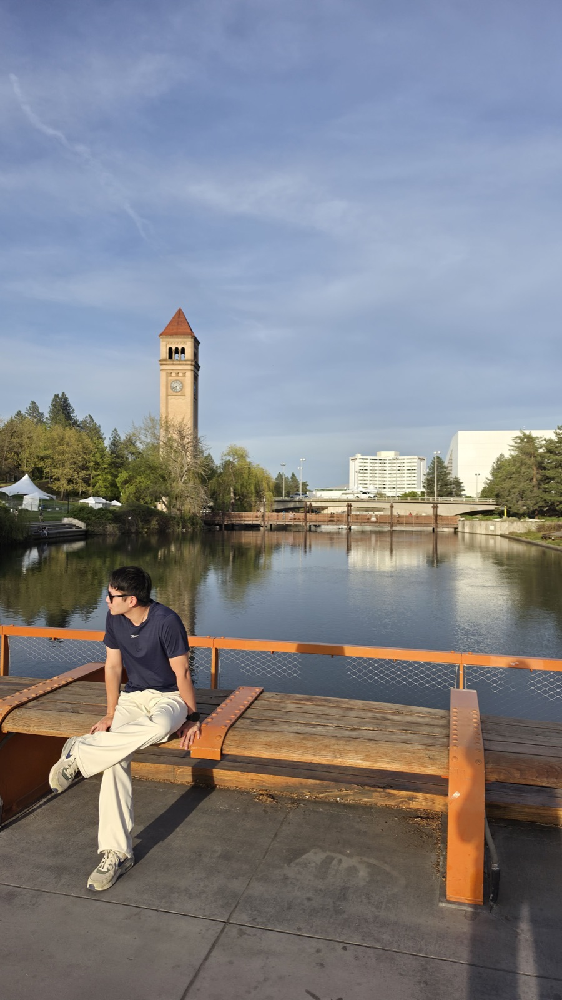

回我們住的露營車欣賞夜景，夜晚的Coeur d'Alene流連忘返

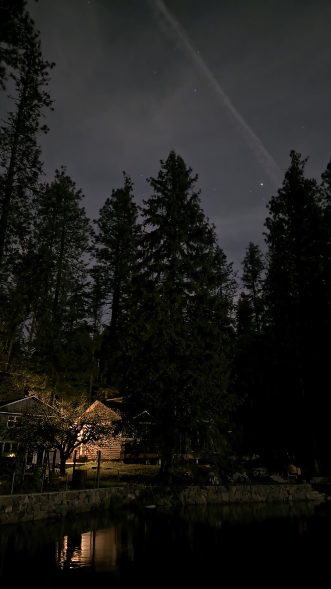

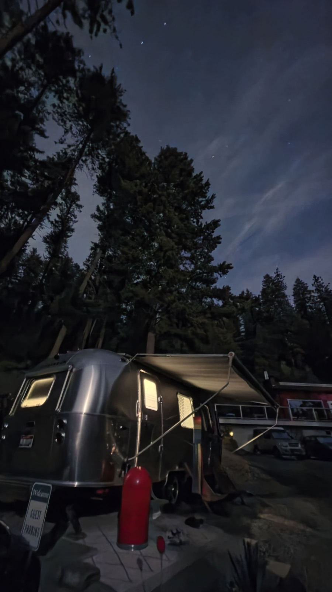

# Day 9 Sandpoint

即將離開我們的露營車，早晨看出去非常美！

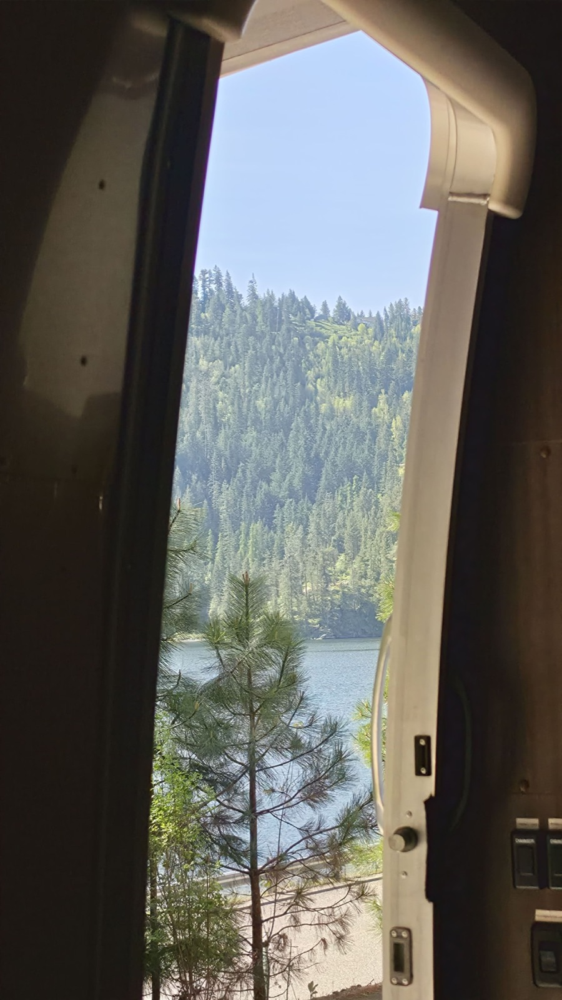

開兩小時的車程前往Sandpoint，這裡冬天是滑雪勝地，湖景也非常美麗，路上超多小朋友，這裏超級適合帶小朋友，空間大、環境舒適、又非常大自然

<iframe src="https://www.google.com/maps/embed?pb=!1m18!1m12!1m3!1d42478.39660739735!2d-116.60173532045442!3d48.285543756636386!2m3!1f0!2f0!3f0!3m2!1i1024!2i768!4f13.1!3m3!1m2!1s0x5363d1332dff4541%3A0xab5434ebcfe9717b!2zODM4NjTnvo7lnIvmhJvpgZTojbfmoZHlvrfms6Llm6Dnibk!5e0!3m2!1szh-TW!2stw!4v1779593175192!5m2!1szh-TW!2stw" width="600" height="450" style="border:0;" allowfullscreen="" loading="lazy" referrerpolicy="no-referrer-when-downgrade"></iframe>

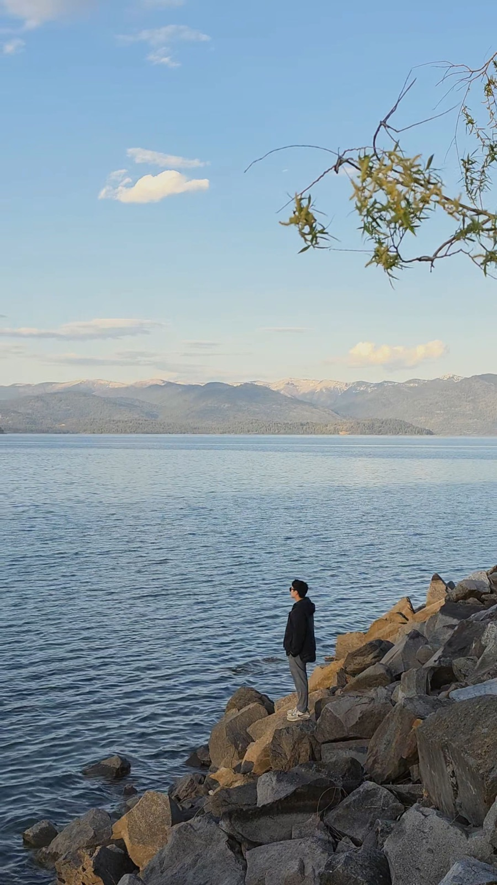

<iframe class="yt short" src="https://www.youtube-nocookie.com/embed/l0jXuHfz_4c" title="YouTube video" loading="lazy" allow="accelerometer; clipboard-write; encrypted-media; gyroscope; picture-in-picture; web-share" referrerpolicy="strict-origin-when-cross-origin" allowfullscreen></iframe>

美麗的夕陽

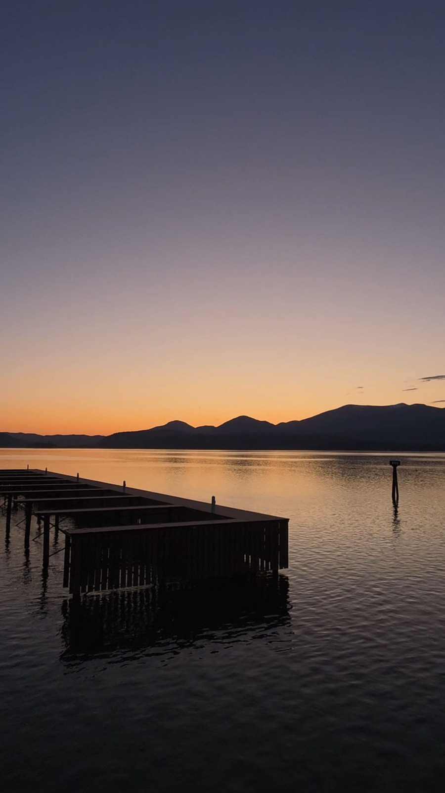

# 心得

Idaho的人都很親切熱情、治安很好，路上沒有大麻或是菸味，風景非常優美，有美麗的湖泊、大量的森林、冰雪覆蓋的山頂，每個人都很耐心聽你分享故事，有錢人沒有那種傲慢，反而非常親和，願意分享、傾聽，並尊重別人，這裡甚至看到有人像在台灣一樣，用手機跟錢包佔位。這裏生育率很高，小孩子到處可見，適合養育小孩，稅率相對較低(6%)，但外食還是很貴，原本以為這裡會是種族歧視很嚴重的地方，但大家反而非常尊重對方。我好喜歡這裡。