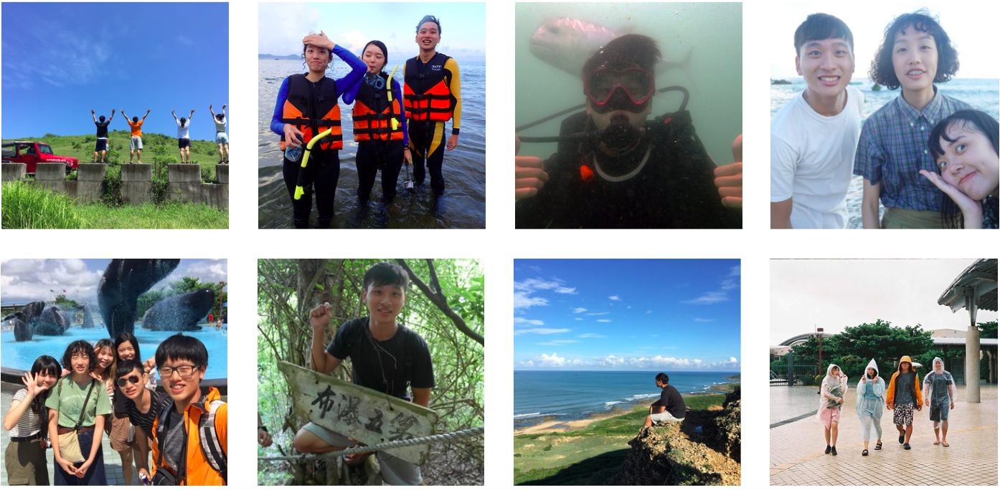
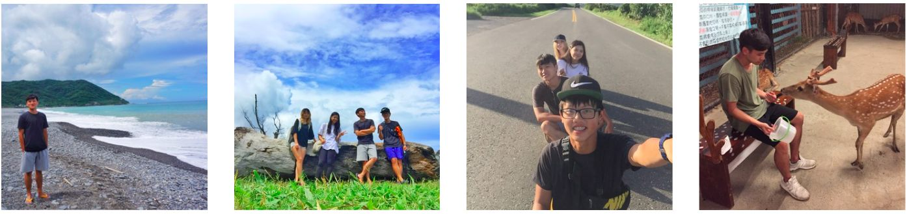
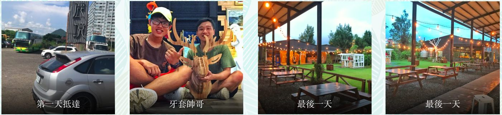

> Thank you to every friend I met here
> I left in such a rush that I didn't get photos with everyone. Hope we meet again someday
> My last summer vacation is over, and grad school life is about to begin
> #ParadiseOfDeer #helper #Hengchun #ocean

# Intro

When you look ahead to the future, you don't try to connect all the dots; only when you look back on the past do you link all those little moments together. You have to believe that these bits of life will connect somehow, someday in your future. You have to believe: courage, purpose, life, fate... none of it will let you down — it will only make you more uniquely you.

 

# Work

The work was actually pretty simple, split between two areas: the bar and the deer park.

## At the bar:
1. Drinks and food
2. Arranging and restocking the merchandise shop outside (removing stitching, cutting off tags, checking for defects)
3. Ordering lunch and dinner for everyone
4. Cleaning the restrooms (checked once every hour)
5. Keeping the ground outside clean

## In the deer park:
1. Mowing grass (I didn't get to try it, but you have to haul over 20 kg of grass)
2. Chopping carrots and sweet potatoes
3. Cleaning the deer park (didn't try it — it stinks)
4. Tour guide (some people got to do this)

# Holiday

Honestly, I only really got to enjoy the holiday part in the first week. The rest of the time I was working at Paradise of Deer, and in the last week days of nonstop heavy rain ruined my plans (I only found one rain-free day to do a loop around Pingtung).

8/5 Snorkeling + Hengchun Night Market
8/6 Sail Rock + Migu (麋谷)
8/7 Group dinner at an American restaurant + playing cards
8/8 Qikong Waterfall (七孔瀑布) + cafe 
8/9 Home-style dishes in Hengchun Old Town + Baisha Bay
8/10 Deep diving + National Museum of Marine Biology and Aquarium + Fei Chun (肥春號) boat
8/11 Jeep ride (with the Big Foot 168 crew)

Last week: a drive to Fu'an Temple + Mudan Reservoir + Mudan Elementary School + Xuhai + Jiupeng Desert + Gangzai Desert + Fengchuisha (風吹砂) + Longpan Park + the southernmost point of Taiwan
