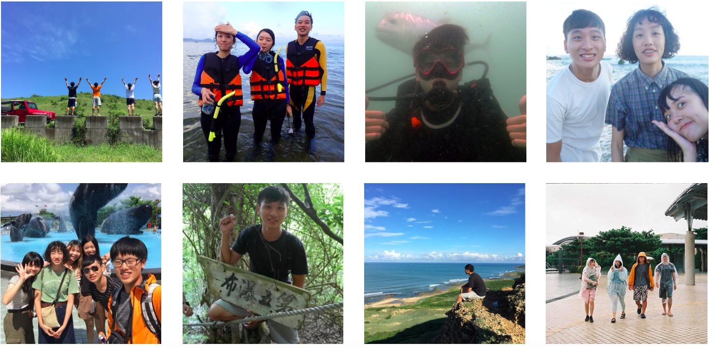
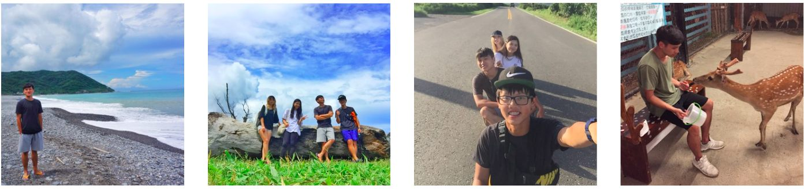
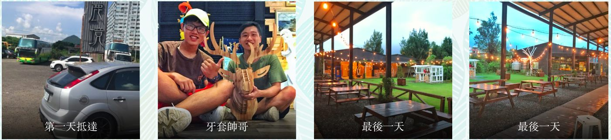

> 謝謝每位我在這裡遇到的朋友
> 離開太趕 沒能全部拍到照 有緣再見
> 結束最後暑假 研究所人生準備開跑
> #鹿境 #小幫手 #恆春 #海

# 前言

你憧憬未來的時候，不會去想著把所有事聯繫起來；只有在回憶過去的時候，才會將這點點滴滴聯繫在一起。一定要相信，這些生活的點滴會在你未來的某一天產生聯繫。一定要相信：勇氣、目標、生命、緣起......一切都不會令你失望，只會增加你的與眾不同。

 

# 工作

其實工作內容很簡單，分為吧台、鹿園兩區的工作

## 在吧台負責：
1. 飲料餐點
2. 外頭的商品部擺放、補貨(拆線、吊牌剪掉、檢查不良品)
3. 幫訂午餐、晚餐
4. 廁所打掃（每1hr巡一次）
5. 外頭路面地面整潔

## 在鹿園負責：
1. 割草（沒體驗到 但要搬運20多公斤草）
2. 切紅蘿蔔、地瓜
3. 打掃鹿園（沒體驗到 很臭）
4. 解說員（有人體驗到）

# 度假

其實幾乎只有第一週體驗到 剩下都待在鹿境工作 還有最後一週連日的大雨打壞行程（只找到一天沒雨空檔去環屏東）

8/5 浮潛+逛恆春夜市
8/6 帆船石+麋谷
8/7 聚餐 美式餐廳 +打牌
8/8 七孔瀑布 + cafe 
8/9 古城家常菜+白沙灣
8/10 深潛+海生館+肥春號
8/11 吉普車（大腳168車隊）

Last week :車程福安宮+牡丹水庫+牡丹國小+旭海+九鵬大沙漠+港仔大沙漠+風吹砂+龍磐+台灣最南點