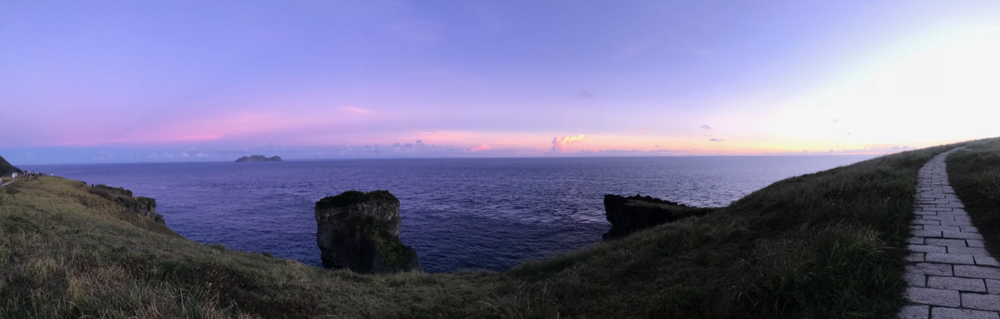
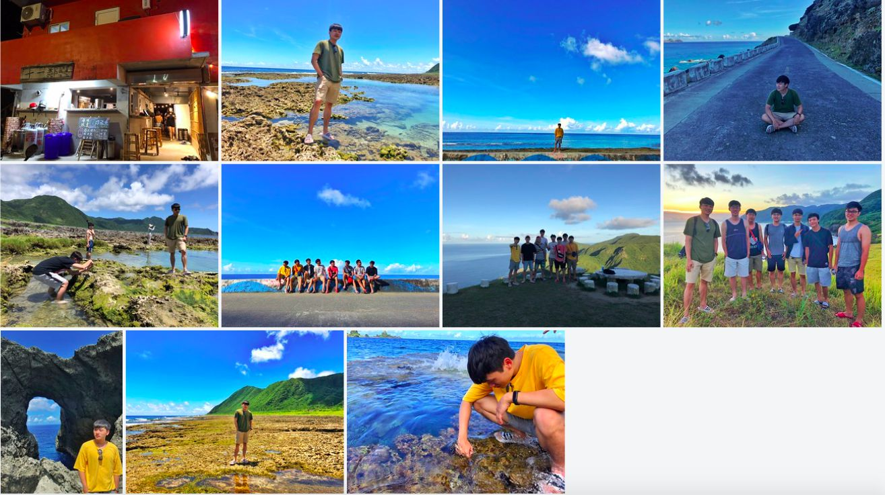
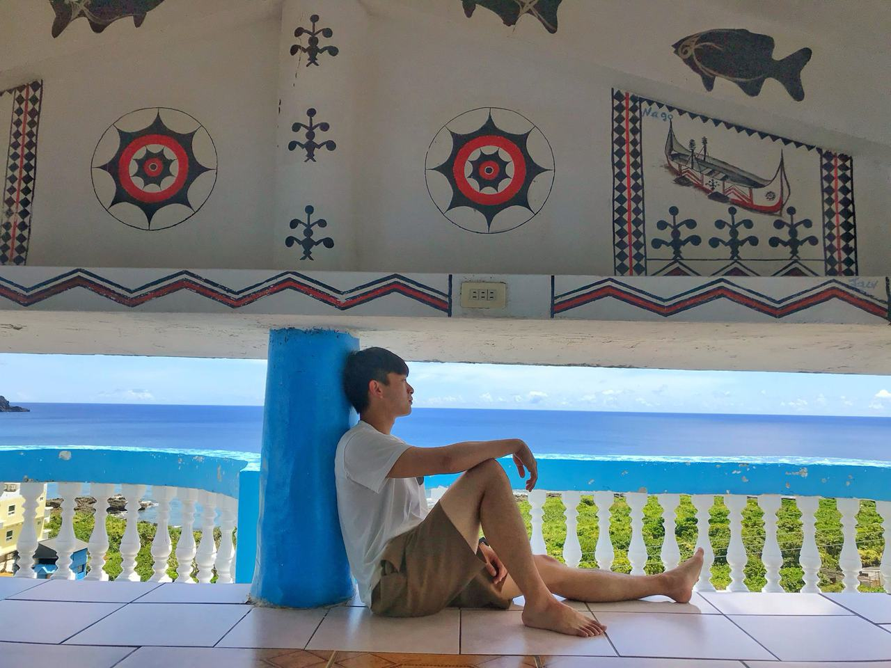

> The starry sky at night is really beautiful
> There are goats everywhere 🐐
> The internet is super laggy
> Prices are on par with Europe and the US

---

# Itinerary

## Day 1 Yabia Homestay (East)
16:00 Arrived on Lanyu
Went to the homestay for a short rest
Ate scallion pancakes at the Dongqing night market
Dinner at Xiruinali (希蕊娜莉)
Back to the homestay to rest
Shiyilin (十一鄰) Bar

## Day 2 (South)
Watched the sunrise
Went back to sleep afterwards
Lanyu Cold Spring
Visited the traditional Lanyu underground houses
Driftwood Restaurant
Played in the water at the west coast beach
Looped around the southern half of Lanyu
Back to the homestay to rest (via the cross-island road)
Watched the sunset at Qingqing Grassland (青青草原)
Dinner at Lanyu Wawa (蘭嶼哇哇)
Bought souvenirs at a nearby store and withdrew cash at the post office
Watched the stars on the way back
Back to the homestay
Bought drinks at a grocery store to drink back at the homestay

## Day 3 (North)
Snorkeling at the Blue Ocean House in the morning (not really recommended for snorkeling, kind of a letdown, but I heard scuba diving is great)
Back to the homestay to shower
Lunch at Mermaid & Cat (人魚和貓)
Started looping around the north of Lanyu (Lover's Cave, Ghost Cave, Shell Sand Beach, "Deep Meaning" spot, Twin Lions Rock, a spot that looks like a water channel, taking photos)
Got shaved ice at an ice shop on the way
Snacked on flying fish roe at a street stall
Lanyu Weather Station
Back to the homestay
Waited until 8 for all-you-can-eat BBQ
Bought drinks at 7-Eleven to bring back to the homestay

## Day 4
Watched the sunrise
Went back to sleep afterwards
Brunch at Dongqing 33 (東清三十三)
Back to the homestay to pack
Photos at the Old Lanyu Lighthouse
Waited for the ferry back to Taiwan

## Planned but didn't make it to:
Wenwen Ice Shop (雯雯冰店)
Angit Bar
Drinks at M cafe 
Drinks at 旅人。Rove 
Local Lanyu food: millet abai (小米阿粨)
Lanyu anti-nuclear bar
Shaved ice at Selang (瑟郎冰沙)  
Free diving

 

> In a word: 
> Just come with a relaxed mindset~~
> Soak in your own world!
