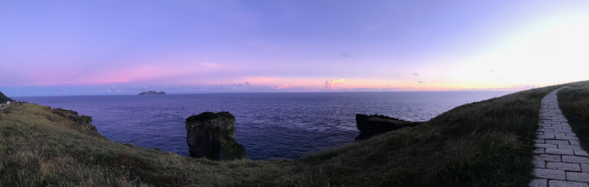
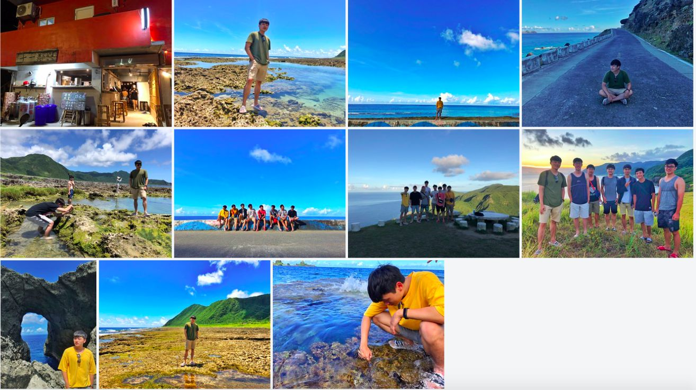
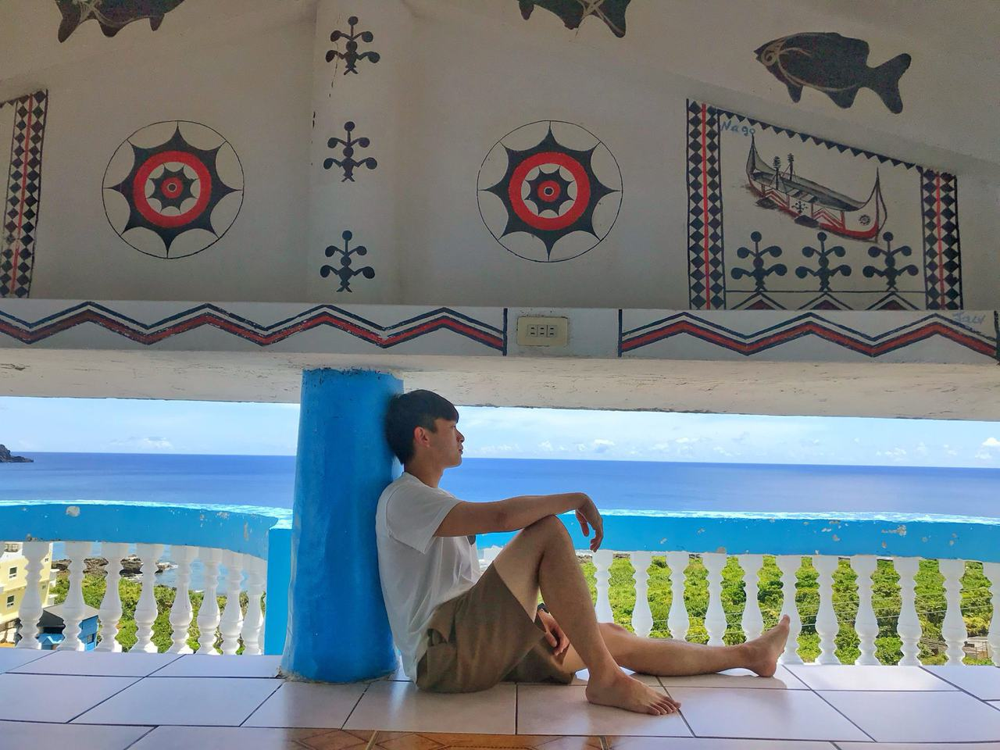

> 蘭嶼夜晚星空真的美 
> 處處有山羊🐐
> 網路卡卡頓
> 物價媲美歐美

---

# 行程

## Day 1 亞比亞民宿 (東)
16:00到達蘭嶼
回民宿休息一下
東清小夜市吃蔥油餅
希蕊娜莉晚餐
回民宿休息
十一鄰酒吧

## Day 2 (南)
看日出
看完回去睡
蘭嶼冷泉
看蘭嶼地下屋
漂流木餐廳
西岸海邊玩水
繞南部蘭嶼一圈
回民宿休息（走中橫）
青青草原看夕陽
蘭嶼哇哇複合式餐飲晚餐
去附近商店買紀念品、郵局領錢
回去路上看星星
回民宿
去雜貨店買酒回民宿喝

## Day 3 (北)
早上藍海屋潛水 （不太推浮潛 有點雷 但聽說深潛很棒）
回民宿洗澡
午餐 人魚和貓
開始北繞蘭嶼（情人洞、蘭嶼鬼洞、貝殼砂、很深之意、雙獅岩、像水渠一樣 拍照）
沿路冰店吃冰
小攤販吃飛魚卵小吃
蘭嶼氣象站
回民宿
等八點吃 燒烤吃到飽
小七買酒回民宿

## Day 4
看日出
看完回去睡
東清三十三早午餐
回民宿收拾行李
舊蘭嶼燈塔拍照
等搭船回本島

## 原訂行程但沒去：
雯雯冰店
安逸酒吧
M cafe喝酒 
旅人。Rove喝酒 
蘭嶼在地美食-小米阿粨
蘭嶼反核bar
瑟郎冰沙吃冰  
自由潛水

 

> 總歸一句： 
> 抱持放鬆的心態來就好
> Soak in your own world!