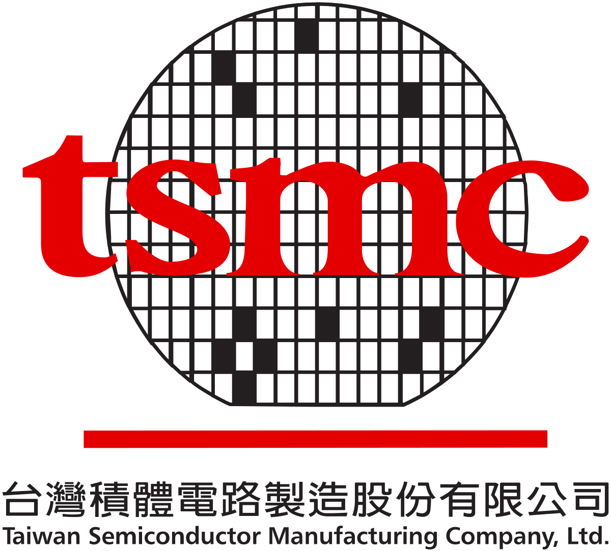
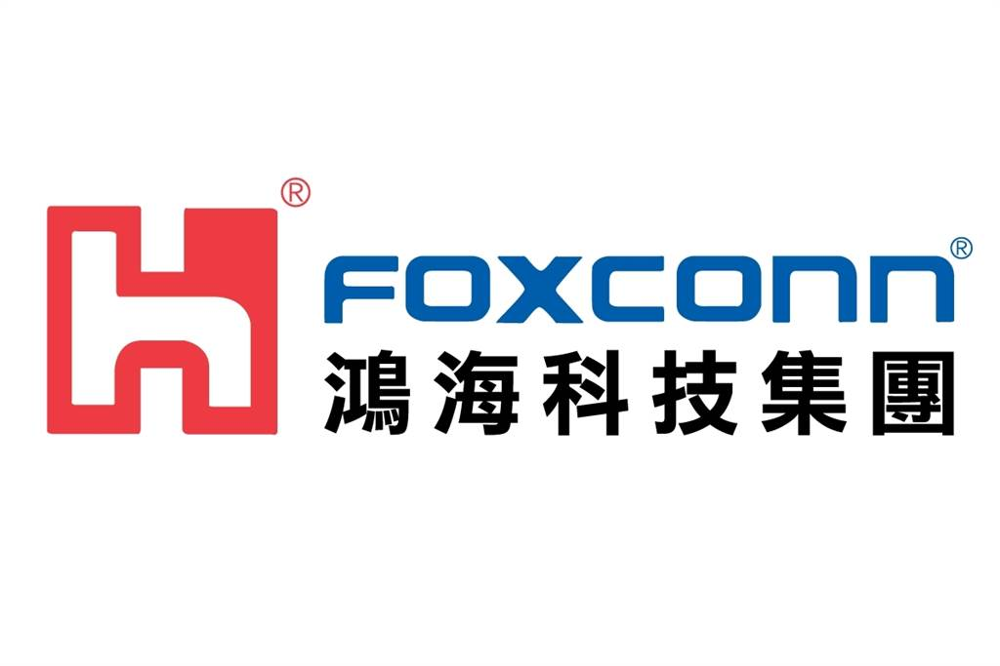
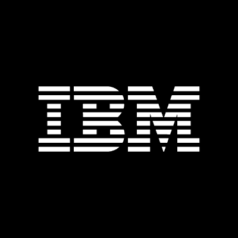
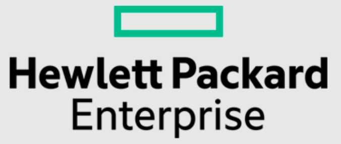

> As my discharge date from military service got closer, I had mixed feelings – happy to finally be free of all the restrictions, but worried about the ups and downs waiting for me on the job hunt.
> A huge thank you to all my classmates and seniors who shared their experiences and cheered me on.

# My Journey

Before graduating, I'd planned to go abroad on an exchange, but military service and the pandemic wrecked all my plans. I didn't do alternative service in R&D or line anything up in advance, so I only started looking after I finished my service.
It turned into a long stretch of job hunting. Landing my first job took more than four months. The days dragged, it was really tough, and comparing myself with my peers put a lot of pressure on me.
I think anyone who's been through a job search knows what I mean. It wasn't that I couldn't find a job – it was that I couldn't find one I liked and that suited me. From the first month on, I stared at job sites and company openings every day. Once I'd settled on my goals, I focused on building the skills they required. Especially after military service, I'd forgotten so much of what I'd learned that I had to spend time reviewing. I didn't spray my resume everywhere; I only applied to the roles I was most interested in and could actually learn from.
At first, plenty of companies reached out, but after interviewing I turned some down because they weren't what I wanted to do. Then when I found a job I really loved, they rejected me. Life loves to mess with you.
As time went on, the interviews got fewer and fewer, and I was glued to my phone checking email every day. People around me started saying things like "You're just too picky!" and "Take whatever you can get first, then aim higher!" I didn't feel like going out when friends invited me, and sometimes even caring questions sounded harsh: "How's it going lately?", "Started working yet?", "Let's grab dinner next week!" I started doubting myself: "Am I really too picky?" "I'm not as good as I thought, am I?" "If only I hadn't turned those companies down." "Maybe I should just take any job." I felt myself sinking deeper into a dark place.
But every time I hit rock bottom, I had lots of friends who were also struggling through their own job hunts. We cheered each other on and talked things through, and many classmates and seniors gave me valuable advice and experience, which helped me face my goals more positively and with more grit. Sometimes I'd take a walk in the park with my family to relax, hit the gym, and so on – meditation is also a great way to ease anxiety. Honestly, job hunting doesn't take weekends off; you have to keep pushing yourself.
Finding a job is just the beginning. If I get beaten by this, how will I handle all the setbacks I'll face at work later on? I have to keep reminding myself that there are bigger goals ahead!

---

# Interview Prep and Goals

After my discharge, I started revising my resume and preparing all the skills I'd need for interviews (Software engineer). Here's the list:
(1) Resume
(2) Get familiar with all my past projects again, and push them to GitHub
(3) Coding skills – practice on Leetcode and codility
(4) Programming languages (e.g., object-oriented concepts)
(5) Networking basics (IP, HTTP...)
(6) Data structures and algorithms
(7) Databases (SQL, NoSQL...)
(8) Operating systems
(9) System Design
(10) Linux
Most of my material came from my old notes from studying for grad school entrance exams, plus the many courses available on YouTube.

---

Before Lunar New Year, I gradually started applying to a lot of openings. My goal was a foreign company in Taipei, for these reasons:
(1) Taiwan's software industry is concentrated in Taipei, where you can grow and learn fast. Hsinchu, Taichung and other cities have jobs too, but they're mostly semiconductor-related, so I chose Taipei.
(2) My network in Taipei is wider, and I'd get to meet a more diverse range of people.
(3) I like the culture at foreign companies, and I also wanted to keep training my English.
(4) I'd rather work with people than just with machines.

---

# The Companies I Interviewed With (or Didn't):

## TSMC System Engineer

TSMC invited me to interview through 104 (a Taiwanese job site). Even though my goal was a foreign company, I was still happy to give it a shot.
First, the manager called me directly to explain the role and required skills. It sounded like helping develop business intelligence systems, DevOps, writing programs and designing processes, and so on. He then asked about my background and whether I was willing to interview, and we set up an on-site interview right there on the call.

The on-site interview was on 1/27 at around 9:30 AM. I'd stayed at a classmate's place the night before, and between the unfamiliar surroundings and nerves, I barely slept. I got there at 9:00, swapped my ID for a visitor pass, handed over all my electronics, and waited. First came an English test and an aptitude test – nothing especially hard, although halfway through, the computer of the person next to me broke down, which was a bit distracting. When I finished, I let HR know, and they gave me a slip of paper telling me to take the shuttle bus to a specific fab. That's when I realized just how many fabs TSMC has XD. After about a 10-minute ride, an assistant took me to an office to wait for the managers. Two of them came in – one good cop, one bad cop. After some small talk, I introduced myself and walked through my portfolio (I'd wanted to demo it on my laptop, but it had been taken away, so I had to do it verbally). They asked a few classic questions: What's the biggest challenge you've faced and how did you solve it? How do you keep improving yourself? How do you handle difficulties within a team? On the technical side, they asked what languages and frameworks my projects used, and they wanted every answer in under a minute. Then I asked whether there was a lot of overtime; they said rarely, only when projects get busy. Before leaving, one manager said I was a good talker and that HR would contact me about the next round, since the department head still had to make a decision. In the end, I declined the second interview.

What to improve: I wasn't well prepared for the common classic questions, and I should know the tech in my own projects better.

---

## Vpon Data Engineer

I applied to this company through Yourator. I'd heard about them at a job fair at Taipei Arena. They do big data and use it to analyze things like how to target ads. The company has around 150 employees on a single office floor. It seemed like a good company, so I wanted to interview, and I scheduled a time with HR.

The interview was on 2/1 at 10:00 AM, on the 7th floor of a building near MRT Zhongshan Junior High School Station. There were no partitions between the desks at all, and the lighting was comfortable – it had that energetic startup feel, even though the company is over 10 years old. When I arrived, some people were just getting in to work, which felt very free and easygoing. When the manager came in, I introduced myself and walked through all my projects on my laptop. He listened patiently and asked questions along the way. Then he explained the role and how the work is done: data cleaning can be a bit tedious, you'd have a mentor, and the company offers all kinds of challenging tasks and lots of chances to present publicly. I honestly felt it was a great learning opportunity. Then the manager quietly pulled out a test sheet with 4 questions. The first two asked which SQL query had better performance and efficiency, one was about a Linux command, and one was a diagram I had to explain (it was actually something like a low-load AWS cloud workflow). I hadn't touched SQL in so long that I only knew basic commands and had no idea which was more efficient, though I roughly explained what each command did, and the manager gave me hints along the way. For the last one, he said it was fine if I didn't get it since I hadn't worked with AWS. In short, I didn't solve much of that test. Afterward, I asked about their learning programs and company policies. I was supposed to have an HR interview after that, but HR was still in a meeting, so the manager personally walked me downstairs. I really liked the atmosphere there. A week later, I got a rejection.

What to improve: This time I felt my basic interview skills had improved, but I didn't study up on SQL beforehand, and I should strengthen concepts like cloud computing and load balancing.

---

## Foxconn Cloud Server R&D Testing

A Foxconn manager saw my profile on 104 and called me directly to talk about the role. He seemed really young, and he even suggested I come interview just to gain experience XD. Basically, Foxconn manufactures physical servers for big customers like AWS and IBM, and this team handles server testing – developing test software for the production units to use, working with Python, Linux, and so on. It sounded worth a try, so I said yes.

The interview was originally set for 1/26, but because of the pandemic the company went remote for a week, so it moved to 2/2 at 2 PM. The office is in Tucheng, and on my scooter ride there I was surrounded by gravel trucks and big lorries. I kept thinking that if I worked here, I'd be scared to death every day. When I arrived, HR took me to a room for an aptitude test and an English test on a touchscreen, but since I'd taken IELTS within the past year, I could skip the English part. Afterward, I waited for the managers in a room with frosted glass. HR gave me a Leetcode 2sum problem to work on while I waited, since the managers would be a while. I finished it quickly and got my laptop ready.

Three managers came in one after another to interview me. My self-introduction this time was really thorough, including my whole portfolio, presented one project at a time in detail. Every manager listened with real interest, asked why I'd wanted to build each one, and we had a great discussion – they even said one of them could make big money XD. We chatted about my art pieces too. That alone took about 40 minutes. Then the senior manager explained the role, much more clearly than on the phone, even sketching diagrams by hand, which helped me understand how things work internally. I asked about overtime, what he thinks makes a good employee, the promotion system, benefits, and so on, and he answered everything happily. Finally, the offer was a salary of (N+2)*(14~15), and if I was interested I could email the manager and they'd send an offer. But it probably wasn't what I was passionate about, so I didn't reply.

What to improve: I did really well this time, but I should have asked the managers what else I could improve on.

---

## AWS Cloud Support Associate

Right after I applied on their official website, the system sent me an online test. You can find the questions online – things like how to handle multitasking, networking basics, and a self-assessment of personal interests and abilities. After finishing the test, I never heard back...

What to improve: I wasn't confident at all on networking basics; I hadn't reviewed them since my grad school exams.

---

## IBM Associate Consultant

I applied on their website on 1/21 and got an online test on 2/5. It wasn't like a typical IPAT; it was more like playing games, including adding and subtracting numbers and rotating 2D and 3D shapes. A long time after,
on 3/24, I was asked to do an online AI interview, where the computer records you and an AI scores you automatically. For reference: [AI interviews](https://zhuanlan.zhihu.com/p/272741655?fbclid=IwAR3ejmIj-aDrGMoYtSsxxTt95M2Kf2_lJbcUlKkDUjHjhA1wV9EZ5ydox30)
On 4/11, I got a rejection.

What to improve:
Maybe it was because my internet connection was really bad during the AI interview – I kept getting interrupted by poor-connection warnings, and many parts didn't get recorded. Also, answers can follow this structure:

When describing an experience, use these three points:
Situation & Task: During my internship at Micron, I came from a software background, but my department worked on hardware, so I had to learn hardware concepts to complete my project.
Action: The department offered professional courses I could take, my manager was always willing to teach me when I had questions, and the other interns were from related fields, so I could ask them too.
Result: In the end, it took a month, and I successfully finished developing the project.

When describing a failure, use these three points:
Situation/Task: As equipment lead of the street dance club, I arranged a time with a vendor, but because of a miscommunication, the performance was delayed on the day of the show.
Result: I admitted my mistake to the club members and quickly borrowed equipment from the school on the spot for rehearsal.
Analyze: I should have communicated clearly with the vendor using the 5W1H.

---

## VMware Associate Consultant

I applied on their website on 2/17. The job description was something I really liked and was interested in, so I decided to give it a try, and I spent the whole time preparing K8S and Container knowledge.

3/3 Role introduction. What was great is that VMware gathered everyone online beforehand to explain the role, the company culture, learning resources, the interview process, and a Q&A. The job is mainly helping customers build solutions; being familiar with Kubernetes, Containers and similar tech is a big plus. There's a year of training, and after that you visit customers with other consultants.

3/10 5 PM: First online interview with the manager, a Solution Architect. He gave me 3–5 minutes to introduce myself. I'd prepared my portfolio to demo, but I was worried about taking up too much time, so I told him I could walk through it if needed. He then asked me a few questions: how I balance work and life, what my thesis was about, a situational question (a customer says the product is bad – how do you respond?), what VMware does, my weaknesses, my future plans, and so on. This interview was mostly about getting to know my personality. Afterward, I asked about project length, whether projects run in parallel, and how I did today.

After waiting two weeks, I emailed the manager on 3/24 to ask about the result. He had HR reply, telling me I wasn't selected.

What to improve: Because I wanted this role so badly, I was way too nervous and stumbled over my words more than in previous interviews. My answers should come from the heart rather than sounding rehearsed, and I should have prepared the classic questions better – I didn't answer them well. The manager also gave me feedback: he hoped I'd follow the interviewer's flow.

---

## HPE Technology Consultant

3/24 Applied through the official website.

3/25 The HR person, who was from Hong Kong, called to talk about the opening. She was really nice and we chatted a lot; she even told me about other presales and postsales openings, and said the manager would contact me.

4/1 Online interview with the manager. It started with a quick self-introduction and some questions about my personality. The manager was really nice and explained what the work is like. This role leans toward Infrastructure – you learn Redhat, VMware and Linux, and it's more IT-service oriented. We had a great conversation.

4/8 Early in the morning, I suddenly got a call from the manager asking if I was free to grab a meal and chat. I didn't know how to react at first. He said it turned out he lived really close to me and had gone to the same grad program as me, so it was just a casual chat and nothing to be nervous about. What a coincidence! So we met at 10 near my place for brunch (super fancy – I'd never eaten anything like it). We talked about my thoughts on the role, and he went over its details: within a year, you might spend only a few days in the office, since you're almost always at customer sites and only occasionally need to come in for meetings. After we finished, he even drove me home. Such a nice guy. I was still thinking about whether I'm a good fit for the role, though.
4/16 Visited HPE's Nangang office. The manager showed me the company's benefits, office space and so on, which gave me a much deeper understanding of the company and made me like the role even more.

---

## No Response
Trend Micro Software Engineer: Heard you have to apply through 104
Verizon Software Engineer: Seems like they only need Sr. right now
Shopee Python Backend Engineer: Seems like you have to apply to the Singapore openings
Microsoft Associate Consultant: The opening was posted last September, so it's probably already filled

---

Finally, I want to thank every company and every manager for giving me the chance to interview. Their patience and advice taught me a lot, and I'll keep working on my weak spots.
I also want to thank all the friends and seniors who gave me advice and helped me during this time.
I hope everyone reading this, and everyone around me, finds a great job they truly "love".

---

# References and Learning Resources

Here are some learning resources and references I found useful.

Networking:
http://linux.vbird.org/linux_server/0110network_basic.php#tcpip_network_arp

<iframe class="yt" src="https://www.youtube-nocookie.com/embed/QKfk7YFILws" title="YouTube video" loading="lazy" allow="accelerometer; clipboard-write; encrypted-media; gyroscope; picture-in-picture; web-share" referrerpolicy="strict-origin-when-cross-origin" allowfullscreen></iframe>

Algorithms:
Sorting: https://www.toptal.com/developers/sorting-algorithms
LeetCode great solutions: https://www.youtube.com/channel/UC_mYaQAE6-71rjSN6CeCA-g/community

Databases:

<iframe class="yt" src="https://www.youtube-nocookie.com/embed/7S_tz1z_5bA" title="YouTube video" loading="lazy" allow="accelerometer; clipboard-write; encrypted-media; gyroscope; picture-in-picture; web-share" referrerpolicy="strict-origin-when-cross-origin" allowfullscreen></iframe>
<iframe class="yt" src="https://www.youtube-nocookie.com/embed/ZS_kXvOeQ5Y" title="YouTube video" loading="lazy" allow="accelerometer; clipboard-write; encrypted-media; gyroscope; picture-in-picture; web-share" referrerpolicy="strict-origin-when-cross-origin" allowfullscreen></iframe>

System Design:
https://medium.com/%E5%BE%8C%E7%AB%AF%E6%96%B0%E6%89%8B%E6%9D%91/%E7%B3%BB%E7%B5%B1%E8%A8%AD%E8%A8%88%E5%AD%B8%E7%BF%92%E5%9C%B0%E5%9C%96-de216ab211fb

<iframe class="yt" src="https://www.youtube-nocookie.com/embed/bUHFg8CZFws" title="YouTube video" loading="lazy" allow="accelerometer; clipboard-write; encrypted-media; gyroscope; picture-in-picture; web-share" referrerpolicy="strict-origin-when-cross-origin" allowfullscreen></iframe>
<iframe class="yt" src="https://www.youtube-nocookie.com/embed/hnpzNAPiC0E" title="YouTube video" loading="lazy" allow="accelerometer; clipboard-write; encrypted-media; gyroscope; picture-in-picture; web-share" referrerpolicy="strict-origin-when-cross-origin" allowfullscreen></iframe>

Operating Systems:
https://mropengate.blogspot.com/2017/09/operating-system-concepts.html
http://debussy.im.nuu.edu.tw/sjchen/OS_Final.html

K8s:
https://ithelp.ithome.com.tw/articles/10192401

<iframe class="yt" src="https://www.youtube-nocookie.com/embed/X48VuDVv0do" title="YouTube video" loading="lazy" allow="accelerometer; clipboard-write; encrypted-media; gyroscope; picture-in-picture; web-share" referrerpolicy="strict-origin-when-cross-origin" allowfullscreen></iframe>

