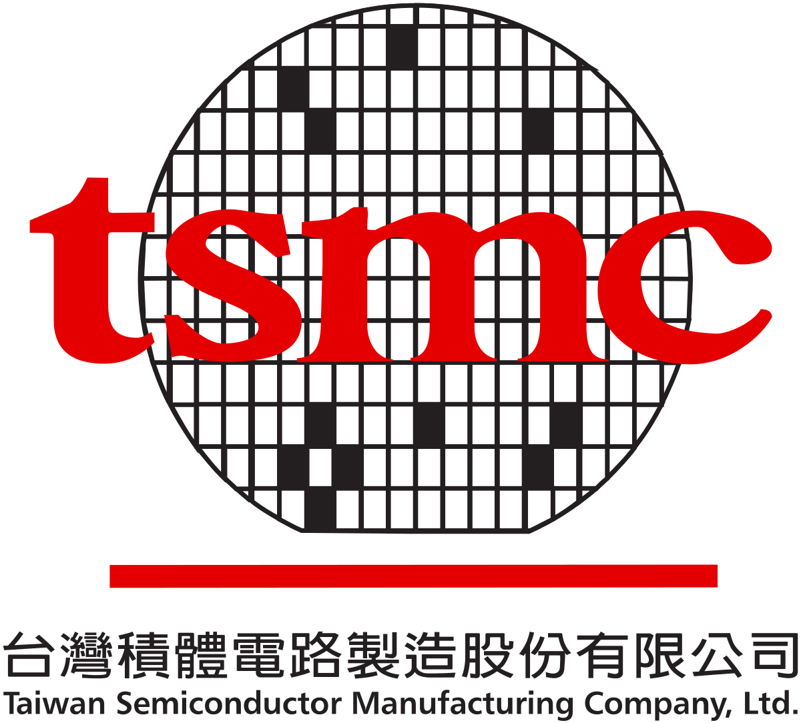
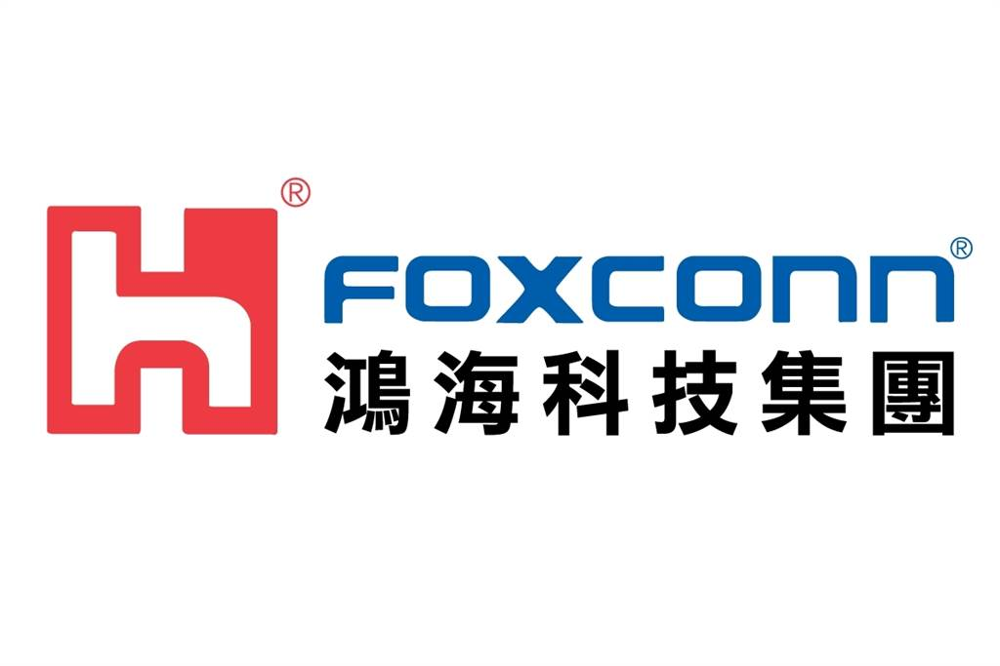
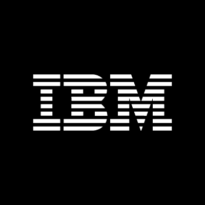
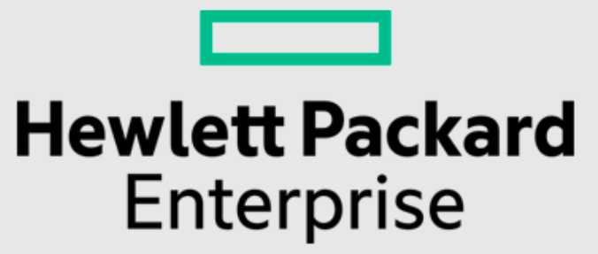

> 伴隨著退伍日期接近，心中五味雜陳，一則以喜，一則以憂，開心退伍後不再受到約束，擔憂求職路上遇到的波瀾
> 非常謝謝所有身邊的同學還有學長姐的經驗分享還有給我的鼓勵

# 心路歷程

畢業前，原本計畫著出國交換，然而卻因為兵役跟疫情，打亂了所有計畫，也沒研替也沒事先找，就等到當完兵才開始。
經歷了一段找工作的漫長時間，第一份工作找了4個多月，日子難熬、十分艱辛，同儕之間的比較等等，壓力很大
我想找過工作的人都能體會我想講的，其實也不是找不到工作，而是找不到自己喜歡且適合的工作，自從第一個月開始每天望著求職網、公司開的職缺，確認好自己的目標後，專注於所需能力的提升，尤其當兵過後，許多以前學的都忘光了，還需要花時間複習，自己投遞履歷的方式不是撒網型，而是針對自己最有興趣且會學得到東西的才丟，
一開始有許多公司的邀約，然而面試後發現有些不是想做的就拒絕了，當遇到非常喜歡的工作時卻被拒絕了，太玩弄人生了
隨著時間的推移，越來越少面試機會、每天盯著手機mail，身邊開始有聲音，如「你就是太挑啦！」、「先求有再求好！」，朋友的邀約都不太想前往，有時甚至是關心的話都覺得特別刺耳，「最近如何？」、「開始工作了嗎？」、「下禮拜吃飯啦！」，便開始懷疑自己，「我是不是真的太挑？」「我其實沒有自己想的那麼好對吧？」「如果當初不要拒絕那些公司就好了。」「還是隨便找份工作做吧！」覺得自己越來越黑暗。
然而就在每次沮喪絕望後，身邊也有許多還在找工作的朋友也在水深火熱中，我們互相打氣、互相討論，而且許多身邊同學、學長姊也都會提供我寶貴的經驗還有建議，讓我可以更正面、更有毅力的去面對未來目標，有時自己都會陪家人到公園走走，放鬆心情，去健身等等、冥想也是一個降低焦慮的方法，說真的，找工作是不分假日的要不斷督促自己
找工作只是開始，如果就被擊敗，更別說以後工作所遇到的所有挫折了，要時常提醒自己，還有更遠大的目標！

---

# 面試準備及目標

自從退伍後，開始修改著自己的履歷以及準備所有面試所需的能力(Software engineer)，以下列點：
(1) 履歷 
(2) 熟悉自己過去所有的作品集、並 push到 GitHub上
(3) 程式能力 - Leetcode, codility 練習
(4) 程式語言 （如物件導向特性）
(5) 網路基礎知識 （IP, HTTP...）
(6) 資料結構、演算法
(7) 資料庫 (SQL, NoSQL...)
(8) 作業系統
(9) System Design
(10) Linux
基本上，資料來源都是以前考研究所的筆記、YouTube有許多課程可以學習

---

在年前開始慢慢投遞許多職缺，自己的目標是台北外商，考量因素有以下：
(1) 軟體業在台灣集中於台北，發展學習速度快，雖然新竹、台中等也有，但多是半導體相關產業，因此選擇台北
(2) 台北的人脈較廣，同時接觸到的可以更多元
(3) 因為外商文化是自己喜歡的，同時也想多訓練自己英文的能力
(4) 自己更喜歡接觸人而非只有機器

---

# 陸續面試及沒面試的以下公司介紹：

## 台積電 System Engineer 

台積透過104發邀請我面試，雖然自己目標在外商，但仍願意參與面試
首先，主管直接電話告知我這個職位的工作內容與所需技能，感覺是在幫助開發商業智慧系統、Devops、幫助撰寫程式並設計流程等，而後問我個人的經歷、是否願意面試等，就直接約了一個時間當場面試

1/27現場面試時間約上午9:30，由於前一天住同學家，環境不適應再加上有點緊張，沒什麼睡著，9:00就抵達現場，換證、卸下所有3C產品後等待，首先是英文能力測驗與性向測驗，感覺沒有特別難，只是作答到一半，旁邊的人電腦還出問題，有些干擾到，而後結束就通知人資，人資給了我小紙條請我搭廠車到指定的廠區，這時才知道原來台積那麼多廠XD，坐了10分鐘左右到指定廠區，由助理帶我到辦公室等候主管，來了兩個主管，一個白臉、一個黑臉，跟主管寒暄一番後開始自我介紹、介紹作品集等（原本想用電腦展示，但被繳走只好口頭），主管問了幾個經典問題：遇過最大的挑戰是什麼如何解決、如何充實自己、團隊遇到困難如何解決、針對技術問題詢問project使用什麼語言、什麼框架等，主管都要求一分鐘內講解，而後我問了主管會不會加班等，主管說很少，只有在專案很忙的時候。最後主管離開前說我很會講話，等待HR再跟我說下次面試，處長那還要做決定，之後就婉拒第二次面試。

改進： 對於基本常見的經典問題沒有準備的很充分，自己的專案技術可以再熟悉一些

---

## Vpon Data Engineer

這間公司是我透過Yourator投遞的，當時有去台北小巨蛋參加就業博覽會，從而得知這間公司，是做Big data還有藉此分析如何廣告投遞等等，公司員工數大約150人左右，一層樓的辦公空間，當時覺得是間不錯的公司就想去參與面試，跟HR喬定時間後面試。

2/1當天早上10:00面試，位在捷運中山國中站附近的大樓7樓，辦公桌間完全沒有隔板，燈光舒適很有新創公司活力的感覺，雖然公司已經超過10年，我到的時候有人也剛好來上班，感覺很自由，主管進來後我先自我介紹並透過自己的筆電分享我的所有專案，主管很耐心聽我介紹，也邊問問題，而後主管開始介紹職位的內容以及工作型態，做data clean時會有點枯燥，並且會有mentor帶，公司提供各種挑戰任務還有很多公開發表的機會，我真心覺得是自己覺得還不錯的學習機會，而後主管默默地拿出一張考卷，裡面有4題題目，前兩題是SQL指令問哪個的performance較好、效率較高，一題Linux的指令，一題圖示要解釋大概是在做什麼（其實是如AWS雲端低負載流程），但我太久沒有碰SQL只知道簡單的指令，完全不知道哪個效率高，但有大概解釋指令是在幹嘛，主管也會在旁邊提示，而最後一題主管說可能我沒接觸AWS不太了解沒關係，總之這個測驗我沒什麼解出來，而後我問了些關於這裡的學習制度還有公司的制度等等。結束後原本是要跟人資做面試，但人資還在開會，所以主管就親自送我下樓，真心覺得這裡的氛圍很好。過了一個禮拜被婉拒了。

改進： 這次覺得面試的基本能力有提升，但沒有事先針對SQL多做研究，同時雲端運算、負載平衡等觀念也應該多做加強。

---

## 鴻海 雲端伺服器RD測試

鴻海主管在104看到我直接打電話跟我聊這個職位的內容，主管感覺很年輕，而且也建議我可以面面看，增加經驗XD，內容大概是鴻海負責生產實體伺服器顧客是AWS或IBM等大公司，而我們負責伺服器的測試，中間會需要研發測試軟體，提供生產單位去做測試，而會接觸到python、Linux等，覺得可以試試看就答應了主管。

原先約1/26面試，但因為疫情，公司一週遠距工作，改2/2下午2點面試，公司位於土城，騎車的路途中，好多砂石車跟大貨車，邊騎邊想，如果在這工作會每天膽戰心驚的，到了公司，HR帶我去一個房間做性向測驗跟英文測驗，透過觸控式的螢幕，但是因為我一年內有考過IELTS因此可以不用再考英文，考完後在一個霧玻璃的房間等主管，而HR也是先給我一題Leetcode 2sum的考題說等待期間可以先寫，主管還要一段時間，很快寫完我就準備好筆電等待主管。

而主管一個個先後共來了三個跟我面試，我這次的自我介紹非常充分，還包括所有作品集，很詳細的一個個介紹，每個主管都聽的非常起勁，還問我當時為什麼想做這個，還跟我討論得很開心，說這個可以拿來賺大錢XD，連藝術的作品也都聊了一番，光這樣下來40分鐘左右，後來由大主管開始介紹這個職務內容，比電話中講的更明確，還有用手畫圖講解，讓我更了解內部的運作，而後我問了主管這裡會不會加班、主管對於一個好的員工的定義、升遷制度福利等等，主管都回得滿開心的，最後的最後，(N+2)*(14~15)的薪水，如果我有興趣可以跟主管mail，再寄offer，但這可能不是我的興趣，所以沒有答覆。

改進： 這次表現得很好，但是應該問主管自己還有哪點可以多做改進

---

## AWS Cloud Support Associate

透過官網投遞後，馬上系統會發線上測驗題，網路都查得到，像是多工處理如何調配、網路基本知識、個人興趣與能力自評，做完測驗後就再也沒消息了...

改進： 網路基本知識很沒有把握，自從考研後都沒在複習

---

## IBM Associate Consultant

1/21就在官網投遞職缺，2/5收到做線上測驗，題目內容不太像一般IPAT，而是像玩遊戲的方式進行，包括數字加減、平面立體圖反轉等等，A long time after，
3/24收到要線上AI interview，主要是透過電腦錄影，然後會自動透過AI打分數，可參考：[AI 面試](https://zhuanlan.zhihu.com/p/272741655?fbclid=IwAR3ejmIj-aDrGMoYtSsxxTt95M2Kf2_lJbcUlKkDUjHjhA1wV9EZ5ydox30) 
4/11收到拒絕通知

改進： 
可能因為在進行AI interview時，我的網路收訊很差，一直跳出通知連線品質差而被干擾，同時很多段都沒有錄到，而且答題可以依照：

事情陳述可採以下三點：
Situation & Task : 我在美光公司實習時，由於本身是軟體領域，而實習部門是硬體相關的領域，因此需要了解硬體的相關概念知識，才能完成自己的專案
Action : 後來部門提供專業課程可以學習、有問題時主管同時也都很願意教導，身邊實習生也都是相關領域，可以詢問
Result : 最後花了一個月，順利完成專案開發

失敗經驗可採以下三點：
情況及任務（Situation/Task）：擔任熱舞社器材長，跟廠商約定時間，卻因為雙方認知落差，造成表演當天時間Delay
事後補救（Result）：向社團同學承認錯誤，當場趕緊跟學校暫時借用器材彩排
事後檢討（Analyze）：應該跟廠商明確的5W、1H溝通

---

## VMware Associate Consultant

2/17透過官網投遞，看了職缺內容是自己滿喜歡且感興趣的，決定試試，期間一直準備K8S、Container的知識。

3/3 職位介紹，很棒的是VMware會在事前召集大家線上說明職位內容、公司文化、學習進修資源、面試流程、ＱＡ等等，主要是協助顧客端做解決方案，熟悉Kubernetes、Container等技術是大加分，主要有一年的學習時間，而後會與其他Consultant拜訪顧客等等。

3/10 5pm跟主管第一次線上面談，主管任職Solution Architect，首先給我3-5min自我介紹，我原先有準備作品集想Demo，但怕耽誤時間就跟主管說有需要我再介紹，而後主管問了我幾個問題：Work-Life 如何調配、論文內容、情境問題（顧客反應產品差，如何反應）、VMware是做什麼的、自己缺點、未來規劃等等，主要這次的面試，主管都是在了解個人特質，而後我問了專案的時長、專案是否並行、今天的表現如何等等

等了兩個禮拜，3/24我寫信詢問主管面試結果，主管請HR回信，告知我沒被選上

改進： 由於太想要這職位，我表現得太過緊張，比之前的面試更語塞，答案應該發自內心而非官腔，基本經典問題應該好好準備，沒有回答很好，主管也有給我建議，說希望能跟著面試官的流程走

---

## HPE Technology Consultant

3/24 透過官網投遞

3/25 HR是香港人，打來跟我聊了關於職缺的內容，人很好聊了很多，還介紹其他presales、postsales的缺，而後跟我說主管會聯繫我

4/1 跟主管線上面試，一開始簡單的自我介紹、問相關的個人特質，主管人很好，介紹工作內容型態，這職位比較偏Infrastructure，要學習Redhat VMware Linux知識，偏向IT service，聊得很開心

4/8 一早突然接到主管的電話，說等等有沒有空，可以一起吃個飯聊聊天，我當下一時反應不過來，主管說原來他住離我家很近又是以前同研究所的，聊聊天而已不用太緊張，真的是太有緣，於是約了10點到家附近吃了早午餐（很高級我都沒吃過），順便聊聊關於我對職缺的想法還有介紹了關於職位的細項，可能一年內在辦公室時間不超過幾天，幾乎都在顧客那，開會偶爾才需在辦公室，聊完後主管還載我回家，真的人超級好。只是仍在思考是否自己適合這個職務。
4/16 去HPE南港參訪，主管介紹了公司的福利、空間環境等等，讓我對公司有更深的認識，更喜歡這個職務

---

## 沒消息 
趨勢科技 Software Engineer : 聽說要去104投才行
Verizon Software Engineer : 好像現在是缺Sr.
Shopee Python Backend Engineer : 好像要去丟新加坡的才有
Microsoft Associate Consultant : 看到是去年9月開的職缺，可能已經招滿

---

最後我想謝謝所有公司所有主管提供我面試的機會，主管們的耐心與建議都讓我學到很多，也會更加強自己不足的點
我也想感謝這段時間提供我建議還有幫助我的所有朋友、學長姐們
希望看到這篇文章及身邊所有的人都能找到自己「喜歡」的好工作

---

# 參考資料與學習資源

以下列了我找到不錯的學習及參考資源

網路：
http://linux.vbird.org/linux_server/0110network_basic.php#tcpip_network_arp

<iframe class="yt" src="https://www.youtube-nocookie.com/embed/QKfk7YFILws" title="YouTube video" loading="lazy" allow="accelerometer; clipboard-write; encrypted-media; gyroscope; picture-in-picture; web-share" referrerpolicy="strict-origin-when-cross-origin" allowfullscreen></iframe>

演算法：
Sorting: https://www.toptal.com/developers/sorting-algorithms
LeetCode great solutions: https://www.youtube.com/channel/UC_mYaQAE6-71rjSN6CeCA-g/community

資料庫：

<iframe class="yt" src="https://www.youtube-nocookie.com/embed/7S_tz1z_5bA" title="YouTube video" loading="lazy" allow="accelerometer; clipboard-write; encrypted-media; gyroscope; picture-in-picture; web-share" referrerpolicy="strict-origin-when-cross-origin" allowfullscreen></iframe>
<iframe class="yt" src="https://www.youtube-nocookie.com/embed/ZS_kXvOeQ5Y" title="YouTube video" loading="lazy" allow="accelerometer; clipboard-write; encrypted-media; gyroscope; picture-in-picture; web-share" referrerpolicy="strict-origin-when-cross-origin" allowfullscreen></iframe>

System Design:
https://medium.com/%E5%BE%8C%E7%AB%AF%E6%96%B0%E6%89%8B%E6%9D%91/%E7%B3%BB%E7%B5%B1%E8%A8%AD%E8%A8%88%E5%AD%B8%E7%BF%92%E5%9C%B0%E5%9C%96-de216ab211fb

<iframe class="yt" src="https://www.youtube-nocookie.com/embed/bUHFg8CZFws" title="YouTube video" loading="lazy" allow="accelerometer; clipboard-write; encrypted-media; gyroscope; picture-in-picture; web-share" referrerpolicy="strict-origin-when-cross-origin" allowfullscreen></iframe>
<iframe class="yt" src="https://www.youtube-nocookie.com/embed/hnpzNAPiC0E" title="YouTube video" loading="lazy" allow="accelerometer; clipboard-write; encrypted-media; gyroscope; picture-in-picture; web-share" referrerpolicy="strict-origin-when-cross-origin" allowfullscreen></iframe>

作業系統：
https://mropengate.blogspot.com/2017/09/operating-system-concepts.html
http://debussy.im.nuu.edu.tw/sjchen/OS_Final.html

K8s:
https://ithelp.ithome.com.tw/articles/10192401

<iframe class="yt" src="https://www.youtube-nocookie.com/embed/X48VuDVv0do" title="YouTube video" loading="lazy" allow="accelerometer; clipboard-write; encrypted-media; gyroscope; picture-in-picture; web-share" referrerpolicy="strict-origin-when-cross-origin" allowfullscreen></iframe>

