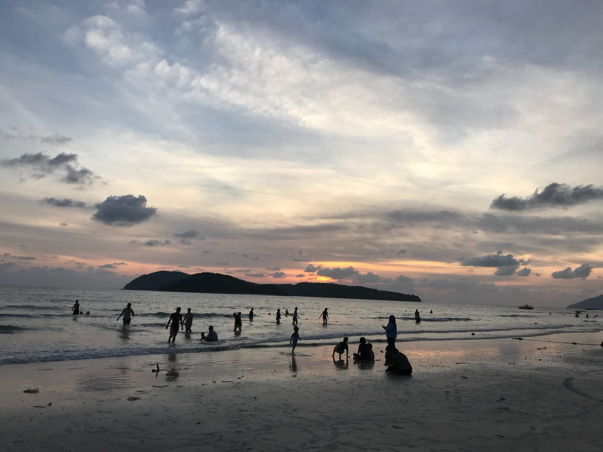
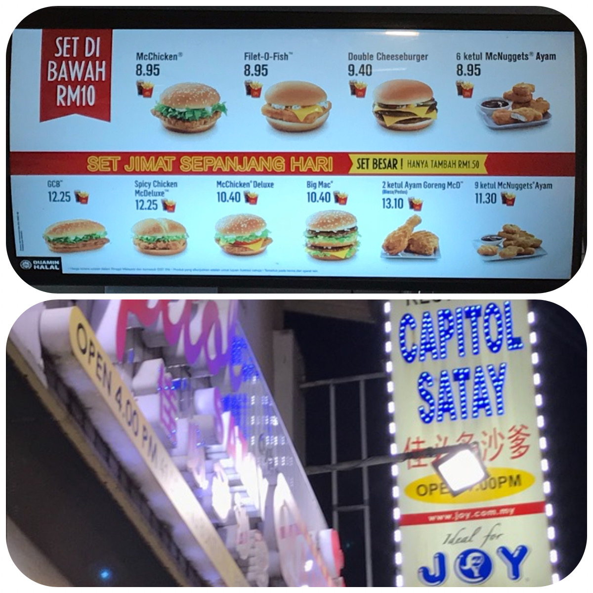
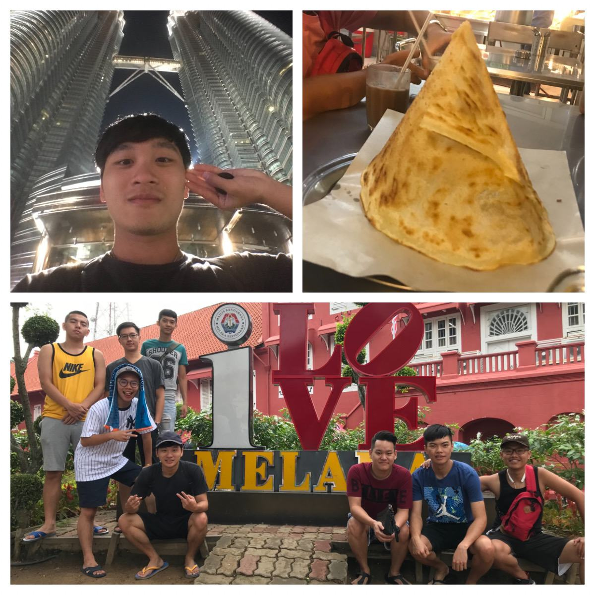
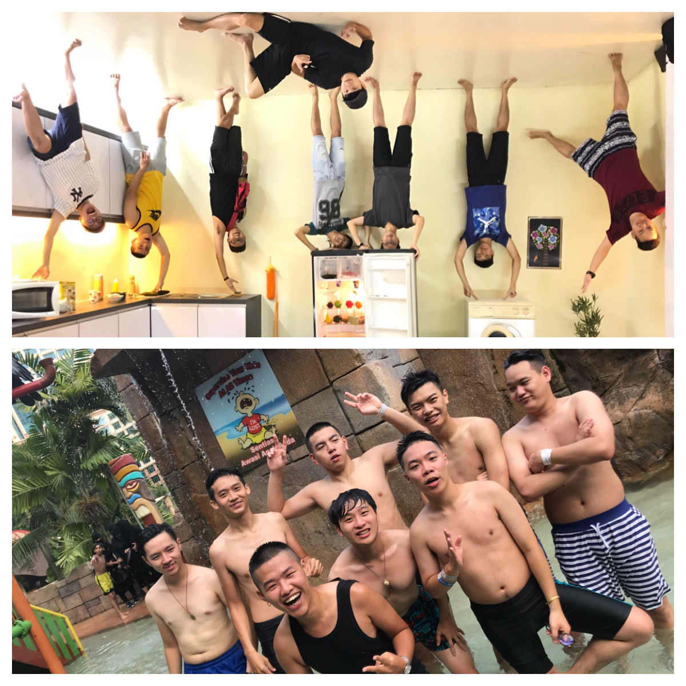
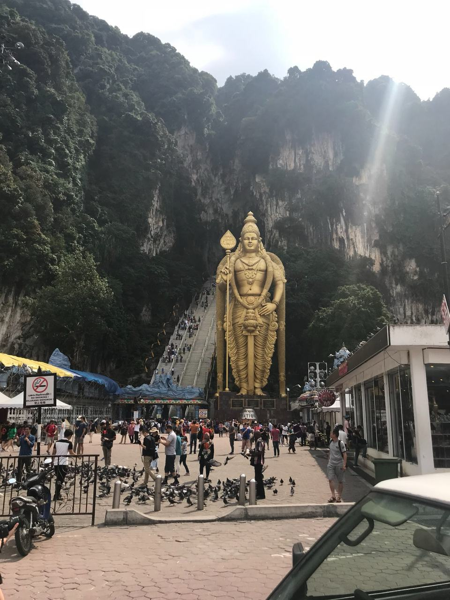
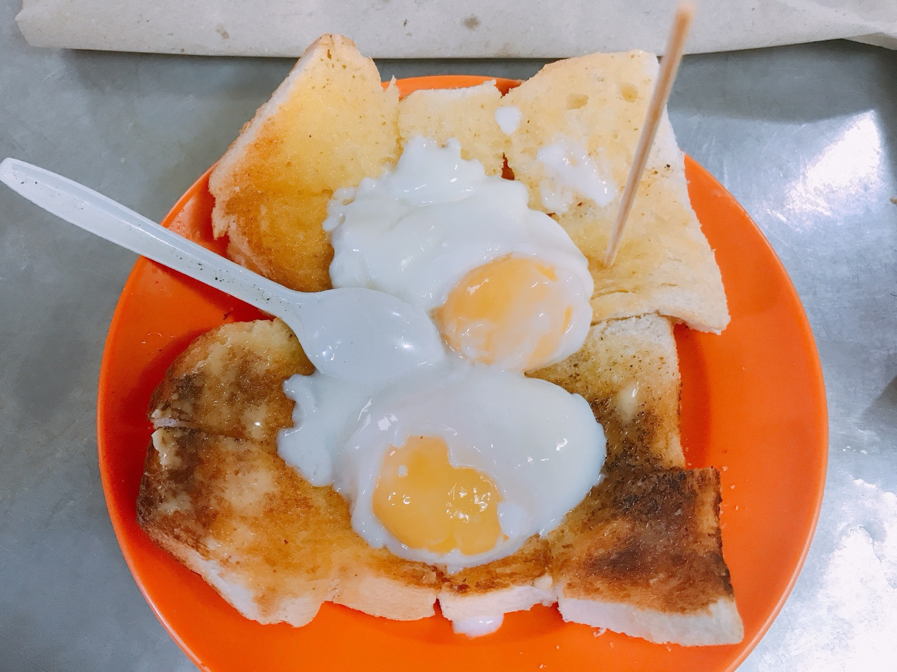
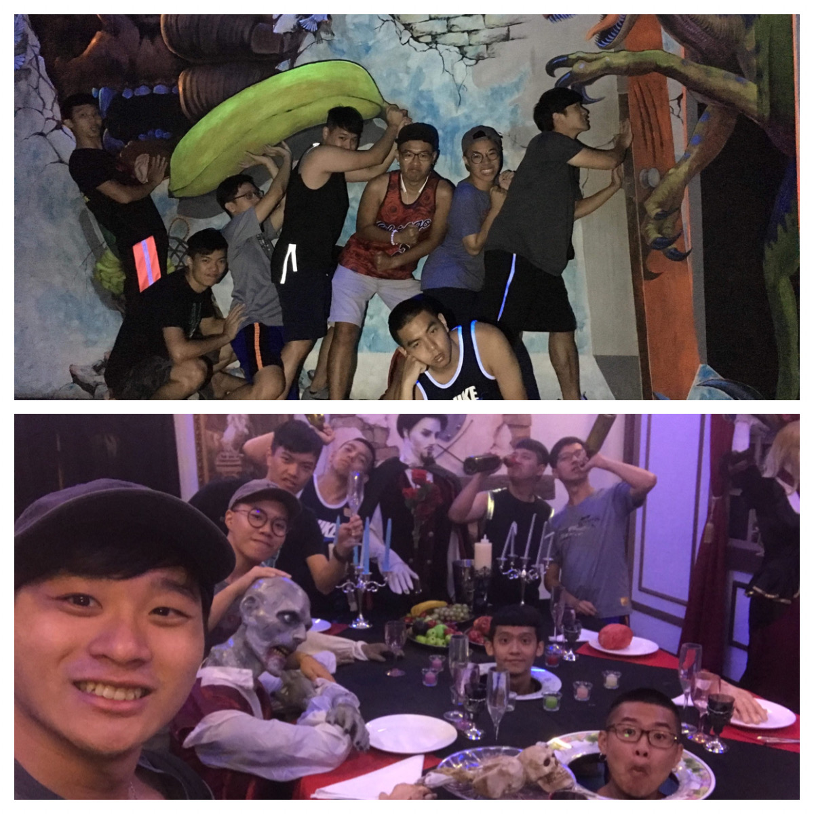
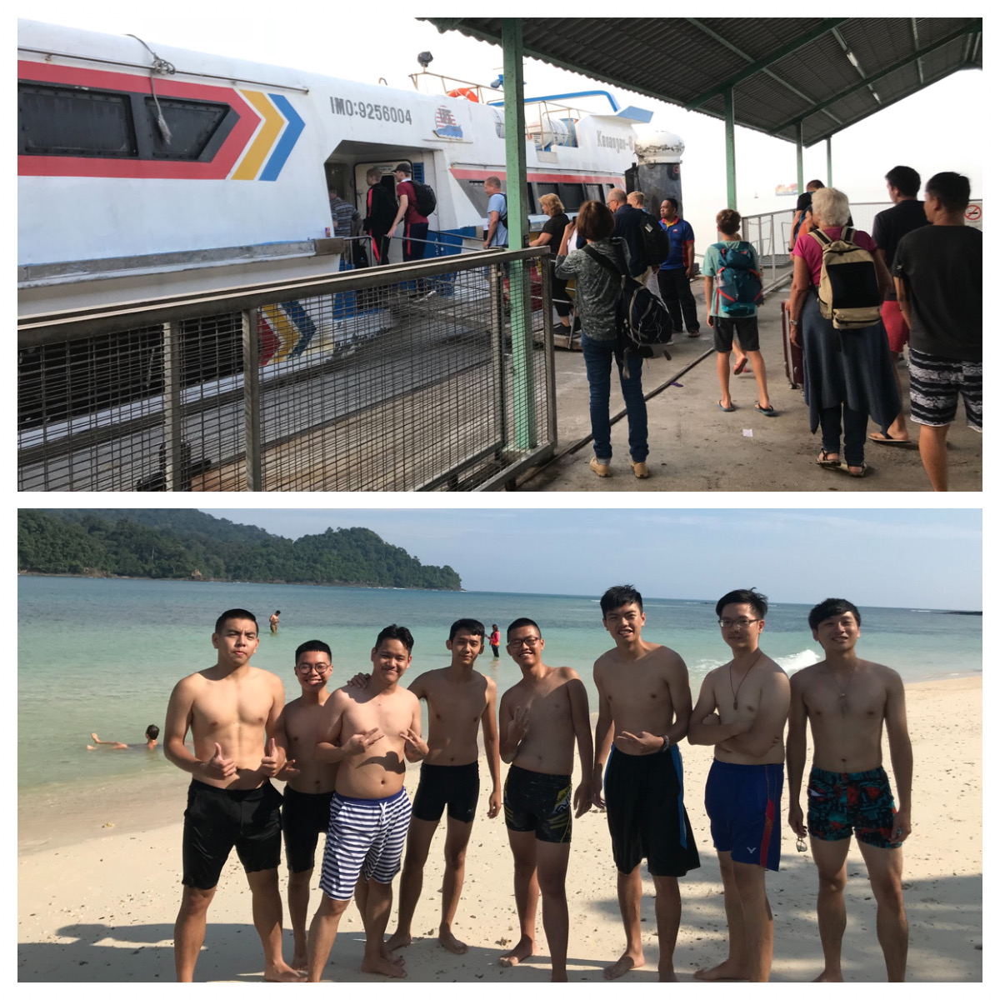
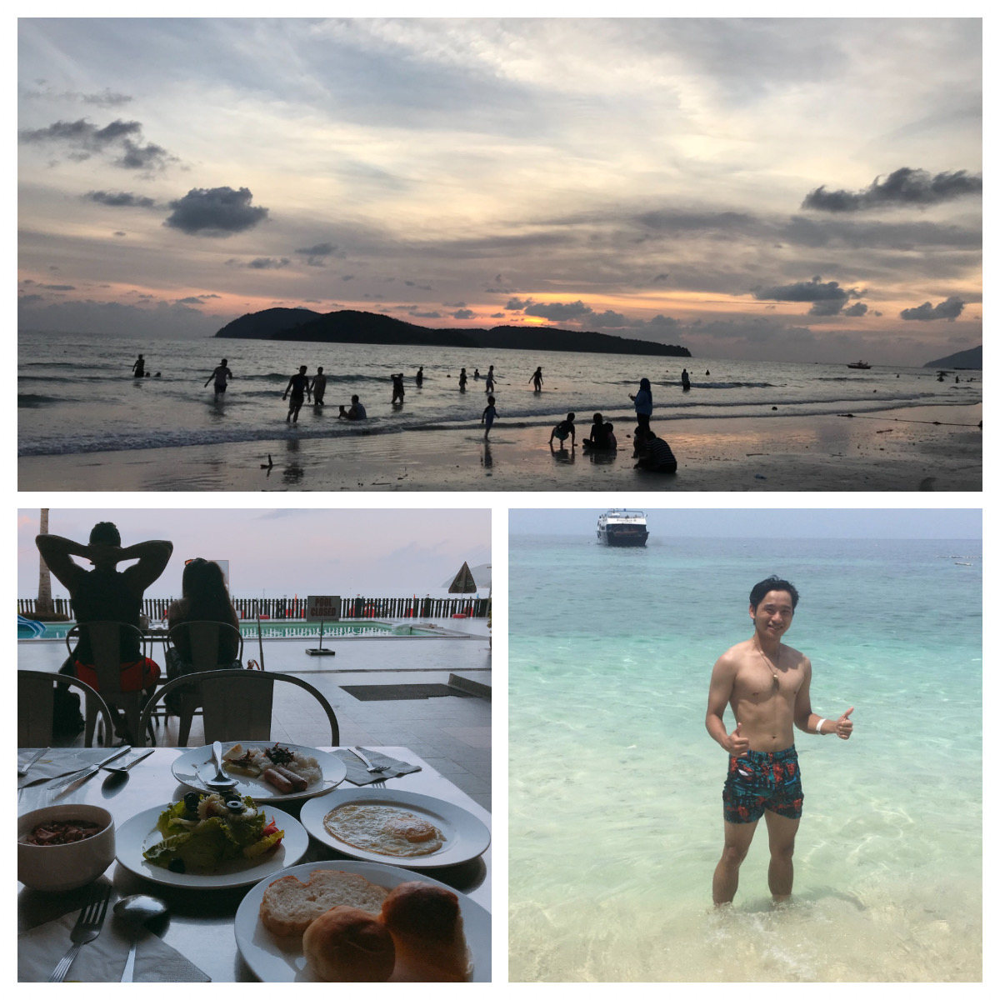
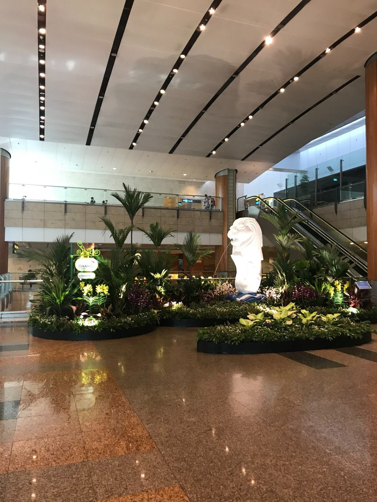

> Malacca > Kuala Lumpur > Penang > Langkawi > Genting Highlands > Johor > Singapore

---

# Itinerary

[Itinerary: Click On Me](https://gsy-life.webnode.tw/_files/200000006-8a0808b03e/馬來西亞之旅.pdf)

---

# Preparation

Since we went in the hot summer vacation season, I packed almost only T-shirts and shorts (but heads up: the AC on the plane can be really strong, so I brought a thin shirt). Bring swim trunks too so you can get in the water, and definitely don't forget sun protection (I got sunburned and peeled like crazy) ><

---

# Travel

## Day 1

The flight to Malaysia takes about 4 hours, and by the time we got to Kuala Lumpur it was already 8 or 9 p.m. We headed straight from the airport to McDonald's. Their McDonald's is cheaper than Taiwan's, and they have fish burgers (1 MYR = 7.6 TWD). It was only after going abroad that I learned Taiwan is the only place where you clear your own trash at McDonald's (a good habit😊).
After dropping off our luggage, we went to Malacca to try authentic satay. The flavor is strong and heavily seasoned, and if you don't keep stirring the sauce, the bottom gets burnt. For drinks I recommend 100plus (kind of like a fizzy Pocari Sweat)

## Day 2

In Malacca, we first visited the famous landmarks, then went to the Upside Down House to take photos. Then we took a car to Kuala Lumpur to play at the Sunway water park (tickets were almost 130 RM, about 930 NTD, if I remember right). As far as I knew, pirate ship rides don't go a full 360 degrees, but the one here does! There's also a wave pool, and luckily we got to do everything. At night we went to the Twin Towers (a famous landmark) and had snacks around there. The Indian flatbread was delicious~

    

## Day 3

We went to the Batu Caves. The stairs were full of macaques. They're cute, but they'll snatch your stuff or food
After the morning, we headed to Penang and arrived around 5 p.m. We bought boat tickets to Langkawi for the day after tomorrow, ate at a local night market, and then checked out the Avatar museum (everything glows like in Avatar, I think? I didn't quite get it)

## Day 4

We got up early for breakfast at Toh Soon, a famous local café, then went to the ghost museum and the history museum. It was a whole day of wandering around, and at night we drove to a laundromat to do laundry  

    

## Day 5

We got up early and took the boat to Langkawi. As soon as we got off, someone pitched us a package deal: 200 RM per person, about 1,500 NTD, covering car rental and diving, so we bought it. We took a boat out to lots of scattered islands, with plenty of beaches. Some of the spots were boring and pricey. In the evening we ate at a restaurant run by Chinese Malaysians. It was around NT$300 per person, but super delicious and super filling

## Day 6

After an early breakfast, we took a boat to a beach to go diving. There were no restrictions on diving and nobody stopped you from swimming wherever you wanted, just a boundary line, and when you got tired you could go ashore to rest. In the late afternoon we went back to the beach next to our hotel to try the rides and activities. For dinner we ate at a Malay-run restaurant (expensive, and we didn't even get full). Our Malaysian friend said we kind of got ripped off, so be careful at Malay-run restaurants. We finished the day with a stroll around a shopping mall

## Day 7

It was pouring rain first thing in the morning, and my friend almost lost his keys. We searched forever, and it turned out they'd been dropped at the place we ate the night before. We rushed by taxi to the pier and luckily made the boat just in time. Leaving Langkawi and then Penang, we drove all the way south to Genting. Tonight's stop: Genting Highlands, which has a huge casino. After dinner we went to the casino. It was my first time ever in a casino, like a movie scene come to life. There are security checks at the entrances and exits to make sure you're an adult

(No photos allowed in the casino)

## Day 8,9

We left Genting and went to our Malaysian friend's home, where we stayed for a day. The next day we flew back to Taiwan from Singapore, and only spent 2 hours in Singapore

# Summary

> With a Kuala Lumpur license plate, it seems everyone gives way to you, because KL drivers are aggressive
> Scooters can ride on the highway too, and you see Thai license plates now and then
> Gas is cheap: 95 octane is about NT$16 a liter
> My Malaysian friends all speak at least five languages and keep switching when talking with locals. I worship them
> The food is bold and spicy. Big recommendations: satay, bak kut teh, Roti tissue
> Drink recommendations: 100 plus, milk tea, Milo, herbal tea
> In Langkawi, alcohol is cheaper than bubble tea
> Malaysia really is a food paradise~
