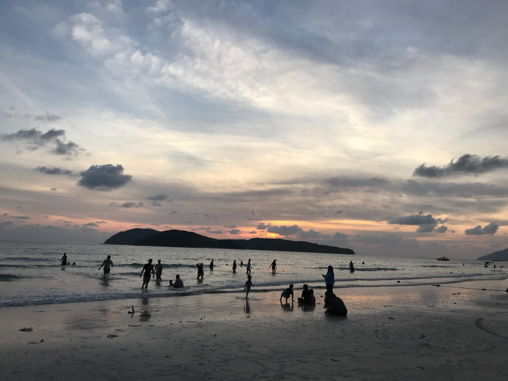
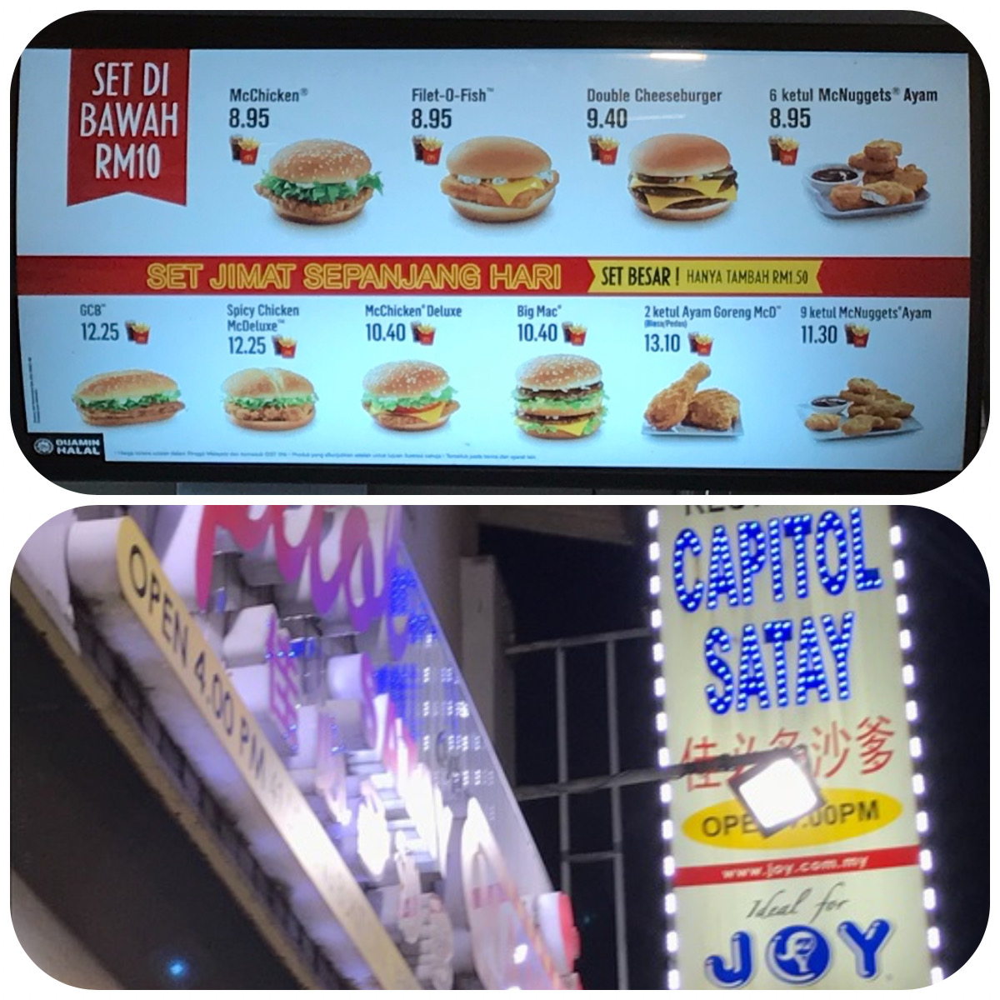
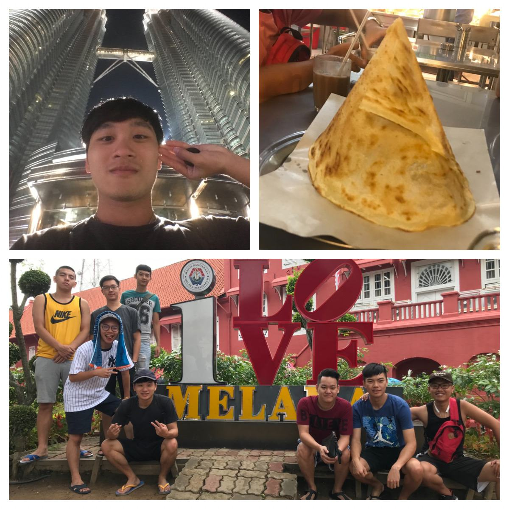
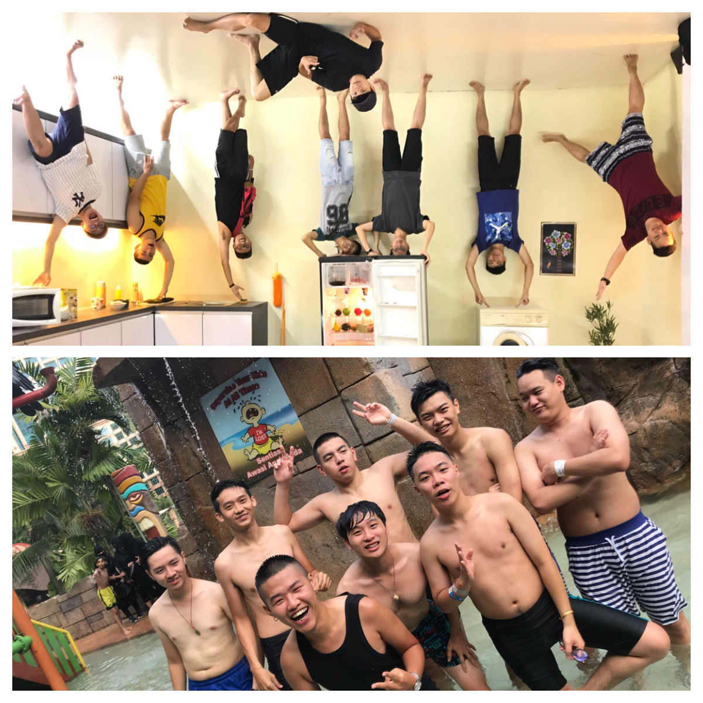
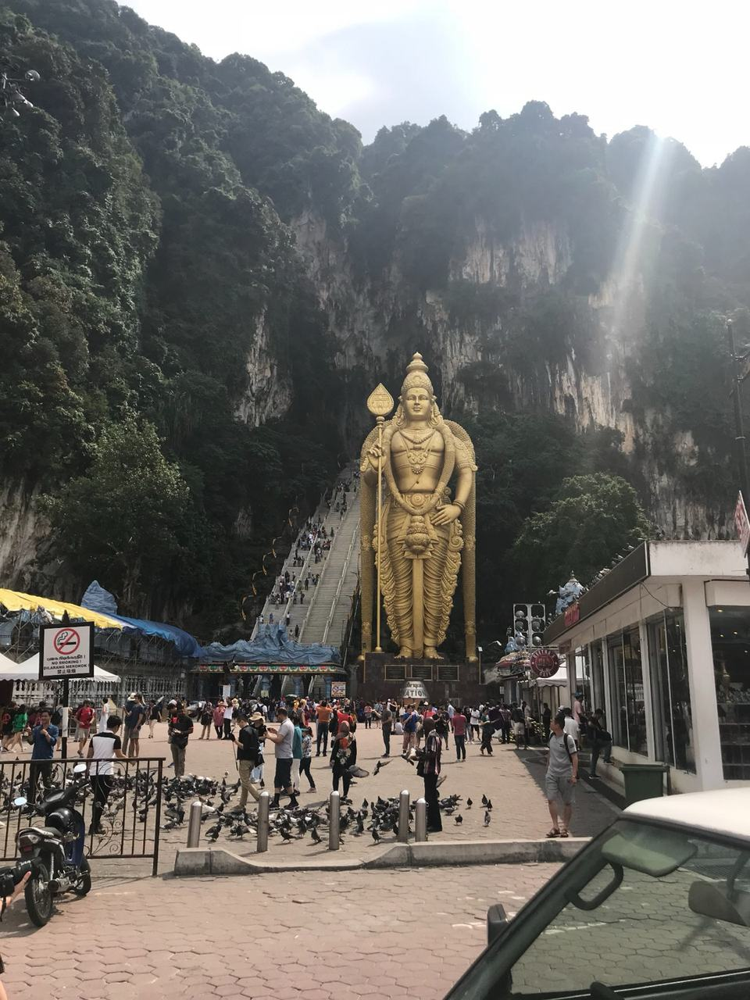
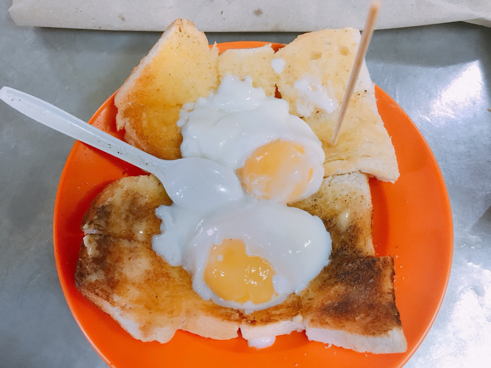
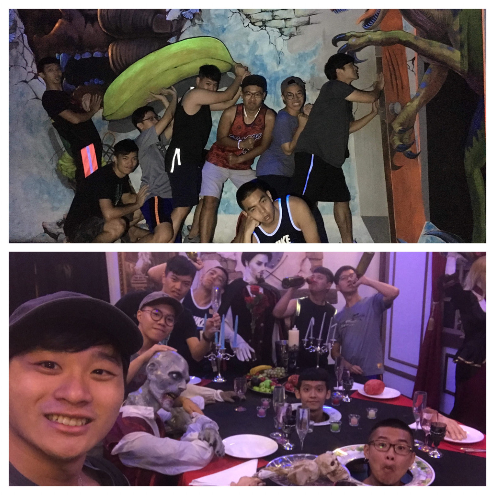
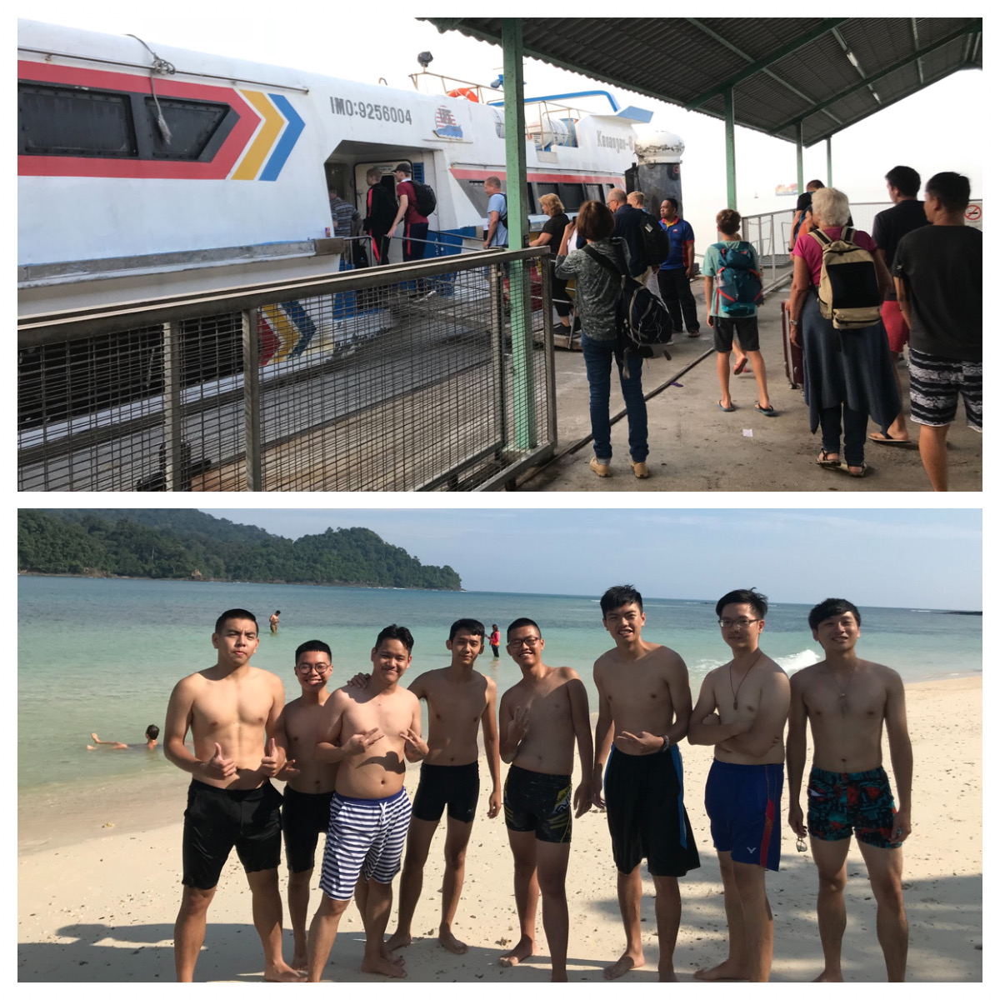
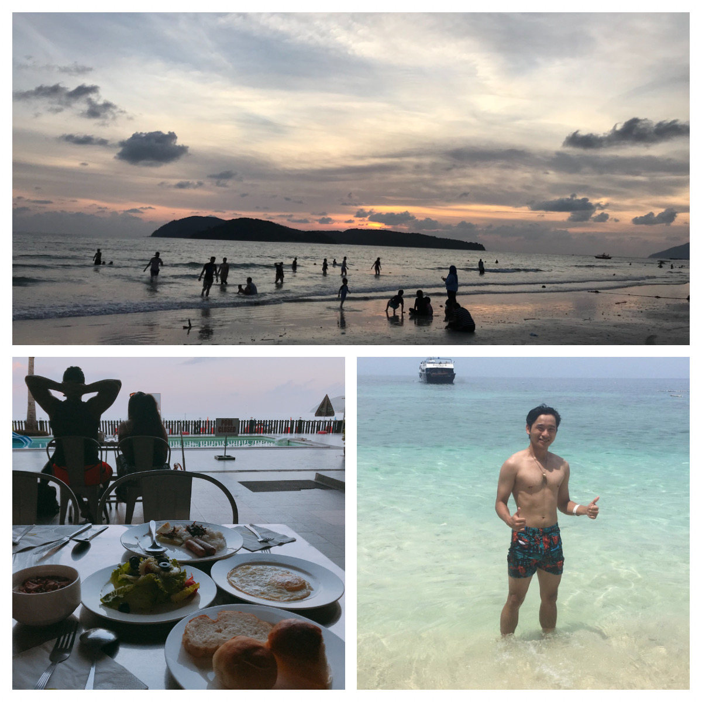
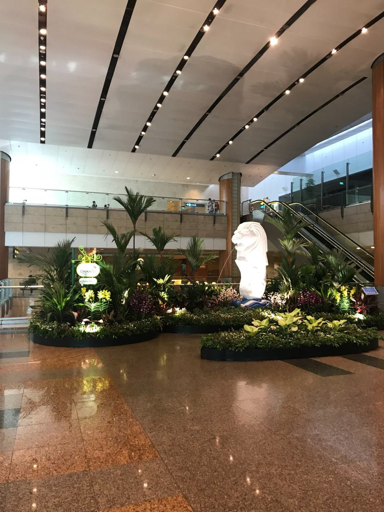

> 馬六甲(Malacca)>吉隆坡(Kuala Lumpur)>檳城(Penang)>蘭卡威(Langkawi)>雲頂高原(Genting Highlands)>柔佛(Johor)>新加坡(Singapore)

---

# 行程規劃

[行程規劃 : Click On Me](https://gsy-life.webnode.tw/_files/200000006-8a0808b03e/馬來西亞之旅.pdf)

---

# 行前準備

由於是在暑假熱季前往，衣物方面幾乎都是短袖短褲（但是要注意可能因為機上冷氣太強，所以有攜帶薄襯衫），還要攜帶泳褲以便下水，防曬物品更不能少（我就被曬傷了 嚴重脫皮) ><

---

# Travel

## Day 1

坐飛機到Malaysia時間大約為4小時，到達 Kuala Lumpur 已經是晚上8、9點，出機場直達麥當勞，他們的麥當勞比台灣便宜，而且有魚漢堡（1馬幣=7.6台幣），也是出國後才知道只有台灣麥當勞垃圾要自己收（好習慣😊）。
接著放完行李後，前往麻六甲(Malacca)品嚐道地沙爹，口味偏重、調味多，醬料如果沒有攪拌，下層便會燒焦，點飲料時推薦100plus(像有氣的舒跑)

## Day 2

在麻六甲，先是前往著名地標，而後到顛倒屋拍照，再坐車前往吉隆坡玩水上樂園Sunway（門票好像要快130RM 約930NTD)，印象中海盜船沒有360度，但這裡的有，這裡還有人造浪，還好都有玩到，晚上前往雙子星大樓（著名地標），在周邊吃小吃，印度薄餅好吃～

    

## Day 3

前往蝙蝠洞，在階梯上充滿了獼猴，雖然可愛，但會搶人的物品或食物
結束早上行程後，前往檳城，到達時間已是下午5點，購買後天前往蘭卡威的船票，晚上吃當地的夜市，再去逛阿凡達館（好像是東西都亮亮的像阿凡達？有點不懂）

## Day 4

早起前往當地有名的早餐店多春，吃完逛鬼怪博物館，再逛歷史博物館，整天走走逛逛的行程，晚上開車去洗衣店洗衣服  

    

## Day 5

早起搭船前往蘭卡威，一下船，便有人推銷我們套票行程，每人200RM 大約1500NTD，便能租車、潛水，我們便購買了此行程，坐船到達許多分散的島嶼，還有很多沙灘，有些景點無聊且東西貴，晚上去吃一間華人開的餐廳，一個人台幣大約300左右，但超好吃也超級飽

## Day 6

早起吃了早餐今天搭船前往沙灘潛水，那裡無限制潛水，而且沒有人會攔你要游到哪，只是有個邊界，累了可以上岸休息，傍晚時，我們回到飯店旁的沙灘玩遊樂設施，晚上吃馬來人開的店（有貴到、而且吃不飽），馬來西亞的朋友說有點被騙了，到馬來人開的餐廳要注意，最後逛了shopping mall，結束一天

## Day 7

一大早大雨滂沱，朋友鑰匙差點搞丟，找了半天，原來掉在昨天吃飯的地方，一大早坐計程車趕車到搭船點，幸好及時趕上船班，離開蘭卡威、離開檳城，一路南下至雲頂，今晚的落腳處：雲頂高原（Genting Highlands)裡面有很大型的賭場，我們吃完飯便去賭場，有生以來第一次去賭場，好像電影的場景都搬到眼前，進出口都有安檢檢查是否成年

(賭場不能拍照)

## Day 8,9

離開雲頂，前往馬來西亞朋友住家，住了一天，隔天到新加坡坐飛機回台灣，只在新加坡待了2小時

# 總結

> 有吉隆坡的車牌好像大家會讓你 因為吉隆坡的人開車很兇
> 機車也可以騎高速公路 也不時看到泰國車牌
> 油價便宜 95汽油 一公升16塊台幣左右
> 馬來西亞朋友都會至少五種語言 跟當地人溝通不停切換 我當神拜
> 食物重口味又辣 大推沙爹、肉骨茶、Roti tissue
> 飲料推 100 plus、奶茶、Milo 、涼茶
> 蘭卡威（Langkawi)的酒比珍奶便宜
> 馬來西亞真的是美食天堂～