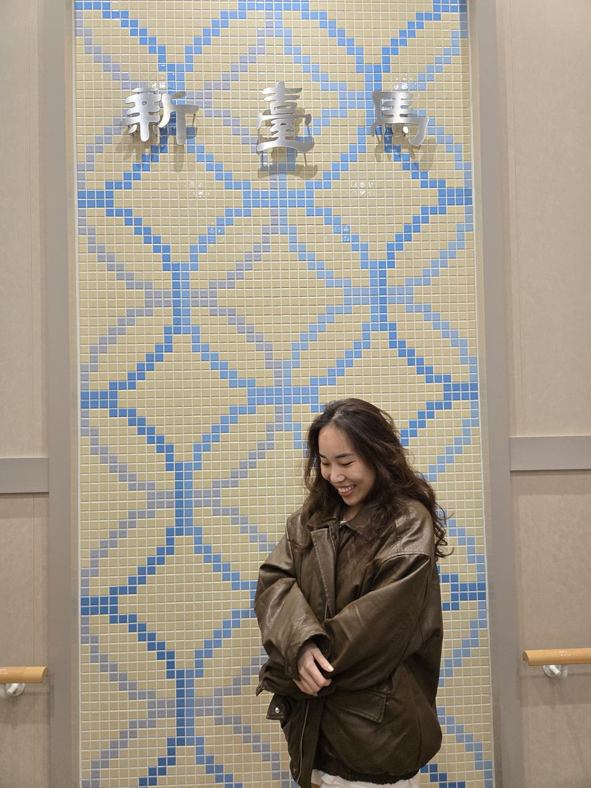
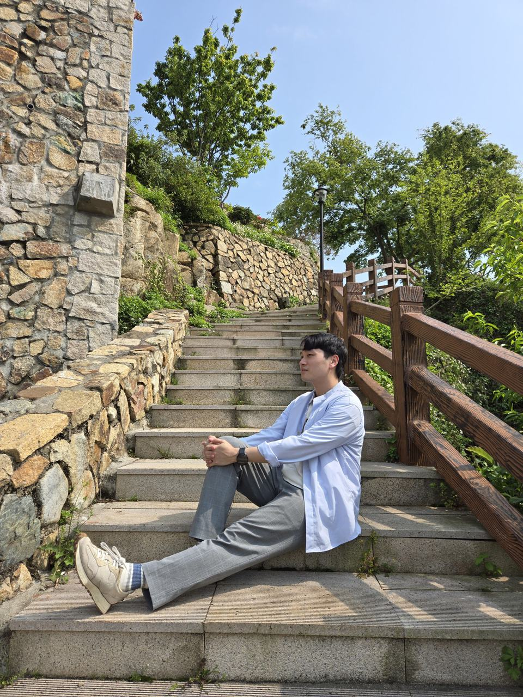
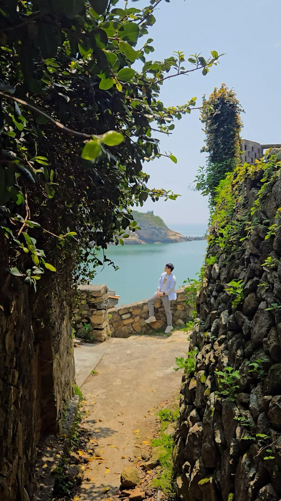
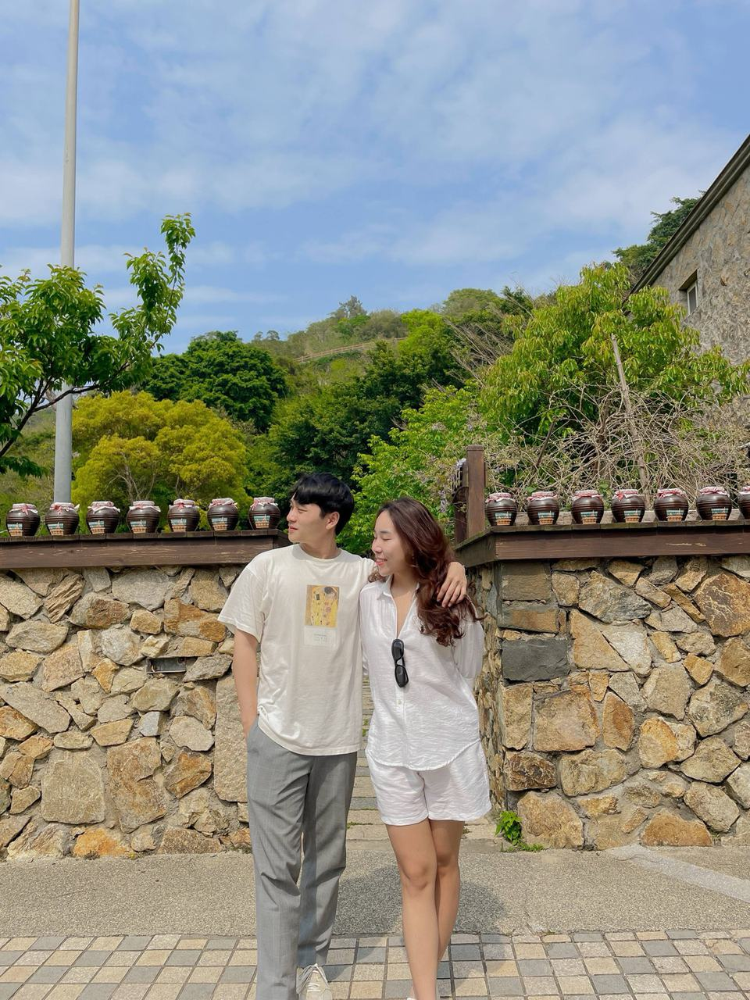
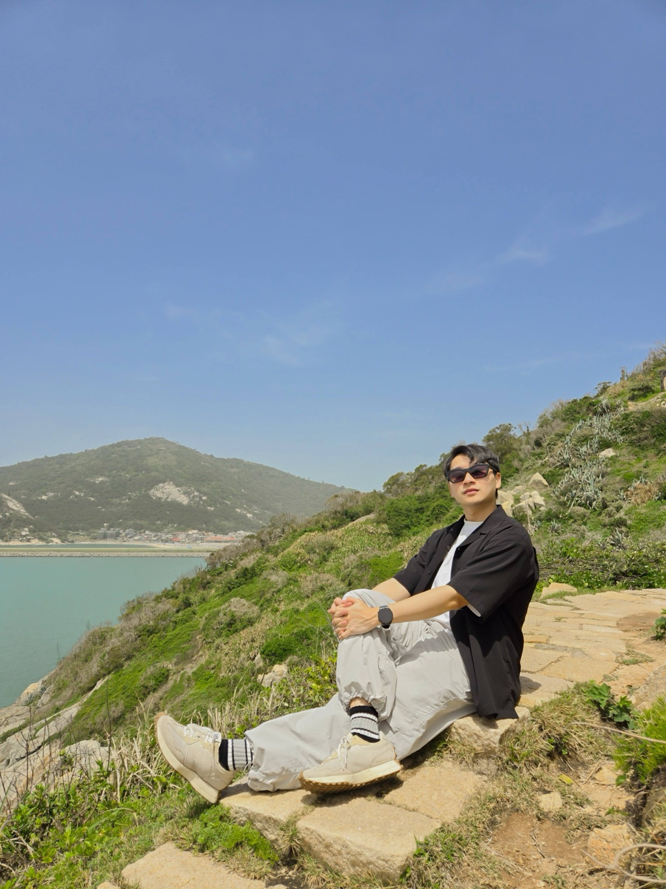
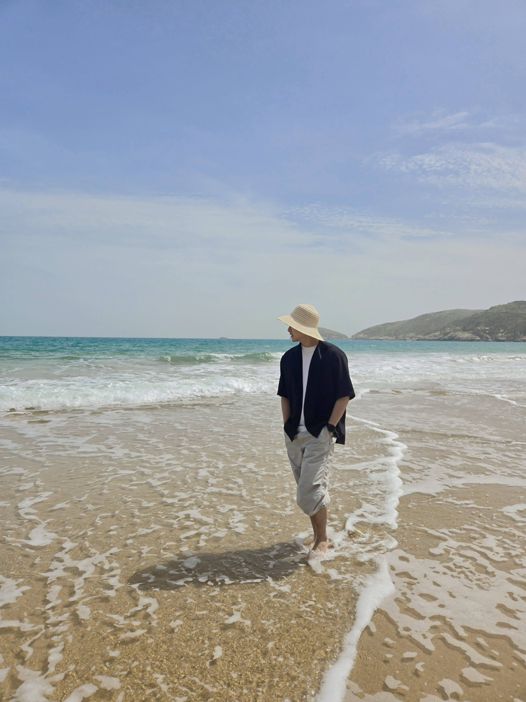
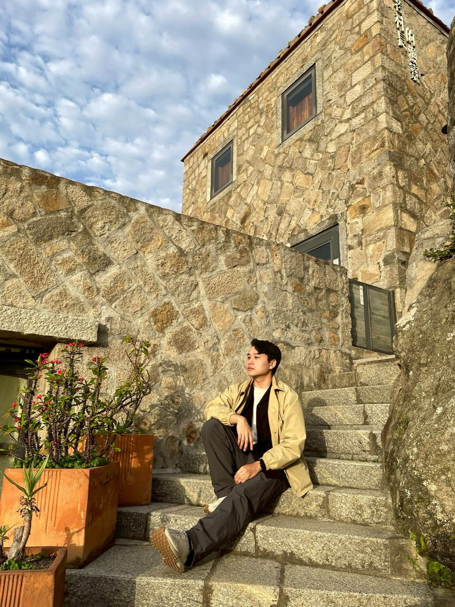
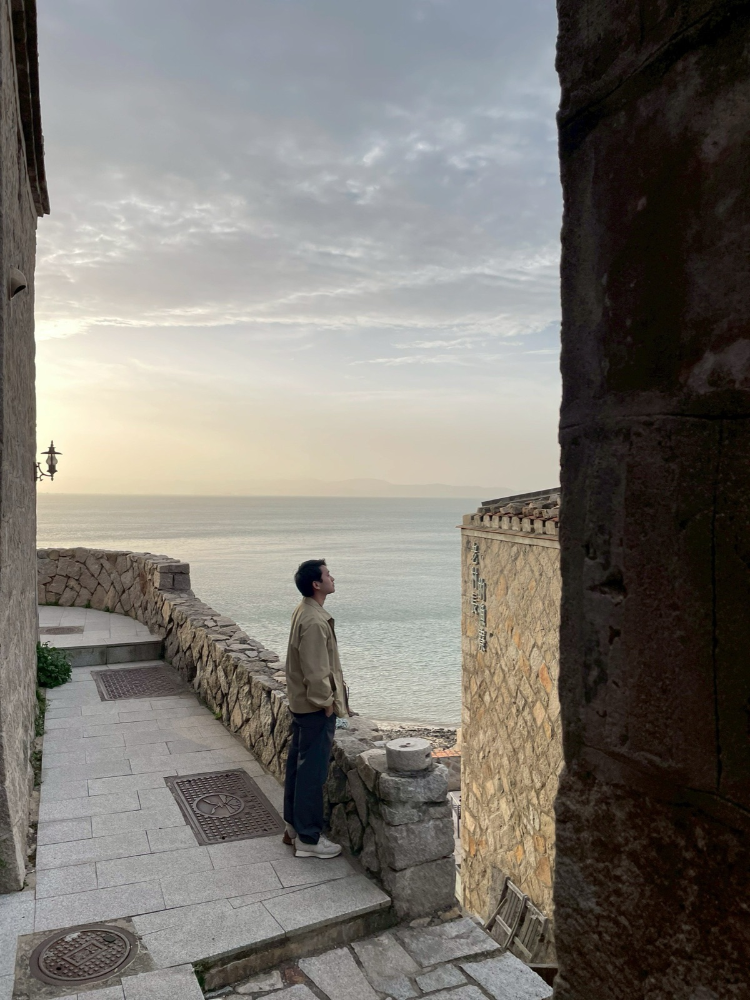

<iframe class="yt short" src="https://www.youtube-nocookie.com/embed/ijpBgZXJArY" title="YouTube video" loading="lazy" allow="accelerometer; clipboard-write; encrypted-media; gyroscope; picture-in-picture; web-share" referrerpolicy="strict-origin-when-cross-origin" allowfullscreen></iframe>
<iframe class="yt short" src="https://www.youtube-nocookie.com/embed/R-swCFxQLbg" title="YouTube video" loading="lazy" allow="accelerometer; clipboard-write; encrypted-media; gyroscope; picture-in-picture; web-share" referrerpolicy="strict-origin-when-cross-origin" allowfullscreen></iframe>

---

# Good to Know

1. Shops in Matsu close really early: lunch is usually only until about 1 p.m., dinner only until about 7 p.m., and only a few 7-Elevens are open 24 hours
2. The roads are really steep, climbing high and then plunging straight down. One of our friends crashed his scooter, so be very careful

---

# Preparation

Matsu is still on the cool side in early April, so bring a jacket. Riding a scooter at night gets cold
1. Sunscreen
2. Sunglasses
3. Clothes
4. Seasickness pills (we took the New Taima ferry, but it actually wasn't very rocky. Pretty comfortable)
5. Umbrella
6. Cash (lots of places only take cash)
7. ID card (you'll need it whether you take the ferry or fly)
8. Power bank
9. Skincare

# Itinerary

## 4/10 
We took the 22:00 New Taima ferry, scheduled to reach Nangan at 8 the next morning. The facilities on board are all new, there are even bidet toilets, and sleeping overnight was really comfortable

## 4/11 (Nangan)
After arriving in Nangan at 8, the homestay owner picked us up at the pier as arranged in advance. We dropped off our bags at the homestay, which also rents out scooters
### Stop1: Dahan Stronghold + Beihai Tunnel
### Stop2: Iron Fort
### Stop3: Jinsha Village + lunch

> Since it was pretty hot, we looped around the island clockwise back to our homestay (Cuobian Homestay, 厝邊民宿) 

> We'd planned to watch the sunset at Nangan's Stronghold 26, but a thick fog rolled in, so we had dinner nearby and went straight back to the homestay

> In the evening we bought fried chicken near the homestay and brought it back to eat

## 4/12 (Nangan)
It poured all day
### Stop1: Breakfast at Jieshou Lion Market
### Stop2: Back to the homestay to laze around~
### Stop3: Lunch at Meiweixuan Bakery (美味軒餅店)
### Stop4: Tunnel 88
You can see this place in about 3 minutes. It's basically become a wine and liquor storage site
### Stop5: Blue Tears Ecology Museum
It's basically watching an intro video + seeing blue tears in a petri dish. You can actually see them glow
### Evening: back to the homestay to laze around

## 4/13 (Beigan)
In the morning we caught the 8:30 boat to Beigan. The homestay owner drove us to the homestay to drop off our bags, and we rented scooters straight from the homestay
### Stop1: Stronghold 06
### Stop2: Luobang Mountain Nature Trail (recommended!)

### Stop3: War and Peace Memorial Park
### Stop4: Lunch at Yu Zhi Xiang (魚之鄉)
### Stop5: Banli Beach

### Stop6: Back to the homestay
Check-in + rest
### Stop7: Qinbi Village (recommended!)
It has a really Italian feel

### Stop8: Dinner at Zhuanshi Local Eats (饌食地方小吃)
### Stop9: Back to the homestay to rest

## 4/14 (Beigan)
### Stop1: Back to Qinbi Village first thing in the morning 
Soaking in its beauty one more time
### Stop2: Qiaozai Village 
It's really close to our homestay, so we just took a stroll around here
### Stop3: Lunch at Yi Ma Eatery (依嬤小吃店) (recommended!)
### Stop4: Beigan Airport 
14:00 flight back to Taipei

# Total Cost for 2

Transport:
New Taima ferry 2100
Flights 4000
Nangan–Beigan boat 320
Scooters 1400

Accommodation:
4400 Nangan
2500 Beigan

Food:
6000

Total: 20,720 NTD
