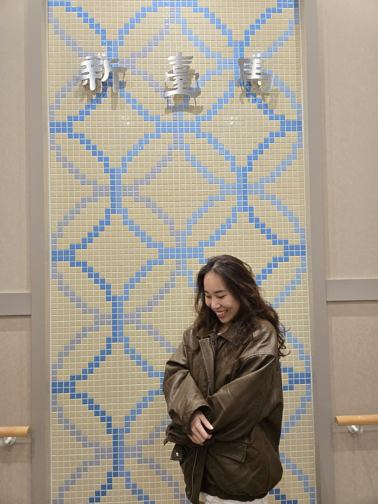
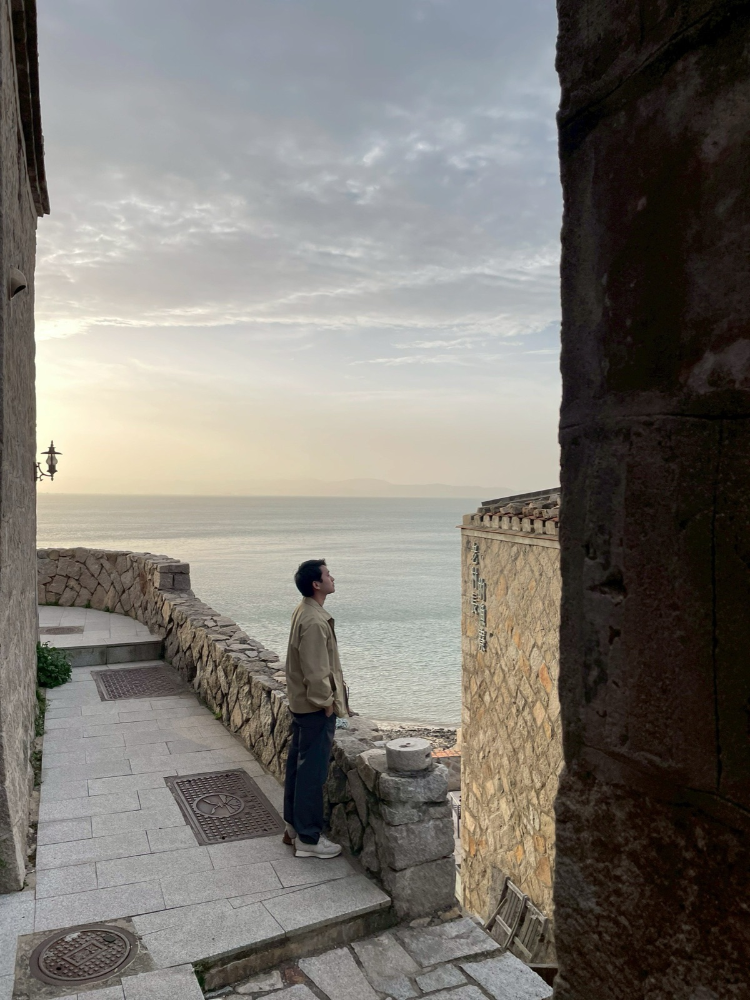

<iframe class="yt short" src="https://www.youtube-nocookie.com/embed/ijpBgZXJArY" title="YouTube video" loading="lazy" allow="accelerometer; clipboard-write; encrypted-media; gyroscope; picture-in-picture; web-share" referrerpolicy="strict-origin-when-cross-origin" allowfullscreen></iframe>
<iframe class="yt short" src="https://www.youtube-nocookie.com/embed/R-swCFxQLbg" title="YouTube video" loading="lazy" allow="accelerometer; clipboard-write; encrypted-media; gyroscope; picture-in-picture; web-share" referrerpolicy="strict-origin-when-cross-origin" allowfullscreen></iframe>

---

# 注意事項

1. 馬祖店家都很早關門：午餐大概只到１點，晚餐大概只到19點，小七少數才24小時
2. 馬路非常陡，爬升很高又急速向下，身旁有朋友就摔車了，要很小心

---

# 行前準備

由於4月初馬祖天氣還是偏涼，建議帶件外套，晚上騎車會冷
1. 防曬
2. 太陽眼鏡
3. 衣物
4. 暈船藥（我們搭新台馬輪，但是其實不會很晃，滿舒服的）
5. 雨傘
6. 現金（許多地方都必須現金支付）
7. 身分證（不論是搭船還是搭飛機都會需要用到）
8. 行動電源
9. 保養品

# 行程規劃

## 4/10 
搭乘22:00的新台馬輪，預計隔天早上8點抵達南竿，船上設施都很新，還有免治馬桶，晚上睡覺也很舒服

## 4/11（南竿）
8點抵達南竿後，民宿老闆會事先跟我們約在碼頭接送，抵達民宿放下行李，民宿就有租機車的服務
### Stop1: 大漢據點＋北海坑道
### Stop2: 鐵堡
### Stop3: 津沙聚落＋午餐

> 因為天氣滿熱的，我們用環島的方式順時針繞回民宿（厝邊民宿） 

> 原本計劃要到南竿26據點看夕陽，結果整個起大霧，我們在附近吃晚餐就直接回民宿

> 晚上到民宿附近買炸雞回民宿吃

## 4/12（南竿）
這一天一直下大雨
### Stop1: 早餐 介壽獅子市場
### Stop2: 回民宿耍廢～
### Stop3: 午餐 美味軒餅店
### Stop4: 八八坑道
這裏大概3分鐘逛完，就是變成儲存酒的地方
### Stop5: 藍眼淚生態館
其實就是看介紹影片＋體驗在培養皿裡面的藍眼淚，可以真的看得到
### 晚上回民宿耍廢

## 4/13（北竿）
早上8:30前往北竿船班，民宿老闆也開車載我們到民宿放行李，直接跟民宿租借摩托車
### Stop1: ０６據點
### Stop2: 螺蚌山自然步道（推！）

### Stop3: 戰爭和平紀念公園
### Stop4: 午餐 魚之鄉
### Stop5: 坂里沙灘

### Stop6: 回民宿
CheckIn+休息
### Stop7: 芹壁聚落（推！）
這裡非常有義大利的感覺

### Stop8: 晚餐 饌食地方小吃
### Stop9: 回民宿休息

## 4/14（北竿）
### Stop1: 一大早前往 芹壁聚落 
再次沉浸於他的美
### Stop2: 橋仔聚落 
這裡因為離民宿很近，我們就在這裡走走逛逛
### Stop3: 午餐 依嬤小吃店（推！）
### Stop4: 北竿機場 
14:00班機回台北

# 總花費2人

交通：
新臺馬2100
飛機4000
南北竿船320
機車1400

住宿：
4400南竿
2500北竿

吃飯：
6000

Total: 20,720 NTD