> Maya is a 3D computer animation software with powerful modeling, rendering, simulation, material, and animation tools, made for artists, modelers, and animators.

[Maya official site](https://www.autodesk.com/products/maya/overview)

# HW 1 - Understated Luxury: MAZDA Elegant M
---

### Understated Luxury: MAZDA Elegant M 

> My first time using Maya to design a car's color scheme. I wanted to express an abstract concept through the car 

To the sound of an elegant piano echoing through the valley, ripples spreading and mountains mirrored in the water, the inside and outside of the car reflect through each other: you in me, and me in you. The whole body is made of glass, water, and bubbles, making it feel supernatural and ethereal, and yet it's right there in front of you, completely real. The bubble shell reflects a purple glow that hints at a subtle luxury. Through the glass handles and the seating area you can make out every detail of the body and its design aesthetic. The headlights and the LOGO are metal, and everything else is designed with water, creating a refined, modern look with an elegant, delicate feel...

---
[See the work](https://drive.google.com/drive/folders/1p1te08vQCDFEZ7dcw9FoyRvf9eRl5cJm)

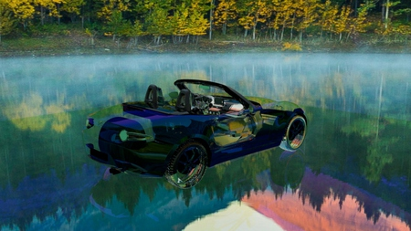   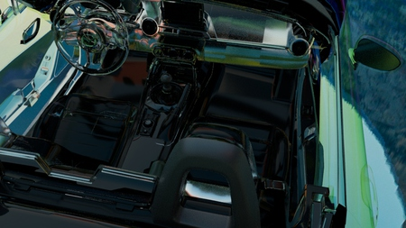   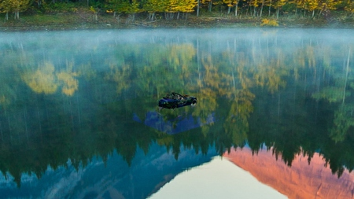

# HW 2 - The Charm Only Old Leather Has
---

### The Charm Only Old Leather Has
> Over time, cowhide oxidizes and gets rubbed until it turns smooth and glossy. We call this process "breaking in" the leather. Leather slowly absorbs oils and changes as it oxidizes in the light, so everyone's leather ends up looking different. Breaking in leather is probably a lot like how tea lovers season their teapots!

The longer leather ages, the more charm it has, and a pair of leather shoes worn for years is full of memories 

How leather shoes age:
1. They lose their shine
2. Creases form at the toe joints where they've been worn for a long time
3. They fade noticeably after being washed by rain
4. They look a bit rougher

---
[See the work](https://drive.google.com/drive/folders/1p63-EbCh_Vi1qWExLoqcV0_fTUuZE9nv)

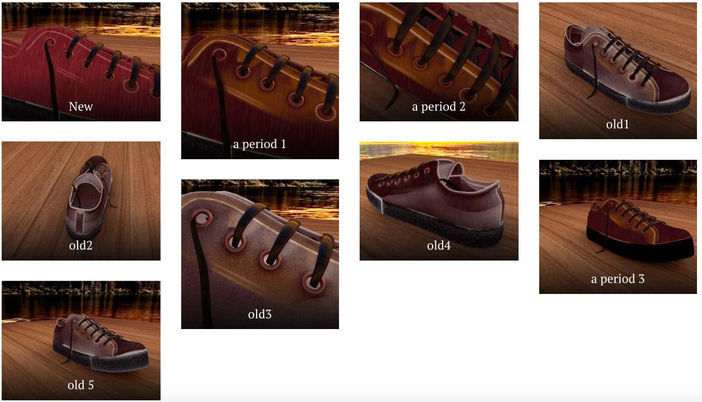

# HW 3 - Heart of the Desert, Source of Civilization

### Heart of the Desert, Source of Civilization
> Atlantis is a fictional aquatic civilization appearing in American comic books published by DC Comics.
### Inspiration: Atlantis from Aquaman

As far as I know, in Western legend this place was a highly advanced civilization, but it sank into the sea more than ten thousand years ago. The earliest description of Atlantis goes back to the dialogues of the ancient Greek philosopher Plato. Plato wrote that Atlantis was a land covered in gold and silver, but sadly a great earthquake and floods struck one after another, and Atlantis was finally swallowed by the sea. As for what really happened, I don't think there's a definitive explanation yet.

---
##### The work:
It has three layers:

Layer 1: Desert
The desert is the origin of life

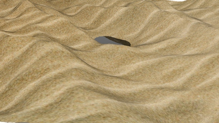

Layer 2: Ocean
Beneath the desert, part of the hidden world is ocean

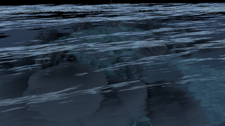

Layer 3: Clouds + City
Below the ocean there are actually clouds and an abandoned civilization, lit up by the only opening in the desert

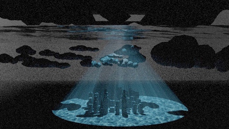

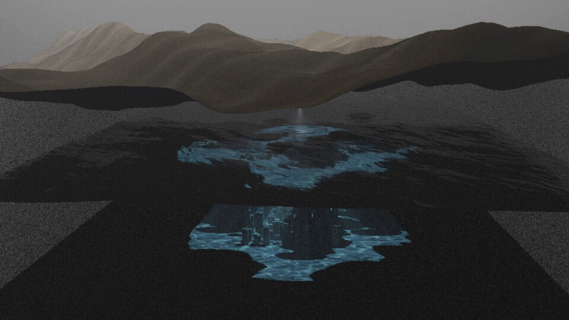   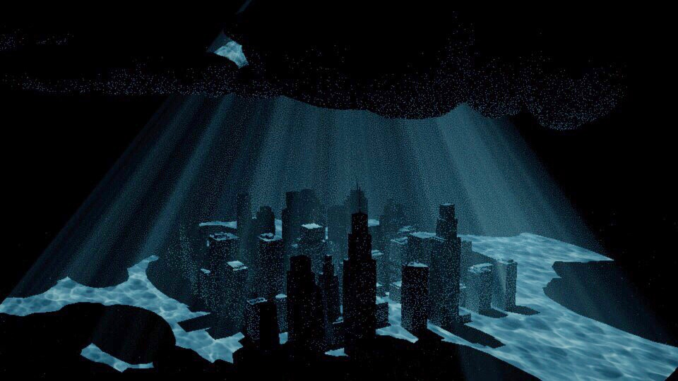   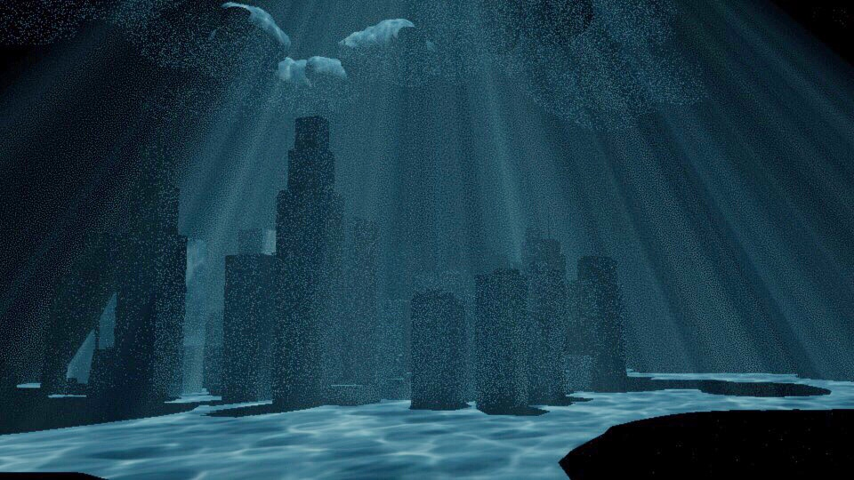   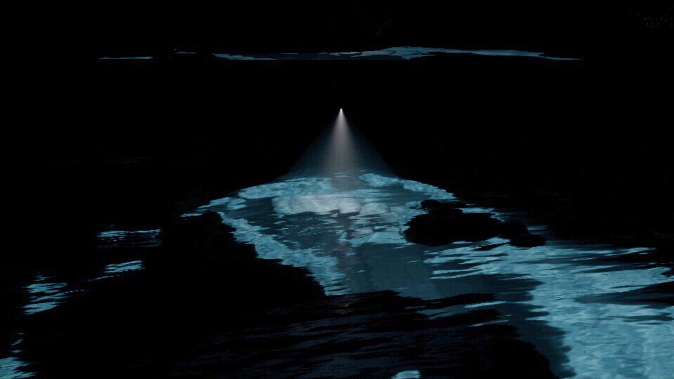

