> Maya 是 3D 電腦動畫軟體，擁有強大的建模、彩現、模擬、材質設定和動畫工具，適用於美工人員、建模人員和動畫師
> Maya is a 3D computer animation software with powerful modeling, color rendering, simulation, material settings, and animation tools for artists, modelers, and animators.

[Maya 官網](https://www.autodesk.com/products/maya/overview)

# HW 1 - 低調奢華 MAZDA Elegant M
---

### 低調奢華 MAZDA Elegant M 

> 第一次使用Maya軟體設計車子色調，想透過車子表達抽象概念 

伴隨優雅的琴聲，聲音迴盪於山谷間，餘波盪漾，山水鏡射，車裡車外相透射，你泥中有我，我泥中有你，全車身以玻璃、水、氣泡，使車體超自然、虛無飄渺，卻又貨真價實擺在眼前，氣泡外殼反射紫色光暈，透露淡淡奢華，玻璃握把、座位區可細看出車體的每個細節，及設計美學，金屬材質的車燈及LOGO，其餘以水進行設計，打造精細的現代感，呈現高雅細膩之感...

---
[作品呈現 Click On Me](https://drive.google.com/drive/folders/1p1te08vQCDFEZ7dcw9FoyRvf9eRl5cJm)

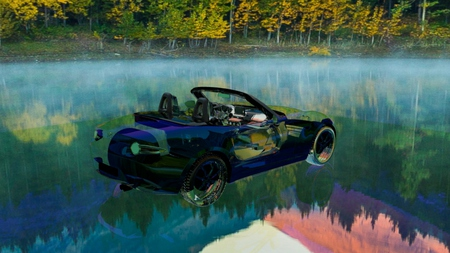   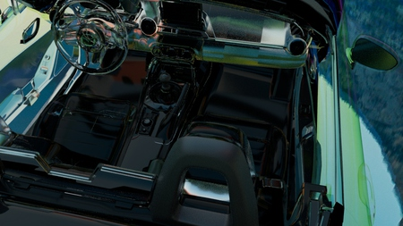   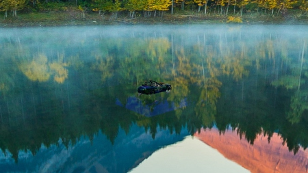

# HW 2 - 老皮革才有的韻味
---

### 老皮革才有的韻味
> 這是牛皮經過時間的氧化、摩擦而變得光滑透亮,這個過程我們稱作「養皮」。皮革會慢慢吸收油分,遇光則會氧化產生變化,所以每個人養出來的皮都會長得不一樣。養皮大概就跟泡茶的人養茶壺是一樣的道理吧!

皮革經歷時間越久越有韻味 然而皮鞋穿久了卻是滿滿回憶 

The longer the leather has passed, the more it has the charm. However, the leather shoes are worn for a long time but full of memories.

皮鞋變舊過程：
1. 會失去其光澤
2. 在長期穿過的指頭關節會有皺摺
3. 經歷雨水沖刷會有明顯褪色
4. 外觀變得些許粗糙

---
[作品呈現 Click On Me](https://drive.google.com/drive/folders/1p63-EbCh_Vi1qWExLoqcV0_fTUuZE9nv)

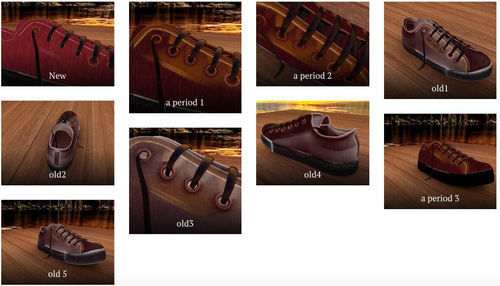

# HW 3 - 沙漠之心 文明之源

### 沙漠之心 文明之源
> Atlantis is a fictional aquatic civilization appearing in American comic books published by DC Comics.
### 靈感發想 : 水行俠Aquaman的亞特蘭提斯

據了解，這個地方在西方傳說中，是一個擁有高度文明的國度，可是這個地方在一萬多年前沉沒在大海中，而對於亞特蘭提斯最早的描述，要追溯至古希臘哲學家柏拉圖的著作《對話錄》中。柏拉圖指出，亞特蘭提斯是一個遍地黃金及白銀的國度，可惜最後因為大地震及洪水相繼發生，最終令亞特蘭提斯淹沒在大海之中。至於真相如何，相信目前仍沒有得到確實的解說。

---
##### 作品呈現：
共分三層：

第一層：沙漠 desert
沙漠乃生命起源

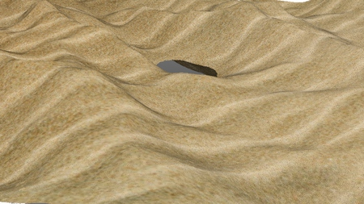

第二層：海洋 ocean
沙漠下方隱匿世界部分海洋

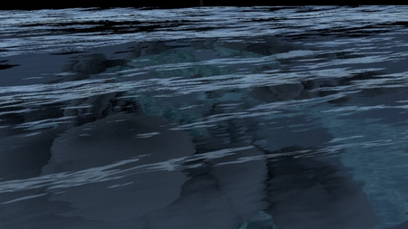

第三層：雲朵 + 城市 cloud + city
海洋下 其實有雲朵及荒廢的文明 其受到沙漠唯一的缺口照亮

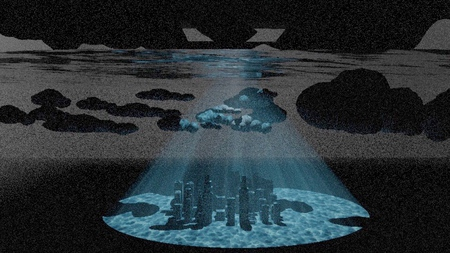

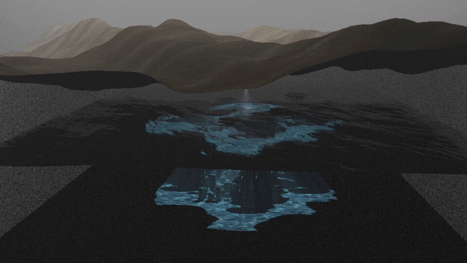   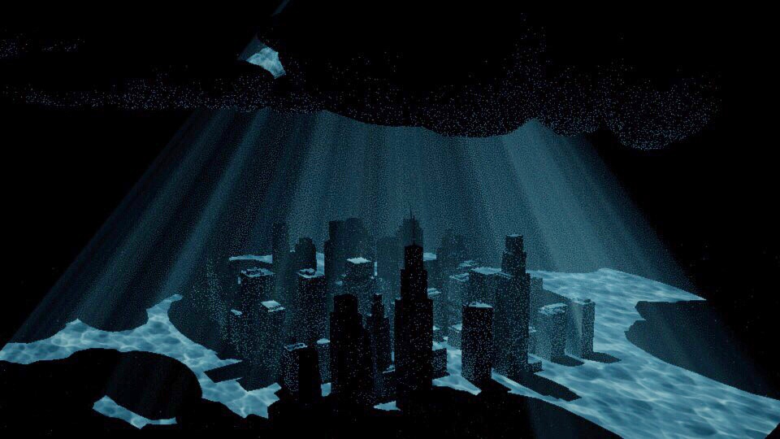   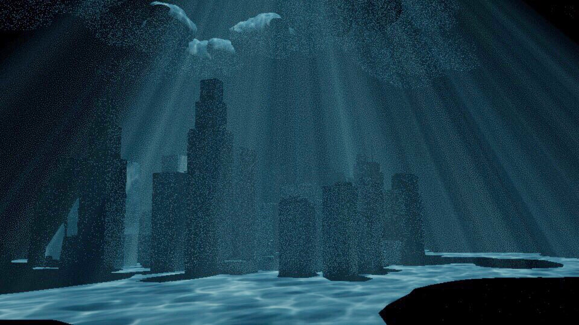   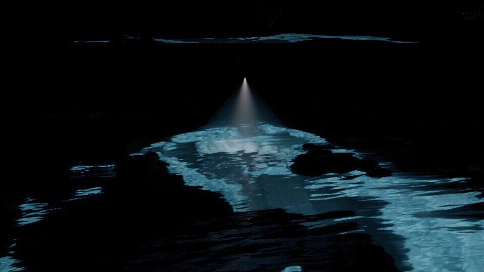

