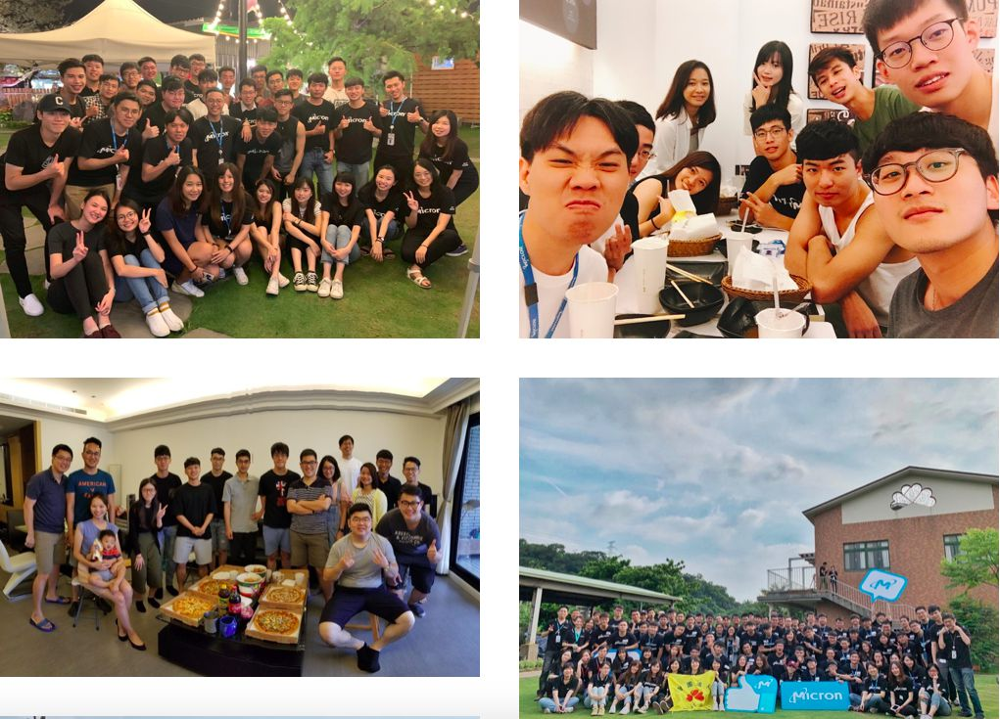
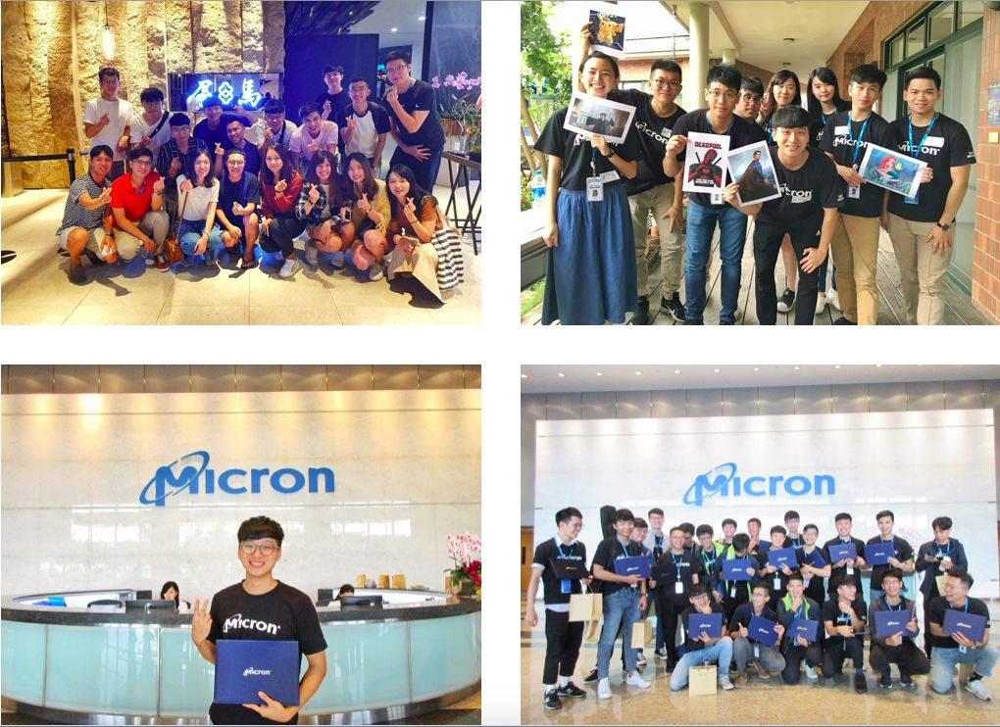

> Foreign companies don't like you working overtime. Self-discipline is key
> English matters, and so do communication skills
> The environment is free and relaxed, but that doesn't mean careless
> How you treat people and handle things matters: build rapport and team spirit with your coworkers

---

# Interview

For the interview, remember to prepare a self-introduction in both Chinese and English, and a personal portfolio will earn you extra points. Make sure to apply through the company's official website (I applied on 104 and never heard back)

## Stage 1. Phone
I didn't get this stage, but several of my friends got a phone interview in English, with a self-introduction and so on

## Stage 2. Face to face
I faced three managers. First they had me introduce myself, and they wanted to see that I knew what kind of company Micron is and could explain memory architecture and my understanding of it (I heard full-time candidates get coding questions, but my portfolio was programming-related, so I wasn't asked any)

## Stage 3. English and logic tests
An English test plus an aptitude test

## Stage 4. HR interview
Basically they ask why you want this position, to understand your motivation and how stable you are

---

# Intern Life

Moving from software into hardware, there was a lot of new knowledge to absorb. The first three days are new-hire training, and every Friday the department holds classes on DRAM, so I learned bit by bit.
Micron had 48 new interns in my cohort, so I made lots of friends and built up my network too!
PS: At companies with manufacturing processes and advanced R&D, information security and company confidentiality are a really big deal. The company keeps stressing that you can't take photos inside or leak internal documents!

