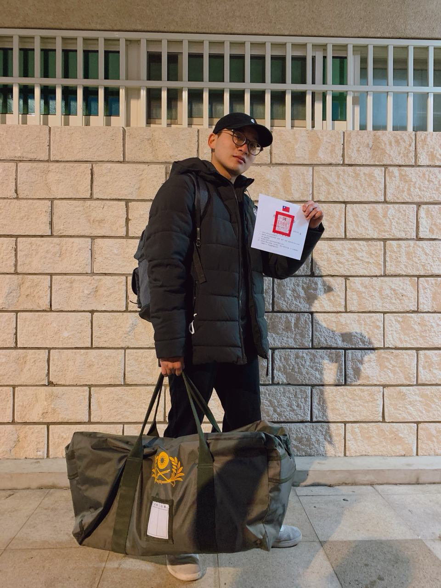
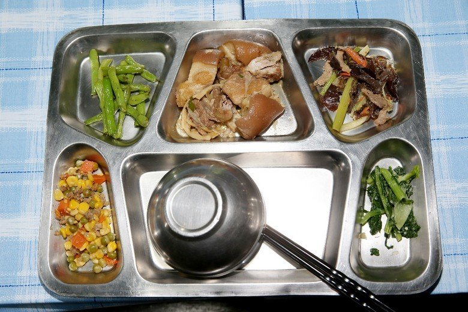
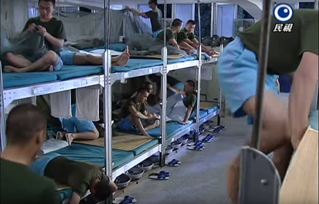
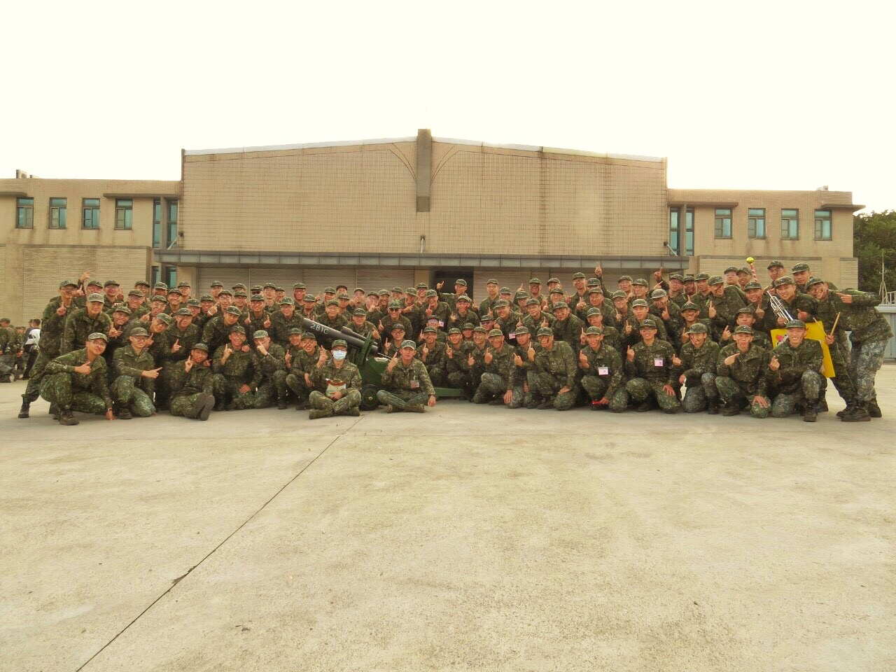

> 2020 was a turbulent year, and on its very last day, my military service came to an end too...

Here's what I went through during my service, plus all kinds of tips, covered in the following parts:
(1) The basics (what to bring, food, clothing, housing, transport, education and fun) 
(2) Training content (Phase 1, Phase 2)
(3) My experiences and tips (what happened to me)
(4) Reflections (what I learned and how I felt)

---

# The Basics

∙ Enlistment: Class 119T (2020/9/22-2021/1/11). I had 9 days credited, so I was supposed to be discharged on 1/2, but that fell on a holiday, so I got out early on 12/31  

∙ Unit: 2nd Battalion, 1st Company - at the Northern Training Center there are 2 battalions, each with 4 companies (the 4th is the HQ company, a directly attached company responsible for resupplying equipment and ammo on the battlefield, but for conscript training it makes no difference). Each company has about 10 squads (basically arranged by height), each squad has around 10 people, so roughly 800-something people in total

∙ Location: Taipingli, Yangmei, Taoyuan (about a 25-minute walk to Yangmei Train Station)

∙ Squad: Squad 10, the equipment squad, 10 people. From Phase 2 on we started rotating duties, like serving food, armory, recycling, indoor cleaning, errands and so on

## Food, Clothing, Housing, Transport, Education and Fun

∙ Food: Everyone online trashes the food at the Northern Training Center, but I didn't think it was as bad as all that. At worst the dishes repeat a lot — I even went back for extra food and rice all the time~ 

∙ Clothing: On the first day everyone goes to pick up their gear together

For a list of what to bring, check out: [[2019 Latest] Checklist of What to Bring When Enlisting (Must-Haves for Conscript Basic Training)](http://jimmytraveling.com/blog/post/68331786) 

** Small notebooks, document bags, hangers, soap, razors, sponges, etc. — at the Northern Training Center you have to buy them as one bundle, and it's expensive! NT$420, when personally I think it's worth maybe NT$200

∙ Housing: The dorms are big open bunk rooms for about 40 people, with two-tier beds, and everyone gets a pillow and a blanket 

∙ Transport: Honestly pricey. From the base to Taoyuan Train Station costs NT$120, to Taipei NT$200, Keelung NT$250, Yilan NT$300. Still, taking the tour bus is convenient — just bring enough cash

∙ Fun: From Phase 2 on there are lots of club classes and free time, so you can play board games (I've never played so much Werewolf in my life). During other classes or recruitment talks we'd secretly play number-guessing games or Bingo

---

#  Training Content

Recommended reading: [[Must-Read Before Enlisting - Northern Training Center, Taipingli, Yangmei, 107T 1B1C #The Basics]](https://matters.news/@lushaoming/%E7%95%B6%E5%85%B5%E5%BF%85%E8%AE%80-%E6%A5%8A%E6%A2%85%E5%A4%AA%E5%B9%B3%E9%87%8C%E5%8C%97%E8%A8%93%E4%B8%AD%E5%BF%83-107-t-1-b1-c-%E5%9F%BA%E6%9C%AC%E4%BB%8B%E7%B4%B9-bafyreigbzyqklgmqf5j3xd4lw3uhnj2o7lfxcwhtl3uwx4566kqvrxu77q) 

---

# My Experiences and Tips

## The Political Officer's Assistant

On the first day, while everyone was still totally clueless, the company political officer asked if anyone wanted to volunteer as his assistant. My hand shot up right away. You get perks like extra leave, skipping some training and eating snacks, but you're in charge of collecting money, odd jobs and paperwork, and sometimes you go to bed later than everyone else. I'd still recommend taking on a duty like this — when everyone else is bored out of their minds, at least you've got something to do XD.

## My Fellow Recruits

Our squad leader said our class was full of highly educated people. Almost everyone around me was a university or grad student, and there were even some med students. I didn't run into any of the so-called "8+9" troublemakers. Also, everyone in this class came from Taoyuan, Taipei, Keelung and Yilan, and my bunkmates were all really reliable — they'd remind me about assembly times and what gear to bring.

## Family Visit Day

Family visit day was in our second week. Remember: if your family can come, definitely ask them to! If they come to pick you up, you get to leave at 12, but if nobody comes, you can't leave until 1600, and you have to stay and take out the trash and clean up.

## Recruitment and Volunteer Service

The whole first week was recruitment talks. At first I just wanted an excuse to slack off and go on a site visit, so I signed up for the Special Forces Command, which I thought was the coolest and the toughest. I had zero intention of signing up as a volunteer soldier, but once I learned about the benefits for each track (enlisted, NCO, officer), pay going up to NT$50,000, and all the skills you can learn, my view of the military slowly started to change. I can't say being a soldier is amazing, but these days training is more humane, and there's a government-backed certification system so soldiers can use their licenses to get other jobs after they leave. After 20 years of service you even get a lifelong pension. There's no overtime either: two training sessions in the morning and two in the afternoon, exercise time from 4 to 6 pm so everyone stays healthy, and after 6 it's free time. If you live nearby (within 50km) you can sleep at home and just report back to base at 7:30 the next morning — it's kind of like a company. When we got to the site we visited, the food was miles better than at the Northern Training Center, and that really won me over. Another big thing about the Special Forces Command is that you learn to skydive — it's a required skill. Skydiving is a super expensive experience outside, but here it's free and mandatory.
But signing up as a volunteer means committing to four years, and after four years it might be hard to go back to my own field. Even though there's time every night to study, I can't guarantee my buddies in the army wouldn't get in the way of that over four years. Having a master's degree doesn't really count for much in the military — at most your superiors pay a bit more attention to you. In the end, I have bigger ambitions and want to go out and see the wider world.

## Rifle Range

On the first day of week three we started practicing the basic commands and moves for prone shooting and clearing the rifle, to get ready for the range the next day. The Taipingli shooting range is about 40 minutes from the base, and we marched there in full gear. It was super windy that day, red dirt was flying everywhere, and visibility kept coming and going. The target was at 175M, right where the bullet's trajectory is rising, so we aimed at the target's waist — but to this day I still have no idea why I hit 0 shots. After that we just kept rotating, about 8 rounds and roughly 60 bullets. The squad leader said however many bullets you're issued, you have to fire them all. I thought it'd be like the live-fire practice in high school, where everyone shoots one round and goes home, but it turned out to be a full day of live fire, so we even ate lunch and napped sitting at the range. The sound of the shots is seriously intense, like fireworks going off right next to your ears, and the strong recoil makes your whole body shake. Steady your breathing before you shoot, don't rush — I was trying to find that steady point too.

## The Food Problem

In week three, the commander (the top boss of the base) heard that someone had reported the food was bad and that people weren't getting enough to eat, so he came to inspect the mess hall himself. When he saw the food, he blew up, chewing out the battalion and company commanders over why everyone's portions were different and why the meals never changed, and told the battalion commander to fix it right in front of everyone. Then he turned around and asked: "Am I a cool commander or what?" It kind of felt like a staged scene, but sure enough, the next day the food was more varied, tastier and bigger portions. He also ordered a meal satisfaction survey every Thursday from then on to keep improving the food. Later the commander told us to be the kind of person who solves problems, not someone who sees a problem and does nothing — that really stuck with me.

## The Weekend After the Fitness Test

The commander said if we passed all 9 tests, we could leave at 1400 on Friday, with one hour of delay for each test failed, but we'd leave by 1700 at the latest. And we didn't have to be back until 1900 the next Monday. The Northern Training Center really is a great place

---

# Reflections

What surprised me was that the squad leaders in charge of us were all reasonable leaders who dealt with things fairly. They'd chat and joke around with us and weren't stiff at all — serious when it was time to be serious, relaxed when it was time to relax. Nothing like the unreasonable demands people talk about. The squad leader said that was how earlier generations did things — they'd gone through that kind of control themselves — but now it's all about keeping up with the times and not making unreasonable demands.
The squad leaders also encouraged us to bring our own books to keep learning, since basically all of us would be job hunting after discharge and should be improving ourselves. I really admired how thoughtful they were. Sure, we ran into plenty of unfair treatment and inefficiency, but everyone can try to balance things out through communication and understanding.
Our superiors said we were the last class at the Northern Region Specialty Training Center — the base would be turned into a station for the 109th Brigade, so there probably won't be any more new recruits serving in the north. What I've shared here may differ depending on your company or region, but if you're about to serve, feel free to use it as a reference.
Over these four months, what bothered me most was every time leave ended, and the closer I got to discharge, the more conflicted I felt. On one hand I was thrilled to be getting out soon, but on the other I was scared and worried about entering the workforce. I hope every one of my fellow recruits reaches their goals. Let's meet up again! See you around~

