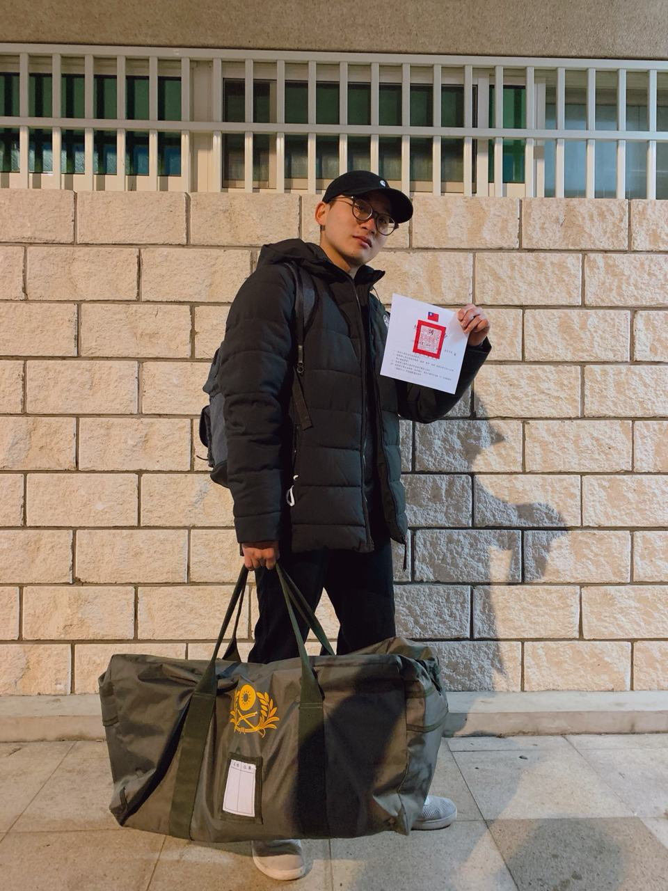
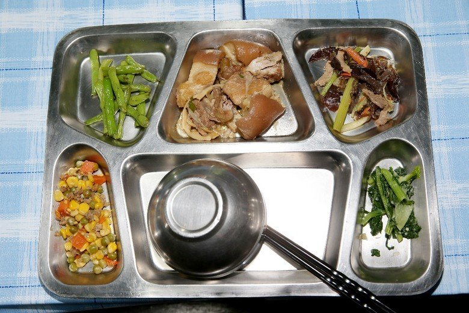
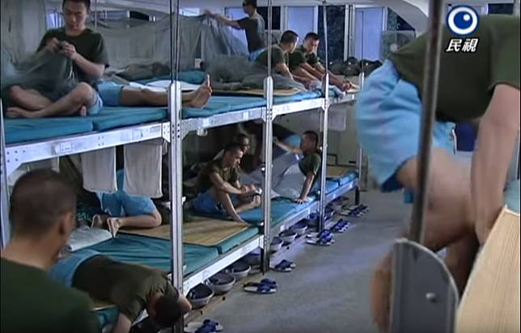
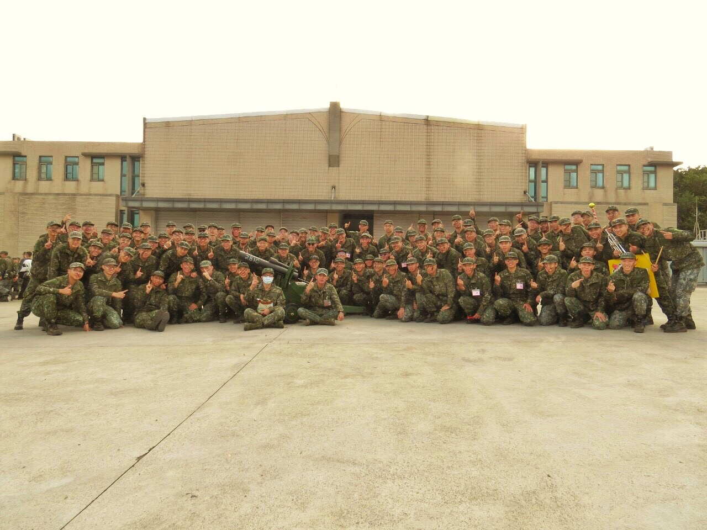

> 2020年不平靜的一年，也在最後一天結束軍旅生涯...

當兵所遇到的以及各種建議，將依以下方式作介紹
(1) 基本介紹（應帶物品、食衣住行育樂） 
(2) 操課內容（一階段、二階段）
(3) 自我經驗及建議（我所遇到的事）
(4) 心得分享（所學與感想）

---

# 基本介紹

∙ 入伍時間：119T (2020/9/22-2021/1/11) 個人折抵9天，預計1/2退伍，但又遇上假日，提早至12/31退伍  

∙ 所屬連隊：2營1連 - 於北訓中心，共2營，每營有4連(第4連為營部連 意指直屬連負責在戰場上補給裝備、彈藥，但在義務役操課都沒差)，每連差不多10班(基本上都按照身高編排)，每班約10人，共約800多人

∙ 地理位置：桃園楊梅太平里（步行至楊梅火車站約25分鐘）

∙ 所屬班級：十班器材班，共10人，二階段之後開始職務輪替，如：打飯、軍械、資收、內掃、公差等

## 食衣住行育樂

∙ 食：雖然在網路上看到大家都在批評北訓的食物，但沒到自己認為的難吃，頂多食物很常重複，我還常去加菜加飯呢～ 

∙ 衣：第一天會統一去領取物品

應帶物品推薦大家參考: [【2019最新】當兵入伍攜帶物品清單（義務役新訓必備）](http://jimmytraveling.com/blog/post/68331786) 

** 小筆記本、資料袋、衣架、肥皂、刮鬍刀、海綿等，在北訓中心是統一購買的一袋，很貴！420元，個人覺得價值才200吧

∙ 住：宿舍為40人左右的大通舖，床有上下兩層，都有枕頭跟棉被 

∙ 行：真心覺得貴，從營區到桃園火車站就要價120，到台北200，基隆250，宜蘭300，不過搭遊覽車還是方便啦，錢要帶夠

∙ 樂： 第二階段開始有許多社團課及休息時間，可以玩桌遊（是我玩過最多次狼人殺的時期），其他操課或聽招募聽講都會偷玩猜數字或Bingo

---

#  操課內容

推薦參考：[【 當兵必讀 - 楊梅太平里北訓中心 107T 1B1C #基本介紹】](https://matters.news/@lushaoming/%E7%95%B6%E5%85%B5%E5%BF%85%E8%AE%80-%E6%A5%8A%E6%A2%85%E5%A4%AA%E5%B9%B3%E9%87%8C%E5%8C%97%E8%A8%93%E4%B8%AD%E5%BF%83-107-t-1-b1-c-%E5%9F%BA%E6%9C%AC%E4%BB%8B%E7%B4%B9-bafyreigbzyqklgmqf5j3xd4lw3uhnj2o7lfxcwhtl3uwx4566kqvrxu77q) 

---

# 自我經驗與建議

## 輔導長公差

記得入伍第一天，大家都還無頭緒時，輔導長便詢問有無自願當輔導長公差，我立馬舉手，可享有放假、免操課、吃零食的福利，但要負責收錢、打雜等文書作業，有時候都會比別人晚就寢，但還是建議可以擔任公差職務，大家無聊到發慌時，你還有事做XD。

## 同梯朋友

班長有說我們這梯次都是高學歷份子，身邊幾乎都是大學、研究所的、還有醫學系的朋友，沒遇到所謂的8+9，此外，這梯都是來自桃園、台北、基隆、宜蘭地區，我的鄰兵們也都滿罩的，會提醒集合時間還有攜帶裝備等。

## 懇親會

我們第二週就是懇親會，記住！如果家人可以來一定要請他們來，因為如果他們帶走我們就能12點離開，如果沒有家人來，只能1600離開，還要收拾垃圾、善後工作等。

## 招募與志願役

第一週都是在聽招募，開始的時候是抱著可以偷懶去參訪，便勾選自己認為最帥也最操的特戰指揮部，原本完全沒有簽志願役的想法，然而當自己開始了解軍種制度（士兵、士官、軍官）的福利政策、薪資上看5W以及各項技能學習後，開始漸漸對國軍改觀，我不能說當軍人有多好，但是現在講求人性化操課、並有國家提供的考證照機制，讓軍人退伍後仍能透過證照取得其他工作，甚至從軍20年後享有終身俸，同時不會有超時加班的問題，每天上午兩節及下午兩節操課，下午4-6點有運動時間，顧及到每個人的健康，6點以後就是自由時間，住附近的(50km以內)可以住家裡，隔天7:30再到營區報到就好，類似一個公司的制度。去到參訪地點後，看到餐點的提供比北訓中心好十萬八千里，深深吸引到我，特戰指揮部還有個重點是要學跳傘，也是必備技能，在外跳傘是很貴的體驗，這裡是免費且必須的。
然而志願役一簽就是四年，四年後自己可能難以回歸本行，雖然每天晚上都有時間進修自我，但我無法保證自己四年後會不會因軍中的弟兄影響我的進修，擁有研究所的學歷並不會在軍中有效用，頂多長官多關注你，最後，自己還是有更遠的志向抱負，想到外面更寬廣的世界看看。

## 打靶

第三週的第一天開始練習臥射、清槍的基本口令動作，為隔天打靶做準備，太平里打靶場距離營區路程約40分鐘，全副武裝步行至打靶場，當天風很大，紅土飛揚，視線時好時壞，打靶距離是175M，剛好是子彈彈道上揚的時候，因此瞄準靶的腰部位置，但是我至今仍不知道為什麼我命中0發，接著就是一直輪著打，大概打了8輪、60發左右的子彈，班長說領多少子彈就要打完多少，原本以為是像高中實彈射擊一人打個一輪就收工回家，沒想到一去就是一整天的實彈射擊，因此我們中午也是在靶場坐著吃午餐、睡午覺，打靶當下的聲音真的很震撼，就像煙火在耳邊爆炸的音量，同時強大的後座力會讓全身都在抖動，穩住氣再打、不要急，我也在試著抓到穩定點。

## 飯菜問題

第三週，指揮官（營區最大的老大）接獲消息有人通報說飯菜難吃，而且吃不飽，所以親自前往餐廳視察，看到飯菜直接暴怒，大罵營長還有連長為何飯菜每個人的量不一樣，而且餐點沒變化等，當著所有人的面要營長改進，說完還回頭問：指揮官我帥不帥，感覺有像套好的劇情，但果真隔天的飯菜變得豐富而且好吃、份量也多，而且還吩咐以後每週四會進行用餐滿意度調查的統計，想改善餐點問題，指揮官日後告訴我們，要當個如何解決問題的人，而不是看到問題還不解決，讓我深深印在腦中。

## 鑑測當週的假日

指揮官說如果9項測驗全過，週五1400就可以走，少一項延後一小時，但最晚1700就離開，而收假是下週一的1900，北訓真是好地方

---

# 心得分享

令我訝異的是帶我的班長們也都是很合理化、就事論事的領導者，也都會跟我們聊天打屁，不會一板一眼，該認真就認真，該輕鬆就輕鬆，比起外面說的不合理要求差得多，班長有說那是以前世代的作法，他們過去也有經歷那些世代的管制方法，現在都是追求與時俱進、不做出不合理要求。
此外，班長也希望我們帶上自己的書充實自我，因為退伍後基本上都要求職，更應該精進自己，真心佩服班長的體貼，雖然也遇到許多不公平的對待或缺乏效率的問題，但人人都可以試著透過溝通與諒解去平衡所遇到的狀況。
聽長官們說我們是末代的北區專長訓練中心，以後營區會改成109旅的駐點，因此日後應該不會看到新兵在北區服役了，此篇分享的內容會因不同連隊或地區而有所差異，若有要服役的可以參考看看。
這四個月下來，最讓我感到心煩的是每次的收假日以及越接近退伍日矛盾感越重，一方面很開心快退伍，一方面卻在為將來進入職場感到恐懼與擔憂，期望每個同梯弟兄都能達到自己的理想，以後再約！後會有期～

