> I always thought it was called "Fengping Mountain," but it's actually Pingfeng Mountain
> My legs were rock-solid on the way back, and I couldn't walk for three days after getting home

___

My first time filming and editing a video: 〔Xiulin Township, Hualien〕That Mt. Pingfeng! Thighs exploding! The trailhead is the most beautiful part😆 (vlog)

<iframe class="yt" src="https://www.youtube-nocookie.com/embed/vtLtr2QE1hQ" title="YouTube video" loading="lazy" allow="accelerometer; clipboard-write; encrypted-media; gyroscope; picture-in-picture; web-share" referrerpolicy="strict-origin-when-cross-origin" allowfullscreen></iframe>

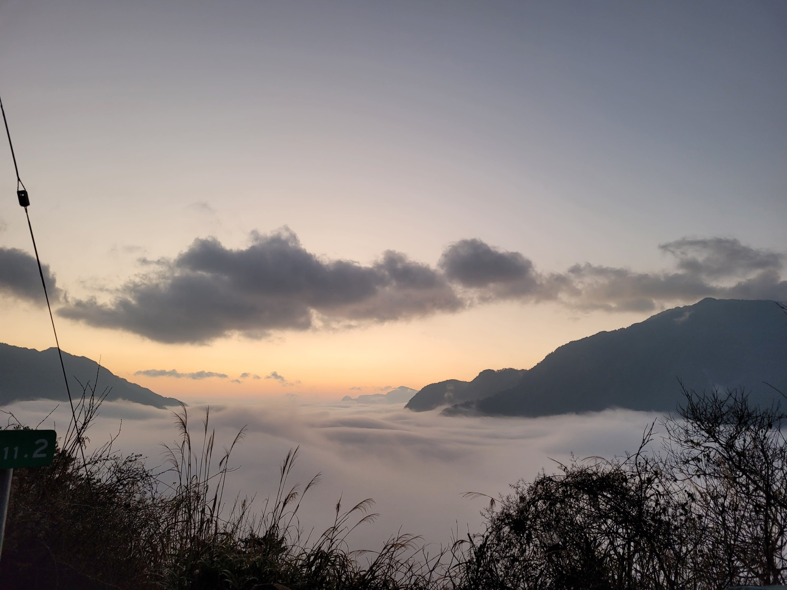

# About Mt. Pingfeng

Mt. Pingfeng (屏風山, "Folding Screen Mountain") sits next to the Hehuan Mountain peaks, standing like a screen that blocks the wind. With an elevation drop of 1,300 meters, it's one of the "Four Brutal Peaks of the Central Cross-Island Highway" (中橫四辣).
Elevation: 1,950–3,250 m
Distance: 10 km one way
!!! No mountain entry permit required !!!

From the Dayuling trailhead, the trail drops steeply down into the Tacijili Creek (塔次基里溪) valley all the way to the lowest point of the hike, the Wire Bridge (鐵線橋). After that it climbs gently to the beautiful pine forest campsite, then keeps climbing to the Hehuan Gold Mine campsite, crosses several small creek valleys, and then starts the assault up Mt. Pingfeng.
[Source: https://hiking.biji.co/index.php?q=trail&act=detail&id=656](https://hiking.biji.co/index.php?q=trail&act=detail&id=656)

Personally, I think the trailhead is the most beautiful part, and the pine needle campsite is the chillest spot. Everything else is either a steep descent or a steep climb. My thighs and calves were absolutely wrecked, especially as a total hiking newbie.

# Preparation

(The following is from our trip leader, Bo-Xian)
Must bring -

1. Backpack (about 30–50 liters, 10–15 kg load; line the inside with a garbage bag to keep your gear dry)
2. 1–2 trekking poles
3. Hiking boots, or rain boots with insoles (go one size up so your big toe doesn't get squeezed)
4. Tent (look for one under 1.5 kg for 1 person, 2 kg for 2, 3 kg for 3)
5. Sleeping bag (look for a down bag under 1 kg, comfort rating 0–5°C)
6. Sleeping pad (look for one under 500 g)
7. Stove setup for boiling water (gas canister + burner + pot, under 800 g total)
8. Moisture-wicking socks + wool socks, a cheap NT$10 poncho or a waterproof/windproof hiking jacket, a moisture-wicking long-sleeve top + athletic pants, a warm jacket, and a beanie (cold wind on your head makes altitude sickness more likely)
9. Headlamp + two sets of batteries, phone (bring a clear zip-lock bag to keep it dry)
10. Power bank of at least 10,000 mAh + charging cable
11. Personal medication (stomach meds, cold meds, painkillers for sprains)
12. Small change
13. Keys
14. One spare set of long-sleeve clothes to sleep in
15. Towel
16. Hand warmers
17. Food (go for low-moisture, filling, high-protein, high-salt, high-fat food, e.g. instant noodles, nuts, multigrain bread, pork floss, dried fruit, salt and sugar, energy bars, candy, M&M's)
18. Water bladder or bottles, 2 liters total (big plastic bottles from the store work fine)
19. Water purification tablets from a pharmacy (under NT$200) or a water filter from an outdoor store (around NT$1,000) (otherwise you'll have to boil your water before drinking it)
20. Utensils, tissues, wet wipes

Optional -
Inflatable pillow
Slippers
Change of clothes (leave it in the car to change into after the hike)
Sunscreen
Earplugs
Warm gloves
Grip gloves (for holding ropes or rocks)
Thermos

# Itinerary

We drove from Puli past Cingjing Farm, Hehuan Mountain, and Wuling, and finally spent the night at the Dayuling cabin.
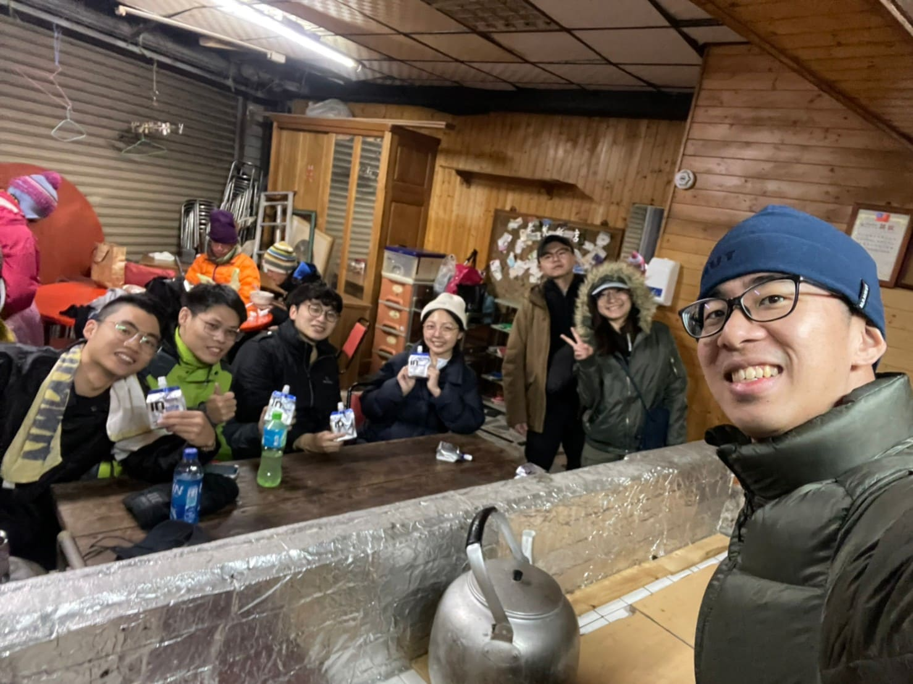
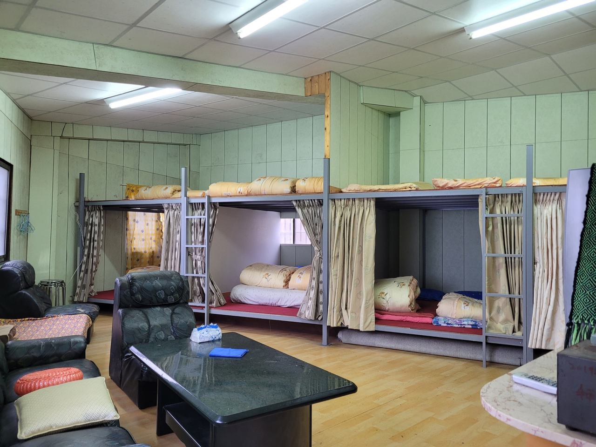

We set off from the trailhead at 6:00 sharp. It was -4°C in the early morning, but honestly I think this was the most beautiful part
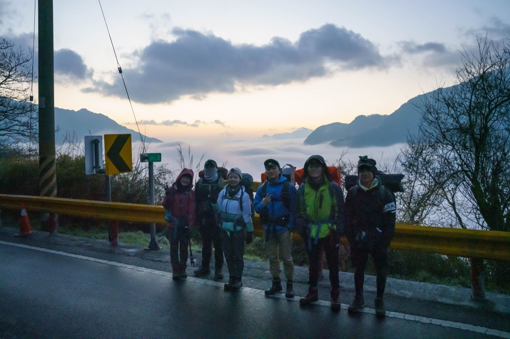

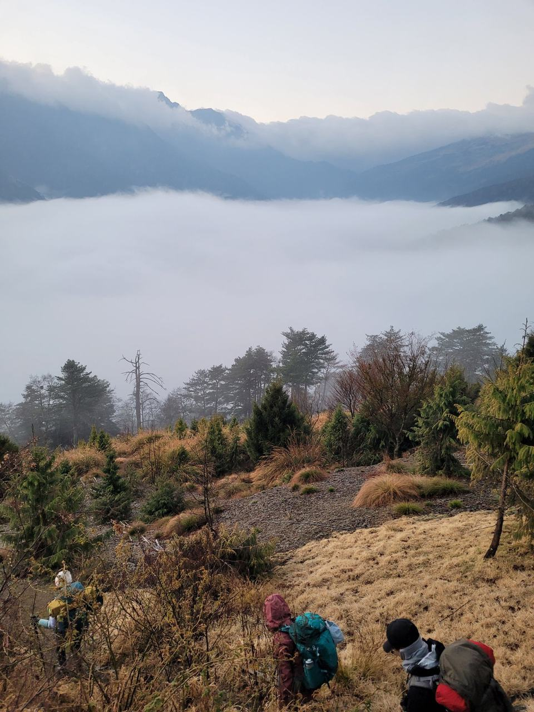
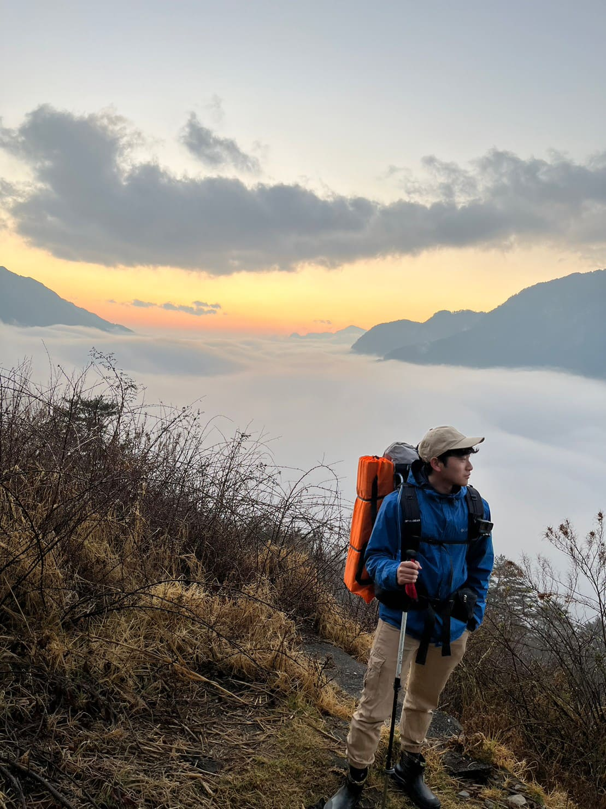

The way down was wrapped in mist
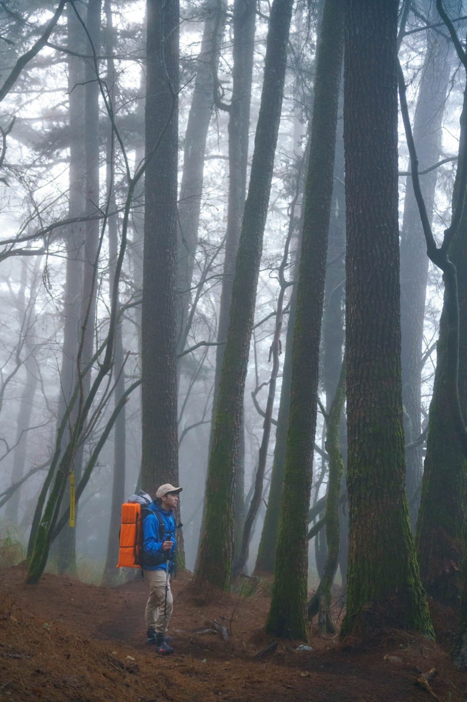

After a long steep descent, we reached the first stream: the Tacijili Creek valley
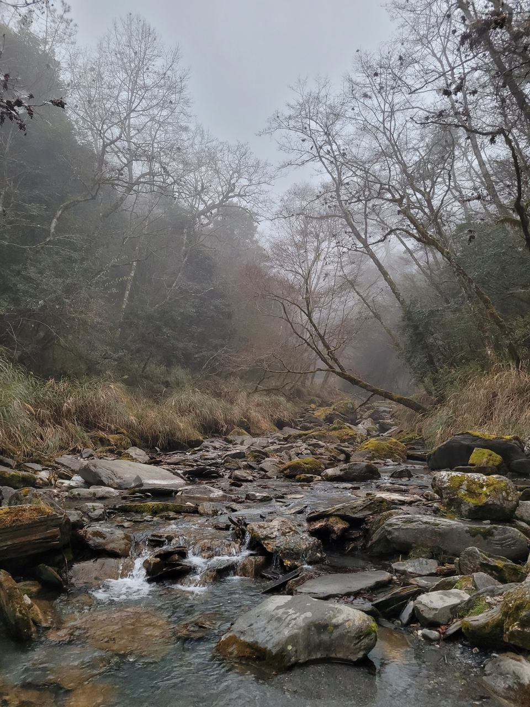
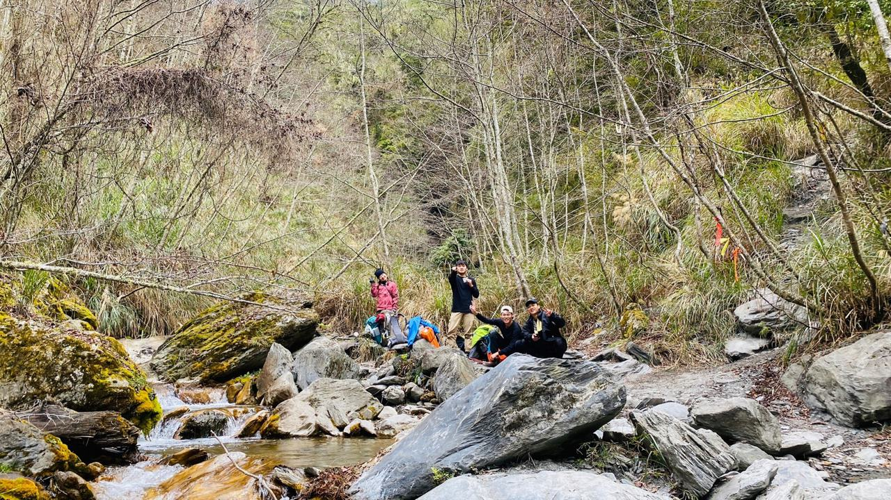

Then we reached the lowest point, the Wire Bridge
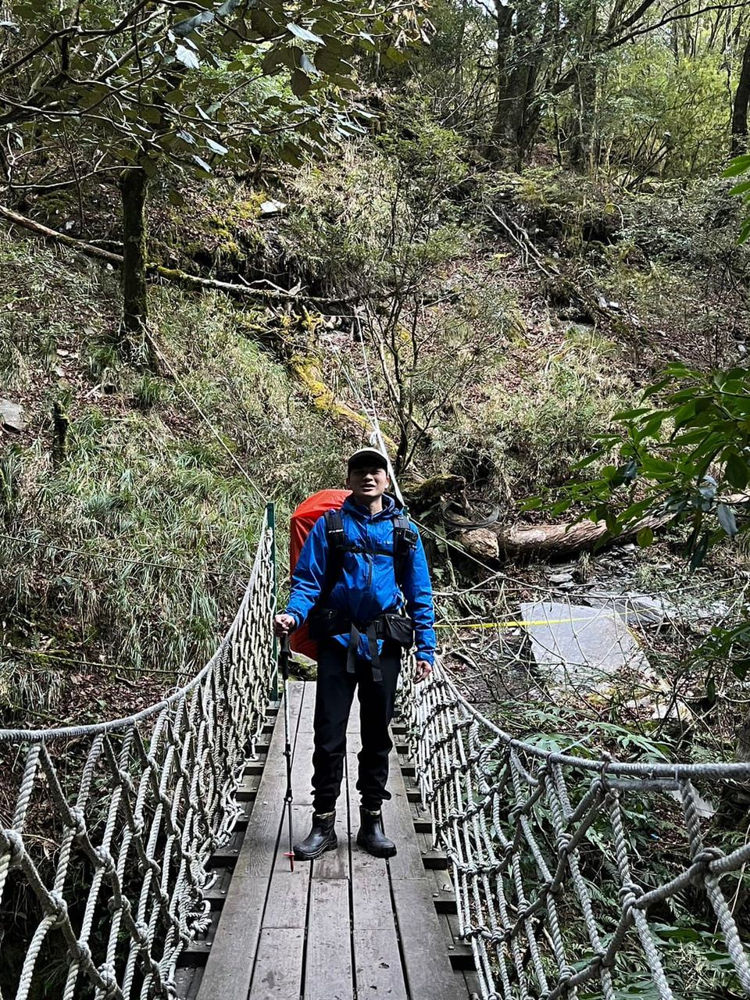

9:10 Arrived at the pine needle campsite
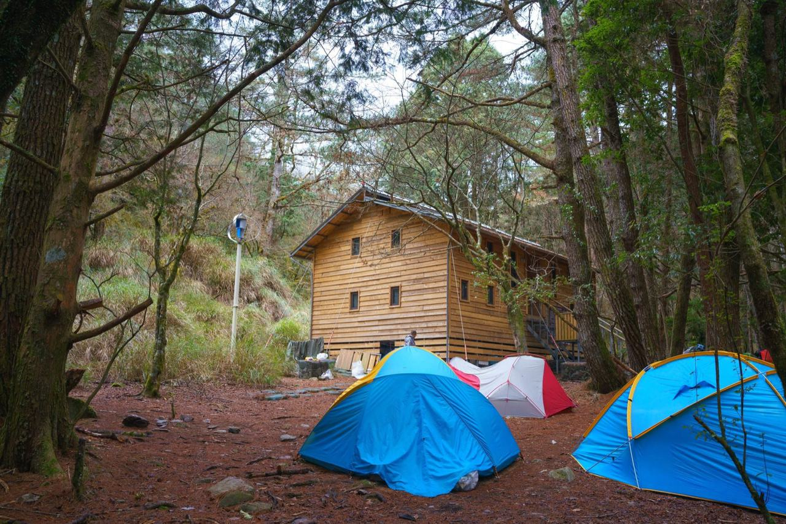
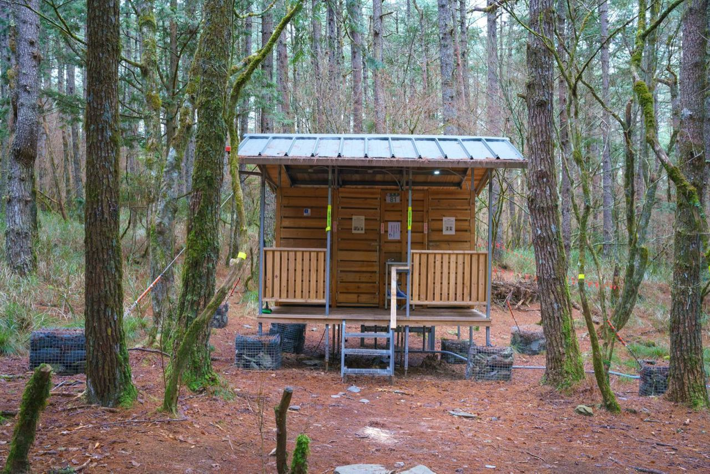

11:00 Headed toward the Mt. Pingfeng triangulation point, stopping first at the water source
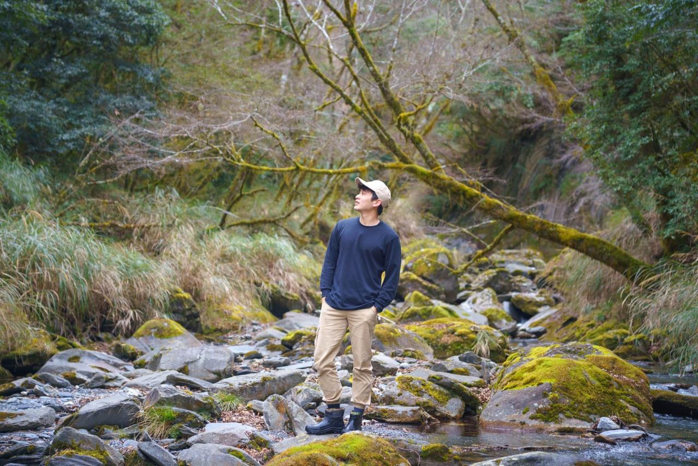

But because resting at the campsite was way too comfortable, we left too late, so after walking for a while we turned back to the camp to rest

Beautiful views on the way back the next day
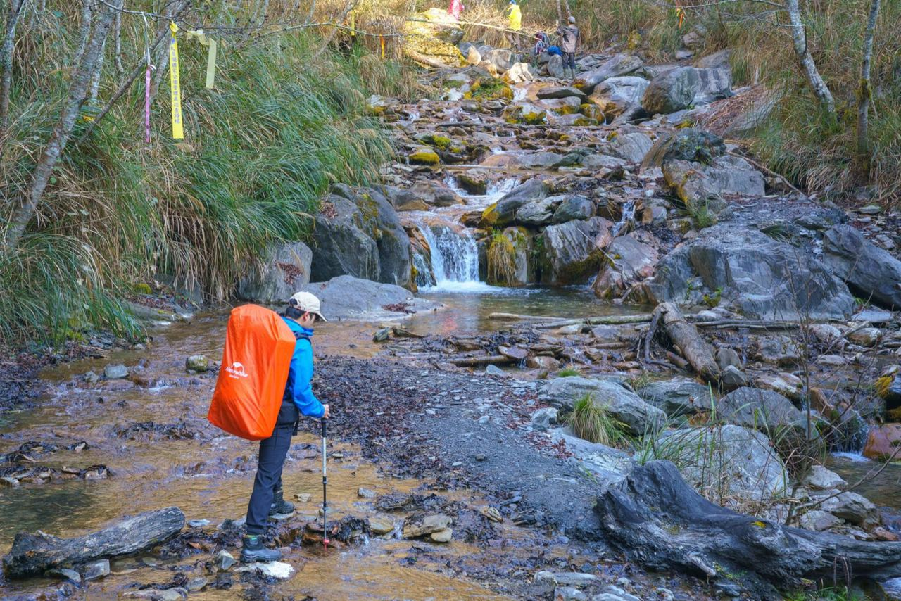
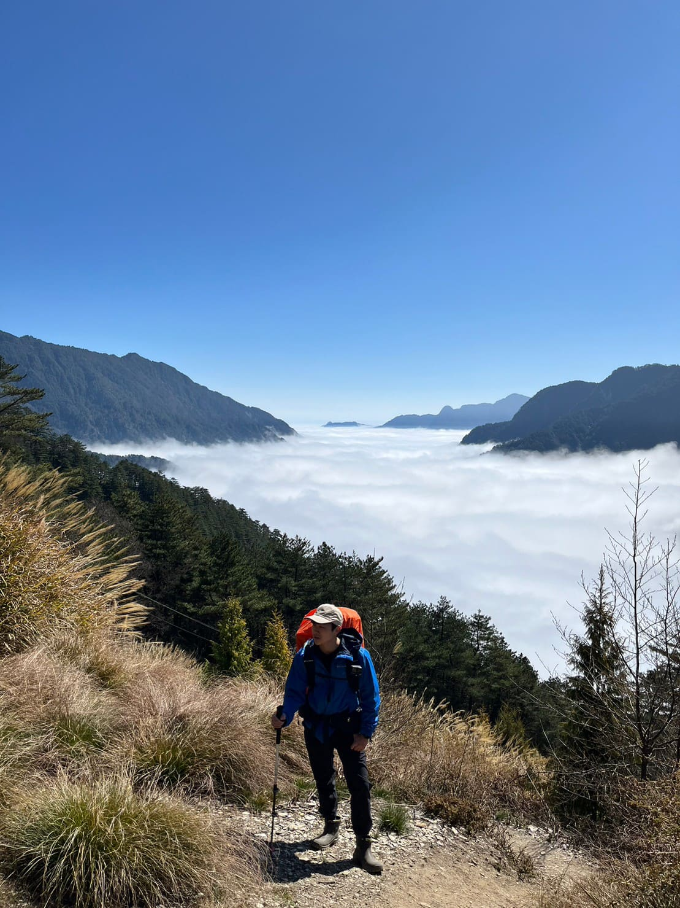
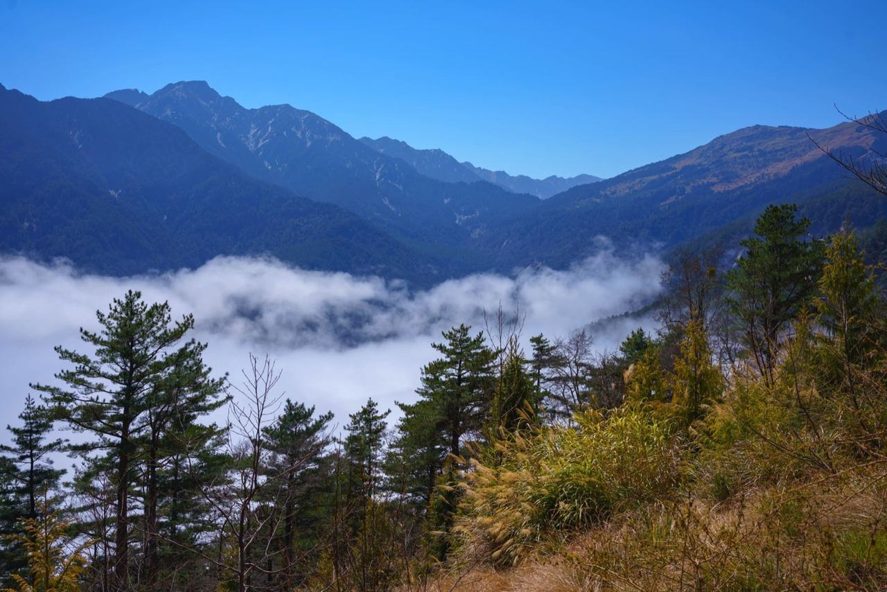

# Summary

I'm a hiking newbie myself, so this rating is from my personal point of view. I'd say the difficulty is upper-intermediate: 10 km one way, 20 km round trip. Make sure you train before you come, or your legs will end up as stiff as mine!

Difficulty  ： ◼️ ◼️ ◼️ ◼️ ◼️ 
Risk        ： ◼️ ◼️ ◼️ ◼️ ◻️
Worth it    ： ◼️ ◼️ ◼️ ◻️ ◻️
