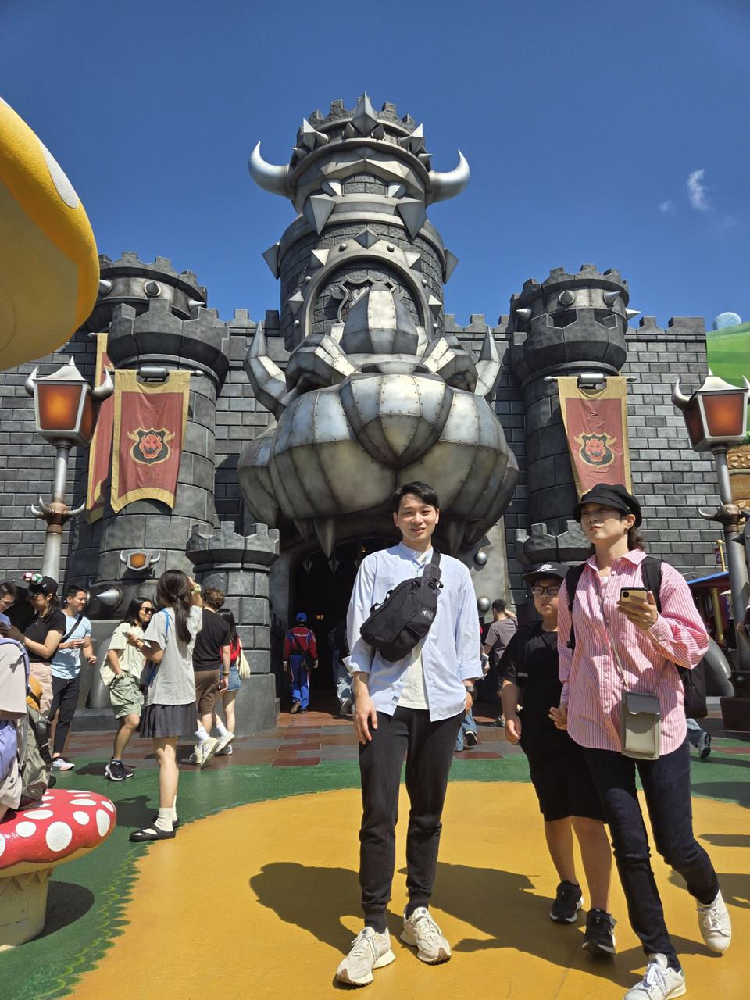
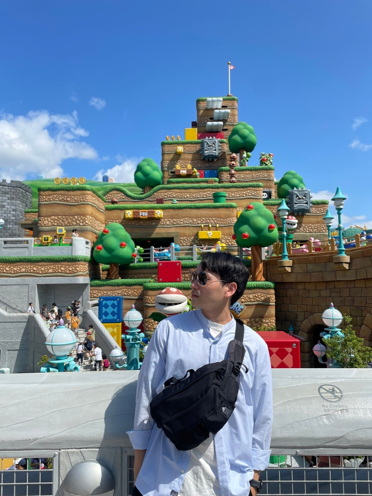
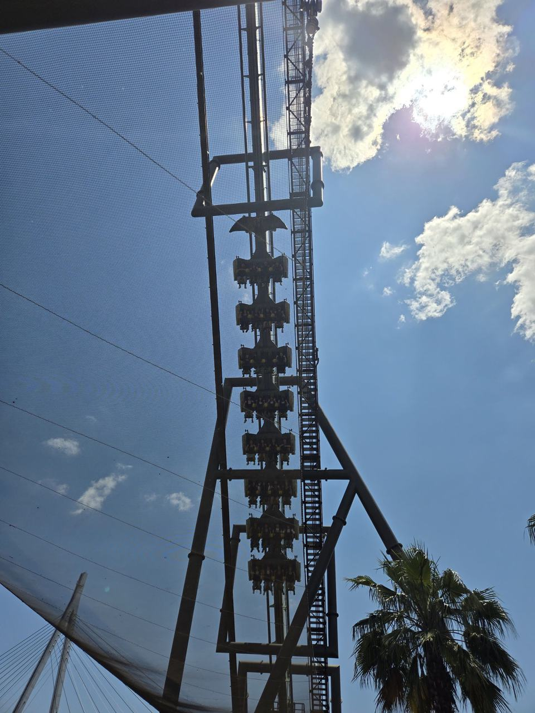
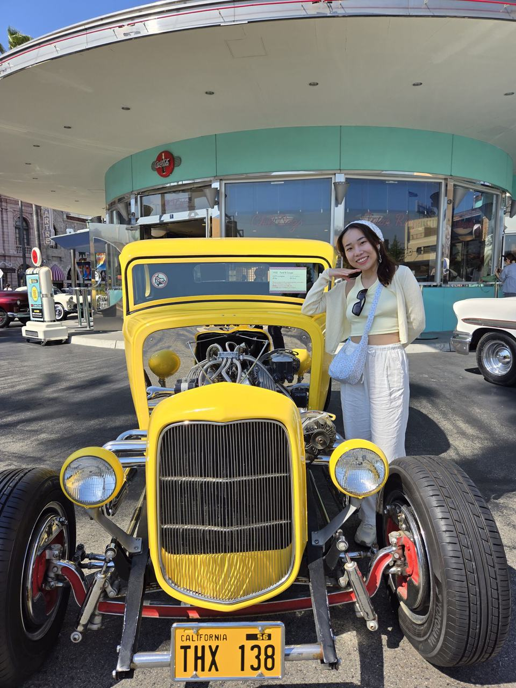
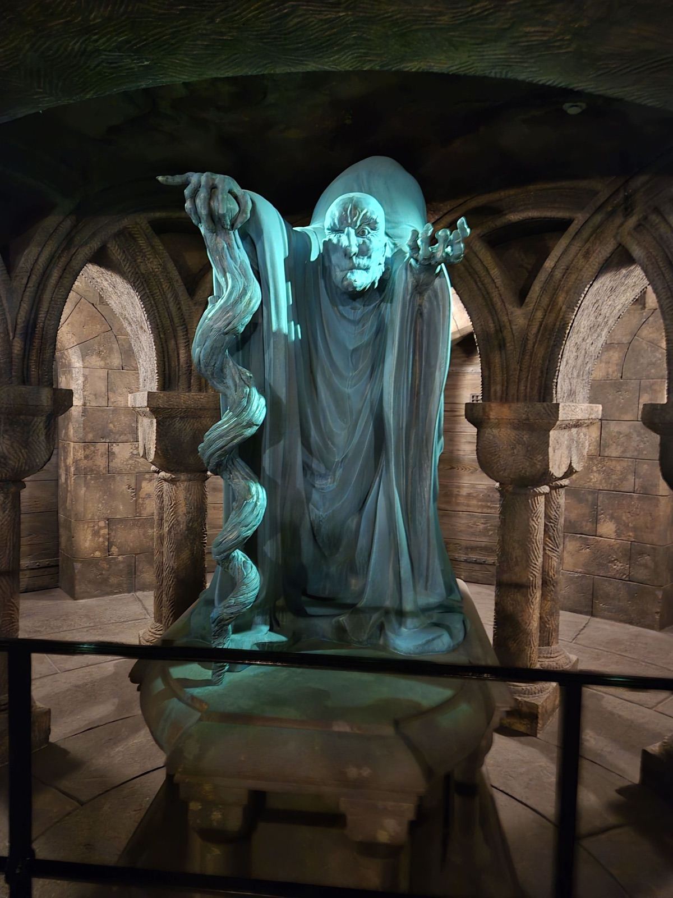
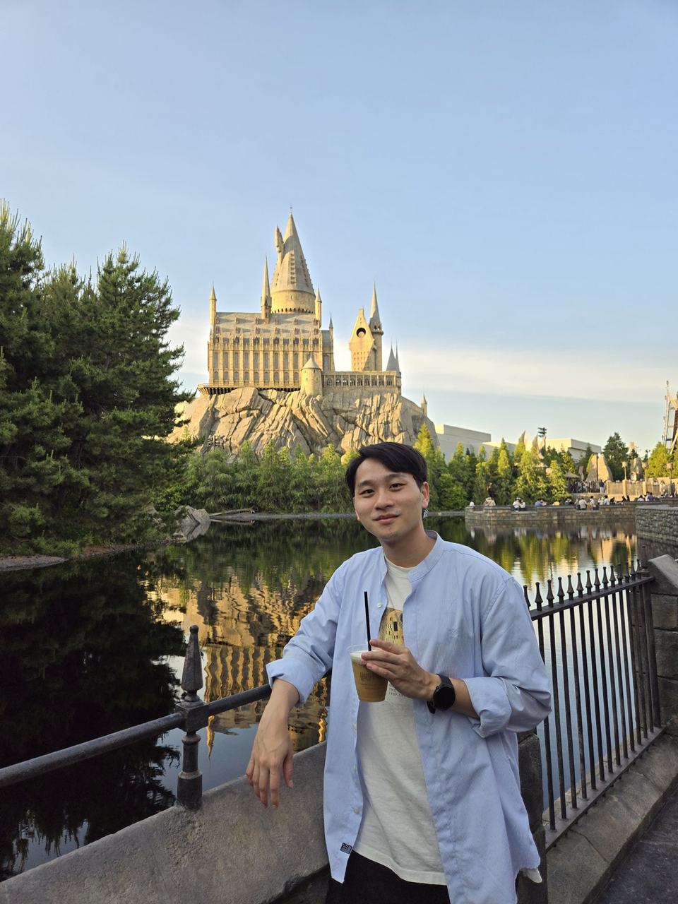
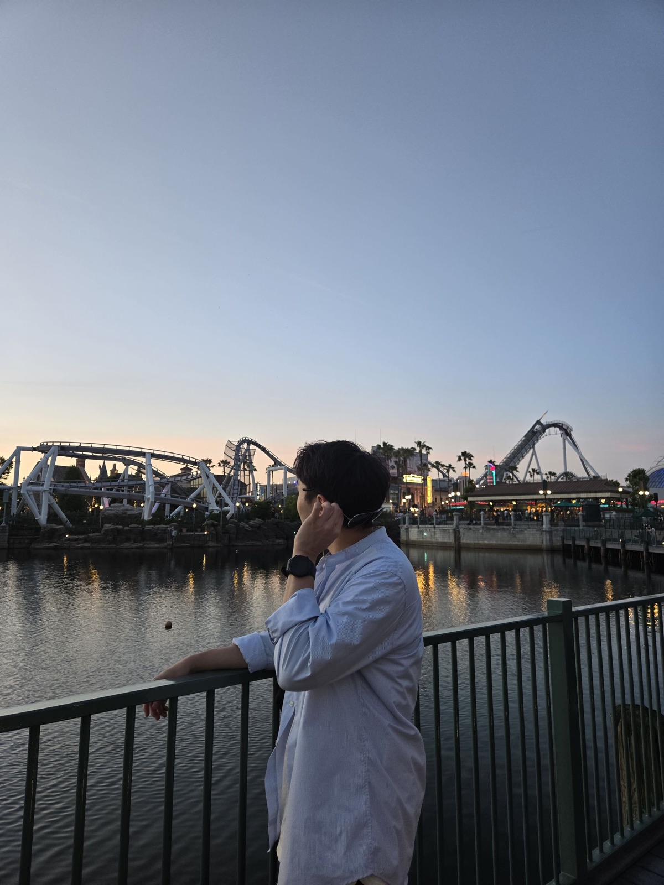
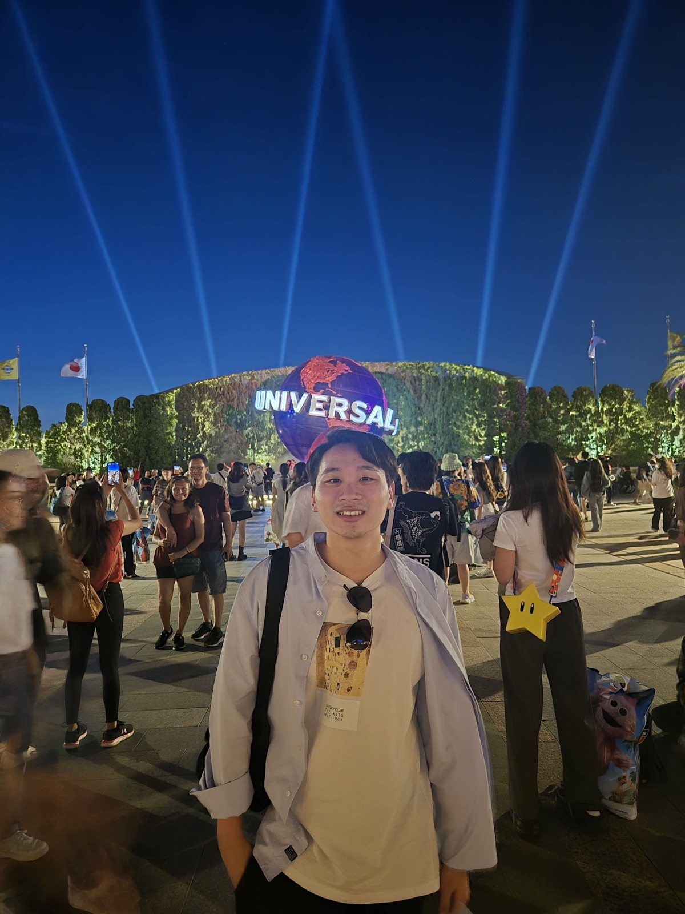

# Preparation

1. Pick the rides and shows you want to see ahead of time, then head straight to the one with the longest typical wait as soon as you get in
2. Bring a stool (the easy-to-fold kind) so you can sit and rest while queuing outside
3. Bring motion-sickness pills, since some rides can make you dizzy
4. Salt candy is good to bring too, so you don't lose electrolytes sweating all day in summer

# Tips

1. I recommend lining up at the park about 2 hours before the official opening time. The official opening for us was 9, we got there at 7, and we were near the front of the line
2. Line up at Gate B, since Gate A is the first place everyone queues after getting off the train (though when I got there both sides had about the same number of people)
3. Once inside, speed-walk to the ride you want most that usually has a huge line (my first pick was Demon Slayer, which normally averages a 140-minute wait. I got on in 15 minutes)
4. Super Nintendo World has capacity control. I grabbed a timed-entry ticket while I was queuing for my second ride
5. Yoshi's Adventure is just a little car that does a lap around Super Nintendo World. Really nothing special, so I didn't bother queuing for it at all
6. Consider eating lunch early, since the lines get much longer around lunchtime
7. Buy souvenirs later in the afternoon, otherwise carrying them around all day is a pain
8. Do your tax refund early. The later it gets, the longer the line, and there's a time limit too

# My Schedule

1. Demon Slayer (rushed there right away), only a 15-minute wait
2. Hollywood Dream (got a Super Nintendo World entry ticket for 9:10~10:10 while waiting), only a 15-minute wait
3. Bowser's Challenge (inside Super Nintendo World, the longest wait of the day at 70 minutes)
4. WaterWorld (awesome! The host was great at hyping up the crowd, and there were explosions too)
5. The Flying Dinosaur (highly recommended! I was scared but got on anyway, and only waited 30 minutes)
6. Minion Mayhem (pretty fun, about a 50-minute wait)
7. Sing on tour (super cute, plus you get to sit and rest for 20 minutes)
8. power of top～world tour (the hosts sang and danced, and set my inner dancer on fire)
9. Universal Monsters show (if only I understood Japanese...)
10. Harry Potter and the Forbidden Journey (great! The whole Harry Potter area is beautifully themed, and the ride makes you a bit dizzy)
11. Jaws (the host gave it everything)

