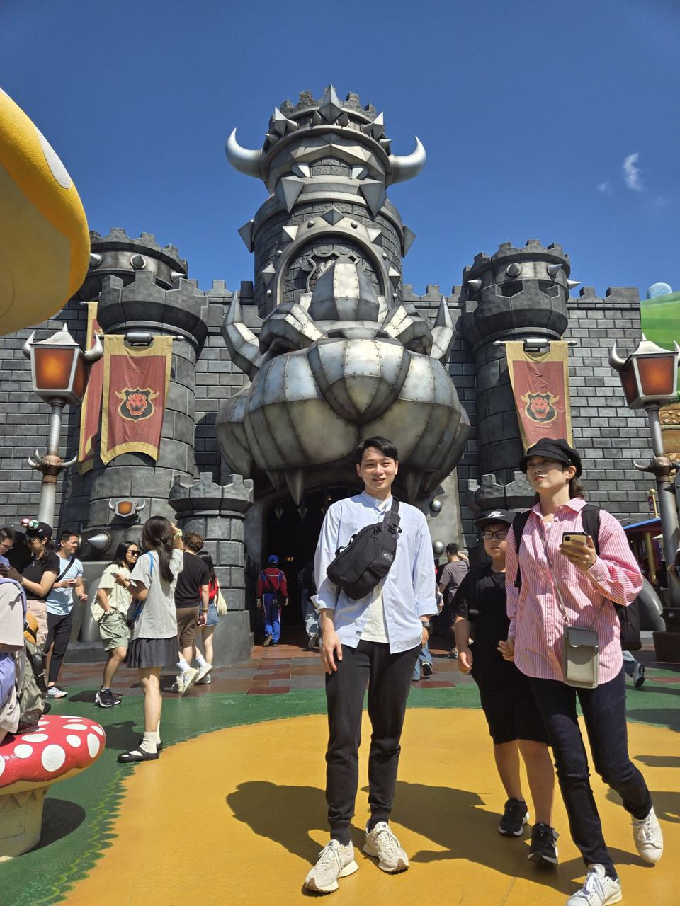
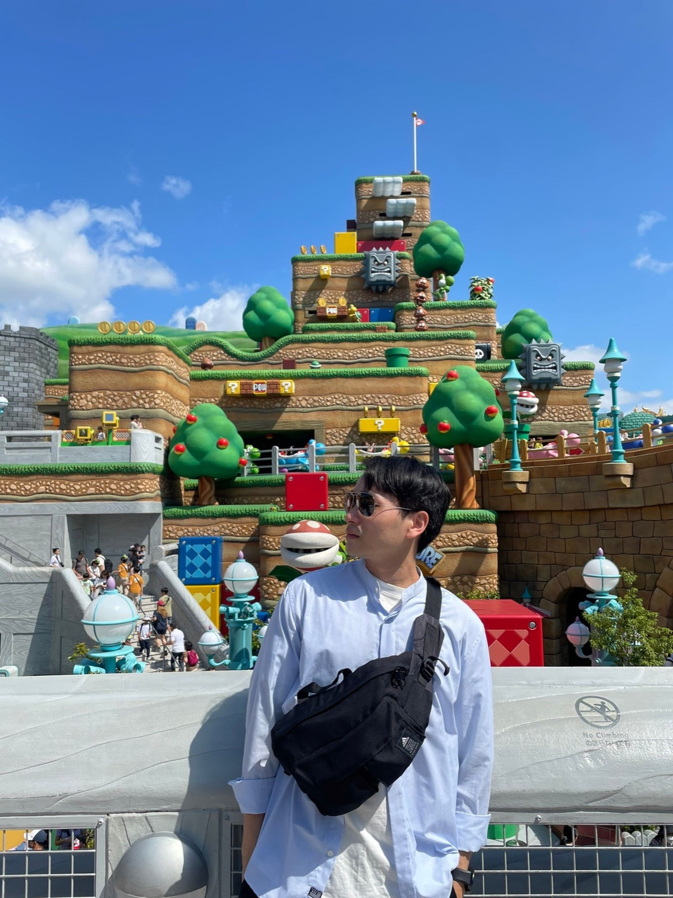
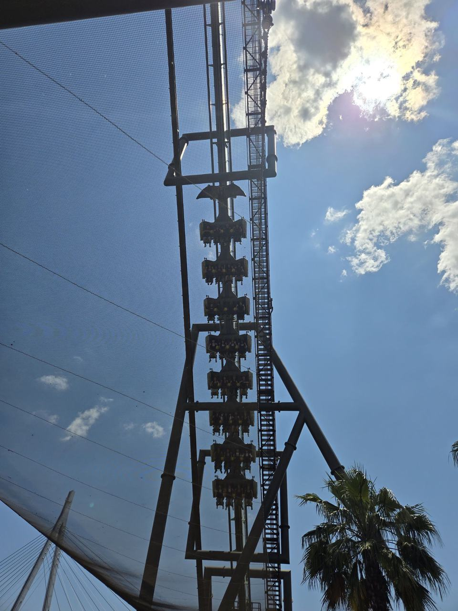
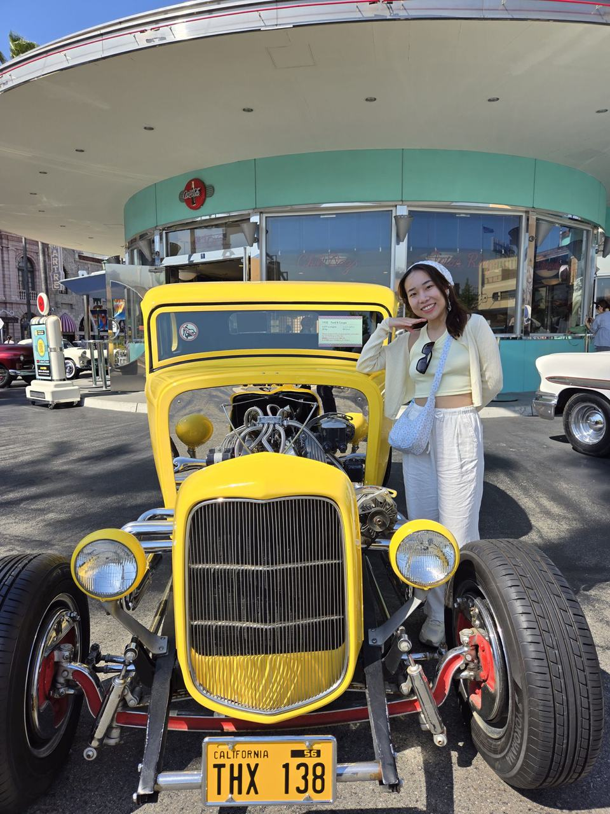
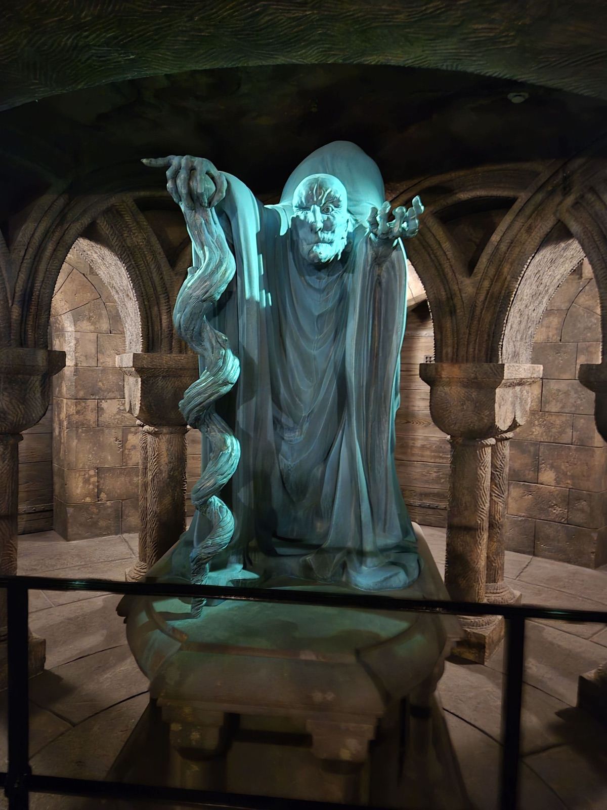
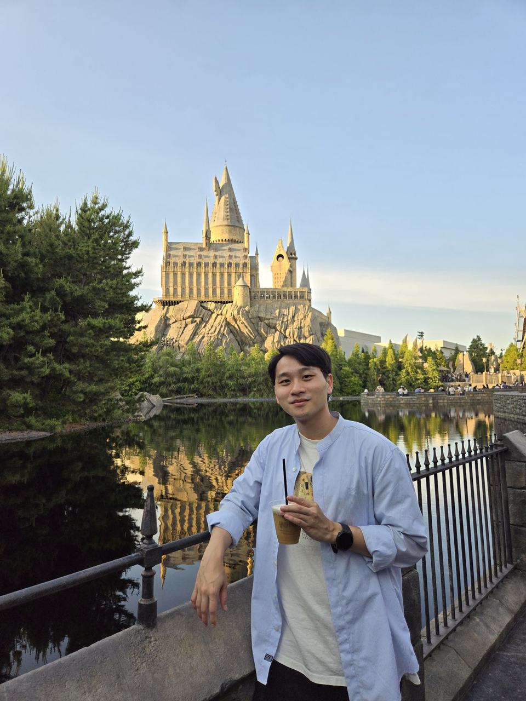
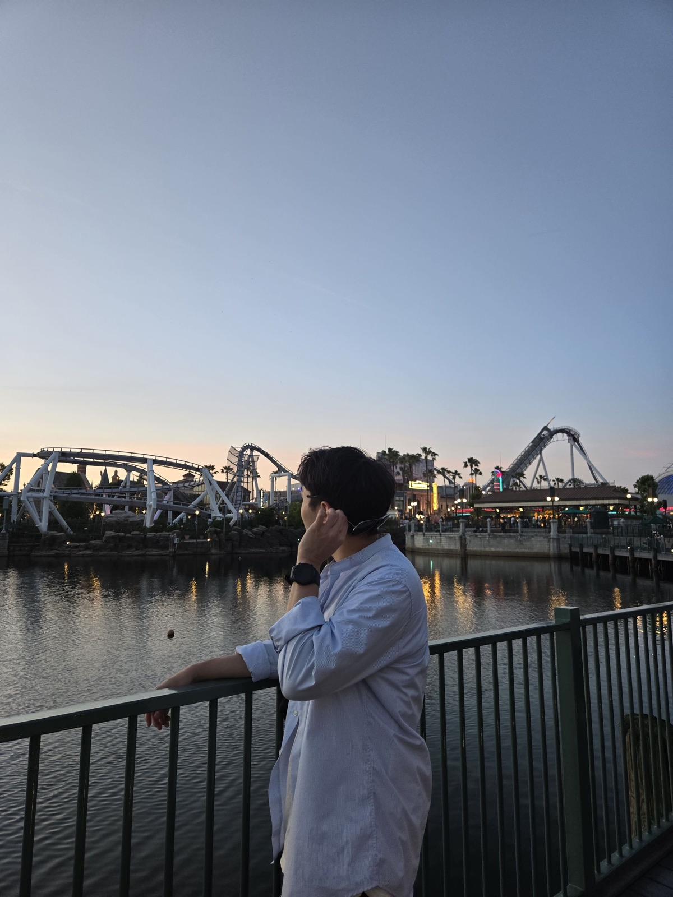
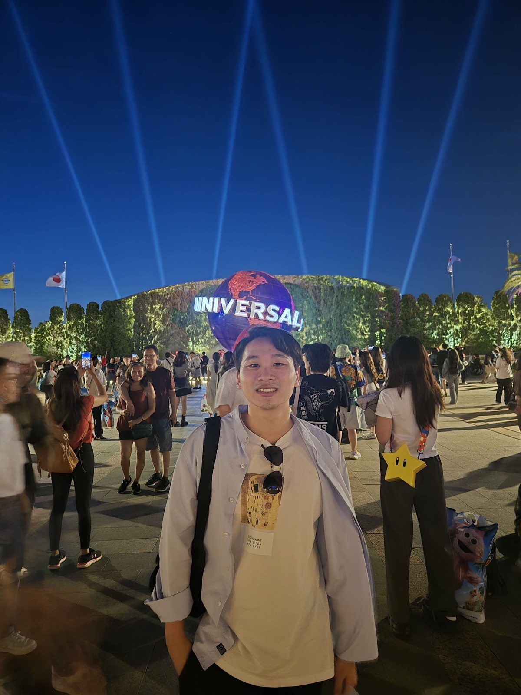

# 行前準備

1. 提早選出想玩的設施與表演，再根據排隊時間越久的一入園區就先排第一個
2. 可以攜帶凳子(收納方便的那種)在外面排隊時可以坐著歇息
3. 可以攜帶暈車藥因為玩有些設施可能會暈
4. 鹽糖也可以帶著避免夏天一直流汗失去電解質

# 攻略

1. 建議在官方表定開園前２小時到園區排隊，像我們是９點官方表定，我們７點到園區，排很前面
2. 排隊可以排B門，因為A門是所有搭地鐵下來後第一個人們會排隊的地方（但我到的時候兩邊人數差不多）
3. 入園後第一個快步前往想玩但一般排隊很多人的設施（像是我第一個選鬼滅之刃，通常平均排隊140分鐘，我15分鐘就排到了）
4. 瑪莉歐園區會有人數管制，我是在排第二個遊戲設施的時候抽整理券去的
5. 耀西的冒險只是小小的車子繞馬力歐園區一圈，真的沒什麼所以我完全沒有想排
6. 午餐可以選擇提早吃，因為午餐時間排隊人相對較多
7. 買紀念品建議晚一點下午再買比較好，不然一直拿著很麻煩
8. 退稅可以提早退稅，越晚排隊人越多，同時也有時間限制

# 我的行程安排

1. 鬼滅之刃（馬上衝），只排１５分鐘
2. 好萊塢美夢（等的時候抽馬力歐園區抽到 9:10~10:10），只排１５分鐘
3. 庫巴的挑戰 （進馬利歐園區，這排最久花了７０分鐘）
4. 水世界（超讚，主持人很會帶氣氛，也有爆破戲碼）
5. 飛天翼龍（超推，雖然很怕但還是上了，只花30分鐘排隊）
6. 小小兵瘋狂乘車遊 （不錯玩，大概排隊50分鐘）
7. Sing on tour (很可愛，同時可以坐著休息２０分鐘)
8. power of top～world tour （主持人唱歌跳舞，燃燒我的熱舞魂）
9. 環球妖怪表演秀 （如果聽得懂日文就好了．．．）
10. 哈利波特禁忌之旅（很讚，整個哈利波特園區造景很讚，會有點小暈）
11. 大白鯊（主持人很賣力）

