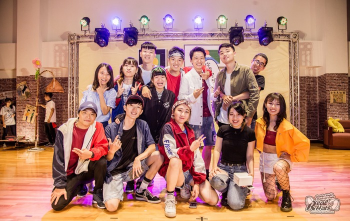
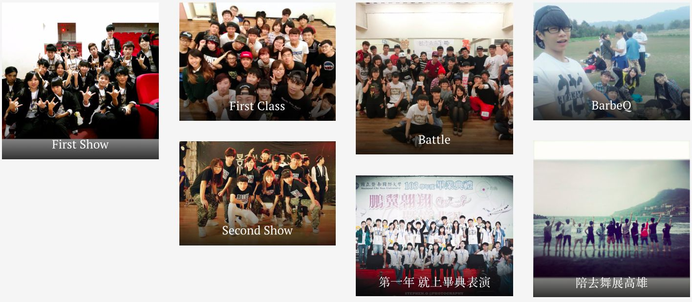
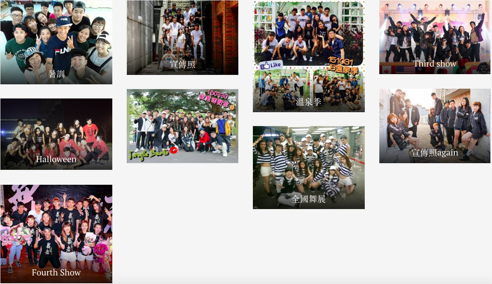
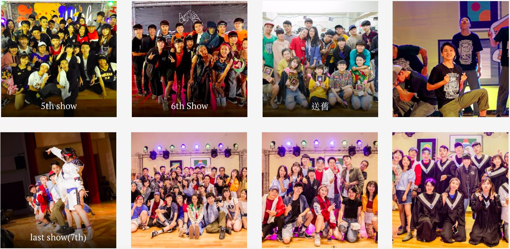

> The dance club stayed with me through all four years of college, through tears and laughter, friends who became family
> It's where I grew the most in college
> From someone shy who didn't dare show himself, to building confidence, to finally performing in front of a crowd
> Thank you for being with me these four years

---

# Freshman

My first time ever dancing. I had zero background, learned bit by bit, until I could finally get up on stage

---

# Personnel

As an officer, I was in charge of equipment. Back then I always thought everyone was selfish, since everyone was busy and only cared about their own stuff. In reality, people were still really willing to help, and that's how we grew close. I didn't speak up much in meetings. I had ideas but didn't dare share them. Every meeting ran late, and I always just wanted it to end so I could go home. I hope that in the future I can speak up at the right moments and help the team

---

# Life After Retiring as an Officer

I'd come back now and then to dance, to chat, and to meet new people. Seeing the dance club grow stronger and stronger, I felt like everyone had grown up

> I'm so glad I decided to join the dance club back then. It changed me a lot!
