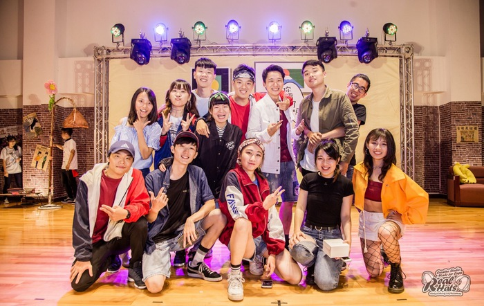
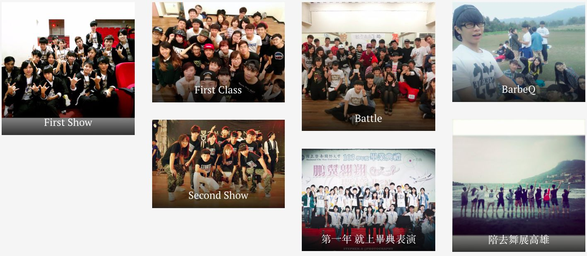
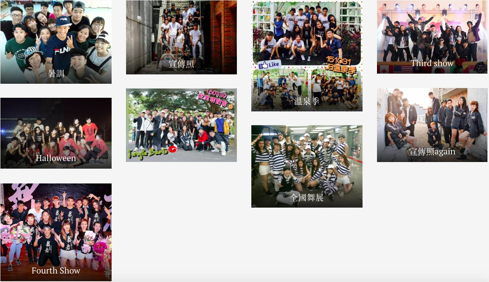
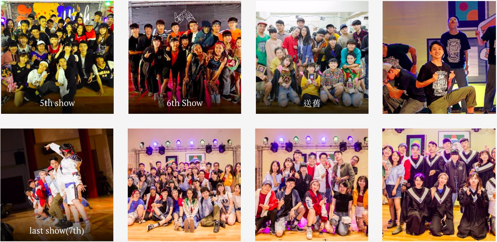

> 熱舞社 陪伴我大學整整四年的社團 有哭有笑 亦友亦親
> 是大學成長最多的時候
> 從一個內向不敢表現 到建立自信 最後在大眾前表演
> 謝謝大學四年的陪伴

---

# Freshman

第一次接觸跳舞，完全沒有基礎，慢慢學習，直到能站上舞台

---

# Personnel

幹部期間 擔任器材長 當時總認為大家很自私 由於大家都很忙 只顧自己的事 事實上大家都還是很願意幫忙 也因此培養好感情 而自己開會時較少發言 當時有想法卻不敢表達 每次開會都到很晚 總是希望趕快結束回家 期許自己未來能適時說出自己的想法 幫助團隊

---

# 退幹生活

偶爾回來跳跳舞 回來聊聊天 回來認識新朋友 看到熱舞社日漸蓬勃 覺得大家都長大了

> 很慶幸自己當時決定加入熱舞社 改變我很多！