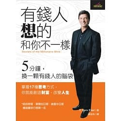
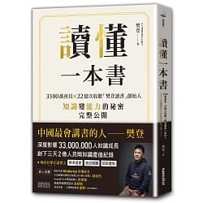
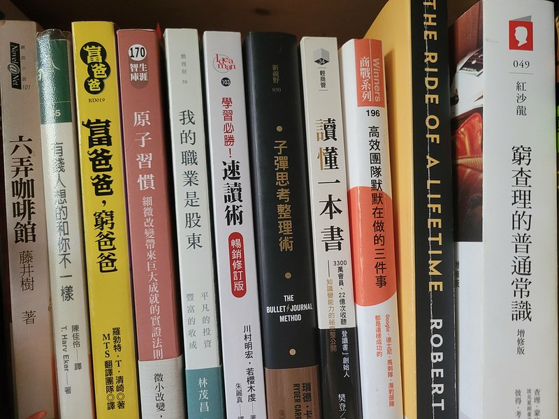

> In my whole life, I have known no wise people (over a broad subject matter area) who didn't read all the time — none, zero.
> You'd be amazed at how much Warren reads — and at how much I read. My children laugh at me. They think I'm a book with a couple of legs sticking out.
> By Charlie Munger

# Introduction

The famous painter Li Kuchan (李苦禪) once said: "A bird that wants to fly high first spreads its wings; a person who wants to get ahead first reads."
From Bill Gates, Warren Buffett and Charlie Munger to Barack Obama..., the world's great and influential people are all avid readers. Everyone knows how important reading is
But someone will always ask: if so many bestsellers, self-help books and how-to books are published every year, why are there still so few successful people?
Does reading actually help?
It depends on how you see it. I've seen friends get promoted and get raises because they love learning and reading; but I could also say that less than 30% of it actually gets used
But after reading this article, my view on reading changed:
[Why doesn't reading help me much? Here's how people earning NT$3 million a year read](https://www.managertoday.com.tw/books/view/53266)

---

# Why I Started Reading

What got me into reading was last April. I was listening to a podcast I really like, "大人學的Small Talk", and one episode was about [how I choose, buy, give up on and absorb a book](https://goldfishblog.tw/darencademy-podcast-ep56/). It mentioned that people in Taiwan read only two books a year on average! At that point I wasn't even reading two a year! After the episode I figured I'd give it a shot: if reading helps people that much, how could I not read? But I wasn't thinking I'd keep it up long term. I just bought a few bestsellers to see how it went.

The very first one was "Secrets of the Millionaire Mind"

This book tells us to build the mindset of rich people. For example -> when you really want to buy something but it's expensive:
Poor people think: "It's too expensive, I'll never be able to afford it"
Rich people think: "How can I afford it?"
Turn the problem into how to solve it, instead of endless complaining and blaming. The book lays out 17 ways rich people think. It made me feel that reading is fun and practical, and that it can actually change how I behave.
I kept up the reading habit all the way into my military service. During service there was a lot of time on standby or waiting for drills, which was really boring, and reading was the only pastime. When there were no drills, all I could do was read; when standing guard got boring, I'd sneak out a book too. That's how my military service locked in my reading habit, and I've kept it up ever since...

---

# Reading Tips

When I read "讀懂一本書" (Understanding a Book), I realized I often forget what I read right after reading it, and even if I read it again, I forget a lot of the ideas all over again. The author says: "Self-rumination of knowledge: the most effective way to study isn't highlighting as you read, but waiting about a week and then drawing a mind map from memory." He also talks about the importance of explaining books to others: being able to internalize knowledge into your own words and pass it on makes you the biggest beneficiary. So I also started keeping a record of the books I read and summarizing the key points.

But as a reader you still need to learn to discern. When you strongly disagree with an idea, use it to train yourself to think about both sides of an issue: why the author thinks that way, and why you think the way you do. Maybe it's a different situation, a different standpoint, or maybe you've misread the author. Think carefully about the author's arguments and build your ability to think independently.

Also, reading can be divided into 3 stages, from low to high: What, How, Why. This actually applies to learning too:

1. What:  When you see something new or unfamiliar in a book, you copy it down and memorize it so you can share it with others later

2. How :  You take the scenarios you read about and place them in real life, so when you run into the same problem you have something to refer to

3. Why :  Once you understand the whole problem, you analyze the author's thinking structure, the motivation behind it and how they think, so when you face a problem you can apply that way of thinking

Back in school, rote memorization might have gotten you high scores, but in real life not every problem has a right answer. Only by really thinking can you fully understand a book, which is the whole spirit of truly mastering something. That's also why, reading the same book, some people get so much more out of it than others.

I'm personally pretty impatient. I often want to rush through a book so I can feel like I've read a lot and I'm amazing. But I often read without really getting the meaning, stuck at the first or second stage. At book club I've noticed that some people have incredibly deep, thorough takes on the same book. I need to gradually get myself to the third stage instead of just swallowing books whole.

---

# Benefits of Reading

Of course everyone's heard about the benefits of reading until they're sick of it, but what really made my eyes light up was when I read that

Reading can take a person from "one-dimensional" to "multi-dimensional" (assuming you reach the third stage: Why):
1. Facts: analyzing decisions

2. Logic: what the logic between the facts is

3. Critical thinking: constantly training how you think

And I'd heard before that your future income is proportional to how much you read, so I looked up this news story: [The higher people's income, the more they love reading](https://kknews.cc/zh-tw/culture/jma648l.html)

---

My reading list and notes: https://www.notion.so/lawrencekao/1a7fb57a6f3c4e30a8f1f5e45677b129?v=e89018e9e9c54144977390b1195ad432

---

# Recommended Reading Lists

My favorite is Bill Gates's reading list. It's super diverse and covers all kinds of topics, which is perfect for someone like me with broad interests. Gooaye (股癌) is a podcaster, and his list is great too. And Charlie Munger is a hugely important figure next to Buffett; Buffett often says, "Without Munger, there would be no me"
1. [Bill Gates's reading list](https://activity.books.com.tw/crosscat/show/A00000023102)

2. [Gooaye's reading list](https://www.evernote.com/shard/s706/client/snv?noteGuid=a0556273-7a2b-9e6b-6d51-33e2c856e353&noteKey=94725ec975a01bbf3cedb6db1b378dec&sn=https%3A%2F%2Fwww.evernote.com%2Fshard%2Fs706%2Fsh%2Fa0556273-7a2b-9e6b-6d51-33e2c856e353%2F94725ec975a01bbf3cedb6db1b378dec&title=%25E8%2582%25A1%25E7%2599%258C%25E6%259B%25B8%25E5%2596%25AE%2528%25E5%25B0%2587%25E6%258C%2581%25E7%25BA%258C%25E6%259B%25B4%25E6%2596%25B0%25EF%25BC%258C%25E6%259C%2580%25E6%2596%25B0%25E7%25BD%25AE%25E9%25A0%2582%2529)

3. [Charlie Munger's reading list](https://jujuchu.com/charlie-munger-s-recommended-reading-material/)

4. [Eslite's celebrity reading lists](https://events.eslite.com/2020/191217-CelebrityPicks/index.html)

5. [Planet of Booklist](https://planetofbooklist.com/)

Also, I recently found this blog, whose book reviews and recommendations are really worth checking out: [JUJU CHU 愛讀書](https://jujuchu.com/)

---

# Recommended Note Tool: Notion

Recently a friend recommended that I use Notion; he records his notes in it after finishing each book. After seeing his layouts and how convenient it is, I decided to use it to track my own reading

[Notion website](https://www.notion.so/product?utm_source=google&utm_campaign=2075789713&utm_medium=80211061801&utm_content=372709093351&utm_term=notion&targetid=aud-840164194020:kwd-312974742&gclid=CjwKCAjwq7aGBhADEiwA6uGZp09kAHOzRRUTrYU8jmxz0-dG-mf2iP5SN7yC6mUTvbUmbJ4VsVBAjRoCnjsQAvD_BwE)

Lots of people online have already shared its advantages, so I won't repeat them here
For example: [Notion: My Experience Using It](https://medium.com/%E8%B8%A2%E4%BB%96%E7%A2%8E%E7%A2%8E%E5%BF%B5/%E4%BA%BA%E5%8F%83-notion-%E4%BD%BF%E7%94%A8%E5%BF%83%E5%BE%97%E5%88%86%E4%BA%AB-230055957305)

---

> **Go and grab a book and read !** 
