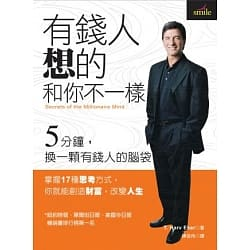
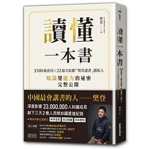
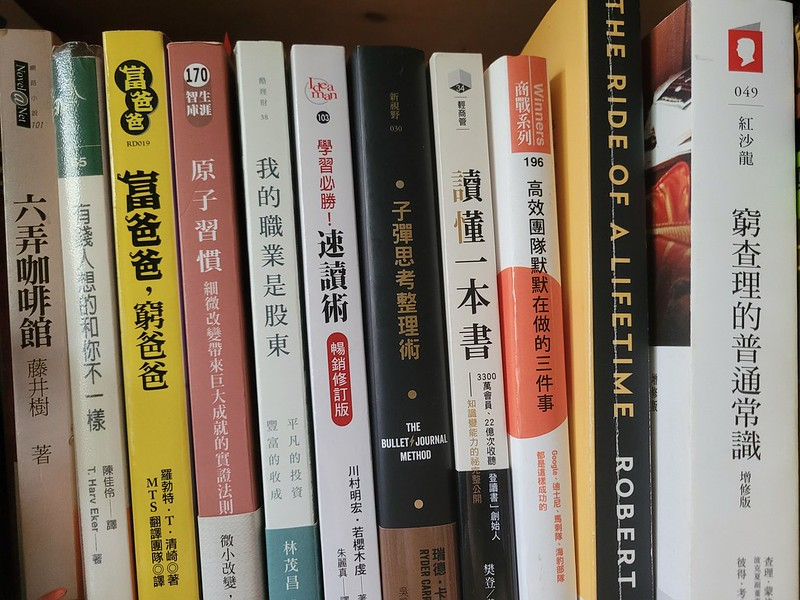

> 我這輩子遇到的聰明人（來自各行各業的聰明人）沒有不每天閱讀的。 沒有，一個都沒有。
> 華倫讀書之多，我讀書之多，可能會讓你感到吃驚。我的孩子們都愛開玩笑，覺得我是一本長了兩條腿的書。
> By 查理．蒙格

# 前言

著名畫家李苦禪曾說過：「鳥欲高飛先振翅，人求上進先讀書。」
從比爾蓋茲、巴菲特、查理蒙格、歐巴馬...，世上偉大而具影響力的人，無不飽讀詩書，閱讀的重要性大家都知道
然而一定會有人說，為什麼每年那麼多排行榜書、勵志書、工具書被出版，成功的人還是這麼少？
閱讀到底有沒有用？
這個問題端看每個人怎麼想，有看過身邊的朋友因為喜歡學習、喜歡閱讀，而升遷、加薪 ;但我也可以說，實際用的不到30%
但當我看到這篇文後，我對閱讀的想法有所改變：
[為什麼閱讀對我幫助不大？來看看年收入300萬的人是怎麼看書的](https://www.managertoday.com.tw/books/view/53266)

---

# 為何開始閱讀

啟發我閱讀的是在去年4月，我在收聽自己滿喜歡的Podcast節目『 大人學的Small Talk 』，其中一集提到[我如何選擇、購買、放棄與吸收一本書](https://goldfishblog.tw/darencademy-podcast-ep56/)，裡面有提到國人平均一年只讀兩本書！其實我當下連一年兩本都不到！聽完節目後，想說姑且一試，既然閱讀對人那麼有幫助，那我怎麼能不看書，但沒有抱著會長久閱讀的想法，買了幾本暢銷書就來看看。

起初第一本是「 有錢人跟你想的不一樣 」

這本書告訴我們要培養有錢人的思考模式，舉例 -> 當遇到一個東西很想買，但很昂貴：
窮人會想著：「太貴了，我永遠買不起」
有錢人會想著：「我該如何買得起它」
將問題轉化為該如何去解決問題，而不是無盡的抱怨、責備，書中提到17個有錢人的思維模式。這本書讓我感覺到閱讀是有趣的而且實用，可以影響我的行為模式。
一直持續閱讀習慣到當兵，在當兵期間，由於長時間待命或是等待操課很無聊，閱讀是唯一消遣，不操課就只能看書，站哨時無聊也偷偷拿出書來看，也因此在當兵時鞏固自己閱讀的習慣，而持續維持自己閱讀習慣到現在...

---

# 閱讀建議

在我看到「讀懂一本書」時了解到，自己很常閱讀後就忘記，甚至就算再看一次很多觀念也會再次忘掉，作者說到：「知識的自我反芻：最有效的讀書不是一邊讀一邊畫重點，而是大概間隔一週，邊回憶邊畫心智圖」，也說到講書的重要性，就是能將知識內化成自己的語言再傳遞給他人，自己將是最大的受益者，因此我也開始記錄自己閱讀的書籍，並做重點整理。

但讀者在閱讀時仍要學習分辨，有些自己非常不認同的想法，可以訓練自己思考事情的正反面，還有為何作者想法如此，而自己的想法為何那樣，也許是情境的不同、立場不同、或是扭曲了作者想法等等，謹慎思考作者的論點，培養自己的獨立思考能力。

再者，閱讀可以分為3種階段，由低至高，What、How、Why，其實也可以套用於學習上：

1. What:  看到書本上的內容覺得有什麼新奇、不了解的，抄寫、背誦下來，以後可以跟他人分享

2. How :  將在閱讀時看到的場景放置在現實生活中，如果有遇到這個問題可以供參考解決

3. Why :  了解整個問題後，分析作者的思維結構、背後的動機、如何思考，當遇到問題需要解決，可以透過這種思維模式執行

過去學生時代的學習，也許死記硬背就能考高分，但是在現實生活中，並非所有問題都有正確答案，真正去思考才能讀透一本書，也就是融會貫通的精神所在。這也是為什麼同樣閱讀一本書，有些人卻能比其他人達到的成效高出許多。

我個人個性比較急，常常想把書快速讀完，然後好像自己讀了很多書，很厲害一樣。但常常讀過卻沒有深入其義，只停留在第一或第二階段。在讀書會時發現同一本書有些人卻有非常深入透徹的想法，要漸漸讓自己能夠領悟第三階段，並非囫圇吞棗。

---

# 閱讀的好處

想當然閱讀的好處大家聽到不想再聽，而最讓我眼睛發亮的是當我看到

閱讀可使人從「單向度」變成「多向度」，（前提是要達到第三階段：Why）：
1. 事實：分析決策

2. 邏輯：事實間的邏輯為何

3. 批判思維：不斷訓練思維方式

以及，之前聽過，未來收入跟閱讀量成正比，我後來去查了一下這個新聞[收入越高的人越愛讀書](https://kknews.cc/zh-tw/culture/jma648l.html)

---

我的閱讀列表與重點整理 : https://www.notion.so/lawrencekao/1a7fb57a6f3c4e30a8f1f5e45677b129?v=e89018e9e9c54144977390b1195ad432

---

# 推薦書單

我最喜愛比爾蓋茲的書單，非常多元，各種面向都有，尤其是對於興趣廣泛的我再適合不過了，而股癌是Podcaster，他的書單也很棒，而查理蒙格是巴菲特身邊非常重要的人，巴菲特常說：「沒有蒙格就沒有我」
1. 比爾蓋茲書單

2. [股癌書單](https://www.evernote.com/shard/s706/client/snv?noteGuid=a0556273-7a2b-9e6b-6d51-33e2c856e353&noteKey=94725ec975a01bbf3cedb6db1b378dec&sn=https%3A%2F%2Fwww.evernote.com%2Fshard%2Fs706%2Fsh%2Fa0556273-7a2b-9e6b-6d51-33e2c856e353%2F94725ec975a01bbf3cedb6db1b378dec&title=%25E8%2582%25A1%25E7%2599%258C%25E6%259B%25B8%25E5%2596%25AE%2528%25E5%25B0%2587%25E6%258C%2581%25E7%25BA%258C%25E6%259B%25B4%25E6%2596%25B0%25EF%25BC%258C%25E6%259C%2580%25E6%2596%25B0%25E7%25BD%25AE%25E9%25A0%2582%2529)

3. [查理蒙格書單](https://jujuchu.com/charlie-munger-s-recommended-reading-material/)

4. [誠品的各名人書單](https://events.eslite.com/2020/191217-CelebrityPicks/index.html)

5. 書單星球

此外，最近發現這個Blog所撰寫的閱讀心得與推薦書非常值得一看 [JUJU CHU 愛讀書](https://jujuchu.com/)

---

# 推薦整理 Notion

近期有個朋友推薦我，他看完書後都會使用 Notion 記錄自己的筆記，在我看過他的排版還有方便性後，決定使用這個軟體記錄自己的閱讀

[Notion 網址](https://www.notion.so/product?utm_source=google&utm_campaign=2075789713&utm_medium=80211061801&utm_content=372709093351&utm_term=notion&targetid=aud-840164194020:kwd-312974742&gclid=CjwKCAjwq7aGBhADEiwA6uGZp09kAHOzRRUTrYU8jmxz0-dG-mf2iP5SN7yC6mUTvbUmbJ4VsVBAjRoCnjsQAvD_BwE)

其實網路上有許多人分享它的優點，我在這裡就不贅述
如：[Notion：使用心得分享](https://medium.com/%E8%B8%A2%E4%BB%96%E7%A2%8E%E7%A2%8E%E5%BF%B5/%E4%BA%BA%E5%8F%83-notion-%E4%BD%BF%E7%94%A8%E5%BF%83%E5%BE%97%E5%88%86%E4%BA%AB-230055957305)

---

> **Go and grab a book and read !** 
