> The scenery I'd always seen on computer wallpapers was right in front of me
> The US city where I've met the most Chinese-speaking people so far

Trip video memories

<iframe class="yt short" src="https://www.youtube-nocookie.com/embed/07emnMyN5OI" title="YouTube video" loading="lazy" allow="accelerometer; clipboard-write; encrypted-media; gyroscope; picture-in-picture; web-share" referrerpolicy="strict-origin-when-cross-origin" allowfullscreen></iframe>

# Day 1

My flight from Boise to San Francisco was massively delayed, pushing my arrival back by almost 4 hours. I didn't land until 2 p.m.
So if you're connecting through San Francisco from another state to fly back to Taiwan or somewhere else, give yourself a lot more buffer time.

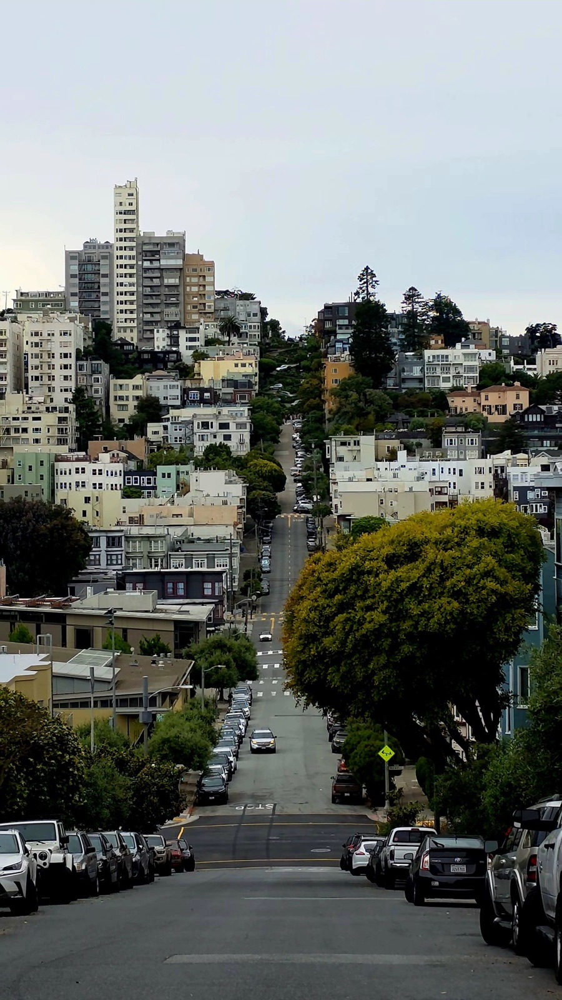

This time I stayed at a hostel near Chinatown. I met so many people there, and getting around is super convenient, but you have to climb a lot of stairs.

<iframe src="https://www.google.com/maps/embed?pb=!1m18!1m12!1m3!1d15625.203632773575!2d-122.39214545850696!3d37.79122739905967!2m3!1f0!2f0!3f0!3m2!1i1024!2i768!4f13.1!3m3!1m2!1s0x8085808afe14c073%3A0x604d24036e9bd240!2sITH%20San%20Francisco%20Pacific%20Tradewinds%20Backpacker%20Hostel!5e0!3m2!1szh-TW!2stw!4v1780108586724!5m2!1szh-TW!2stw" width="600" height="450" style="border:0;" allowfullscreen="" loading="lazy" referrerpolicy="no-referrer-when-downgrade"></iframe>

Since it was already around 4 p.m. by the time I headed out, I decided to go to the famous Pier 39. There are lots of markets, stalls, and street performers, plus a ton of sea lions.

<iframe src="https://www.google.com/maps/embed?pb=!1m18!1m12!1m3!1d7773.3945502383685!2d-122.41622319479029!3d37.806794134532865!2m3!1f0!2f0!3f0!3m2!1i1024!2i768!4f13.1!3m3!1m2!1s0x808580fc8bb3211d%3A0xbaf631600de6b39e!2zMznomZ_norzpoK0!5e0!3m2!1szh-TW!2stw!4v1780108842213!5m2!1szh-TW!2stw" width="600" height="450" style="border:0;" allowfullscreen="" loading="lazy" referrerpolicy="no-referrer-when-downgrade"></iframe>

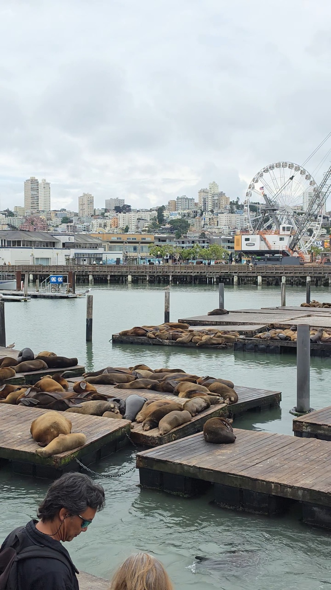

You can also see Alcatraz from here. The currents are really strong, so swimming across would be incredibly hard, and the weather is freezing too.

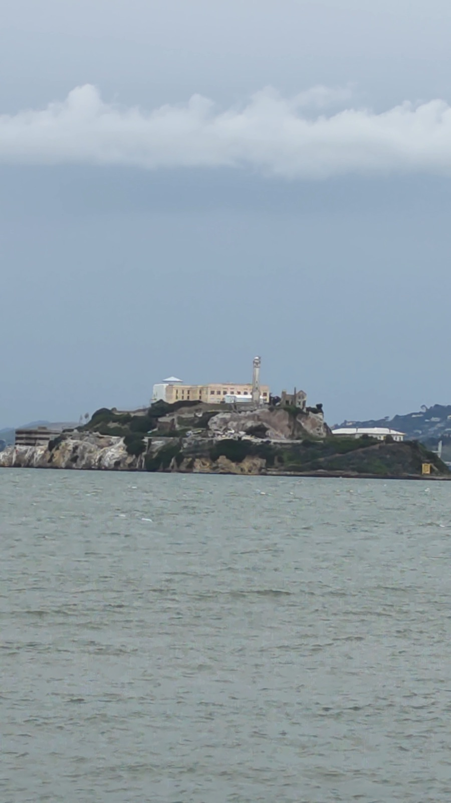

On the very first night I made friends from Vietnam and Korea, and we drank until we were pretty wasted.

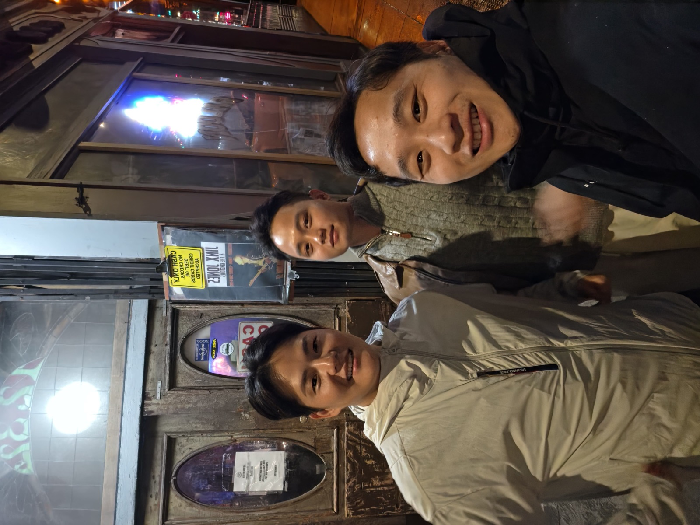

# Day 2

First stop: The Painted Ladies.
The houses are all gorgeous. Living here must be so nice.

<iframe src="https://www.google.com/maps/embed?pb=!1m18!1m12!1m3!1d13254.480120086622!2d-122.44417546547409!3d37.77098564287345!2m3!1f0!2f0!3f0!3m2!1i1024!2i768!4f13.1!3m3!1m2!1s0x808580a524767fb9%3A0x8421d0c06f9e59c5!2z5b2p57mq5aWz5aOr!5e0!3m2!1szh-TW!2stw!4v1780109281109!5m2!1szh-TW!2stw" width="600" height="450" style="border:0;" allowfullscreen="" loading="lazy" referrerpolicy="no-referrer-when-downgrade"></iframe>

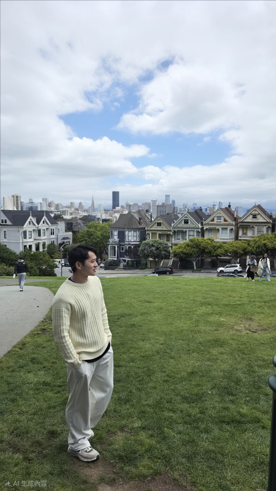

Golden Gate Park was on the way, so I dropped by.
I honestly feel like everything in America is huge. The park is enormous, with tons of museums and gardens inside, and lots of sports fields. No wonder the US has so many great athletes: there are so many places to play.

<iframe src="https://www.google.com/maps/embed?pb=!1m18!1m12!1m3!1d24674.936255696204!2d-122.47156160575088!3d37.769351142426075!2m3!1f0!2f0!3f0!3m2!1i1024!2i768!4f13.1!3m3!1m2!1s0x808587726045f763%3A0x71be8b68ef3ba730!2z6YeR6ZaA5YWs5ZyS!5e0!3m2!1szh-TW!2stw!4v1780109114286!5m2!1szh-TW!2stw" width="600" height="450" style="border:0;" allowfullscreen="" loading="lazy" referrerpolicy="no-referrer-when-downgrade"></iframe>

Last stop was the must-see of San Francisco: the Golden Gate Bridge.
You see a million beautiful photos of it online, and there are lots of different viewpoints to explore. Every one of them is stunning, especially since the weather was great that day!

<iframe src="https://www.google.com/maps/embed?pb=!1m18!1m12!1m3!1d9124.719157261963!2d-122.46694558384861!3d37.801463712991406!2m3!1f0!2f0!3f0!3m2!1i1024!2i768!4f13.1!3m3!1m2!1s0x80858724f3e53865%3A0x549fe1deae649dfa!2sGolden%20Gate%20Postcard%20Viewpoint!5e0!3m2!1szh-TW!2stw!4v1780109452956!5m2!1szh-TW!2stw" width="600" height="450" style="border:0;" allowfullscreen="" loading="lazy" referrerpolicy="no-referrer-when-downgrade"></iframe>

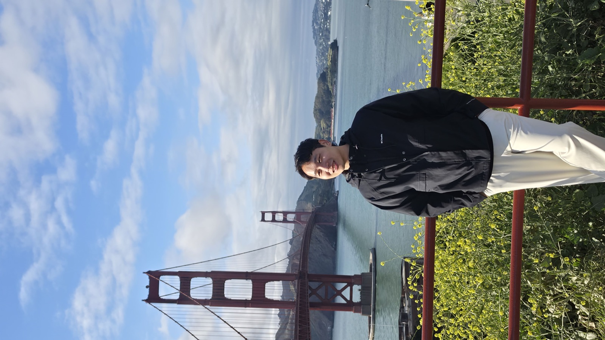

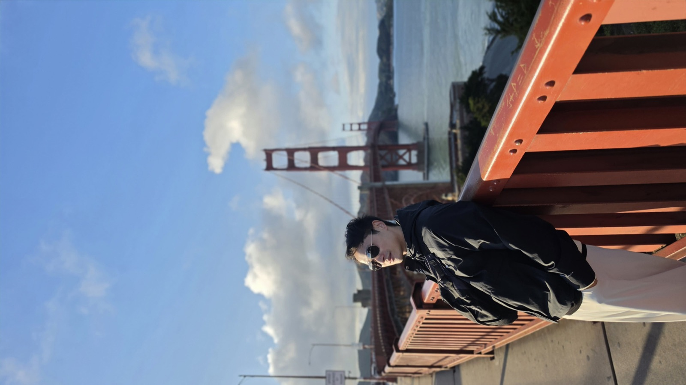

That night the hostel hosted a Taco night where we made our own tacos. Another meal saved!

# Day 3

I headed to the Palace of Fine Arts first thing in the morning. It's beautiful at any time of day. I've seen photos from different times, and the way the sunlight falls on it from different angles always shows off its beauty! Lots of people were doing photoshoots there. I could have sat there all morning!

<iframe src="https://www.google.com/maps/embed?pb=!1m18!1m12!1m3!1d9124.749469682762!2d-122.45943055472002!3d37.80121834397787!2m3!1f0!2f0!3f0!3m2!1i1024!2i768!4f13.1!3m3!1m2!1s0x808586d510144681%3A0xe960db8a581aacf5!2z6Jed6KGT5a6u!5e0!3m2!1szh-TW!2stw!4v1780109554121!5m2!1szh-TW!2stw" width="600" height="450" style="border:0;" allowfullscreen="" loading="lazy" referrerpolicy="no-referrer-when-downgrade"></iframe>

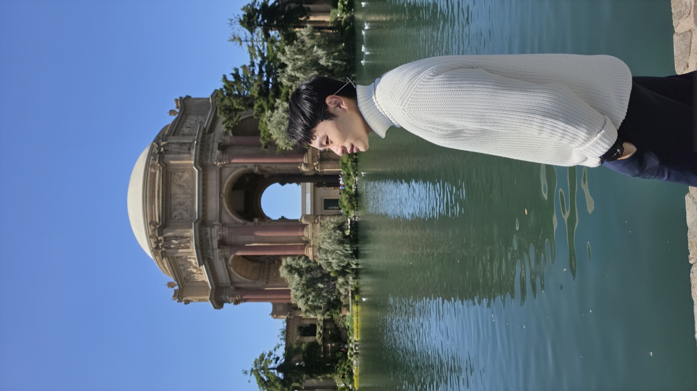

Next up was San Francisco City Hall. Lots of local Chinese couples take their wedding photos here, and plenty of people shoot graduation photos too. It's absolutely gorgeous, with a real Renaissance feel.

<iframe src="https://www.google.com/maps/embed?pb=!1m18!1m12!1m3!1d9155.563755448045!2d-122.4288775742763!3d37.780625890589455!2m3!1f0!2f0!3f0!3m2!1i1024!2i768!4f13.1!3m3!1m2!1s0x808580997aeae663%3A0xb2706dff83574f4a!2z6IiK6YeR5bGx5biC5pS_5buz!5e0!3m2!1szh-TW!2stw!4v1780109748109!5m2!1szh-TW!2stw" width="600" height="450" style="border:0;" allowfullscreen="" loading="lazy" referrerpolicy="no-referrer-when-downgrade"></iframe>

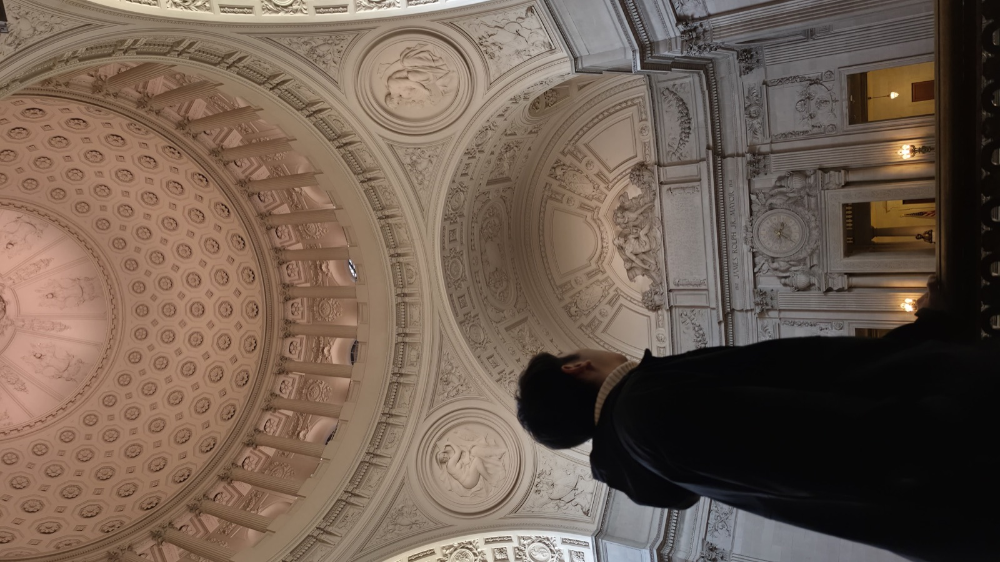

In the evening the hostel held a Kahoot night with all kinds of questions. Only three of us played, but it was really fun!

# Day 4

Went to the farmers market, but a lot of the stalls weren't open

<iframe src="https://www.google.com/maps/embed?pb=!1m18!1m12!1m3!1d18630.0059285191!2d-122.41617399828658!3d37.78350981657871!2m3!1f0!2f0!3f0!3m2!1i1024!2i768!4f13.1!3m3!1m2!1s0x80858066930b3f81%3A0xbccd01da3fa2daa0!2sFerry%20Plaza%20Farmers%20Market!5e0!3m2!1szh-TW!2stw!4v1780110423287!5m2!1szh-TW!2stw" width="600" height="450" style="border:0;" allowfullscreen="" loading="lazy" referrerpolicy="no-referrer-when-downgrade"></iframe>

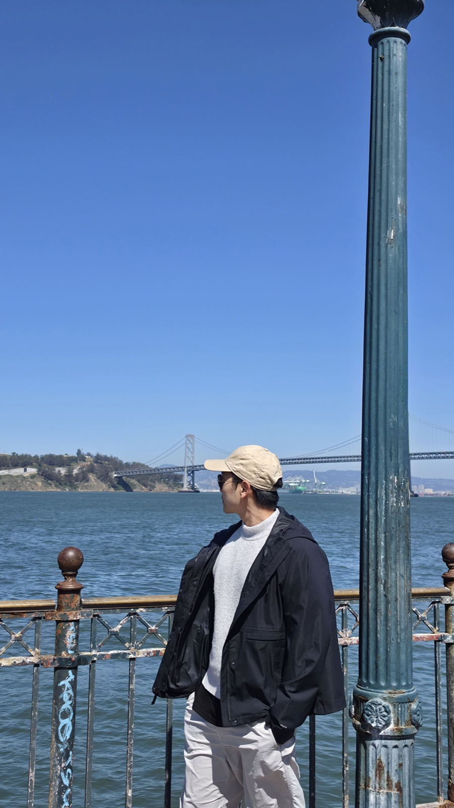

# Day 5

I planned an early-morning trip to Twin Peaks, but it was a bad call: crazy wind and really thick clouds. On a clear day it would definitely be amazing.

<iframe src="https://www.google.com/maps/embed?pb=!1m18!1m12!1m3!1d28977.824982131155!2d-122.43956927139061!3d37.7666091304477!2m3!1f0!2f0!3f0!3m2!1i1024!2i768!4f13.1!3m3!1m2!1s0x808f7de2acf071b7%3A0xb2cfa1c901ae6e6d!2z6ZuZ5bOw!5e0!3m2!1szh-TW!2stw!4v1780110106764!5m2!1szh-TW!2stw" width="600" height="450" style="border:0;" allowfullscreen="" loading="lazy" referrerpolicy="no-referrer-when-downgrade"></iframe>

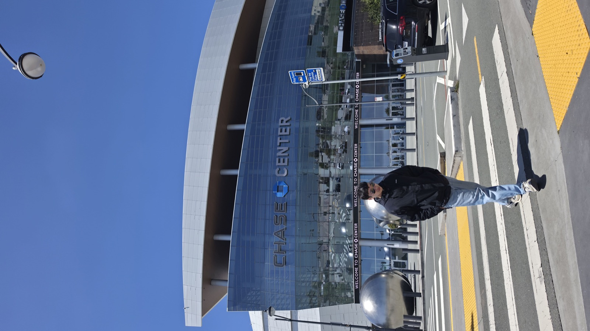

Then I took a ride to Chase Center, the Warriors' home arena and a must for any NBA fan. There was no game, but just browsing the jersey shop and the area around it made me happy.

<iframe src="https://www.google.com/maps/embed?pb=!1m18!1m12!1m3!1d18634.387426136545!2d-122.40375005878298!3d37.76612408280669!2m3!1f0!2f0!3f0!3m2!1i1024!2i768!4f13.1!3m3!1m2!1s0x808f7fc67f4400e9%3A0x7d6793e3d8a141e3!2sChase%20Center!5e0!3m2!1szh-TW!2stw!4v1780110175144!5m2!1szh-TW!2stw" width="600" height="450" style="border:0;" allowfullscreen="" loading="lazy" referrerpolicy="no-referrer-when-downgrade"></iframe>

In the afternoon I took my time exploring every corner of the city.

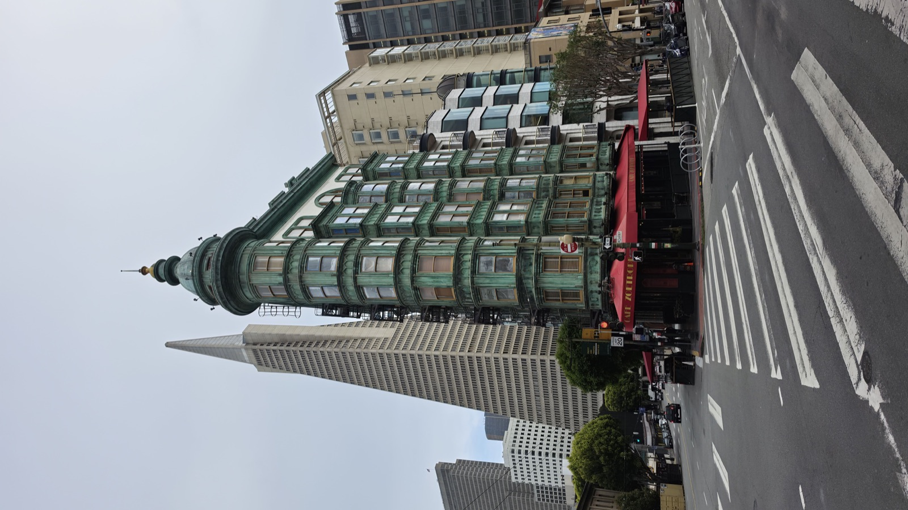

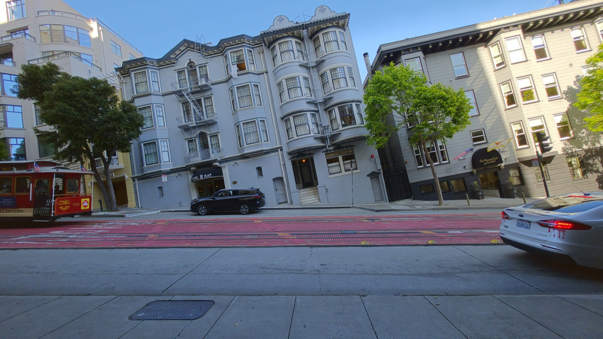

It was Friday night, and the hostel had a BBQ. Another meal saved!

# Day 6

Packed up in the morning to head back to Taiwan. Thank you, beautiful San Francisco, for the wonderful memories.

# Thoughts

San Francisco is incredibly hilly and surrounded by skyscrapers, and you can clearly feel that it's a tech hub. Self-driving cars like Waymo are everywhere here, and a lot of the ads are about AI. Yet it all blends perfectly with 1960s architecture and the retro cable cars. The weather always felt cool, even a bit cold. Even with the sun out, it gets chilly once the wind picks up. Things here are shockingly expensive too: transport, accommodation, and food all cost a lot. As for safety, I stayed next to Chinatown and felt very safe. You rarely see "zombies" or sketchy people here. There are still some, but far fewer than in Seattle. This is the place where I've seen the most Asians. The hostel here is where I met the most people, and the most diverse mix of people, of anywhere I've stayed. I really felt part of this city.
