> 常常在電腦桌布看到的背景，就在我眼前
> 目前在美國遇到華人最多的城市

旅遊影片回憶

<iframe class="yt short" src="https://www.youtube-nocookie.com/embed/07emnMyN5OI" title="YouTube video" loading="lazy" allow="accelerometer; clipboard-write; encrypted-media; gyroscope; picture-in-picture; web-share" referrerpolicy="strict-origin-when-cross-origin" allowfullscreen></iframe>

# Day 1

因為Boise飛San Francisco的班機大誤點，整個抵達時間延後了將近4個小時。下午2點才抵達。
所以建議如果從其他州要來舊金山轉機回台灣或回其他國家，需要提早更多時間。

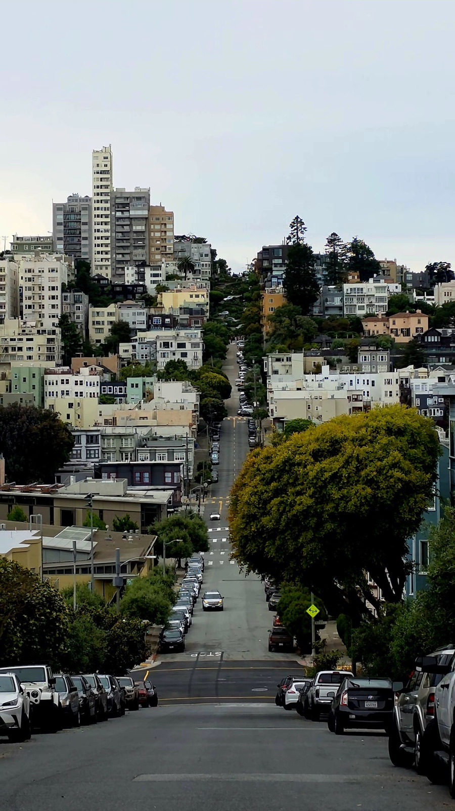

這次我入住Chinatown 附近的青旅。在這青旅認識超多人，這裡交通也非常方便，但是要爬很多階梯。

<iframe src="https://www.google.com/maps/embed?pb=!1m18!1m12!1m3!1d15625.203632773575!2d-122.39214545850696!3d37.79122739905967!2m3!1f0!2f0!3f0!3m2!1i1024!2i768!4f13.1!3m3!1m2!1s0x8085808afe14c073%3A0x604d24036e9bd240!2sITH%20San%20Francisco%20Pacific%20Tradewinds%20Backpacker%20Hostel!5e0!3m2!1szh-TW!2stw!4v1780108586724!5m2!1szh-TW!2stw" width="600" height="450" style="border:0;" allowfullscreen="" loading="lazy" referrerpolicy="no-referrer-when-downgrade"></iframe>

因為出發已經是下午4點左右，決定去著名的Pier39，這裡有許多市集、攤販，也有人在表演，這裡也有很多海豹。

<iframe src="https://www.google.com/maps/embed?pb=!1m18!1m12!1m3!1d7773.3945502383685!2d-122.41622319479029!3d37.806794134532865!2m3!1f0!2f0!3f0!3m2!1i1024!2i768!4f13.1!3m3!1m2!1s0x808580fc8bb3211d%3A0xbaf631600de6b39e!2zMznomZ_norzpoK0!5e0!3m2!1szh-TW!2stw!4v1780108842213!5m2!1szh-TW!2stw" width="600" height="450" style="border:0;" allowfullscreen="" loading="lazy" referrerpolicy="no-referrer-when-downgrade"></iframe>

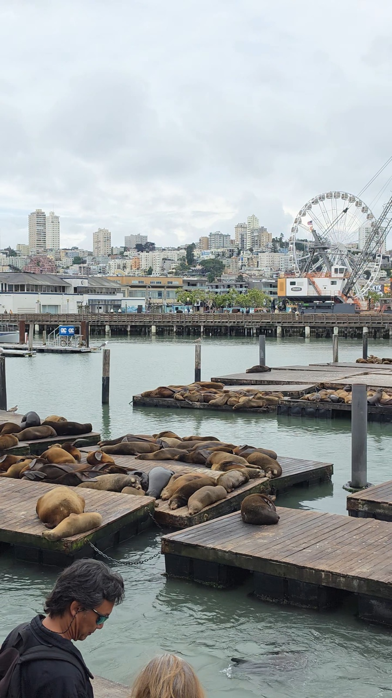

這裡也看得到惡魔島監獄，水流很湍急要游泳渡海非常困難，而且天氣也好冷。

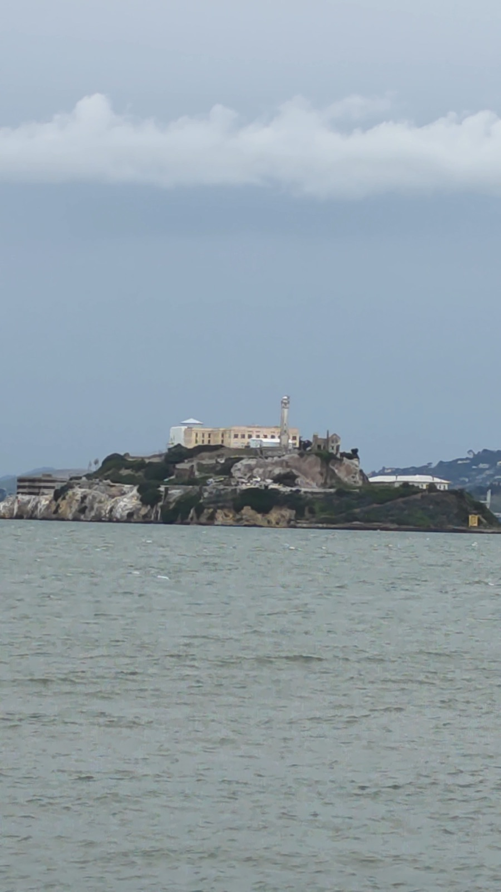

第一天晚上就認識來自越南跟韓國的朋友，一起喝酒到很昏。

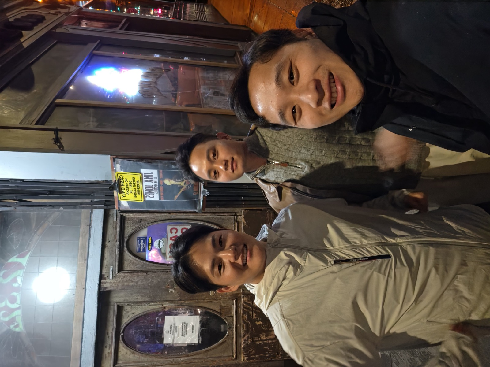

# Day 2

第一站去 The Painted Ladies。
建築物都很美，在這裡生活很舒服。

<iframe src="https://www.google.com/maps/embed?pb=!1m18!1m12!1m3!1d13254.480120086622!2d-122.44417546547409!3d37.77098564287345!2m3!1f0!2f0!3f0!3m2!1i1024!2i768!4f13.1!3m3!1m2!1s0x808580a524767fb9%3A0x8421d0c06f9e59c5!2z5b2p57mq5aWz5aOr!5e0!3m2!1szh-TW!2stw!4v1780109281109!5m2!1szh-TW!2stw" width="600" height="450" style="border:0;" allowfullscreen="" loading="lazy" referrerpolicy="no-referrer-when-downgrade"></iframe>

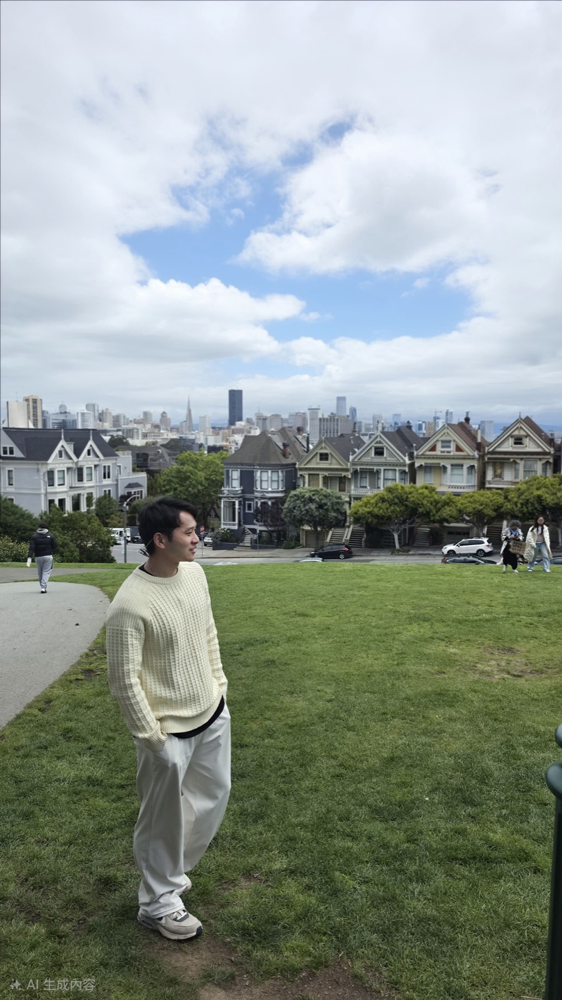

順路去Golden Gate Park。
真心覺得美國每個東西都好大，公園佔地也超大，裡面超多美術館跟園區。很多運動場地，這也是為什麼美國一堆運動好手，很多場地可以運動。

<iframe src="https://www.google.com/maps/embed?pb=!1m18!1m12!1m3!1d24674.936255696204!2d-122.47156160575088!3d37.769351142426075!2m3!1f0!2f0!3f0!3m2!1i1024!2i768!4f13.1!3m3!1m2!1s0x808587726045f763%3A0x71be8b68ef3ba730!2z6YeR6ZaA5YWs5ZyS!5e0!3m2!1szh-TW!2stw!4v1780109114286!5m2!1szh-TW!2stw" width="600" height="450" style="border:0;" allowfullscreen="" loading="lazy" referrerpolicy="no-referrer-when-downgrade"></iframe>

最後去舊金山必來的Golden Gate Bridge。
網路上看到一堆美照，有許多不同的觀景角度可以探索，每個都好美，尤其今天天氣很好！

<iframe src="https://www.google.com/maps/embed?pb=!1m18!1m12!1m3!1d9124.719157261963!2d-122.46694558384861!3d37.801463712991406!2m3!1f0!2f0!3f0!3m2!1i1024!2i768!4f13.1!3m3!1m2!1s0x80858724f3e53865%3A0x549fe1deae649dfa!2sGolden%20Gate%20Postcard%20Viewpoint!5e0!3m2!1szh-TW!2stw!4v1780109452956!5m2!1szh-TW!2stw" width="600" height="450" style="border:0;" allowfullscreen="" loading="lazy" referrerpolicy="no-referrer-when-downgrade"></iframe>

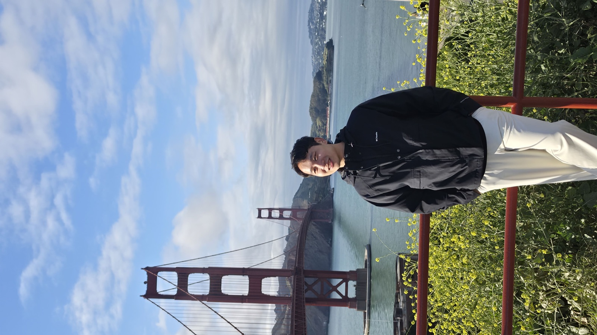

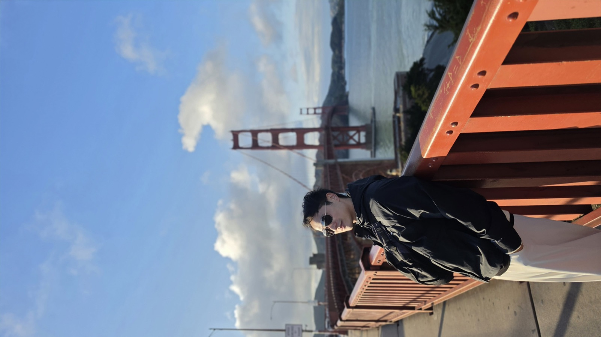

這天晚上民宿舉辦Taco night, 自己做Taco 來吃，又省下一餐

# Day 3

一早前往Palace of Fine Arts，這裡每個時段都很美，我看過不同時間的照片，陽光灑下來，不同角度的光線都能襯托它的美！好多人在這裡外拍，我可以在這裏坐一個早上！

<iframe src="https://www.google.com/maps/embed?pb=!1m18!1m12!1m3!1d9124.749469682762!2d-122.45943055472002!3d37.80121834397787!2m3!1f0!2f0!3f0!3m2!1i1024!2i768!4f13.1!3m3!1m2!1s0x808586d510144681%3A0xe960db8a581aacf5!2z6Jed6KGT5a6u!5e0!3m2!1szh-TW!2stw!4v1780109554121!5m2!1szh-TW!2stw" width="600" height="450" style="border:0;" allowfullscreen="" loading="lazy" referrerpolicy="no-referrer-when-downgrade"></iframe>

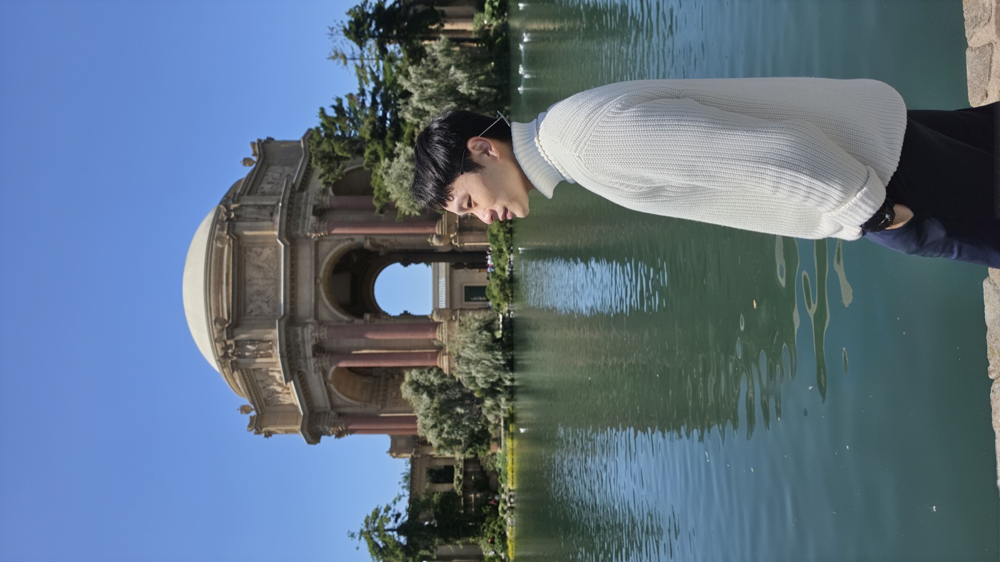

接著前往舊金山市政廳。很多當地華人在這裡拍婚紗，也好多人在這裡拍畢業照，真的超級美，主要是真的非常有文藝復興感。

<iframe src="https://www.google.com/maps/embed?pb=!1m18!1m12!1m3!1d9155.563755448045!2d-122.4288775742763!3d37.780625890589455!2m3!1f0!2f0!3f0!3m2!1i1024!2i768!4f13.1!3m3!1m2!1s0x808580997aeae663%3A0xb2706dff83574f4a!2z6IiK6YeR5bGx5biC5pS_5buz!5e0!3m2!1szh-TW!2stw!4v1780109748109!5m2!1szh-TW!2stw" width="600" height="450" style="border:0;" allowfullscreen="" loading="lazy" referrerpolicy="no-referrer-when-downgrade"></iframe>

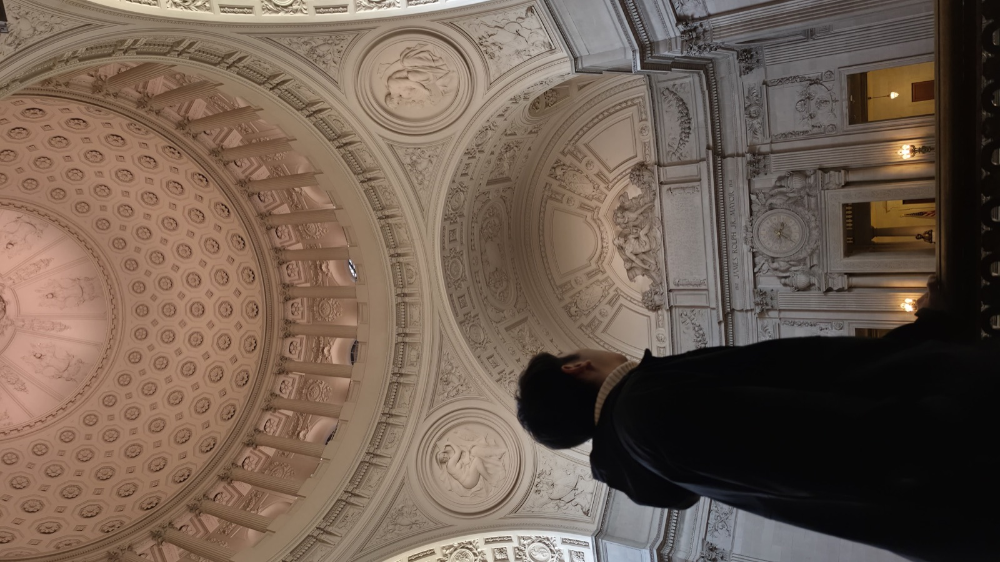

晚上青旅舉辦Kahoot night，題目非常多樣，雖然只有三個人比賽，但真的很好玩！

# Day 4

前往農夫市集，但很多都沒開

<iframe src="https://www.google.com/maps/embed?pb=!1m18!1m12!1m3!1d18630.0059285191!2d-122.41617399828658!3d37.78350981657871!2m3!1f0!2f0!3f0!3m2!1i1024!2i768!4f13.1!3m3!1m2!1s0x80858066930b3f81%3A0xbccd01da3fa2daa0!2sFerry%20Plaza%20Farmers%20Market!5e0!3m2!1szh-TW!2stw!4v1780110423287!5m2!1szh-TW!2stw" width="600" height="450" style="border:0;" allowfullscreen="" loading="lazy" referrerpolicy="no-referrer-when-downgrade"></iframe>

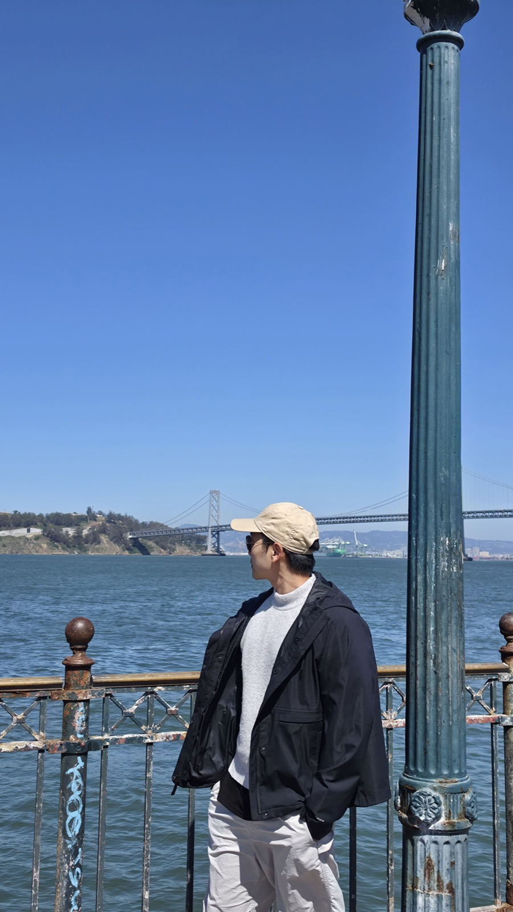

# Day 5

一大早規劃去Twin Peaks，結果失策，風超大，雲層非常厚，不然天氣好一定超美。

<iframe src="https://www.google.com/maps/embed?pb=!1m18!1m12!1m3!1d28977.824982131155!2d-122.43956927139061!3d37.7666091304477!2m3!1f0!2f0!3f0!3m2!1i1024!2i768!4f13.1!3m3!1m2!1s0x808f7de2acf071b7%3A0xb2cfa1c901ae6e6d!2z6ZuZ5bOw!5e0!3m2!1szh-TW!2stw!4v1780110106764!5m2!1szh-TW!2stw" width="600" height="450" style="border:0;" allowfullscreen="" loading="lazy" referrerpolicy="no-referrer-when-downgrade"></iframe>

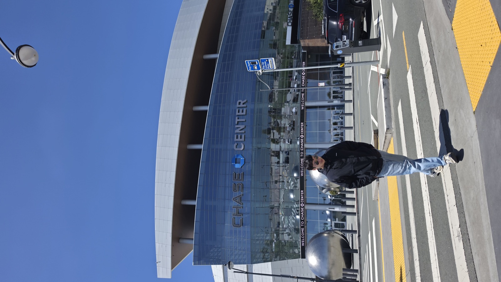

接著坐車到NBA球迷必去的勇士主場Chase Center，雖然沒有比賽，但是逛逛內部的球衣店跟周邊就很滿足。

<iframe src="https://www.google.com/maps/embed?pb=!1m18!1m12!1m3!1d18634.387426136545!2d-122.40375005878298!3d37.76612408280669!2m3!1f0!2f0!3f0!3m2!1i1024!2i768!4f13.1!3m3!1m2!1s0x808f7fc67f4400e9%3A0x7d6793e3d8a141e3!2sChase%20Center!5e0!3m2!1szh-TW!2stw!4v1780110175144!5m2!1szh-TW!2stw" width="600" height="450" style="border:0;" allowfullscreen="" loading="lazy" referrerpolicy="no-referrer-when-downgrade"></iframe>

下午時間，開始慢慢探索這個城市的每個角落。

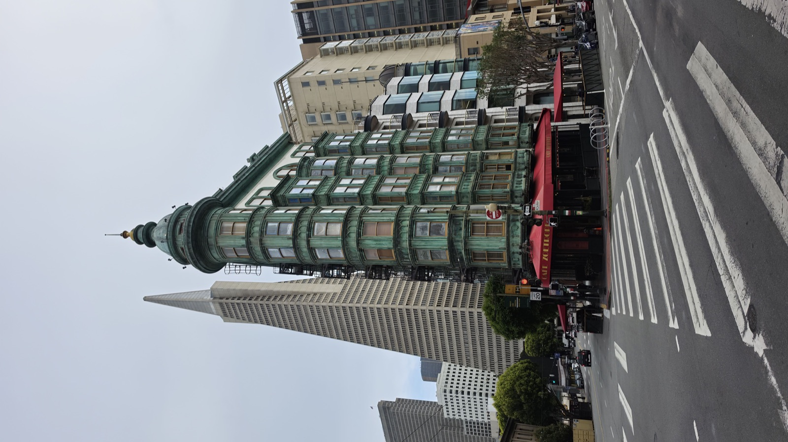

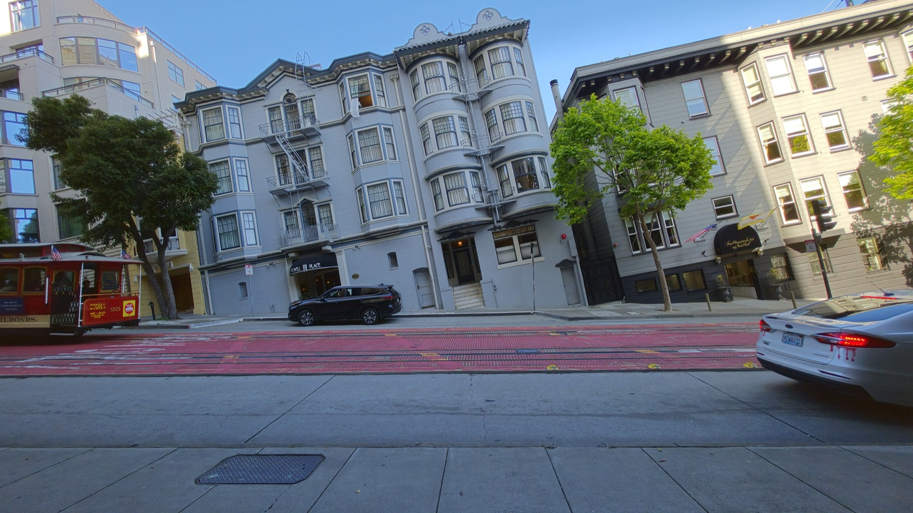

晚上是Friday night, 青旅有BBQ活動，又省下一餐。

# Day 6

一早準備行李回台灣，謝謝美麗的San Francisco給我美好的回憶。

# 心得

舊金山地勢高低起伏超級劇烈，周圍許多高樓大廈，明顯感受到是科技發展中心，Waymo等自動駕駛在這非常密集廣泛使用，廣告宣傳也有許多跟AI科技相關，但又跟1960年代的建築、復古的叮叮車完美整併，天氣一直都感覺涼偏冷，儘管有陽光但風一來還是很冷，在這裡的花費也很驚人，交通、住宿、飲食都很高。說到治安，我住在Chinatown旁邊，感受很安全，這裡很少看到殭屍或是奇怪的人，雖然還是有但比在西雅圖少很多，這裡是我看到最多亞洲人的地方。在這裡的民宿是我待過認識最多人、最多元的地方。非常融入這片城市。