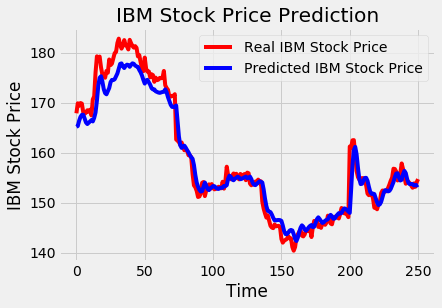
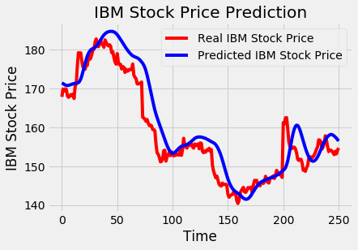
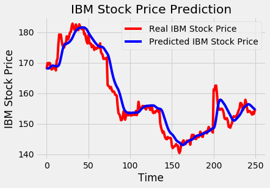

> Using three different deep learning methods (RNN, LSTM, GRU) to predict IBM's stock price trend and compare them

[Code + report PDF : Click On Me](https://github.com/LawrenceGao0224/data_mining/tree/main/datamining_final)

# Introduction 
---

When ordinary investors put money into financial products, they often end up losing big and winning small, because they tend to follow the news and their impulses, or jump in without any careful evaluation or analysis. Analyzing all kinds of economic information on your own means collecting a huge amount of related data, which is not only very time-consuming but also requires a lot of professional financial knowledge — and the predicted trends still aren't necessarily accurate. On top of that, economic indicators usually lag behind the market.
Meanwhile, artificial intelligence is booming and being applied in many fields, especially finance, where predicting with neural networks has become quite popular. With the speed of computers and multi-layer neural networks, AI can help investors make predictions. 

---

# Workflow and Results

[Data source Kaggle : Click On Me](https://www.kaggle.com/szrlee/stock-time-series-20050101-to-20171231)

## Workflow : 

In this experiment, we used Keras to build the deep learning models, made predictions with RNN, LSTM, and GRU respectively, and used root mean square error (RMSE) as the evaluation metric.

## Results:

(1)LSTM:
RMSE:2.5459669921977524.

(2)RNN:
RMSE: 4.72949126626088.

(3)GRU:
RMSE: 3.3223451158225696.

---

# Analysis and Discussion

From the charts above, you can see the trends we predicted are close to what actually happened, with LSTM performing best and RNN worst. Our guess is that RNN only considers the most recent state, while LSTM has a more complex structure that concatenates past outputs with the current input. In reality, stock price movements usually aren't just related to the previous day's price, but to price changes throughout history.
