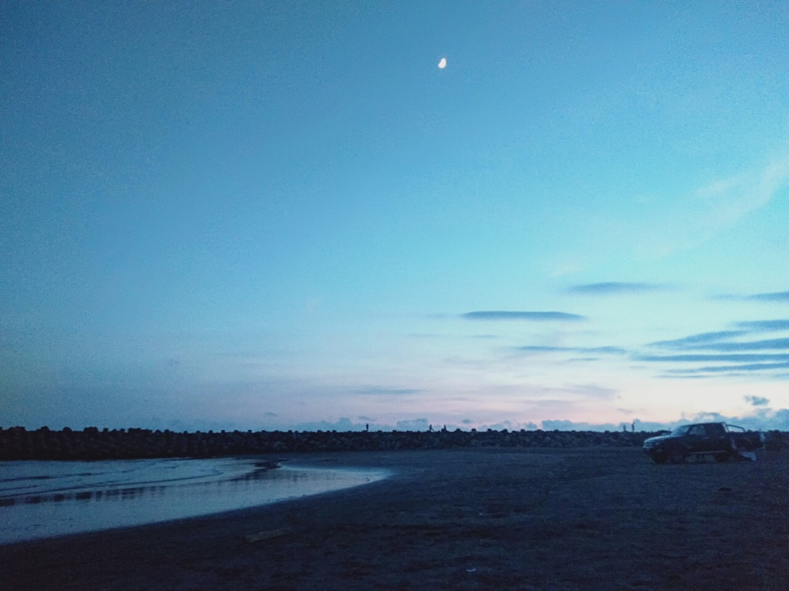
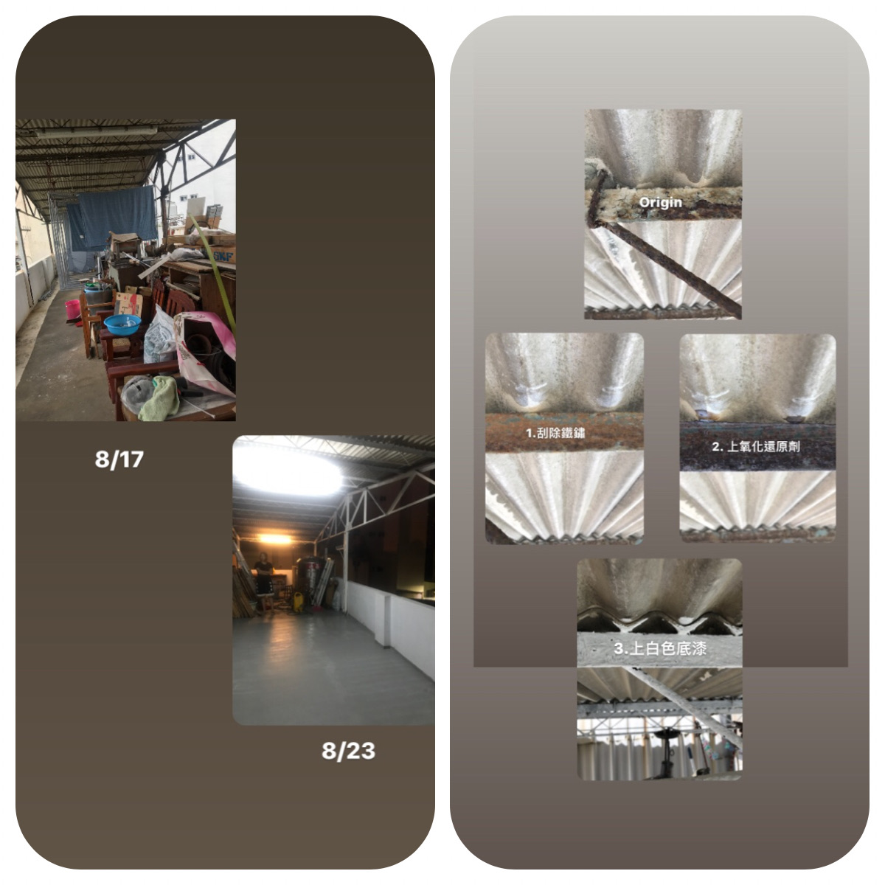
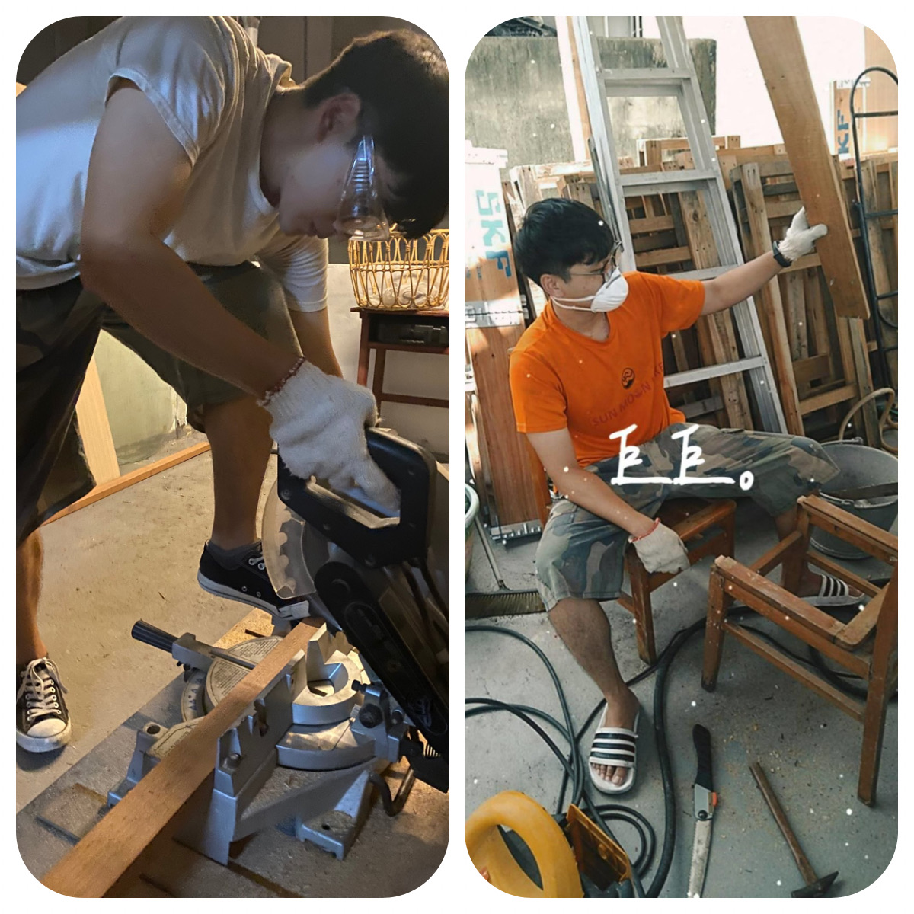
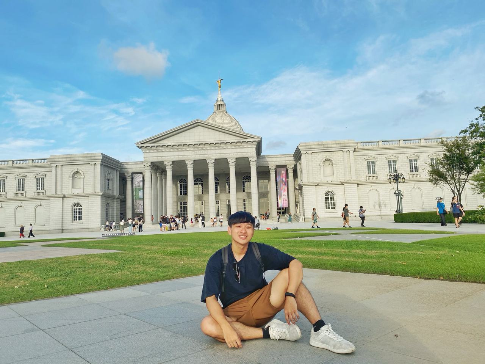
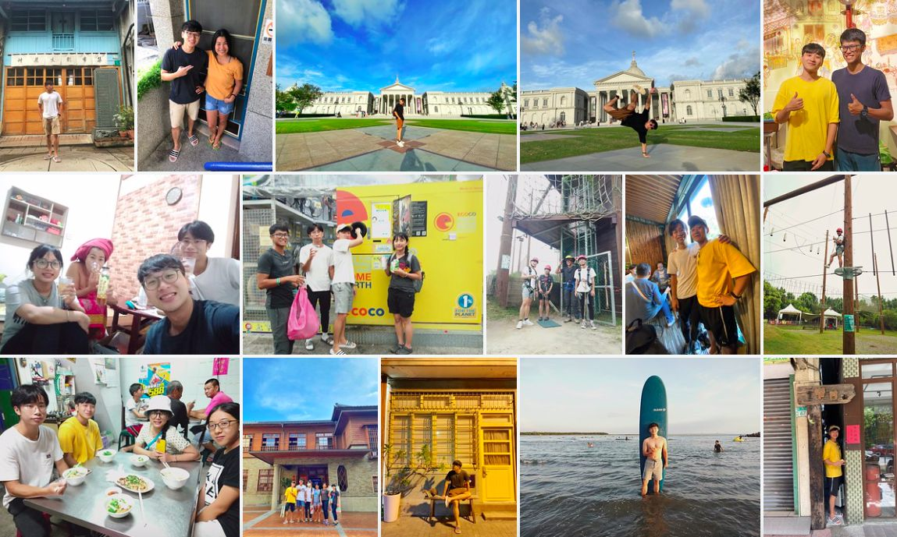

> I originally came to explore Tainan while waiting for my military service, lend a hand as a helper, and try all the Tainan food
> I never expected to learn woodworking, painting, and interior design, things I'll probably never touch again 🚪
> Everyone loves speaking Taiwanese, so I tried to keep up with my broken Taiwanese (it's getting a little better)
> Reggie taught us all kinds of skills, and even how to surf 🏄! He can do everything! A true idol!
> Every night, Candy's "chicken soup for the soul" taught us life lessons, teamwork, and learning from mistakes. She's a life mentor and a friend for life
> The other helpers each had their own personality and a willingness to give, and together we pulled off this project

---

# Working

Our mission this time:
1. Mainly to clean up the rooftop terrace and turn it into a social space 
2. Also housekeeping, cleaning, and so on

 

---

# Holiday

Tainan has quite a lot of sights. On the second night, the owner took us on a deep dive around Tainan and told us the history of each building
Temple architecture I never used to pay any attention to now seems so amazing, and it made me even more interested in Taiwan's history
Starting from the 24hr Donuts at the Tainan roundabout, we walked past Taiwan's first temple, Snail Alley, the Tainan Prefecture Hall, Chuan Mei Theater, Tainan Art Museum Buildings 1 and 2, the Judicial Museum, Hayashi Department Store, and more (not in that order)
I was in awe of the sites and wisdom our ancestors left behind
During our stay, the owner took us surfing at Yuguang Island two weekend days in a row. My first-ever surf session goes to you guys! And on the second day I actually stood up twice. So happy ^^
A few days later we went to the Chimei Museum, but we got there at 5 p.m. and it closed at 5:30, so we took photos outside the building with the huge, beautiful view. The museum covers 9.5 hectares and holds countless precious world-class artworks. It's the most beautiful museum Mr. Shi Wen-long left to Tainan

---

# Working Holiday
This work exchange taught me a lot, both technical skills and personal growth 
Reggie, the owner of the guesthouse, is only 6 years older than me, but his way of thinking, life experience, and the way he enjoys life are goals that still feel far out of reach for me
He also found a huge blue-ocean market and came up with really creative goals
I also dream of doing what I love like he does, and I hope to keep moving toward my goals!
On top of that, the one leading us was Candy, owner of another surf shop (in Wushi, Yilan). She has a ton of experience in team management and is also a lecturer at many universities
Every night she gave us so much knowledge and taught us how to be a good person and get along with others. She made me realize the kind of thoughtfulness I'd always overlooked. Her chicken soup for the soul fed our hungry minds!

> Thank you, At The End, for the valuable work exchange experience!
> #巷仔邸At The End #helper #Tainan #ChimeiMuseum #YuguangIsland #LearningTaiwanese #WorkingMan #WaitingForMilitaryService
