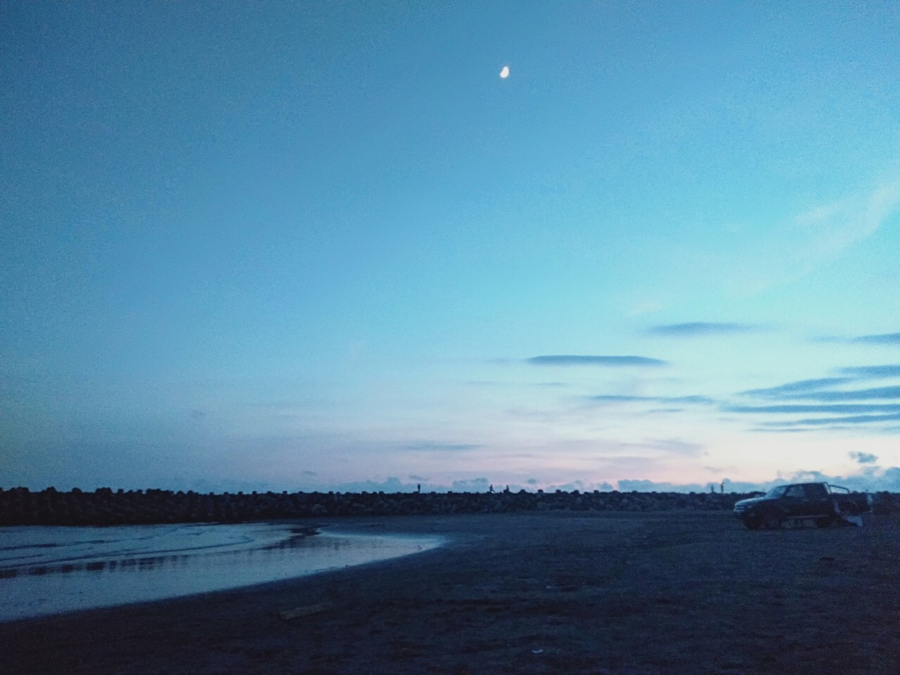
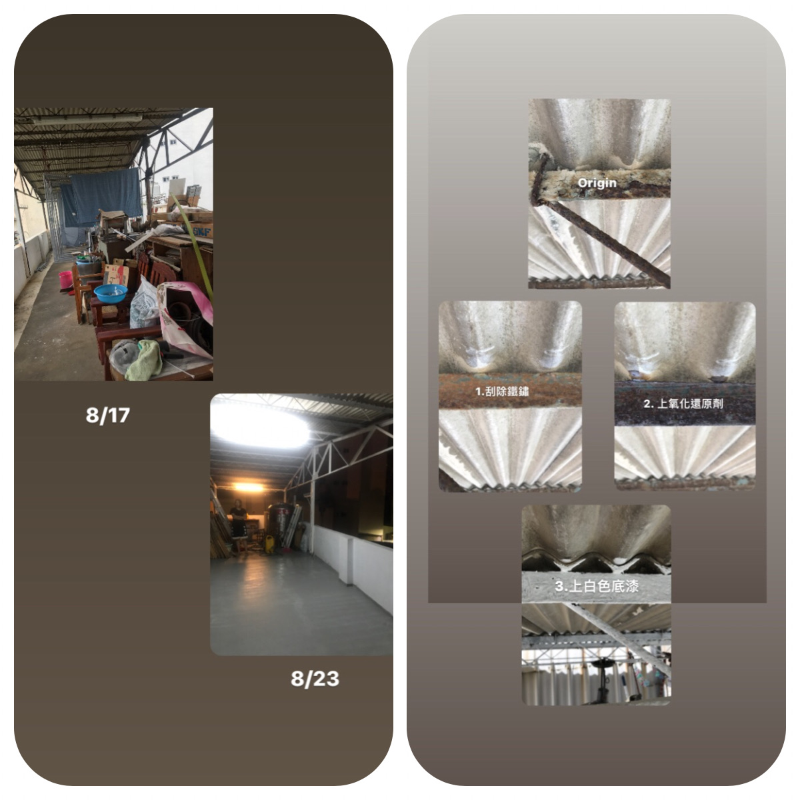
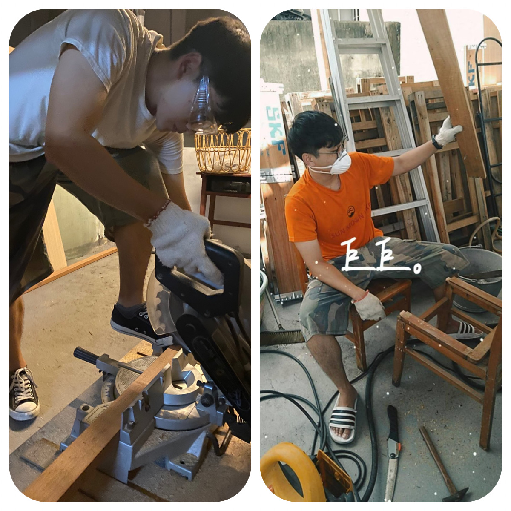
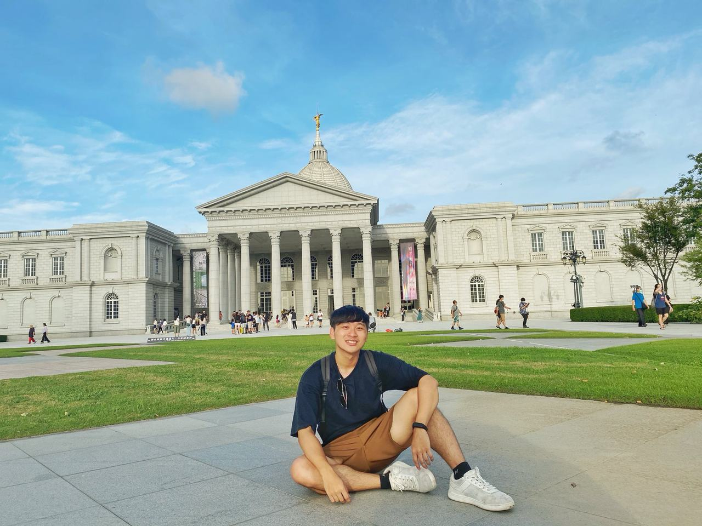
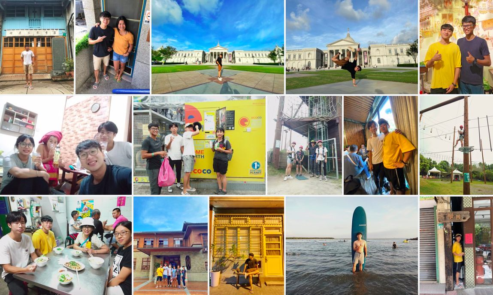

> 原本抱著等待兵役空檔玩台南順便當個老幫手 同時體驗台南美食
> 沒想到學習以後可能不會再接觸到的木工、油漆及裝潢設計等 🚪
> 大家愛恭台語 我就操玲呆(有點進步)
> Reggie教導我們各項技術還有如何衝浪🏄！他什麼都會！真的是偶像！
> 每晚Candy的心靈雞湯 學習人生經驗 團隊合作及錯中學習 是人生的導師也是永遠好的朋友
> 其他小幫手 每個都有自己的特色 以及願意付出的心 成就這次的工程

---

# 工作

本次的任務：
1. 主要是將頂樓天臺整理並規劃成交誼的空間 
2. 同時整理房務工作打掃等

 

---

# 度假

台南的景點還滿多的，在第二天晚上，老闆帶著我們深度探索台南，同時介紹每個建築物的歷史
以前從來不會特別去在意的廟宇建築外觀，現在都覺得好神奇，讓我對台灣的歷史更有興趣
從台南圓環24hr Donuts，沿路走經過台灣第一間廟、蝸牛巷、台南州廳、全美戲院、台南美術館1、2館、司法博物館、林百貨等（沒按照順序）
對先人留下的遺址及智慧讚嘆不已
期間老闆帶我們連續兩天假日去漁光島衝浪，生平第一次衝浪就獻給你們了，不過我第二天就站起來兩次，超開心＾＾
幾日後前往奇美博物館，到的時候已是下午5點，5:30就關門，因此在建築外與這大片美景拍照，佔地9.5公頃的博物館，典藏無數珍貴的國際級藝術品，許文龍先生留給台南最美的博物館

---

# Working Holiday
這次的換宿經驗讓我學到不論是技術上的技巧更是心靈上的成長 
民宿店的老闆Reggie，雖然只大我6歲，但想法、人生歷練、享受人生都是我遙不可及的目標
更發現大片藍海市場，想到極為可創性的目標
我自己也憧憬能像他做自己喜歡的事的念頭 期許未來能更往目標前進！
此外，帶領我們的是另一位衝浪店（宜蘭烏石）的老闆Candy，對於團隊管理非常有經驗，還是許多大學的講師
每晚給我們滿滿的知識與做人處事的道理，讓我意識到過去一直忽略掉的貼心，心靈雞湯溫飽我們求知的心!

> 謝謝巷仔邸換宿帶給我寶貴的經驗！
> #巷仔邸At The End #小幫手 #台南 #奇美博物館 #漁光島 #學台語 #做工的人 #等待兵役
