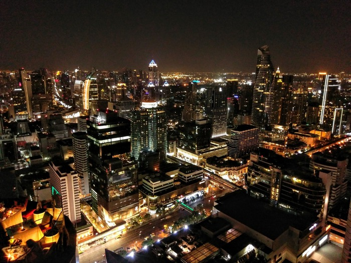
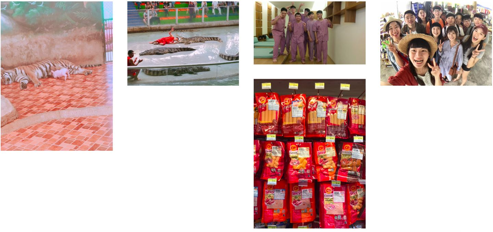
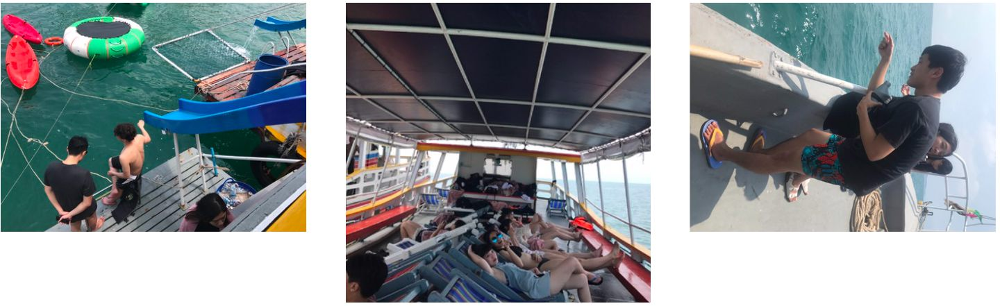
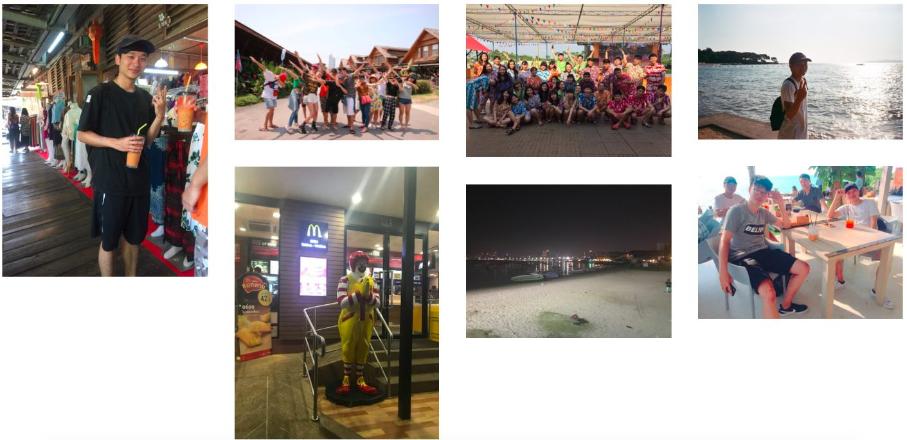
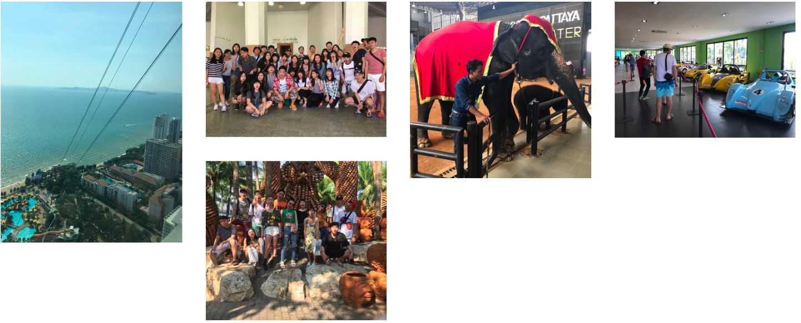
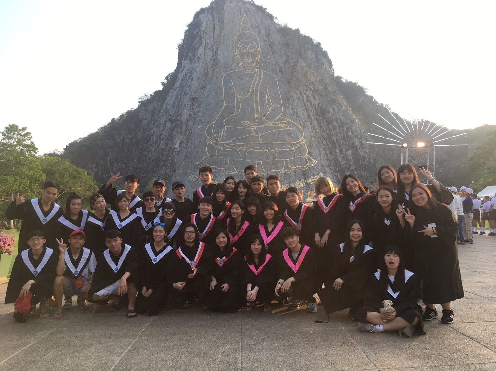
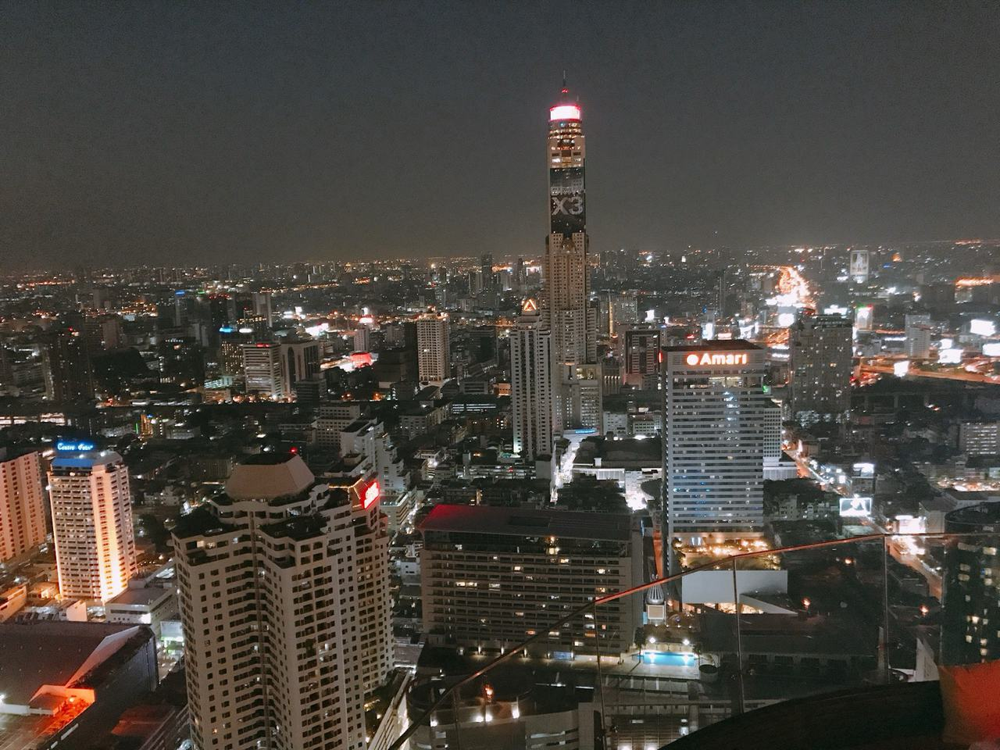
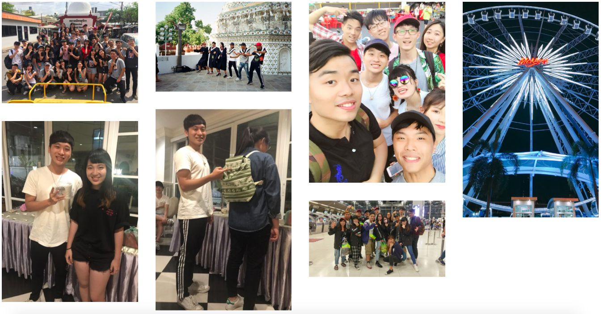

> My first trip abroad ever, and my first college graduation trip
> I got to experience the spice of Thai food, the strength of Thai massage, the heat of Thai weather, and the charm of Thai culture
> I just got back and I already miss everything about Thailand. I made lots of friends (our tour group included students from Fu Jen, Chung Yuan, and Soochow universities) — everyone was fun and easy to get along with. Thanks to our tour leader and guide for taking care of us. Can't wait to travel together again, and I hope everyone achieves their dreams in the future

---

# Itinerary

This trip was planned and arranged by Da Le Travel (大樂旅行社)

[Itinerary : Click On Me](https://drive.google.com/file/d/0B_MUcnppdaa7VWM0SmxFWHVISkU/view?usp=sharing&resourcekey=0-5oMlViKCfi0GSGR7omYBqw)

---

# Before You Go

Even though February and March are the tail end of winter in Taiwan, Thailand (Bangkok, Pattaya) stays around 25–35°C all year. Light short sleeves and shorts are all you need, bringing a few thin long-sleeve tops is a good idea, and you definitely can't skip sun protection

---

# TRAVEL

## Day 1,2

On the first night our flight didn't take off until 11pm, and by the time we landed in Bangkok it was already 2 or 3am, so we slept straight through until 9
On day two we hopped on the tour bus first thing in the morning and headed to Pattaya. The first stop was a local zoo, famous for its crocodile show, a pig that drinks tiger milk, pig races, and a pig that can do math. In the afternoon we went to a sauna (I remember it was also results day for a lot of grad school admissions — checking which schools I got into and which I didn't in the middle of a show was quite the thrill). After a big meal we went straight back to the hotel, rested a bit, then headed out to the nearby 7-Eleven and food stalls. The 7-Eleven toasted sandwiches were the tastiest and most memorable thing for me.

## Day 3

We got up and took the tour bus straight to the Pattaya beach and spent half the day out on the sea. The boat had water activities, we ate seafood on board for lunch, belted out party songs, and then did some fishing. Afterward we went back to the hotel to freshen up and headed to a local nightclub (the first time in my life I'd been to one). Smoking wasn't allowed inside. The night was wild — whisky and Coke, drinking games with the Chung Yuan students, dancing on stage — and it felt like Taiwanese people had booked out the whole place, because every song was in Chinese

## Day 4

This morning we went to the Four Regions Floating Market (Pattaya Floating Market), and in the afternoon Nong Nooch Tropical Garden for a huge water fight where everyone went all out. Afterward we chilled by the sea and enjoyed the view, where I got called out to dance solo. Dinner was Thai barbecue hotpot, and then we wandered the shops along the Pattaya beachfront (Walking Street), full of all kinds of people. After that we went with our guide to eat fruit (mangosteen, durian, rambutan) and headed back to the hotel. There was an optional Thai bath outing at night

## Day 5

First we did a "sky slide" off a 55-story building. In the afternoon we visited what was supposedly the home of a very, very, very rich landowner — he owns the whole mountain, and the place is packed with supercars and decorations, plus an elephant show in the park. Then it was off to a sauna again, but we didn't pay for the extra time, so I hung out outside with my Fu Jen friends while waiting for everyone else. After that we watched Muay Thai, and in the evening a ladyboy cabaret show

## Day 6

We were worn out from the last two days, so it was time for a more laid-back walking-and-shopping schedule. Back in Bangkok, we took the train from Terminal 21 to their department stores, with the famous Erawan Shrine (Four-Faced Buddha) nearby. After a full day of shopping, in the afternoon we went to Khao Chi Chan (the Buddha Mountain) to take graduation photos (that night I bought an H&M shirt for 1,799 THB — it's even cheaper in Taiwan -_-). In the evening we enjoyed the view at the sky bar

 

## Day 7

The trip was coming to an end. In the morning we went shopping at Chatuchak market. Pipi (our tour leader) came up with the idea of a gift exchange, so we bought gifts for that night. I got a bunch of menthol inhalers (super famous in Taiwan) to clear your nose (100 THB) and a dreamcatcher (190 THB), and I also helped a friend pick out decorative string lights for his girlfriend. In the afternoon we took a boat to visit Wat Arun. They say when you feed bread to the fish in the river, you say "💰money, money," and it means you'll make a fortune. In the evening we went straight to a store partnered with the travel agency and went on a snack spree — I spent almost 1,500 THB on Pocky, seaweed snacks, candy, dried fruit... Finally we checked out the night market at Mekkog, and for dinner we had Thai Hainanese chicken rice across the street — so good, I couldn't stop raving about it! After everything wrapped up, we rested in our rooms for a bit and then met in the lobby for the gift exchange. We got called out to dance solo again, and I traded a bag with Thai patterns for a Thai elephant mug
Back in our rooms, we went to play cards with the others until after 3am, right up until it was time to catch our flight. The flight was a little after 6am, and that was the end of the trip~

---

> I came back with a terrible cold... but Thailand was so much fun
