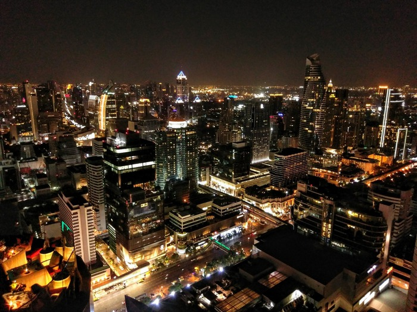
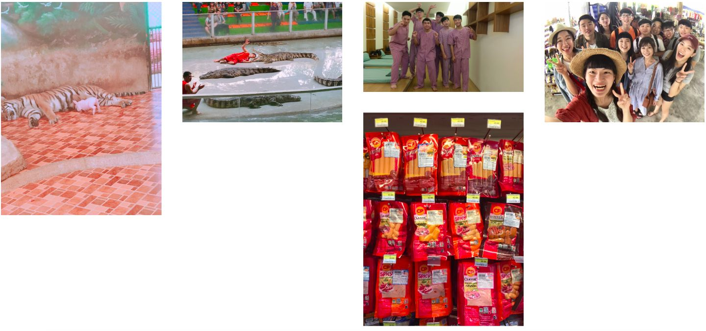
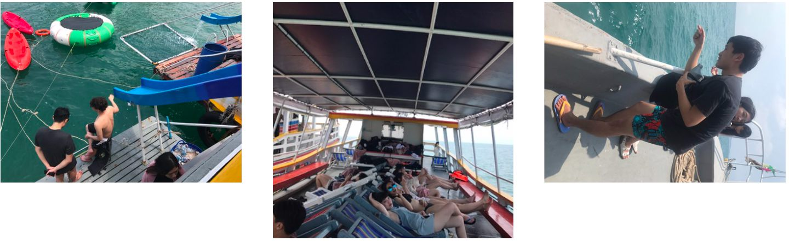
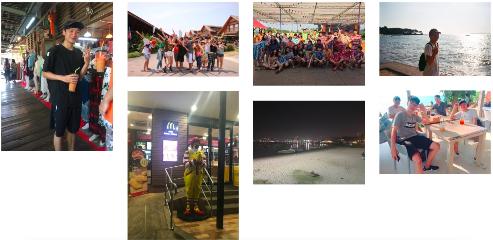
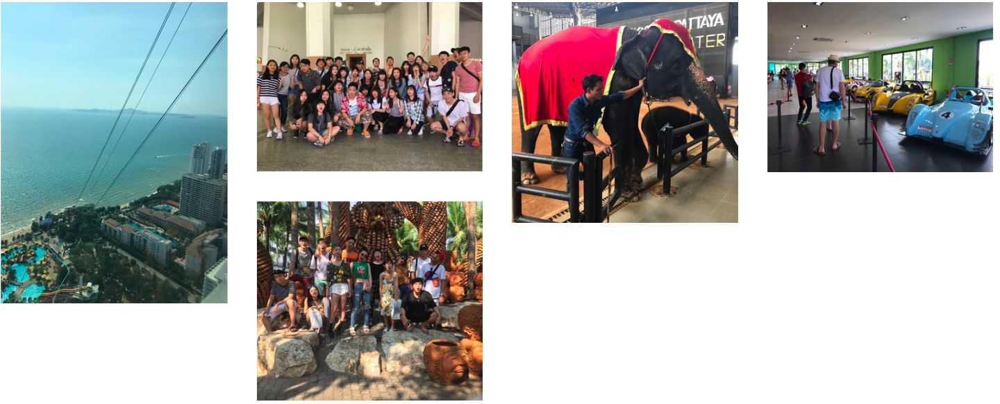
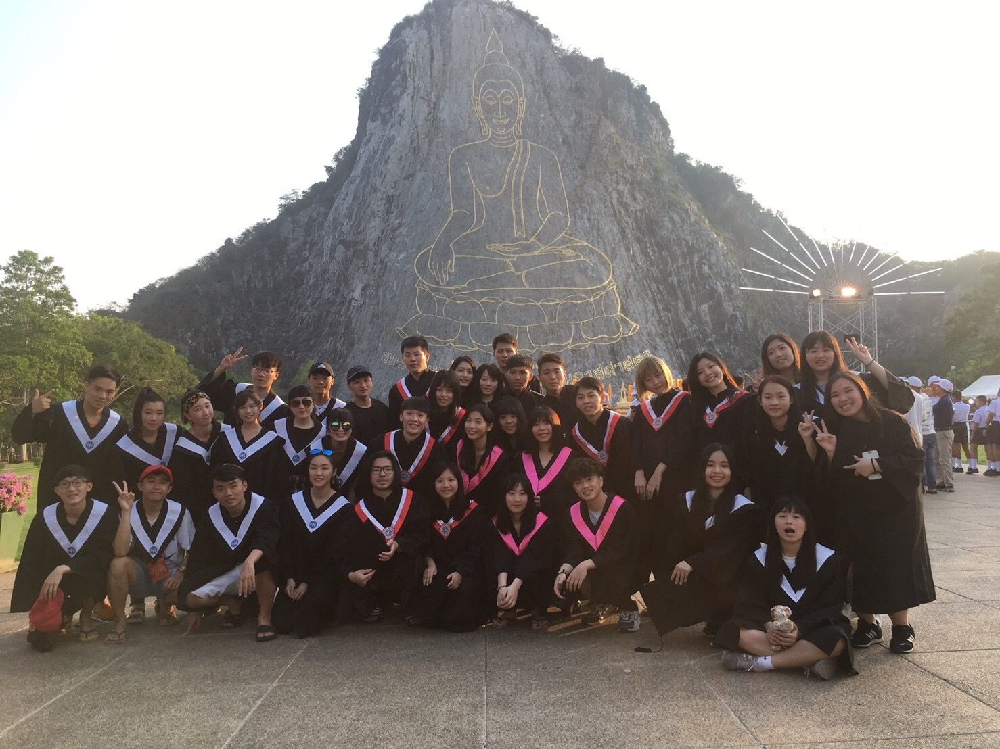
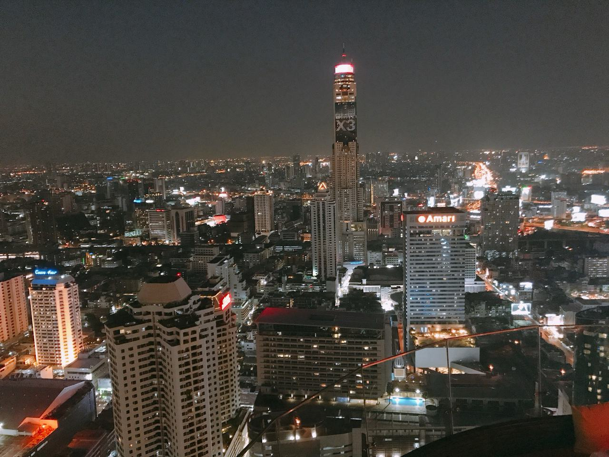
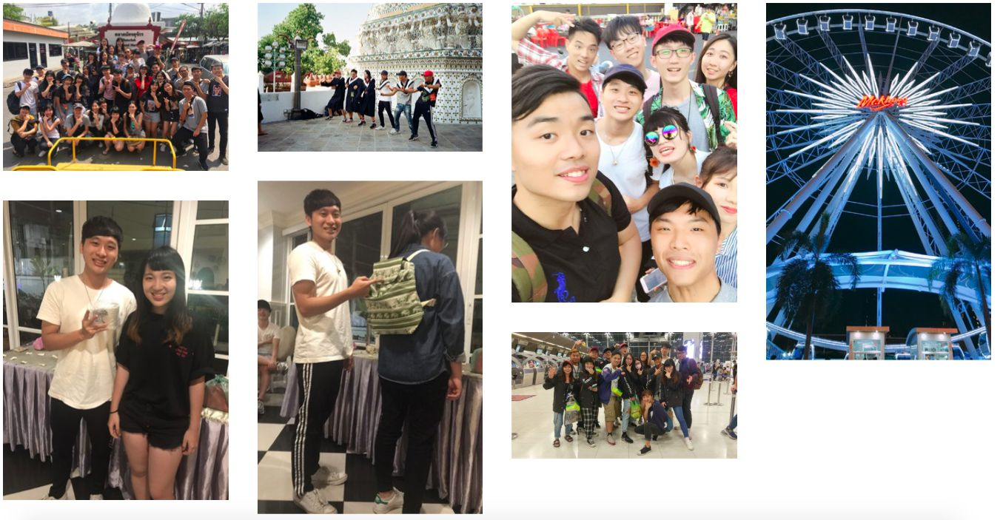

> 生平第一次出國、大學第一次畢旅
> 體驗到泰式食物的辣、泰式按摩的力道、泰國天氣的熱、泰國文化的風情
> 才剛回國就想念泰國的種種回憶 認識很多朋友（跟輔大、中原、東吳的學生同團） 都很有趣也都很好相處 謝謝領隊導遊在一旁照顧我們 期待下次大家再一起出去玩 也希望大家在未來都能達到自己夢想

---

# 行程規劃

這次旅行交由大樂旅行社幫忙規劃安排

[行程 : Click On Me](https://drive.google.com/file/d/0B_MUcnppdaa7VWM0SmxFWHVISkU/view)

---

# 行前準備

雖然2、3月在台灣是在冬季末，但泰國（曼谷、芭達雅）長年25~35度，攜帶衣物短袖短褲輕便即可，多帶薄長袖較佳，防曬物品更不能少

---

# TRAVEL

## Day 1,2

第一晚上飛機已是11點，到達曼谷已經2、3點了，直接睡到9點
第二天一早搭上遊覽車，出發前往芭達雅，第一站前往當地動物園，著名的有鱷魚表演、吃老虎奶的豬、豬的賽跑跟厲害的豬算數學，下午來桑一下（記得當天也是許多研究所的放榜日，看個表演就收到哪間有上、哪間沒上很刺激），飽餐過後晚上直接回旅館，休息片刻後，相約到附近7-11及小吃光顧，7-11有個熱壓吐司，是我覺得最好吃印象最深的。

## Day 3

起床一樣搭上遊覽車直達芭達雅海邊，直接在海上度過了半天，船上有海上遊樂設施，午餐在船上吃海鮮，直接唱爆嗨歌，唱完就來垂釣個，結束後回到飯店整理儀容，前往當地夜店（是我有生以來第一次去夜店），那間夜店內部禁菸，當晚很嗨，可樂配威士忌，跟中原的同學玩敲敲杯，又上台熱舞，場子好像被台灣人包場，全部是中文歌

## Day 4

這天一早去四方水上市集，下午去東芭樂園，體驗潑水大戰，每個人都卯起來，結束後再去海邊悠閒享受風景，在海邊還被要求solo跳舞，之後晚餐吃泰國的燒烤火鍋，結束後去芭達雅海邊的商店(美軍不夜城徒步街)逛逛，很多形形色色的人，而後跟導遊去吃水果（山竹、榴槤、紅毛丹），回飯店，夜晚有泰國浴行程，自由參加

## Day 5

先是去高空滑樓55層樓，下午去一個聽說是去很很很有錢的一個地主的家，整座山都是他的裡面充斥超跑、跟很多裝飾品，園區內有大象表演，之後又去桑一下，但我們沒有多加時間，所以在外面跟輔大的朋友待著等其他人結束，而後去看泰拳，晚上去看人妖秀

## Day 6

前兩天玩太累了，開始走逛行程，回到曼谷，到Terminal 21的地鐵搭車，到他們的百貨公司、還有著名的四面佛在附近，逛了整天下來，下午去七珍佛山拍學士照，（我晚上直接在那買了件Ｈ＆Ｍ的衣服1799泰銖，台灣還更便宜＝＝），晚上到sky bar享受美景

 

## Day 7

旅程到了尾聲，早上先去Chatuchak market逛街，皮皮（領隊）發起交換禮物的想法，我們買晚上要交換禮物的東西，我買了很多薄荷棒（在台灣很有名）通鼻子（100泰銖）還有捕夢網（190泰銖），當時還陪朋友買裝飾燈泡送他女友，後來下午去搭船到鄭王廟參觀，河裡的魚聽說餵麵包的時候說：💰錢錢，象徵可以賺大錢，傍晚直接到旅行社合作的賣場大買零食，我花了將近1500泰銖買了pocky、海苔、糖果、果乾...，最後再去Mekkog逛夜市，晚餐到對面吃泰國的海南雞飯，真的好吃～～讚不絕口！ 全部行程結束後，大家到房間休息一下就到大廳集合，開始交換禮物，我們又被cue要solo跳舞，我用泰國圖案的包包換到泰國大象杯子
回到房間，就去其他房跟他們打牌到3點多到準備搭飛機，飛機是6點多，結束旅程～

---

> 回來後得到重感冒... 但是泰國好好玩喔