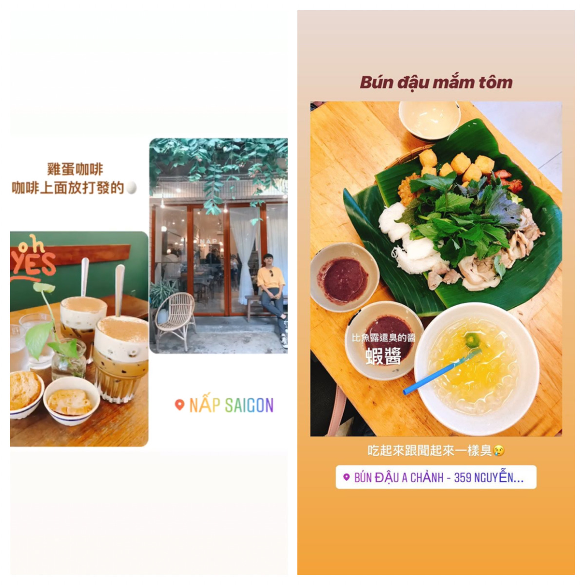
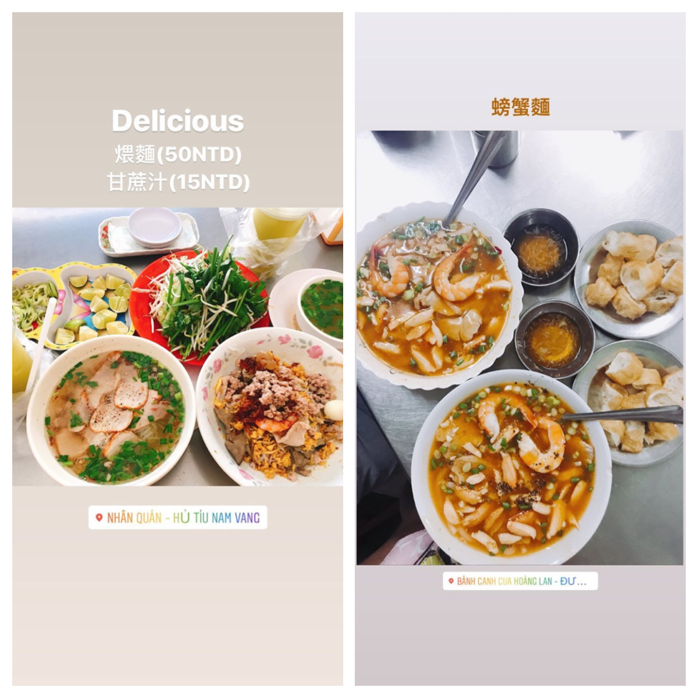
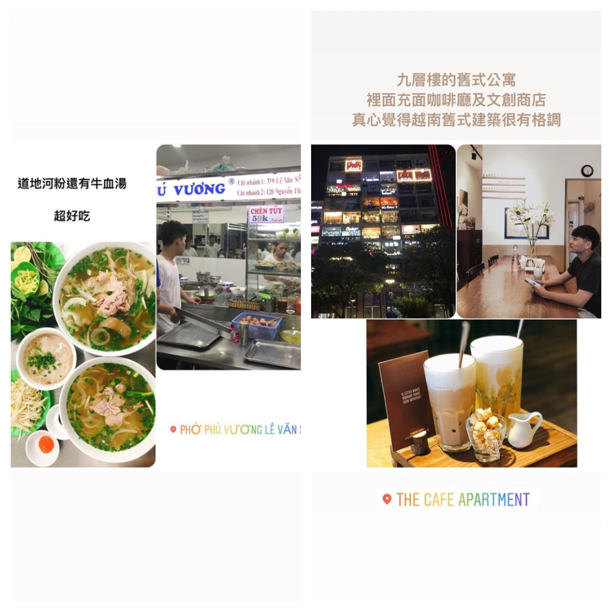
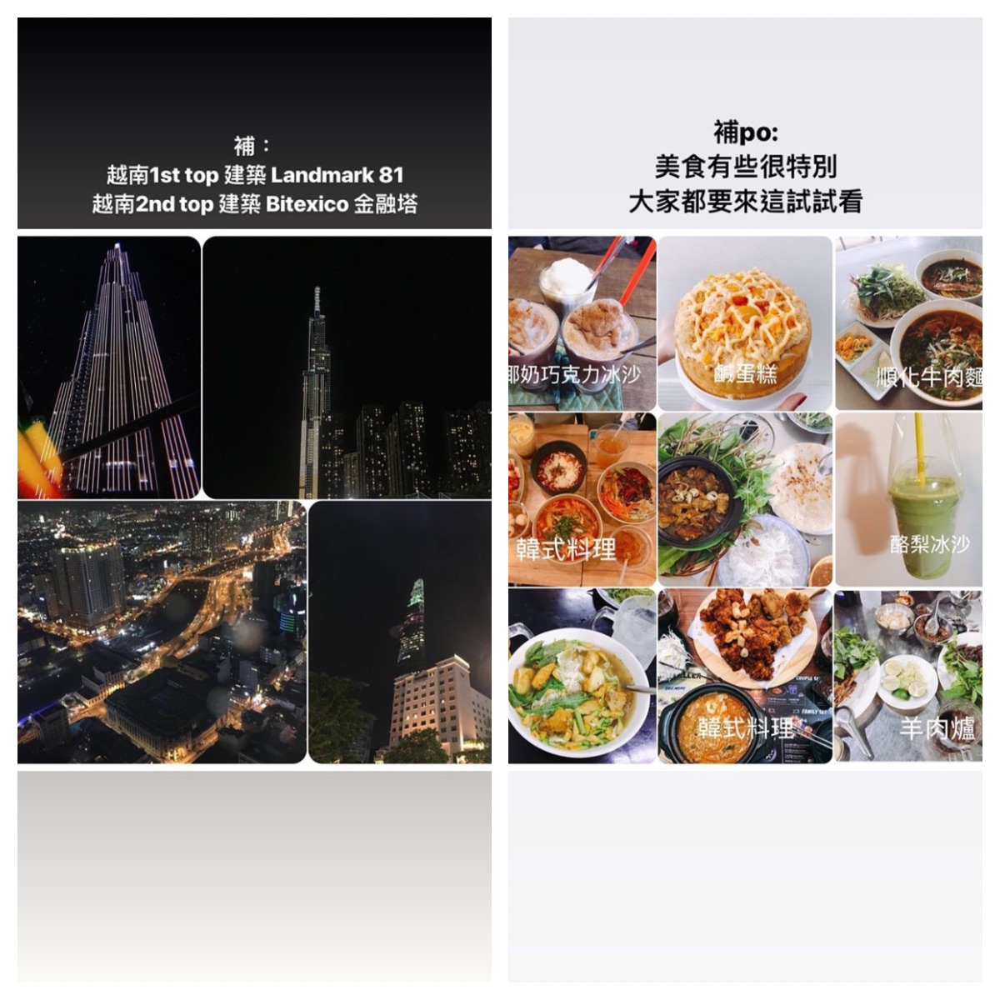

> A week-long trip to Vietnam 🇻🇳
> What I used to imagine Vietnam was like: fried insects 🐛 sold on the street, hardly any cars, lots of traditional markets
> But once I got here, I realized it's actually a lot like Taiwan: tons of scooters, busy traffic, shops and stalls packed together, plenty of old buildings renovated with lots of character, a booming creative scene, young people who love following trends, and a big obsession with all things Korean
> What's different here, though:
> 🏍️ The roads are super dangerous. Scooters weave everywhere, horns never stop honking, there's lots of trash on the ground and more potholes (insurance would probably do great business here). Helmets are almost all the half-shell kind with no visor, so rain really hurts. Also, every shop has a guard out front who helps move your scooter
> I didn't dare take my phone out on the street. 🚕 Grab is cheap, but remember to lock the car doors (depends on which app you use). Much cheaper than in Taiwan
> 🍹 Drinks are pretty sweet, a lot of the food is dipped in fish sauce, and flavors are on the stronger side
> Nights are cooler than in Taiwan and not too muggy
> Most people here seem to speak softly and come across as really good-tempered 😂

---

# Itinerary

6/22 Dropped off our stuff around 11, had pho

6/23
- 9:30 Breakfast (grilled pork rice)
- 10:30 Central Post Office, Book Street, Notre-Dame Cathedral (the Red Church), Ben Thanh Market for lunch and dessert
- Afternoon: market, back home to shower
- 6:00 Drinks and dinner with friends (Cafe Apartment, Opera House, Nguyen Hue Walking Street)

6/24
- Get up early, go to District 1 for coffee, wander around, do some shopping
- Back home to shower
- Evening: dinner with my uncle

6/25
- 8:30 a.m. Breakfast (Hue-style beef noodle soup, bún bò Huế)
- 10:00 Visit a charity
- Lunch: beef hot pot, then home
- Evening: bun dau mam tom
- Go to Bitexco Financial Tower
- Buy cheese-foam drinks to have at home

6/26
- 6:00 Breakfast (braised noodles)
- Buy Phuc Long
- Head to Vung Tau
- Play in the water
- Shower and rest
- Afternoon photo session
- Evening: seafood dinner, beach stroll, ice cream

6/27 Vung Tau (I got an upset stomach the day before we went to Vung Tau)
- Get up early for the sunrise
- Back home to shower, then coffee and breakfast
- Go out and play, take photos
- 5:00 p.m. Bus back to Saigon
- Shower, goat hot pot
- Cafe Apartment, Opera House, Nguyen Hue Walking Street

6/28 Amusement park, grocery shopping and cooking dinner

6/29 for free

  

Food:
bánh tráng trộn, bánh tráng cuộn, cơm cháy chà bông, bông lan trứng muối, ts tá lả, ts ali, ts tik tak, phúc long, bún đậu mắm tôm, nước mía, trà đào nhà hát tp, sinh tố, gỏi cuốn, lẩu dê

> Hope to come back again~
> To be continued...
