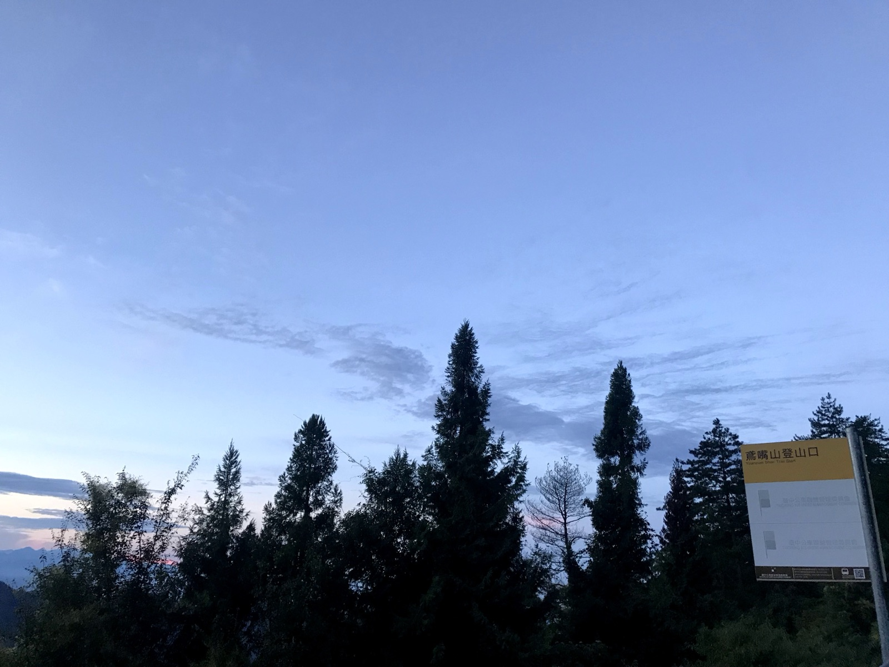
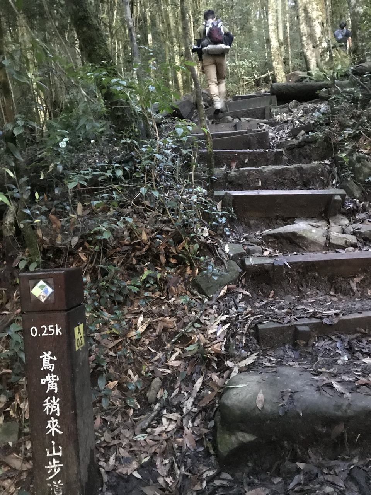
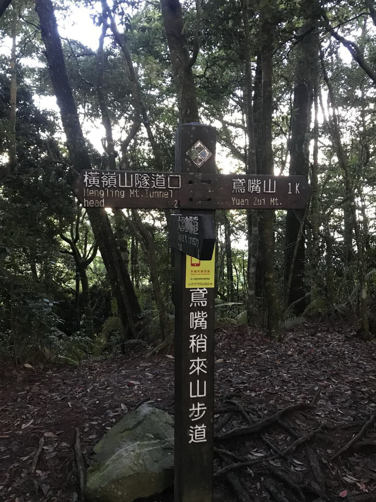
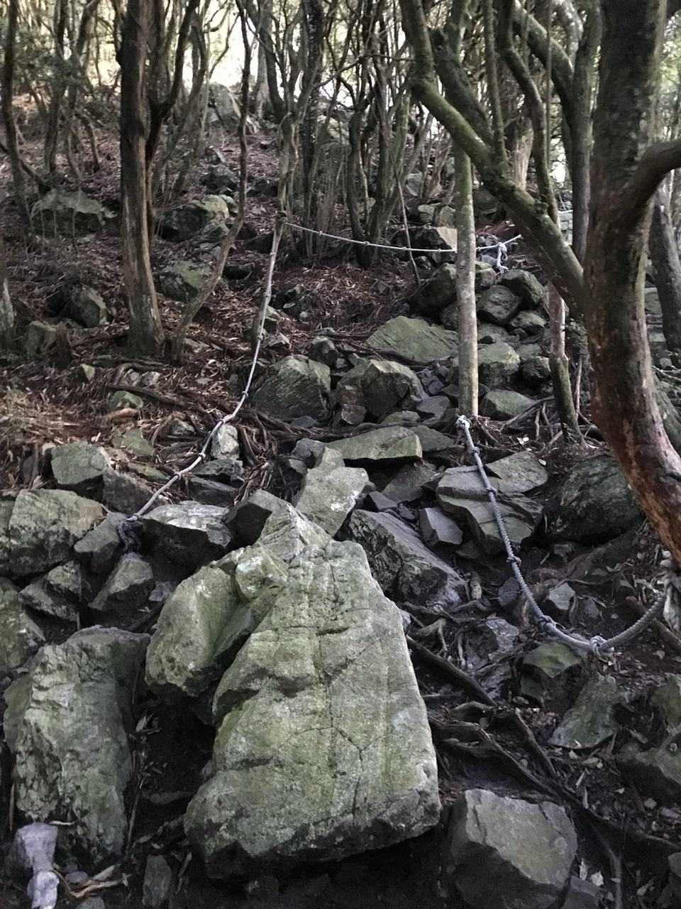
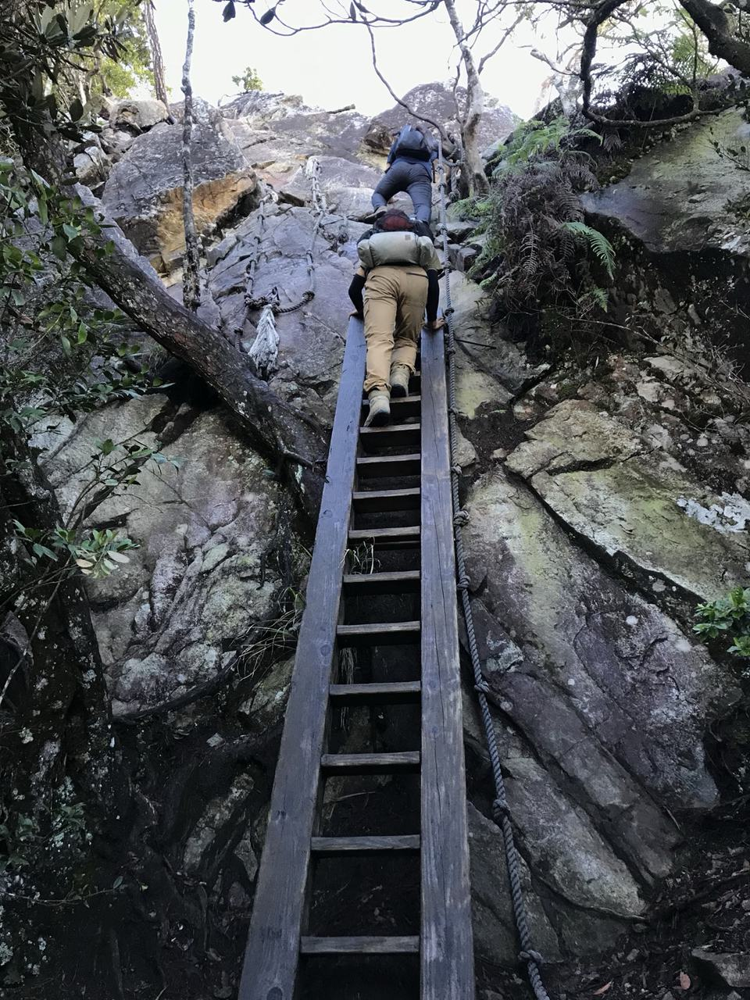
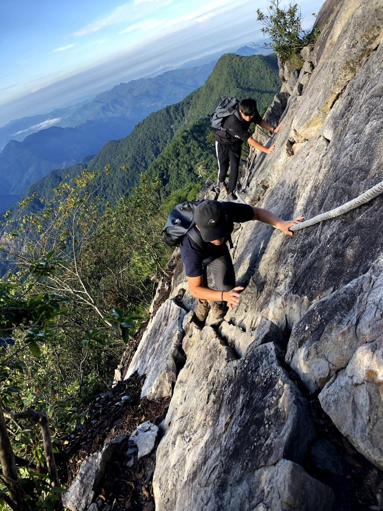
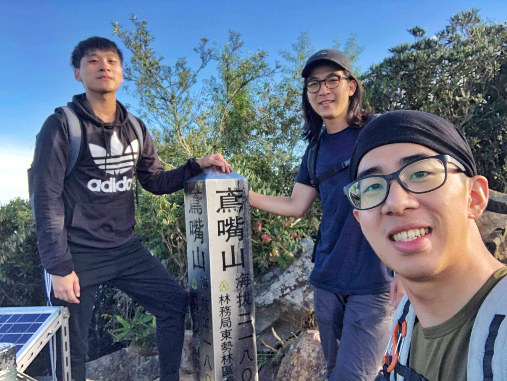
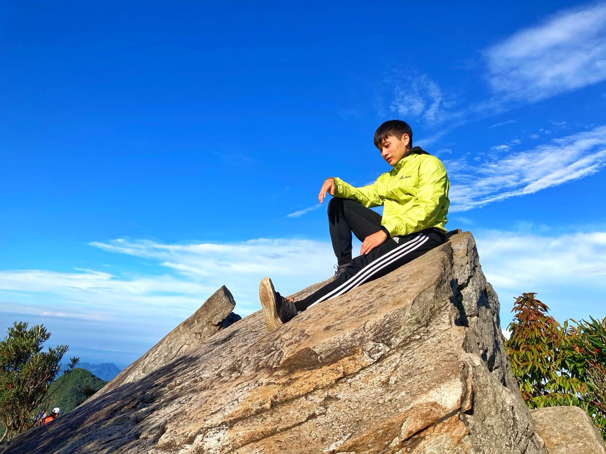

> The real heroes aren't the ones who reach the summit
> They're the people who built the trails and the ropes

---

# Preparation
1. I recommend getting travel insurance
2. Your hiking backpack should have at least 1.5 liters of water, (a raincoat), a warm jacket, (gloves), (hand warmers), (a headlamp), trail snacks, and salt candy
3. Pack a separate bag to leave in the car with a fresh change of clothes, lunch, water, and a sleeping bag
4. What to wear: sneakers, athletic pants, a moisture-wicking shirt (arm sleeves), a towel, sunglasses, a sun hat
5. Remember to pack light

---

# The Day's Schedule
Leaving early in the morning helps you avoid the crowds, makes it easier to find parking, and lets you dodge the afternoon thunderstorms. That said, a lot of people camp here the night before, so parking was still a bit hard to find

Left at 2:30 a.m. on Sunday, reached the trailhead at 4, napped for an hour, started climbing at 5:30. The round trip actually only takes about three hours (if there aren't too many people queuing). Back at the trailhead around 10 for a short rest, then went down the mountain for lunch

---

# Trail Conditions
From the trailhead at the 27K marker, the trail starts out with fairly easy man-made wooden steps, but each step is really tall, so it's more tiring than it looks

As you climb higher, it gets harder and harder
 

Further on, there are big boulders and ropes. In some spots you have to step into gaps between the rocks and use the ropes for support, plus there are wooden ladders (the people who hauled those up here are seriously impressive)
 

Bit by bit we made it to the top. The summit of Mt. Yuanzui is 2,180 meters, and getting views this stunning for only about 1.5 hours of hiking is totally worth it
 

---

# Summary

I'm a total hiking newbie myself, so these ratings are just my personal take. Mostly because the route is short and you don't need to carry anything heavy, it's not too difficult

Difficulty: ◼️ ◼️ ◼️ ◻️ ◻️
Danger:     ◼️ ◼️ ◼️ ◼️ ◻️
Worth it:   ◼️ ◼️ ◼️ ◼️ ◼️
